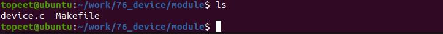
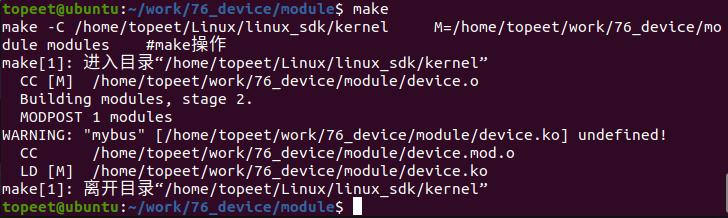
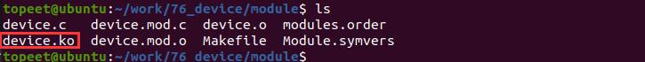
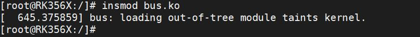
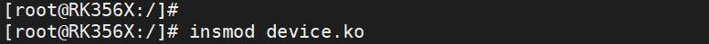
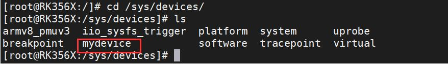
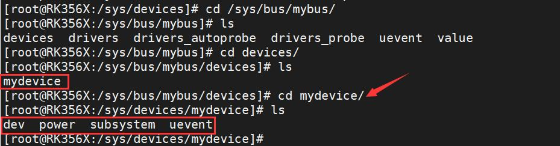
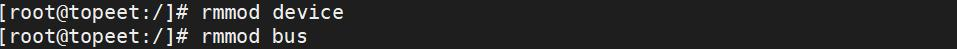

# 第104章 在总线下注册设备实验

在注册自定义总线章节中，注册了自定义的总线。本章将在注册自定义总线章节的基础上，在自定义的总线下注册设备。
## 104.1 实验程序的编写
### 104.1.1 驱动程序编写
本实验代码存储在网盘iTOP-RK3568 开发板\07_学习教程配套资料\03_Linux 驱动配套资料\04_Linux 驱动例程\76_device\module 路径下。本实验定义了一个名为mybus 的总线，并在此总线下注册设备。注册自定义总线实验代码bus.c 如代码清单104.1 所示。代码清单104.1
```c
#include <linux/module.h>
#include <linux/init.h>
#include <linux/slab.h>
#include <linux/configfs.h>
#include <linux/kernel.h>
#include <linux/kobject.h>
#include <linux/device.h>
#include <linux/sysfs.h>
int mybus_match(struct device *dev, struct device_driver *drv)
{
       // 检查设备名称和驱动程序名称是否匹配
        return (strcmp(dev_name(dev), drv->name) == 0);
};
int mybus_probe(struct device *dev)
{
        struct device_driver *drv = dev->driver;
        if (drv->probe)
            drv->probe(dev);
        return 0;
};
struct bus_type mybus = {
```

```c
.name = "mybus",// 总线的名称
.match = mybus_match,// 设备和驱动程序匹配的回调函数
.probe = mybus_probe,// 设备探测的回调函数
};
```
EXPORT_SYMBOL_GPL(mybus);// 新加导出总线符号
```c
ssize_t mybus_show(struct bus_type *bus, char *buf)
{
        // 在sysfs 中显示总线的值
        return sprintf(buf, "%s\n", "mybus_show");
};
struct bus_attribute mybus_attr = {
        .attr = {
            .name = "value",// 属性的名称
            .mode = 0664,// 属性的访问权限
        },
        .show = mybus_show,// 属性的show 回调函数
};
// 模块的初始化函数
static int bus_init(void)
{
        int ret;
        ret = bus_register(&mybus);// 注册总线
        ret = bus_create_file(&mybus, &mybus_attr);// 在sysfs 中创建属性文件
        return 0;
}
// 模块退出函数
static void bus_exit(void)
{
        bus_remove_file(&mybus, &mybus_attr);// 从sysfs 中移除属性文件
        bus_unregister(&mybus);// 取消注册总线
}
module_init(bus_init);// 指定模块的初始化函数
module_exit(bus_exit);// 指定模块的退出函数
MODULE_LICENSE("GPL");// 模块使用的许可证
MODULE_AUTHOR("topeet");// 模块的作者
```
接着编写驱动文件device.c，创建一个自定义设备并将其注册到自定义总线上。实验代码

device.c 如代码清单104.2 所示。代码清单104.2
```c
#include <linux/module.h>
#include <linux/init.h>
#include <linux/slab.h>
#include <linux/configfs.h>
#include <linux/kernel.h>
#include <linux/kobject.h>
#include <linux/device.h>
#include <linux/sysfs.h>
extern struct bus_type mybus;
void myrelease(struct device *dev)
{
        printk("This is myrelease\n");
};
struct device mydevice = {
        .init_name = "mydevice",// 设备的初始化名称
        .bus = &mybus,// 所属总线
        .release = myrelease,// 设备的释放回调函数
        .devt = ((255 << 20 | 0)),// 设备号
};
// 模块的初始化函数
static int device_init(void)
{
        int ret;
        ret = device_register(&mydevice);// 注册设备
        return 0;
}
// 模块退出函数
static void device_exit(void)
{
        device_unregister(&mydevice);// 取消注册设备
}
module_init(device_init);// 指定模块的初始化函数
module_exit(device_exit);// 指定模块的退出函数
```

```c
MODULE_LICENSE("GPL");// 模块使用的许可证
MODULE_AUTHOR("topeet");// 模块的作者
```
## 104.3 运行测试
### 104.3.1 编译驱动程序
在和device.c 的同一目录下创建Makefile 文件，如图104.1 所示。

Makefile 文件内容如代码清单104.3 所示。代码清单104.3
```c
export ARCH=arm64#设置平台架构
export CROSS_COMPILE=aarch64-linux-gnu-#交叉编译器前缀
obj-m += device.o#此处要和你的驱动源文件同名
KDIR :=/home/topeet/Linux/linux_sdk/kernel#这里是你的内核目录
PWD ?= $(shell pwd)
all:
    make -C $(KDIR) M=$(PWD) modules#make 操作
clean:
    make -C $(KDIR) M=$(PWD) clean#make clean 操作
```
使用命令make 编译驱动程序，编译成功后如图104..2 所示。

图104.2编译完后会生成bus.ko 目标文件，如下图104.3 所示：

图104.3

至此device.ko 驱动模块就编译成功了，bus.ko 也需要重新编译，接下来进行测试。
### 104.3.2 运行测试
将本章节编译好的bus.ko 和device.ko 驱动文件拷贝到开发板上。开发板启动之后，使用insmod bus.ko 命令进行bus.ko 驱动模块的加载，如下图104.4 所示：

图104.4然后使用命令insmod device.ko 加载device.ko 驱动模块，如下图104.5 所示：

图104.5驱动加载成功之后，进入/sys/devices 目录下，如下图104.6 所示，有注册生成的设备。

图104.6接着进入到/sys/bus/mybus/devices 目录下，如下图104.7 所示，如果在mybus 总线下看到注册的设备为mydevice 说明实验成功。

图104.7实验成功后使用rmmod bus 命令和rmmod device 命令进行驱动的卸载，如下图104.8 所示：

图104.8至此，在总线下注册设备实验就完成了。

