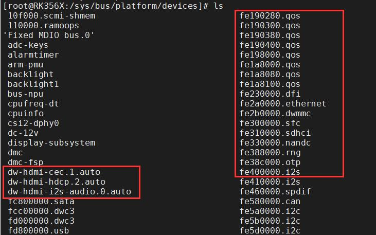
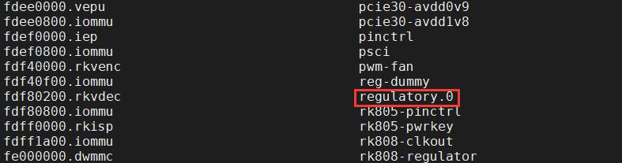

# 第106章  platform总线设备注册流程实例分析实验

```c
if (bus) {// 如果成功获取总线类型指针
    // 打印调试信息，包括总线名称和设备名称
    pr_debug("bus: '%s': add device %s\n", bus->name, dev_name(dev));
// 将设备添加到总线类型的设备组(dev_groups)中
    error = device_add_groups(dev, bus->dev_groups);
    if (error)
        goto out_put;
// 在总线类型的设备集(kset)的内核对象(kobj)下创建设备的符号链接
error = sysfs_create_link(&bus->p->devices_kset->kobj,&dev->kobj, dev_name(dev));
     if (error)
        goto out_groups;
// 在设备的内核对象(kobj)下创建指向总线类型子系统(subsystem)的符号链接
error = sysfs_create_link(&dev->kobj,&dev->bus->p->subsys.kobj, "subsystem");
    if (error)
        goto out_subsys;
// 将设备的节点添加到总线类型的设备列表中
    klist_add_tail(&dev->p->knode_bus, &bus->p->klist_devices);
  }
return 0;// 返回0 表示成功添加设备
}
```
核心操作是代码清单105.9 中第23 行代码klist_add_tail(&dev->p->knode_bus,&bus->p->klist_devices)将设备的节点添加到总线类型的设备列表中。即设备注册就是把设备添加到设备列表中。至此，设备注册流程分析结束。

在上个章节中，分析了设备注册到总线上的过程，在本章节中，将进一步探讨platform 设备注册到platform 总线上的过程。在Linux 内核的设备模型中，平台设备是一类特殊的设备，用来描述SOC 内部或无明确总线的硬件，如UART、GPIO 控制器等。平台设备注册到platform 总线上使用platform_device_register()函数，此函数将platform_device 实例注册到platform 总线，并触发驱动匹配，函数实现如代码清单106.1 所示。代码清单106.1
```c
int platform_device_register(struct platform_device *pdev)
{
    device_initialize(&pdev->dev);
    arch_setup_pdev_archdata(pdev);
    return platform_device_add(pdev);
}
```
在代码清单106.1 中，第3 行代码在上个章节已经分析过，在此不作过多解释。接下来重点看第5 行代码platform_device_add()函数将设备添加到platform 总线，其流程可拆解为6 个关键步骤。步骤一检查设备基本信息，如代码清单106.2 所示。代码清单106.2
```c
int platform_device_add(struct platform_device *pdev)
{
    u32 i;
    int ret;
    // 检查输入的平台设备指针是否为空
    if (!pdev)
        return -EINVAL;
    // 如果平台设备的父设备为空，将父设备设置为platform_bus
    if (!pdev->dev.parent)
        pdev->dev.parent = &platform_bus;
```
步骤二设置设备的总线类型，将设备的dev->bus 指向platform_bus_type，如代码清单106.3所示。代码清单106.3
```c
int platform_device_add(struct platform_device *pdev)
{
    ...
    // 将平台设备的总线设置为platform_bus_type
```

```c
pdev->dev.bus = &platform_bus_type;
...
```
}步骤三设置设备名称，如代码清单106.4 所示。代码清单106.4
```c
int platform_device_add(struct platform_device *pdev)
{
    ...
    // 根据平台设备的id 设置设备的名字
    switch (pdev->id) {
    default:
    // 根据设备名和id 设置设备的名字，如图101.2 所示的名字
        dev_set_name(&pdev->dev, "%s.%d", pdev->name, pdev->id);
        break;
    case PLATFORM_DEVID_NONE:
    // 如果id 为PLATFORM_DEVID_NONE，则只使用设备名作为设备的名字，如图101.1 右边框选名字
        dev_set_name(&pdev->dev, "%s", pdev->name);
        break;
    case PLATFORM_DEVID_AUTO:
  // 使用ida_simple_get 函数获取一个可用的ID，并将设备ID 标记为自动分配，如图101.1 左边框选名字
        ret = ida_simple_get(&platform_devid_ida, 0, 0, GFP_KERNEL);
        if (ret < 0)
             goto err_out;
        pdev->id = ret;
        pdev->id_auto = true;
        dev_set_name(&pdev->dev, "%s.%d.auto", pdev->name, pdev->id);
        break;
    }
    ...
```
}代码清单106.4 中设置设备名字有三种格式，三种格式分别如下图106.1 和图106.2 中红框所示：


图106.1

图106.2
步骤四添加设备资源，如代码清单106.5 所示。代码清单106.5
```c
int platform_device_add(struct platform_device *pdev)
{
    ...
    // 遍历平台设备的资源列表，处理每个资源
    for (i = 0; i < pdev->num_resources; i++) {
        struct resource *p, *r = &pdev->resource[i];
        // 如果资源的名称为空，则将资源的名称设置为设备的名字
        if (r->name == NULL)
```

```c
r->name = dev_name(&pdev->dev);
p = r->parent;
if (!p) {
// 如果资源没有指定父资源，则根据资源类型设置默认的父资源
if (resource_type(r) == IORESOURCE_MEM)
    p = &iomem_resource;
else if (resource_type(r) == IORESOURCE_IO)
    p = &ioport_resource;
}
// 如果父资源存在，并且将资源插入到父资源中失败，则返回错误
if (p && insert_resource(p, r)) {
dev_err(&pdev->dev, "failed to claim resource %d: %pR\n", i, r);
ret = -EBUSY;
goto failed;
}
}
...
```
}步骤五调用device_add()函数将设备添加到内核设备模型中，如代码清单106.6 所示。代码清单106.6
```c
int platform_device_add(struct platform_device *pdev)
{
    ...
    // 通用设备注册
    ret = device_add(&pdev->dev);
    if (ret == 0)
        return ret;
    ...
```
}在代码清单106.6 中第5 行代码调用了device_add()函数，在device_add()函数中会调用bus_probe_device()函数触发总线的驱动匹配逻辑。到此，platform 总线设备注册流程分析完毕。

