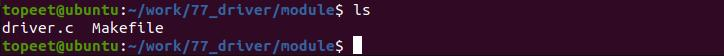
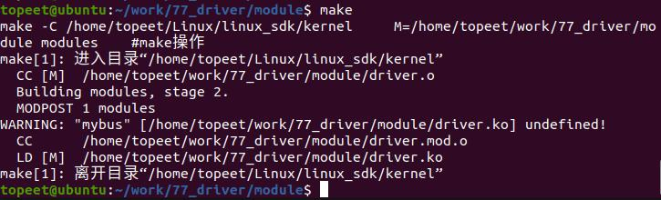
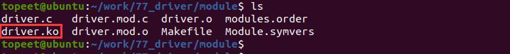
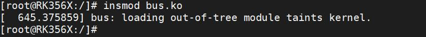
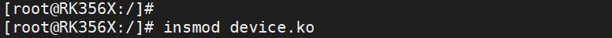
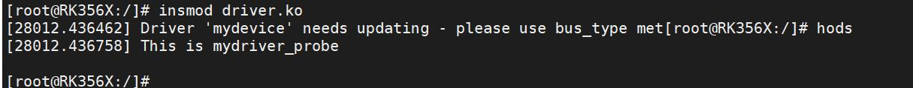
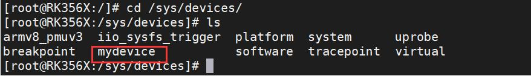
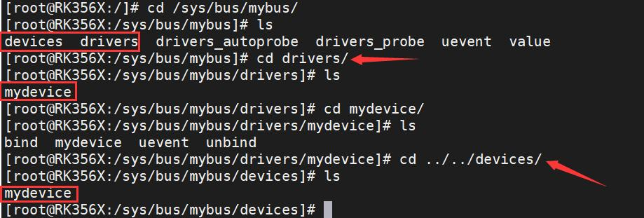

# 第108章 在自定义总线下注册驱动实验

本章节在99 章节实验的基础上进行实验，在自定义总线下注册驱动。
## 108.1 实验程序的编写
### 108.1.1 驱动程序编写
本实验代码存储在网盘iTOP-RK3568 开发板\07_学习教程配套资料\03_Linux 驱动配套资料\04_Linux 驱动例程\77_driver\module 路径下。本实验定义了一个名为mybus 的总线，并在总线下注册驱动。实验代码driver.c 如代码清单108.1 所示：代码清单108.1
```c
#include <linux/module.h>
#include <linux/init.h>
#include <linux/slab.h>
#include <linux/configfs.h>
#include <linux/kernel.h>
#include <linux/kobject.h>
#include <linux/device.h>
#include <linux/sysfs.h>
extern struct bus_type mybus;// 引入外部定义的总线类型mybus
int mydriver_remove(struct device *dev){
        printk("This is mydriver_remove\n");
        return 0;
};
int mydriver_probe(struct device *dev){
        printk("This is mydriver_probe\n");
        return 0;
};
struct device_driver mydriver = {
        .name = "mydevice",// 驱动程序的名称
        .bus = &mybus,// 驱动程序所属的总线类型
        .probe = mydriver_probe,// 驱动程序的probe 函数
        .remove = mydriver_remove,// 驱动程序的remove 函数
};
// 模块的初始化函数
static int mydriver_init(void)
{
```

```c
int ret;
ret = driver_register(&mydriver);// 注册驱动程序
return ret;// 返回注册结果
}
// 模块退出函数
static void mydriver_exit(void)
{
driver_unregister(&mydriver);// 注销驱动程序
}
module_init(mydriver_init);// 指定模块的初始化函数
module_exit(mydriver_exit);// 指定模块的退出函数
MODULE_LICENSE("GPL");// 模块使用的许可证
MODULE_AUTHOR("topeet");// 模块的作者
```
## 108.3 运行测试
### 108.3.1 编译驱动程序
在driver.c 代码同一目录下创建Makefile 文件，如图108.1 所示。

图108.1Makefile 文件内容如代码清单108.2 所示。代码清单108.2
```c
export ARCH=arm64#设置平台架构
export CROSS_COMPILE=aarch64-linux-gnu-#交叉编译器前缀
obj-m += driver.o#此处要和你的驱动源文件同名
KDIR :=/home/topeet/Linux/linux_sdk/kernel#这里是你的内核目录
PWD ?= $(shell pwd)
all:
    make -C $(KDIR) M=$(PWD) modules#make 操作
clean:
    make -C $(KDIR) M=$(PWD) clean#make clean 操作
```
在存放driver.c 和Makefile 文件目录下使用make 命令编译驱动程序，编译完成如图108.2所示：


图108.2编译完生成driver.ko 目标文件，如图108.3 所示：

图108.3
### 108.3.2 运行测试
将本章节编译好的driver.ko 驱动文件和第104 章节编译好的bus.ko、device.ko 驱动文件拷贝到开发板上。开发板启动之后，使用insmod bus.ko 命令进行bus.ko 驱动模块的加载，如下图108.4 所示：

图108.4然后使用命令insmod device.ko 命令加载device.ko 驱动模块，如下图108.5 所示：

图108.5最后使用命令insmod driver.ko 加载driver.ko 驱动模块，如下图108.6 所示，如果可以看到打印This is mydriver_probe 信息，说明driver 和device 匹配成功之后成功执行probe 函数。

图108.6驱动加载成功之后，进入/sys/devices 目录下，如下图108.7 所示，如果实验成功会有注册生成的设备。


图108.7进入到/sys/bus/mybus/目录下，如下图108.8 所示，可以看到在mybus 总线目录下有devices和drivers 文件夹。接着进入到drivers 目录下，可以看到在总线下注册的驱动为mydevice。接着返回上一级，进入到devices 目录下，可以看到在总线下注册的设备为mydevice。上述现象说明在mybus 总线下注册驱动成功。

图108.8实验成功之后，可以使用以下命令进行驱动的卸载。rmmod devicermmod driverrmmod bus至此，在总线下注册驱动实验就完成了。

