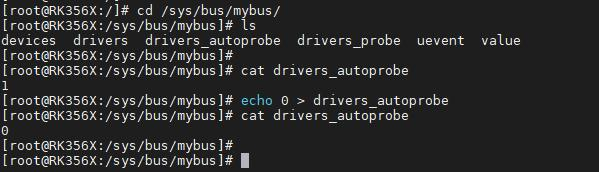
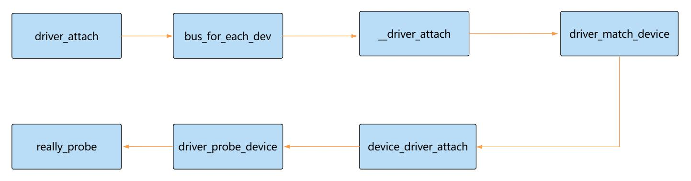

# 第110章  probe函数执行流程分析实验

```c
return 0;// 返回成功
}
```
代码清单109.2 第33 行代码是核心代码，调用了klist_add_tail()函数将驱动程序添加到总线的驱动列表中，完成总线对驱动的管理绑定。至此，总线下注册驱动流程已经分析完毕。
本章节将接着上个章节分析代码，本章重点分析probe 函数执行流程。在代码清单110.1 第26 行代码调用了bus_add_driver()函数，此函数将驱动添加到总线上，并触发设备匹配。在上个章节中讲解了驱动注册到总线的过程，本章节讲解触发驱动匹配进入probe 函数的过程。bus_add_driver()函数实现如代码清单110.1 所示：代码清单110.1
```c
int bus_add_driver(struct device_driver *drv)
{
    ...
    priv->kobj.kset = bus->p->drivers_kset;
    // 初始化并添加驱动程序的内核对象
    error = kobject_init_and_add(&priv->kobj, &driver_ktype, NULL,"%s", drv->name);
    if (error)
        goto out_unregister;
    // 将驱动程序添加到总线的驱动程序列表
    klist_add_tail(&priv->knode_bus, &bus->p->klist_drivers);
    // 决定是否自动触发驱动和设备匹配
    if (drv->bus->p->drivers_autoprobe) {
        error = driver_attach(drv);//若匹配成功，调用驱动的probe 函数初始化设备
        if (error)
             goto out_unregister;
    }
    ...
    return 0;// 返回成功
    }
```
在代码清单110.1 中，如果总线设置drivers_autoprobe 标志位为1，则调用driver_attach()函数遍历总线上的所有设备，尝试与当前驱动匹配。drivers_autoprobe 标志位也可以在用户空间通过属性文件drivers_autoprobe 来控制，如下图110.1 所示输入命令。


图110.1driver_attach()函数实现如代码清单110.2 所示。代码清单110.2
```c
int driver_attach(struct device_driver *drv)
{
    return bus_for_each_dev(drv->bus, NULL, drv, __driver_attach);
}
    EXPORT_SYMBOL_GPL(driver_attach);
```
通过代码清单110.2 可知，driver_attach()函数实际调用了bus_for_each_dev()函数，此函数遍历总线上所有设备，对每个设备执行指定回调函数。bus_for_each_dev()函数实现如代码清单110.3 所示：代码清单110.3
```c
int bus_for_each_dev(struct bus_type *bus, struct device *start,void *data, int (*fn)(struct device *, void *))
{
    struct klist_iter i;//定义链表迭代器，用于遍历设备列表
    struct device *dev; //存储当前遍历到的设备指针
    int error = 0;
    // 检查总线及其私有数据有效性
    if (!bus || !bus->p)
        return -EINVAL;
    // 初始化设备链表迭代器
    klist_iter_init_node(&bus->p->klist_devices, &i,(start ? &start->p->knode_bus : NULL));
    // 遍历设备列表
    while (!error && (dev = next_device(&i)))
        error = fn(dev, data); // 对当前设备执行fn 回调函数
        klist_iter_exit(&i);
    return error;
}
```
通过代码清单110.3 可知bus_for_each_dev()函数的作用是遍历指定总线上的所有设备，并对每个设备执行指定的函数fn。fn 要执行的回调函数为driver_attach()函数，函数实现如代码清单110.4 所示：代码清单110.4

```c
static int __driver_attach(struct device *dev, void *data)
{
    struct device_driver *drv = data;
    int ret;
    //步骤1：检查驱动和设备是否匹配（调用总线的match 函数）
    ret = driver_match_device(drv, dev);
    if (ret == 0) {
        return 0;
    } else if (ret == -Eprobe_DEFER) {
        dev_dbg(dev, "Device match requests probe deferral\n");
        driver_deferred_probe_add(dev);
    } else if (ret < 0) {
        dev_dbg(dev, "Bus failed to match device: %d", ret);
        return ret;
    }
     //步骤2：若匹配成功且没有延迟，检查是否允许异步探测
    if (driver_allows_async_probing(drv)) {
        dev_dbg(dev, "probing driver %s asynchronously\n", drv->name);
        device_lock(dev);
        if (!dev->driver) {
             get_device(dev);
             dev->p->async_driver = drv;
             async_schedule(__driver_attach_async_helper, dev);
        }
        device_unlock(dev);
        return 0;
    }
    //步骤3：同步probe 函数
    device_driver_attach(drv, dev);
    return 0;
}
```
在代码清单110.4 中，第6 行调用了driver_match_device()函数，driver_match_device()函数实现如代码清单110.5 所示。代码清单110.5
```c
static inline int driver_match_device(struct device_driver *drv,struct device *dev)
{
    return drv->bus->match ? drv->bus->match(dev, drv) : 1;
}
```
在代码清单110.5 中，driver_match_device()函数返回drv->bus->match ?drv->bus->match(dev, drv) : 1。drv->bus 表示驱动所属的总线，bus->match 表示总线的匹配函数指针。如果存在match 函数，则调用总线的match 函数，传入设备和驱动进行匹配判断。如果

不存在match 函数，则默认返回1。如果设备和驱动匹配上，会继续执行第30 行代码的device_driver_attach()函数，函数实现如代码清单110.6 所示。代码清单110.6
```c
int device_driver_attach(struct device_driver *drv, struct device *dev)
{
    int ret = 0;
    __device_driver_lock(dev, dev->parent);
    if (!dev->p->dead && !dev->driver)
        ret = driver_probe_device(drv, dev);
    __device_driver_unlock(dev, dev->parent);
    return ret;
}
```
通过代码清单110.6 第7-8 行代码可知，当设备处于可用状态并且设备没有绑定任何驱动时，调用driver_probe_device()函数，driver_probe_device()函数实现如代码清单110.7 所示：代码清单110.7
```c
int driver_probe_device(struct device_driver *drv, struct device *dev)
{
    ...
    // 根据初始化调试标志选择调用真实的探测函数
    if (initcall_debug)
        ret = really_probe_debug(dev, drv);
    else
        ret = really_probe(dev, drv);
    ...
    return ret;
}
```
在代码清单110.7 中，driver_probe_device()函数最终调用really_probe()函数，函数实现如代码清单110.8 所示。代码清单110.8
```c
static int really_probe(struct device *dev, struct device_driver *drv)
{
    int ret = -Eprobe_DEFER;// 初始化返回值为延迟探测
    int local_trigger_count = atomic_read(&deferred_trigger_count);// 获取当前延迟探测计数
    bool test_remove = IS_ENABLED(CONFIG_DEBUG_TEST_DRIVER_REMOVE) && !drv->suppress_bind_attrs;
    ...
    dev->driver = drv;
    ...
```

```c
if (dev->bus->probe) {// 如果总线有probe 函数，调用总线的probe 函数
    ret = dev->bus->probe(dev);
    if (ret)
        goto probe_failed;
} else if (drv->probe) {// 否则调用驱动的probe 函数
    ret = drv->probe(dev);
    if (ret)
        goto probe_failed;
}
return ret;
}
```
通过代码清单110.8 第8-15 行代码可知如果总线注册了probe 回调，则调用总线的probe回调函数。如果总线未指定probe 回调，驱动指定了probe 回调，则调用驱动的probe 回调函数。经过前面代码的分析，设备和驱动匹配完整的注册流程，如下图110.2 所示。

图110.2至此，probe 函数执行流程分析完毕。

