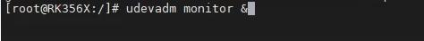
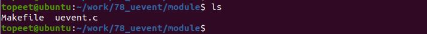
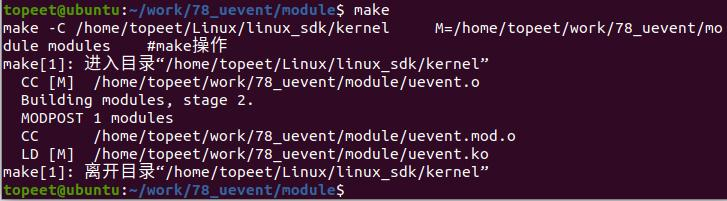
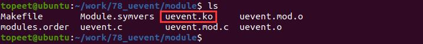

# 第114章 内核发送事件到用户空间

## 第113 章热插拔简介
## 113.1 热插拔概述
热插拔是指在不关闭系统电源的情况下，动态插入或拔出硬件设备的能力。在嵌入式系统中，常见的热插拔机制有udev 和mdev。udev 是基于netlink 实现的。netlink 是一种特殊的套接字类型，用于内核空间和用户空间之间的通信。当内核发生uevent 事件时，会通过netlink 将该事件发送给用户空间的udevd 守护进程。udevd 守护进程负责接收来自内核的事件，并按照预定义的规则文件（通常位于/etc/udev/rules.d/）决定如何处理这些事件，如创建或删除设备节点、设置设备权限等。mdev 则是基于uevent_helper 机制来处理设备的插入和拔出事件。当内核产生uevent 时，会调用uevent_helper 所指定的用户程序来执行热插拔操作。系统启动时，可以通过命令echo/sbin/mdev >/proc/sys/kernel/hotplug 指定mdev 为处理程序。这样当内核产生uevent 时，会自动调用mdev 并按照预定义的规则文件（通常位于/etc/mdev.conf）执行对应的热拔插动作。例如在学习字符设备驱动开发时，调用class_create()和device_create()函数可以自动为设备创建/dev/xxx 设备节点。这个创建过程是怎样的呢？例如当加载LED 设备驱动时，基于设备模型，驱动程序中会有对应的device 结构体。由于device 结构体包含对应的kobject，因此在/sys 下会生成该设备的sysfs 目录。随后驱动会调用kobject_uevent()函数触发uevent 事件，应用层中的udev 或mdev 就会根据sysfs 提供的信息自动创建设备节点。

## 114.1 kobject_uevent 函数
kobject_uevent()函数是Linux 内核用于生成和发送uevent 事件的API 函数。kobject_uevent()函数的原型如代码清单114.1 所示。代码清单114.1
```c
int kobject_uevent(struct kobject *kobj, enum kobject_action action);
```
函数参数：kobj : 要发送uevent 事件的内核对象（kobject）action: 表示触发uevent 的动作，uevent 的动作可以是设备的插入，拔出，属性变化等。这些动作用于描述设备发生的不同事件，通过将相应的动作类型作为action 参数传递给kobject_uevent()函数，以便触发相应的uevent 事件，从而通知用户空间的udev 进行相应的操作。以下是常见的action 参数值。KOBJ_ADD：表示添加或插入操作。KOBJ_REMOVE：表示移除或拔出操作。KOBJ_CHANGE：表示修改操作，如对内核对象进行更改，属性修改等。KOBJ_MOVE：表示移动操作，如设备从一个位置移动到另一个位置。KOBJ_ONLINE：表示上线操作，即设备从离线状态变为在线状态，使其可以被访问。KOBJ_OFFLINE：表示离线操作，即设备从在线状态变为离线状态，使其不可以被访问。KOBJ_BIND：表示将一个设备连接到内核对象上KOBJ_UNBIND: 表示从内核对象上将一个设备解绑KOBJ_MAX:表示枚举类型的最大值，通常用于表示没有任何操作行为。
kobject_uevent()函数的主要作用是在内核中生成uevent 事件，并通过netlink 机制将该事件发送给用户空间的udev。在调用该函数时，内核会将相关的设备信息和事件类型封装为uevent 消息，并通过netlink 套接字将消息发送给用户空间。

如用户空间的udev 接收到uevent 消息后，就可以根据消息中的设备信息和事件类型来执行相应的操作，例如创建或删除设备节点，加载或卸载驱动程序等。
## 114.2 udevadm 命令
udevadm 是一个用于与udev 进行交互的命令行工具。用于查询和管理设备、触发uevent事件以及执行其他与udev 相关的操作。一些常见的udevadm 命令及其功能如下：udevadm info 命令：用于获取设备的详细信息，包括设备路径、属性、驱动程序等。udevadm monitor 命令：用于监视和显示当前系统中的uevent 事件。它会实时显示设备的插入、拔出以及其他相关事件。udevadm trigger 命令：用于手动触发设备的uevent 事件。可以使用该命令模拟设备的插入、拔出等操作，以便触发相应的事件处理。udevadm settle 命令：用于等待udev 处理所有已排队的uevent 事件。它会阻塞直到udev 完成当前所有的设备处理操作。udevadm control 命令：用于与udev 守护进程进行交互，控制其行为。例如，可以使用该命令重新加载udev 规则、设置日志级别等。udevadm test 命令：用于测试udev 规则的匹配和执行过程。可以通过该命令测试特定设备是否能够正确触发相应的规则。在iTOP-RK3568 开发板上烧写buildroot 系统，输入udevadm monitor &命令可以监视和显示当前系统中的uevent 事件，如图114.1 所示。在之后的实验中，我们也会用到这个命令。

图114.1
## 114.3 实验程序的编写
本实验存放在网盘iTOP-RK3568 开发板\07_学习教程配套资料\03_Linux 驱动配套资料\04_Linux 驱动例程\78_uevent\module 路径下。实验代码uevent.c 如代码清单114.2 所示。代码清单114.2
```c
#include <linux/module.h>
#include <linux/init.h>
```

```c
#include <linux/slab.h>
#include <linux/configfs.h>
#include <linux/kernel.h>
#include <linux/kobject.h>
struct kobject *mykobject01;
struct kset *mykset;
struct kobj_type mytype;
// 模块的初始化函数
static int mykobj_init(void)
{
    int ret;
    // 创建并添加一个kset
    mykset = kset_create_and_add("mykset", NULL, NULL);
    // 分配并初始化一个kobject
    mykobject01 = kzalloc(sizeof(struct kobject), GFP_KERNEL);
    mykobject01->kset = mykset;
    // 初始化并添加kobject 到kset
    ret = kobject_init_and_add(mykobject01, &mytype, NULL, "%s", "mykobject01");
    // 触发一个uevent 事件，表示kobject 的属性发生了变化
    ret = kobject_uevent(mykobject01, KOBJ_CHANGE);
    return 0;
}
// 模块退出函数
static void mykobj_exit(void)
{
    // 释放kobject
    kobject_put(mykobject01);
}
module_init(mykobj_init);// 指定模块的初始化函数
module_exit(mykobj_exit);// 指定模块的退出函数
MODULE_LICENSE("GPL");// 模块使用的许可证
MODULE_AUTHOR("topeet");// 模块的作者
```

## 114.4 运行测试
### 114.4.1 编译驱动程序
在上一小节中的uevent.c 代码同一目录下创建Makefile 文件，如图114.2 所示。

图114.2Makefile 文件内容如代码清单114.3 所示。代码清单114.3
```c
export ARCH=arm64#设置平台架构
export CROSS_COMPILE=aarch64-linux-gnu-#交叉编译器前缀
obj-m += uevent.o#此处要和你的驱动源文件同名
KDIR :=/home/topeet/Linux/linux_sdk/kernel#这里是你的内核目录
PWD ?= $(shell pwd)
all:
    make -C $(KDIR) M=$(PWD) modules#make 操作
clean:
    make -C $(KDIR) M=$(PWD) clean#make clean 操作
```
回到存放uevent.c 和Makefile 文件目录下，使用命令make 编译驱动程序，编译成功如图114.3 所示。

图114.3编译完会生成uevent.ko 目标文件，如图114.4 所示。

图114.4

