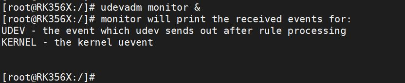
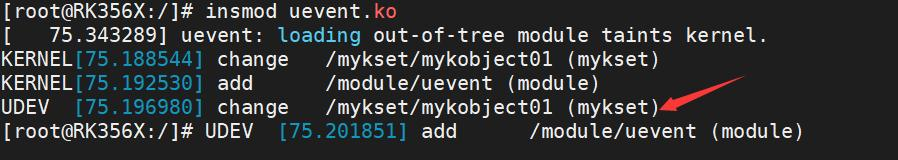
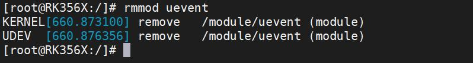
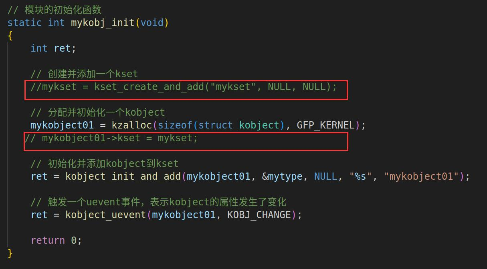

# 第115章 内核是如何发送事件到用户空间的？

### 114.4.2 运行测试
开发板启动之后，先使用命令udevadm monitor &监视和显示当前系统中的uevent 事件。然后使用insmod uevent.ko 命令加载驱动模块，如图114.5 和图114.6 所示。

图114.5

图114.6图114.6 中，当驱动加载成功后，udev 接收到了change 动作，说明uevent 事件已经发送成功了。图114.6 中的/mykset/mykobject01 是kobject 在根目录/sys/下的路径。实验成功后可以使用rmmod uevent 命令卸载驱动程序，如图114.7 所示。

图114.7至此，发送事件到用户空间实验就完成了。

在前一章节中，我们成功地通过uevent 机制将内核事件发送到用户空间。本章节我们在实验代码中去掉了创建kset 的步骤，发现用户空间无法收到事件。在分析这个问题之前，我们回顾一下前一章节中的实验。
## 115.1 实验现象
在前一章节的代码示例中在内核中创建kset 和kobject，并将其添加到sysfs 文件系统中。如图115.1 所示。

图115.1这样做的目的是为了在sysfs 中创建相应的目录结构，以便用户空间的udev 能够通过sysfs响应对应的事件。所以，当去掉了创建kset 的步骤后，用户空间便无法响应事件。接下来我们通过代码分析为什么没有创建kset 会导致用户空间无法接收事件，从而了解内核是如何发送事件到用户空间的。
## 115.2 代码分析
追踪kobject_uevent()函数。kobject_uevent()函数如代码清单115.1 下所示。代码清单115.1
```c
/**
```

```c
* kobject_uevent - notify userspace by sending an uevent
*
* @kobj: struct kobject that the action is happening to
* @action: action that is happening
*
* Returns 0 if kobject_uevent() is completed with success or the
* corresponding error when it fails.
*/
int kobject_uevent(struct kobject *kobj, enum kobject_action action)
{
   return kobject_uevent_env(kobj, action, NULL);
}
EXPORT_SYMBOL_GPL(kobject_uevent);
```
通过代码清单115.1 可知，在kobject_uevent()函数中调用了kobject_uevent_env()函数。kobject_uevent_env()函数代码比较多，接下来我们拆分为几个部分给大家讲解下。1. 函数注释第1 部分是函数注释，如代码清单115.2 所示。在函数注释中告诉我们kobject_uevent_env()函数的作用是发送带有环境变量的数据事件，成功返回0，失败返回错误码。参数kobj 表示发生操作的struct kobject 对象，action 表示正在发生的操作，envp 表示指向环境变量数据的指针。代码清单115.2
```c
/**
 * kobject_uevent_env - send an uevent with environmental data//发送带有环境变量数据的事件
 *
 * @kobj: struct kobject that the action is happening to //正在发生动作的对象
 * @action: action that is happening//正在发生的动作
 * @envp_ext: pointer to environmental data//环境变量的指针
 *
 * Returns 0 if kobject_uevent_env() is completed with success or the
 * corresponding error when it fails.
 */
```
2. 变量定义第2 部分是变量定义，如代码清单115.3 所示。第2 部分中定义了kobject_uevent_env()函数中使用的变量。

代码清单115.3
```c
int kobject_uevent_env(struct kobject *kobj, enum kobject_action action,
                char *envp_ext[])
{
    struct kobj_uevent_env *env;//指向kobj_uevent_env 结构体的指针，用于存储发送的事件和环境变量
    const char *action_string = kobject_actions[action]; //事件的类型
    const char *devpath = NULL;//存放kobject 的路径
    const char *subsystem;//存放所属子系统的名称
    struct kobject *top_kobj; //指向顶层top_kobj 的kobject 指针
    struct kset *kset;//指向kset 的指针，表示kobject 所属的kset
    const struct kset_uevent_ops *uevent_ops; //指向struct kset_uevent_ops 结构体的指针
    int i = 0;//计数器i,用来编译环境变量数组
    int retval = 0//表示函数的执行结果，也就是返回值
```
3. 发送uevent 前的环境检查和设置第3 部分是发送uevent 前的环境检查和设置，如代码清单115.4 所示。在代码清单115.4中，首先检查action是否是KOBJ_REMOVE ，如果是，则设置kobj->state_remove_uevent_sent 为1，表示remove 事件已发送。然后从当前kobj 开始向上查找当前kobj 所属的kset。最后将找到的kset 赋值给变量kset,并将其uevent_ops 字段赋值给变量uevent_ops，以便后续使用。所以也就是解释了为什么不创建kset 就不能发送uevent 。因为找不到kset 则kobject_uevent()函数直接返回错误。代码清单115.4
```c
if (action == KOBJ_REMOVE)
    kobj->state_remove_uevent_sent = 1;
pr_debug("kobject: '%s' (%p): %s\n",
     kobject_name(kobj), kobj, __func__);
/* search the kset we belong to */
top_kobj = kobj;
while (!top_kobj->kset && top_kobj->parent)
    top_kobj = top_kobj->parent;
if (!top_kobj->kset) {
    pr_debug("kobject: '%s' (%p): %s: attempted to send uevent "
         "without kset!\n", kobject_name(kobj), kobj,
         __func__);
    return -EINVAL;
}
kset = top_kobj->kset;
```

```c
uevent_ops = kset->uevent_ops;
```
4.检查是否跳过当前事件的发送第4 部分检查是否跳过当前事件的发送，如代码清单115.5 所示。在代码清单116.5 中先检查kobj->uevent_suppress 是否为1，如果kobj->uevent_suppress 为1，则输出调试信息表示该事件被跳过，并返回0。代码清单115.5
```c
/* skip the event, if uevent_suppress is set*/
if (kobj->uevent_suppress) {
    pr_debug("kobject: '%s' (%p): %s: uevent_suppress "
              "caused the event to drop!\n",
              kobject_name(kobj), kobj, __func__);
    return 0;
}
```
5.检查标志位和函数操作集以及子系统名称第5 部分检查先uevent_suppress 标志位是否设置，如果设置该标志位，则跳过该事件的发送并打印调试信息。接着检查是否存在uevent 操作集(uevent_ops)和操作集中是否有filter函数，如果有filter 函数则调用uevent_ops->filter(kset, kobj)函数实现对事件的过滤。最后检查子系统名称。第5 部分如代码清单115.6 所示。代码清单115.6
```c
/* skip the event, if uevent_suppress is set*/
if (kobj->uevent_suppress) {
    pr_debug("kobject: '%s' (%p): %s: uevent_suppress "
              "caused the event to drop!\n",
              kobject_name(kobj), kobj, __func__);
    return 0;
}
/* skip the event, if the filter returns zero. */
if (uevent_ops && uevent_ops->filter)
    if (!uevent_ops->filter(kset, kobj)) {
        pr_debug("kobject: '%s' (%p): %s: filter function "
              "caused the event to drop!\n",
              kobject_name(kobj), kobj, __func__);
        return 0;
    }
/* originating subsystem */
if (uevent_ops && uevent_ops->name)
```

```c
subsystem = uevent_ops->name(kset, kobj);
else
subsystem = kobject_name(&kset->kobj);
if (!subsystem) {
pr_debug("kobject: '%s' (%p): %s: unset subsystem caused the "
     "event to drop!\n", kobject_name(kobj), kobj,
     __func__);
return 0;
}
```
6.配置检查第6 部分针对CONFIG_ARCH_ROCKCHIP、CONFIG_FREEZER 和CONFIG_ANDROID 三个条件进行检查，只有三个条件同时满足时在挂起时会忽略这个uevent，第6 部分如代码清单115.7 所示。代码清单115.7
```c
if (IS_ENABLED(CONFIG_ARCH_ROCKCHIP) &&
    IS_ENABLED(CONFIG_FREEZER) &&
    IS_ENABLED(CONFIG_ANDROID)) {
    /*
     * Android healthd try to listen power_supply subsystem uevent,
     * but which will block system from suspend on big.LITTLE system
     * because thermal_cooling_device_unregister will called when
     * cpufreq_exit. So ignore this uevent when suspend.
     */
    extern bool pm_freezing;
    if (pm_freezing && !strcmp(subsystem, "thermal"))
        return 0;
}
```
第6 部分中的注释解释了为什么需要忽略这个uevent 的操作。在big.LITTLE 系统上，当cpufreq_exit 函数被调用时，thermal_cooling_device_unregister 函数也会被调用，这可能会导致系统挂起失败，为了避免这种情况，该函数忽略了thermal 子系统的uevent 事件。
7.构建和发送uevent 的环境变量数据第7 部分是kobject_uevent_env() 函数的核心部分，用来构建和发送uevent 的环境变量数据。代码清单115.8 中第2 行代码使用kzalloc()函数分配一个kobj_uevent_env 结构体，用于存储环境变量。第7 行代码调用kobject_get_path()函数获取内核对象在sysfs 中的完整路径。第14、17 和20 行代码添加基本环境变量。第24 行代码如果有从外部传入的环境变量则添加外部环境变量。第34 行代码执行uevent_ops->uevent()函数。代码清单115.8
```c
/* environment buffer */
```

```c
env = kzalloc(sizeof(struct kobj_uevent_env), GFP_KERNEL);
if (!env)
    return -ENOMEM;
/* complete object path */
devpath = kobject_get_path(kobj, GFP_KERNEL);
if (!devpath) {
    retval = -ENOENT;
    goto exit;
}
/* default keys */
retval = add_uevent_var(env, "ACTION=%s", action_string);
if (retval)
    goto exit;
retval = add_uevent_var(env, "DEVPATH=%s", devpath);
if (retval)
    goto exit;
retval = add_uevent_var(env, "SUBSYSTEM=%s", subsystem);
if (retval)
    goto exit;
/* keys passed in from the caller */
if (envp_ext) {
    for (i = 0; envp_ext[i]; i++) {
        retval = add_uevent_var(env, "%s", envp_ext[i]);
        if (retval)
             goto exit;
    }
}
/* let the kset specific function add its stuff */
if (uevent_ops && uevent_ops->uevent) {
    retval = uevent_ops->uevent(kset, kobj, env);
    if (retval) {
        pr_debug("kobject: '%s' (%p): %s: uevent() returned "
              "%d\n", kobject_name(kobj), kobj,
              __func__, retval);
        goto exit;
    }
}
```
8.处理不同事件(uevent)对应的不同动作当action 为KOBJ_ADD 时，将kobject 对象的state_add_uevent_sent 成员设置为1，表示已经发送了“add”事件。如果该对象已经发送了“add”事件，内核会自动发送“remove”事件，否则

需要调用者手动发送“remove”事件。当action 为KOBJ_UNBIND 时，调用zap_modalias_env() 函数清除环境变量中MODALIAS变量。MODALIAS 是一个特殊的环境变量，用于描述设备的模块别名。在设备驱动程序加载时，内核会根据MODALIAS 环境变量自动加载相应的驱动程序模块。在设备卸载时，需要清除MODALIAS 环境变量，以便下次重新加载设备驱动程序时能够正确地识别设备。如代码清单115.9 所示。代码清单115.9
```c
switch (action) {
case KOBJ_ADD:
    /*
     * Mark "add" event so we can make sure we deliver "remove"
     * event to userspace during automatic cleanup. If
     * the object did send an "add" event, "remove" will
     * automatically generated by the core, if not already done
     * by the caller.
     */
    kobj->state_add_uevent_sent = 1;
    break;
case KOBJ_UNBIND:
    zap_modalias_env(env);
    break;
default:
    break;
}
```
9. 添加环境变量将一个名为"SEQNUM" 的环境变量添加到uevent 环境变量列表中，并将其值设置为uevent_seqnum 的值加1。然后调用kobject_uevent_net_broadcast()广播函数，向所有网络命名空间发送uevent，如代码清单115.10 所示。代码清单115.10
```c
retval = add_uevent_var(env, "SEQNUM=%llu", (unsigned long long)++uevent_seqnum);
if (retval) {
    mutex_unlock(&uevent_sock_mutex);
    goto exit;
}
retval = kobject_uevent_net_broadcast(kobj, env, action_string,devpath);
```

10.uevent 机制代码清单115.11 当内核配置启用CONFIG_UEVENT_HELPER 时会通过用户空间程序（如/sbin/hotplug）处理uevent 事件。代码清单115.11
```c
#ifdef CONFIG_UEVENT_HELPER
/* call uevent_helper, usually only enabled during early boot */
if (uevent_helper[0] && !kobj_usermode_filter(kobj)) {
    struct subprocess_info *info;
    retval = add_uevent_var(env, "HOME=/");
    if (retval)
        goto exit;
    retval = add_uevent_var(env,
                 "PATH=/sbin:/bin:/usr/sbin:/usr/bin");
    if (retval)
        goto exit;
    retval = init_uevent_argv(env, subsystem);
    if (retval)
        goto exit;
    retval = -ENOMEM;
    info = call_usermodehelper_setup(env->argv[0], env->argv,
                       env->envp, GFP_KERNEL,
                       NULL, cleanup_uevent_env, env);
    if (info) {
        retval = call_usermodehelper_exec(info, UMH_NO_WAIT);
        env = NULL;/* freed by cleanup_uevent_env */
    }
}
#endif
```
kobject_uevent_env()函数分析完毕。

