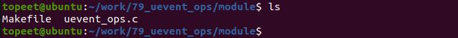
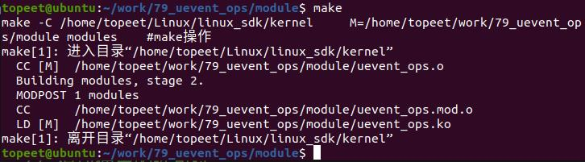
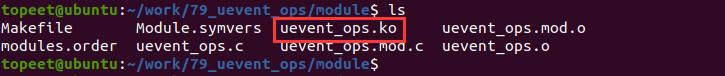

# 第116章 完善kset_uevent_ops结构体实验

本章kset_uevent_ops 结构体中的成员进行完善。
## 116.1 实验程序的编写
### 116.1.1 驱动程序编写
本实验代码存放在iTOP-RK3568 开发板\07_学习教程配套资料\03_Linux 驱动配套资料\04_Linux 驱动例程\79_uevent_ops\module 路径中。在调用kset_create_and_add() 函数创建kset 时第二个函数参数是kset 对应的kset_uevent_ops 结构。kset_uevent_ops 结构体定义在include/linux/kobject.h 文件中，结构体原型如代码清单116.1 所示。代码清单116.1
```c
struct kset_uevent_ops {
    int (* const filter)(struct kset *kset, struct kobject *kobj);
    const char *(* const name)(struct kset *kset, struct kobject *kobj);
    int (* const uevent)(struct kset *kset, struct kobject *kobj,
               struct kobj_uevent_env *env);
};
```
kset_uevent_ops 结构体有filter、name 和uevent 函数。通过kset_uevent_ops 结构体可以根据需求定制内核中对uevent 事件的处理。实验代码uevent_ops.c 通过filter 函数对mykobject01 对象进行过滤，通过name 函数返回kset 的名称，通过uevent 函数发送事件。如代码清单116.2 所示。代码清单116.2
```c
#include <linux/module.h>
#include <linux/init.h>
#include <linux/slab.h>
#include <linux/configfs.h>
#include <linux/kernel.h>
#include <linux/kobject.h>
```

```c
struct kobject *mykobject01;
struct kobject *mykobject02;
struct kset *mykset;
struct kobj_type mytype;
// 定义一个回调函数，返回kset 的名称
const char *myname(struct kset *kset, struct kobject *kobj)
{
    return "my_kset";
};
// 定义一个回调函数，处理kset 的uevent 事件
int myevent(struct kset *kset, struct kobject *kobj, struct kobj_uevent_env *env)
{
    add_uevent_var(env, "MYDEVICE=%s", "TOPEET");
    return 0;
};
// 定义一个回调函数，用于过滤kset 中的kobject
int myfilter(struct kset *kset, struct kobject *kobj)
{
    if (strcmp(kobj->name, "mykobject01") == 0){
        return 0; // 返回0 表示通过过滤
    }else{
        return 1; // 返回1 表示过滤掉
    }
};
struct kset_uevent_ops my_uevent_ops = {
    .filter = myfilter,
    .uevent = myevent,
    .name = myname,
};
// 模块的初始化函数
static int mykobj_init(void)
{
    int ret;
    // 创建并添加一个kset
    mykset = kset_create_and_add("mykset", &my_uevent_ops, NULL);
    // 分配并初始化一个kobject
    mykobject01 = kzalloc(sizeof(struct kobject), GFP_KERNEL);
```

```c
mykobject01->kset = mykset;
// 初始化并添加kobject 到kset
ret = kobject_init_and_add(mykobject01, &mytype, NULL, "%s", "mykobject01");
// 分配并初始化一个kobject
mykobject02 = kzalloc(sizeof(struct kobject), GFP_KERNEL);
mykobject02->kset = mykset;
// 初始化并添加kobject 到kset
ret = kobject_init_and_add(mykobject02, &mytype, NULL, "%s", "mykobject02");
// 触发一个uevent 事件，表示mykobject01 的属性发生了变化
ret = kobject_uevent(mykobject01, KOBJ_CHANGE);
// 触发一个uevent 事件，表示mykobject02 被添加
ret = kobject_uevent(mykobject02, KOBJ_ADD);
return 0;
}
// 模块退出函数
static void mykobj_exit(void)
{
// 释放kobject
kobject_put(mykobject01);
kobject_put(mykobject02);
kset_unregister(mykset);
}
module_init(mykobj_init); // 指定模块的初始化函数
module_exit(mykobj_exit); // 指定模块的退出函数
MODULE_LICENSE("GPL");// 模块使用的许可证
MODULE_AUTHOR("topeet"); // 模块的作者
```
## 116.2 运行测试
### 116.2.1 编译驱动程序
在上一小节中的uevent_ops.c 代码同一目录下创建Makefile 文件，如图116.1 所示。

图116.1

Makefile 文件内容如代码清单116.3 所示。代码清单116.3
```c
export ARCH=arm64#设置平台架构
export CROSS_COMPILE=aarch64-linux-gnu-#交叉编译器前缀
obj-m +=uevent_ops.o#此处要和你的驱动源文件同名
KDIR :=/home/topeet/Linux/linux_sdk/kernel#这里是你的内核目录
PWD ?= $(shell pwd)
all:
    make -C $(KDIR) M=$(PWD) modules#make 操作
clean:
    make -C $(KDIR) M=$(PWD) clean#make clean 操作
```
回到存放uevent_ops.c 和Makefile 文件目录下，使用命令make 编译驱动程序，编译完成如图116.2 所示。

图116.2编译成功会生成uevent_ops.ko 目标文件，如图116.3 所示。

图116.3至此驱动模块就编译成功了，接下来进行测试。
### 116.2.2 运行测试
开发板启动之后，使用命令udevadm monitor &监视和显示当前系统中的uevent 事件。然后使用insmod uevent_ops.ko 命令加载驱动程序，如图116.4 和116.5 所示。

