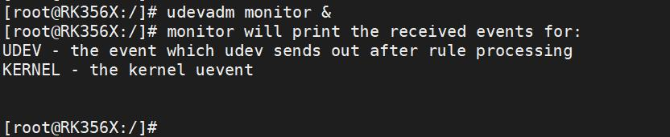
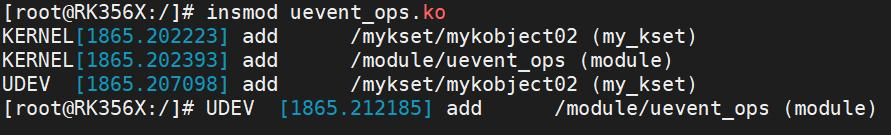
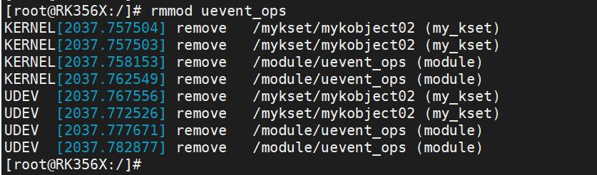
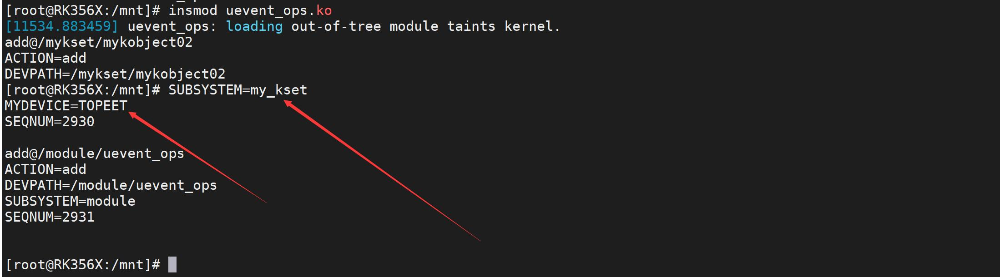

# 第117章netlink监听广播信息实验


图116.4

图116.5因为在函数filter 中把mykobject01 的事件过滤掉了。所以在图116.5 中只有mykobject02的add 事件，没mykobject01 的add 事件。实验完成后可以使用rmmod uevent_ops 命令进行驱动的卸载，如图116.6 所示。

图116.6至此，完善kset_uevent_ops 实验就完成了。

在上一章的实验中，我们填充了三个回调函数，分别为.filter = myfilter,.uevent =myevent,.name = myname,但在最后的实验中只验证filter 过滤了kset 中的kobject1，那另外两个回调函数要如何验证呢？内核通过kobject uevent 接口发送广播事件之后，用户空间可以通过netlink 来监听这些广播信息。通过监听广播信息，就可以获取到携带环境变量的事件，在本章节将会对netlink 进行详细的讲解。
## 117.1 netlink 机制介绍
netlink 是Linux 内核中用于内核和用户空间之间进行双工通信的机制。它基于socket 通信机制，并提供了一种可靠的、异步的、多播的、有序的通信方式。netlink 机制的主要特点包括：（1）双工通信：netlink 允许内核和用户空间之间进行双向通信，使得内核可以向用户空间发送消息的同时也可以接收来自用户空间的消息。（2）可靠性：netlink 使用了确认和重传机制，以确保消息的可靠传输。（3）异步通信：netlink 支持异步通信，即内核和用户空间可以独立地发送和接收消息，无需同步等待对方的响应。（4）多播支持：netlink 允许向多个进程或套接字广播消息，以实现一对多的通信。（5）有序传输：netlink 保证消息的有序传输，即发送的消息按照发送的顺序在接收端按序接收。netlink 的应用广泛，常见的应用包括：（1）系统管理工具：如ifconfig、ip 等工具使用netlink 与内核通信来获取和配置网络接口的信息。（2）进程间通信：进程可以使用netlink 进行跨进程通信，实现进程间的数据交换和协调。（3）内核模块和用户空间应用程序的通信：内核模块可以通过netlink 向用户空间应用程序发送通知或接收用户空间应用程序的指令。

## 117.2 netlink 的使用
### 117.2.1 创建socket
在Linux socket 编程中，创建套接字是构建网络应用程序的第一步。套接字可以理解为应用程序和网络之间的桥梁，用于在网络上进行数据的收发和处理。该系统调用的原型和所需头文件如下所示：表117.1所需头文件函数原型
```c
#include <sys/types.h>int socket(int domain, int type, int protocol);
#include <sys/socket.h>
```
其中，domain 参数指定了套接字的协议族，type 参数指定了套接字的类型，protocol 参数指定了套接字所使用的具体协议。下面分别介绍这三个参数的含义：（1）协议族协议族指定了套接字所使用的协议类型，常用的协议族包括AF_INET、AF_INET6、AF_UNIX等。其中，AF_INET 表示IPv4 协议族，AF_INET6 表示IPv6 协议族，AF_UNIX 表示Unix 域协议族，如使用netlink 协议族，该参数要设置为AF_ NETLINK。（2）套接字类型套接字类型指定了套接字的数据传输方式，常用的套接字类型包括SOCK_STREAM、SOCK_DGRAM、SOCK_RAW 等。其中，SOCK_STREAM 表示面向连接的流套接字，主要用于可靠传输数据，例如TCP 协议。SOCK_DGRAM 表示无连接的数据报套接字，主要用于不可靠传输数据，例如UDP 协议。在本实验中该参数要设置为SOCK_RAW 表示原始套接字，表示可以直接访问底层网络协议。（3）协议类型协议类型指定了套接字所使用的具体协议类型，常用的协议类型包括IPPROTO_TCP、IPPROTO_UDP、IPPROTO_ICMP 等。其中，IPPROTO_TCP 表示TCP 协议，IPPROTO_UDP 表示UDP协议，IPPROTO_ICMP 表示ICMP 协议，在本实验中，我们要设置为NETLINK_ _KOBJECT_ UEVENT。如使用以下代码创建一个netlink 套接字：
```c
int socket_fd = socket(AF_NETLINK, SOCK_RAW, NETLINK_KOBJECT_UEVENT);
```
其中：AF_NETLINK：指定了使用netlink 协议族

SOCK_RAW：指定了创建原始套接字，这种套接字类型可以直接访问底层协议，而不需要进行协议栈处理。NETLINK_KOBJECT_UEVENT：指定了netlink 协议的一种类型，即kobject uevent 类型。kobjectuevent 用于内核对象相关的事件通知，当内核中的kobject 对象发生变化时，会通过此类型的netlink 消息通知用户空间。
### 117.2.2 绑定套接字
创建套接字后，需要将其与一个网络地址绑定，以便其他计算机可以访问该套接字。在Linux系统下，可以使用bind()系统调用绑定套接字和地址。该系统调用的原型和所需头文件如表117.2 所示。表117.2所需头文件函数原型
```c
#include <sys/types.h>int bind(int sockfd, const struct sockaddr *addr,
#include <sys/socket.h>socklen_t addrlen);
```
函数参数sockfd 参数指定了需要绑定的套接字描述符，函数参数addr 参数指定了需要绑定的地址信息，填充该参数需要使用sockaddr_nl 结构体，sockaddr_nl 结构体的定义如代码清单117.1 所示。代码清单117.1
```c
struct sockaddr_nl {
    sa_family_t nl_family;// AF_NETLINK
    unsigned short nl_pad;// zero
    uint32_t nl_pid;// port ID
    uint32_t nl_groups;// multicast groups mask
};
```
其中：nl_family：表示地址族，此处固定为AF_NETLINK，指示使用netlink 协议族。nl_pad：填充字段，设置为0。在结构体中进行字节对齐时使用。nl_pid：端口ID，表示进程的标识符。可以将其设置为当前进程的PID，也可以设为0，表示不加入任何多播组。nl_groups：多播组掩码，用于指定感兴趣的多播组。当设置为1 时，表示用户空间进程只会接收内核事件的基本组的内核事件。这意味着，用户空间进程将只接收到属于基本组的内核事件，而不会接收其他多播组的事件。

绑定套接字编程示例如代码清单117.2 所示。代码清单117.2
```c
struct sockaddr_nl *nl;// 定义一个指向struct sockaddr_nl 结构体的指针nl
bzero(nl, sizeof(struct sockaddr_nl));// 将nl 指向的内存区域清零，确保结构体的字段初始化为0
nl->nl_family = AF_NETLINK;// 设置nl 结构体的nl_family 字段为AF_NETLINK，指定地址族为
Netlink
nl->nl_pid = 0;// 设置nl 结构体的nl_pid 字段为0，表示目标进程ID 为0，即广播给所有进程
nl->nl_groups = 1;// 设置nl 结构体的nl_groups 字段为1，表示只接收基本组的内核事件
ret = bind(socket_fd, (struct sockaddr *)nl, sizeof(struct sockaddr_nl));// 使用bind 函数将socket_fd 套
接字与nl 地址结构体绑定在一起
if (ret < 0) {
    printf("bind error\n");
    return -1;
}
```
### 117.2.3 接收数据
netlink 套接字在接收数据时不需要调用listen()函数，而是可以直接使用recv()函数进行接收。下面是recv()函数的相关说明：头文件：
```c
#include <sys/types.h>
#include <sys/socket.h>
```
函数原型：
```c
ssize_t recv(int sockfd, void *buf, size_t len, int flags);
```
函数参数：sockfd：指定套接字描述符，即要接收数据的netlink 套接字。buf：指向数据接收缓冲区的指针，用于存储接收到的数据。len：指定要读取的数据的字节大小。flags：指定一些标志，用于控制数据的接收方式。通常情况下，可以将其设置为0。返回值：成功情况下，返回实际读取到的字节数。如果返回值为0，表示对方已经关闭了连接。如果返回值<0，表示发生了错误，可以通过查看errno 变量来获取具体的错误代码。

使用recv()函数可以从指定的netlink 套接字中接收数据，并将其存储在提供的缓冲区中。函数的返回值表示实际读取到的字节数，可以根据返回值来判断是否成功接收到数据。接收数据的代码示例如代码清单117.3 所示。代码清单117.3
```c
while (1) {
    bzero(buf, 4096);// 将缓冲区buf 清零，确保数据接收前的初始化
    len = recv(socket_fd, &buf, 4096, 0);// 从socket_fd 套接字接收数据，存储到缓冲区buf 中，最
大接收字节数为4096
    for (i = 0; i < len; i++) {
        if (*(buf + i) == '\0') {// 如果接收到的数据中有'\0' 字符，将其替换为'\n'，以便在打印时换
行显示
            buf[i] = '\n';
        }
    }
    printf("%s\n", buf);// 打印接收到的数据
}
```
## 117.3 实验程序的编写
本实验代码存放在网盘“iTOP-RK3568 开发板\07_学习教程配套资料\03_Linux 驱动配套资料\04_Linux 驱动例程\80_netlink”目录下。使用netlink 监听广播信息，应用程序netlink.c 如代码清单117.4 所示：代码清单117.4
```c
#include <stdio.h>
#include <strings.h>
#include <sys/types.h>
#include <sys/socket.h>
#include <linux/netlink.h>
int main(int argc, char *argv[]) {
    int ret;
    struct sockaddr_nl *nl;// 定义一个指向struct sockaddr_nl 结构体的指针nl
    int len = 0;
    char buf[4096] = {0};// 数据接收缓冲区
    int i = 0;
    bzero(nl, sizeof(struct sockaddr_nl));// 将nl 指向的内存区域清零，确保结构体的字段初始化为0
```

```c
nl->nl_family = AF_NETLINK;// 设置nl 结构体的nl_family 字段为AF_NETLINK，指定地址族为
Netlink
nl->nl_pid = 0;// 设置nl 结构体的nl_pid 字段为0，表示目标进程ID 为0，即广播给所有进
程
nl->nl_groups = 1;// 设置nl 结构体的nl_groups 字段为1，表示只接收基本组的内核事件
int socket_fd = socket(AF_NETLINK, SOCK_RAW, NETLINK_KOBJECT_UEVENT);// 创建一个Netlink
套接字
if (socket_fd < 0) {
    printf("socket error\n");
    return -1;
}
ret = bind(socket_fd, (struct sockaddr *)nl, sizeof(struct sockaddr_nl));// 使用bind 函数将
socket_fd 套接字与nl 地址结构体绑定在一起
if (ret < 0) {
    printf("bind error\n");
    return -1;
}
while (1) {
    bzero(buf, 4096);// 将缓冲区buf 清零，确保数据接收前的初始化
    len = recv(socket_fd, &buf, 4096, 0);// 从socket_fd 套接字接收数据，存储到缓冲区buf 中，
最大接收字节数为4096
    for (i = 0; i < len; i++) {
        if (*(buf + i) == '\0') {// 如果接收到的数据中有'\0' 字符，将其替换为'\n'，以便在打印
时换行显示
            buf[i] = '\n';
        }
    }
    printf("%s\n", buf);// 打印接收到的数据
}
return 0;
}
```
## 117.4 运行测试
### 117.4.1 编译应用程序
使用aarch64-linux-gnu-gcc -o netlink netlink.c 命令编译应用程序，编译完成以后会生成一

个netlink 的可执行程序，如图117.1 所示。

图117.1下面进行程序的测试。
### 117.4.2 运行测试
本小节测试所使用的驱动文件为上一章编译生成的uevent_ops.ko，应用程序为上一小节编译出来的netlink。开发板启动之后，首先使用./netlink &命令让应用程序在后台运行，如图117.2 所示：

图117.2然后使用insmod uevent_ops.ko 命令加载uevent_ops.ko 驱动，如图117.3 所示。

图117.3图117.3 中打印了netlink 接收到的信息，其中SUBSYSTEM=my_kset，表示设备或对象所属的子系统。在这里，子系统是"my_kset"。MYDEVICE 表示设备的名称或标识。在这里，设备的名称是"TOPEET"，正是在.name 回调函数中所设置的名称。实验成功后使用rmmod uevent_ops.ko 命令进行驱动的卸载，如图117.4 所示。

