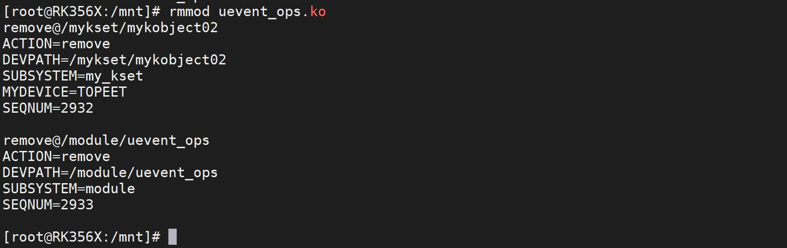
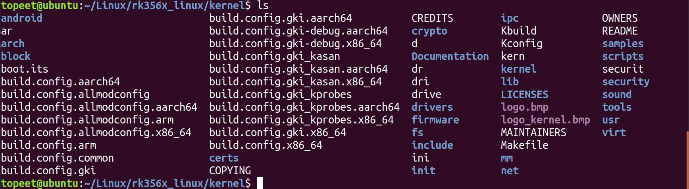
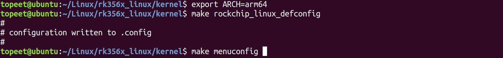
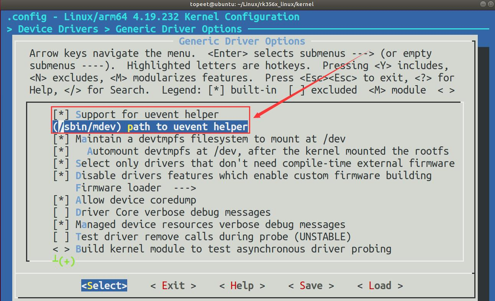
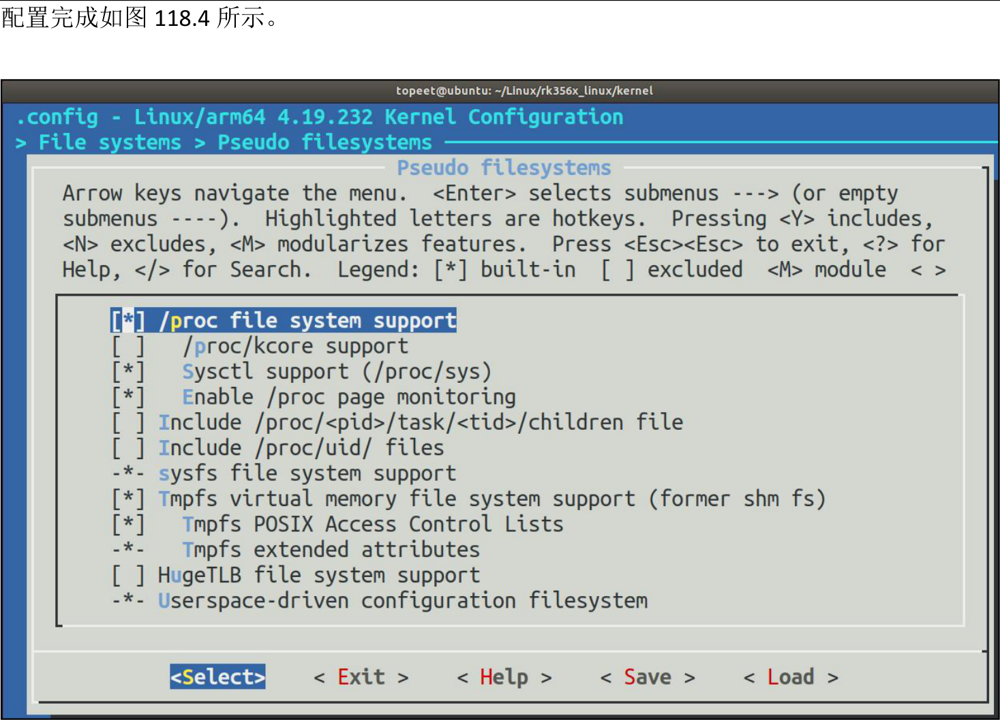
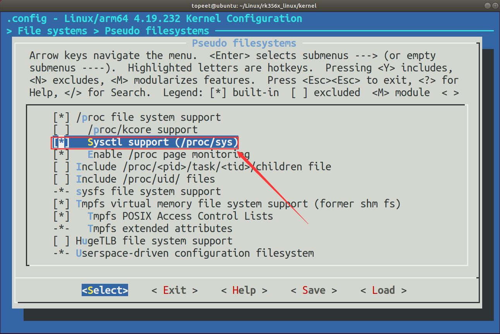
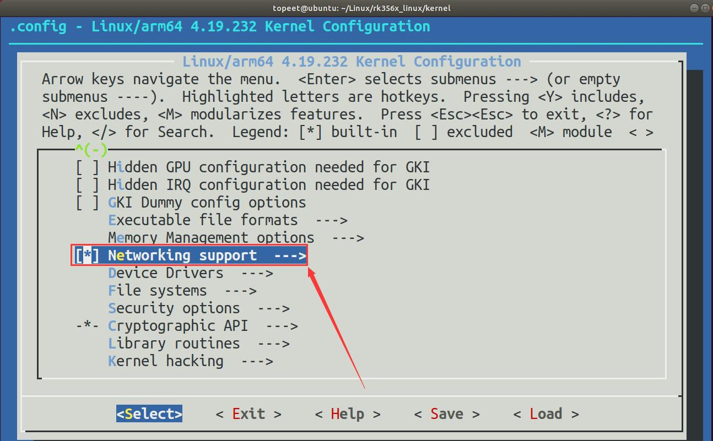
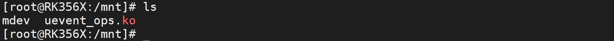
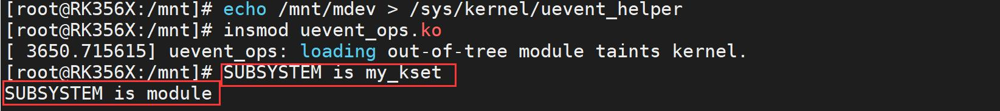
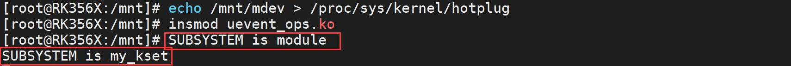

# 第118章uevent_helper实验


图117.4至此，使用netlink 监听广播信息实验就完成了。
本章节中会讲解内核发送事件到用户空间并处理的第二种方法。
## 118.1 设置uevent_helper
在具kobject_uevent()函数中，当内核配置启用CONFIG_UEVENT_HELPER 时会通过用户空间程序（如/sbin/hotplug）处理uevent 事件，如代码清单118.1 所示。代码清单118.1
```c
#ifdef CONFIG_UEVENT_HELPER
/* call uevent_helper, usually only enabled during early boot */
if (uevent_helper[0] && !kobj_usermode_filter(kobj)) {
    struct subprocess_info *info;
    retval = add_uevent_var(env, "HOME=/");
    if (retval)
        goto exit;
    retval = add_uevent_var(env,
                 "PATH=/sbin:/bin:/usr/sbin:/usr/bin");
    if (retval)
        goto exit;
    retval = init_uevent_argv(env, subsystem);
    if (retval)
        goto exit;
    retval = -ENOMEM;
```

```c
info = call_usermodehelper_setup(env->argv[0], env->argv,
                  env->envp, GFP_KERNEL,
                  NULL, cleanup_uevent_env, env);
if (info) {
    retval = call_usermodehelper_exec(info, UMH_NO_WAIT);
    env = NULL; /* freed by cleanup_uevent_env */
}
}
#endif
```
第3 行为一个if 表达式，它检查uevent_helper 数组的第一个元素是否为真。并调用kobj_usermode_filter 函数进行用户模式过滤，uevent_helper 定义如代码清单118.2 所示。代码清单118.2
```c
char uevent_helper[UEVENT_HELPER_PATH_LEN] = CONFIG_UEVENT_HELPER_PATH;
```
其中CONFIG_UEVENT_HELPER_PATH 是一个宏定义，定义在内核源码的“include/generated/autoconf.h”文件中，如代码清单118.3 所示。代码清单118.3
```c
#define CONFIG_UEVENT_HELPER_PATH ""
```
在代码清单118.3 中该宏为空，如果要使能uevent_helper 功能需要在图形配置界面使能CONFIG_UEVENT_HELPER 和CONFIG_UEVENT_HELPER_PATH 两个宏。接下来介绍配置此宏的3种方法。配置方法一来到内核源码顶层目录下，如图118.1 所示。

图118.1然后输入以下命令将平台切换为arm64，并加载iTOP-RK3568 默认配置文件和进入图像配置界面。export ARCH=arm64

make rockchip_linux_defconfigmake menuconfig如图118.2 所示。

图118.2接着在menuconfig 的图形配置界面选中4 项配置：配置项1:
```c
Device Drivers
    Generic Driver Options
        [*] Support for uevent helper//选中
        (/sbin/mdev) path to uevent helper//设置mdev 路径
```
配置完成如图118.3 所示。

图118.3配置项2:
```c
File systems
    Pseudo filesystems.
```

```c
[*]/proc file system support//选中
```

图118.4配置项3:
```c
File systems
    Pseudo filesystems.
        [*] Sysctl support(/proc/sys)//选中
```
配置完成后如图118.5 所示。


图118.5配置项4:
```c
[*]Networking support//选中
```
配置完成后如图118.6 所示。


图118.64 项配项配置完成后需要重新编译内核，所以这种配置方法使用起来较为麻烦，除了这种配置方法外，还有配置方法2 和配置方法3。配置方法2无论是否配置了CONFIG_UEVENT_HELPER_PATH 配置项，在系统启动后，直接使用以下命令来设置uevent_helper：echo /sbin/mdev > /sys/kernel/uevent_helper这将会把uevent_helper 设置为/sbin/mdex。配置方法3无论是否配置了CONFIG_UEVENT_HELPER_PATH 配置，在系统启动后，直接使用以下命令来设置uevent_helper：echo /sbin/mdev > /proc/sys/kernel/hotplug这将把uevent_helper 设置为/sbin/mdexw.。需要注意的是配置方法2 和配置方法3 依赖于配置方法1 的配置项2、3、4，并且通过配置方法2 和配置方法3 也可以修改配置方法1 中已经设置的uevent_helper。对/proc/sys/kernel/hotplug 和/sys/kernel/uevent_helper 进行读写均是对uevent_helper 属性

进行读写操作。/sys/kernel/uevent_helper 是sysfs 文件系统中的一个文件，它是uevent_helper 属性的接口。通过对该文件进行读写操作，可以读取或修改uevent_helper 属性的值。在内核源码的kernel/ksysfs.c 目录下可以找到对uevent_helper 属性的定义和相关操作的实现，如代码清单118.4 所示。代码清单118.4
```c
#ifdef CONFIG_UEVENT_HELPER
/* uevent helper program, used during early boot */
static ssize_t uevent_helper_show(struct kobject *kobj, struct kobj_attribute *attr, char *buf)
{
    return sprintf(buf, "%s\n", uevent_helper);
}
static ssize_t uevent_helper_store(struct kobject *kobj, struct kobj_attribute *attr,
                                    const char *buf, size_t count)
{
    if (count + 1 > UEVENT_HELPER_PATH_LEN)
        return -ENOENT;
    memcpy(uevent_helper, buf, count);
    uevent_helper[count] = '\0';
    if (count && uevent_helper[count - 1] == '\n')
        uevent_helper[count - 1] = '\0';
    return count;
}
KERNEL_ATTR_RW(uevent_helper);
#endif
```
uevent_helper_show()函数用于将uevent_helper 的值写入buf 中，并返回写入的字符数。uevent_helper_store()函数用于将buf 中的值复制到uevent_helper 中，并根据需要进行处理，然后返回写入的字符数。而/proc/sys/kernel/hotplug 是一个虚拟文件，用于配置内核中的热插拔事件处理程序。通过对该文件进行写操作，可以设置uevent_helper 属性的值。在内核源码的kernel/sysctl.c 文件中，可以看到对hotplug 操作其实是对uevent_helper 进行操作。如代码清单118.5 所示。

代码清单118.5
```c
#ifdef CONFIG_UEVENT_HELPER
{
    .procname = "hotplug",
    .data = &uevent_helper,
    .maxlen = UEVENT_HELPER_PATH_LEN,
    .mode = 0644,
    .proc_handler = proc_dostring,
}
```
代码清单118.5 中定义了一个名为hotplug 的文件，用于处理uevent 事件。它与uevent_helper 属性相关联。代码清单118.5 中：.procname 表示文件名，即/proc/hotplug。.data 是一个指向uevent_helper 结构体的指针，用于保存与该文件相关的数据。该指针指向uevent_helper 结构体，用于处理uevent 事件。.maxlen 表示文件内容的最大长度。该值为UEVENT_HELPER_PATH_LEN，表示文件内容的最大长度为UEVENT_HELPER_PATH_LEN。.mode 表示文件的访问权限。该值为0644，表示该文件的权限为-rw-r--r--，即所有用户都可以读取该文件，但只有root 用户可以写入该文件。
## 118.2 处理uevent 事件
在上一章节中使用netlink 机制来监听内核向用户空间发送的uevent 事件，本小节学习调用用户空间程序来处理内核发送的uevent 事件。
### 118.2.1 编写应用程序
本实验代码存放在网盘“iTOP-RK3568 开发板\07_学习教程配套资料\03_Linux 驱动配套资料\04_Linux 驱动例程\81_mdev”路径下。实验代码mdev.c 获取SUBSYSTEM 环境变量并打印，如代码清单118.6 所示。代码清单118.6
```c
#include <stdio.h>
```

```c
#include <stdlib.h>
#include <sys/types.h>
#include <sys/stat.h>
#include <fcntl.h>
#include <unistd.h>
int main(int argc, char *argv[])
{
    int fd = open("/dev/ttyFIQ0", O_WRONLY);
    dup2(fd, STDOUT_FILENO);
    printf("SUBSYSTEM is %s\n", getenv("SUBSYSTEM"));
    return 0;
}
```
### 118.2.2 编译应用程序
使用aarch64-linux-gnu-gcc -o mdev mdev.c 命令编译应用程序，编译完成以后会生成一个mdev 的可执行程序，如图118.7 所示。

图118.7下面进行程序的测试。
### 118.2.3 运行测试
本小节测试所使用的驱动文件为完善kset_uevent_ops 结构体实验中编译生成的uevent_ops.ko，应用程序为上一小节编译出来的mdev。将mdev 可执行文件和uevent_ops.ko 驱动存放在开发板的/mnt 目录下，如图118.8 所示。

图118.8在本章讲解了三种配置方法，配置方法1 是在内核中直接指定的，使用起来较为麻烦，这里直接使用配置方法2 和配置方法3 这两种方式进行演示。配置方法2：使用echo /mnt/mdev > /sys/kernel/uevent_helper 命令把本节编译的mdev 可执行文件设置成uevent_helper，然后使用命令insmod uevent_ops.ko 命令加载驱动程序，如图118.9 所示。


图118.9图118.9 中当加载驱动程序后会打印事件信息。说明实验成功。配置方法3：使echo /mnt/mdev > /proc/sys/kernel/hotplug用命令把本节编译的mdev可执行文件设置成uevent_helper，然后使用命令insmod uevent_ops.ko 命令加载驱动程序，如图119.10 所示。

图118.10图118.10 中当加载驱动程序后会打印事件信息。说明实验成功。至此，uevent_helper 实验就完成了。

