# 第119章 使用udev挂载U盘和T卡实验

本章使用udev 实现自动挂载U 盘和T 卡。
## 119.1 配置buildroot 文件系统支持udev
udev 和mdev 程序都很复杂，而且工作中也并不需要自己来写。如果使用udev，在构建buildroot 文件系统时勾选udev 选项即可。配置步骤如下：步骤1：来到buildroot 的源码目录顶层下，如图119.1 所示。
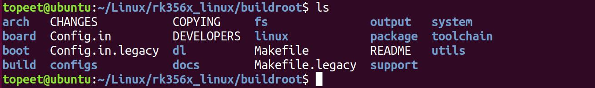
图119.1使用以下命令加载rk3568 的默认配置文件并进入到图形化配置界面。make rockchip_rk3568_defconfigmake menuconfig如图119.2 所示。
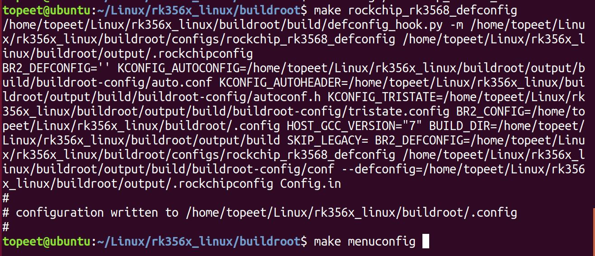
图119.2

选中System configuration 菜单中的/dev management (Dynamic using devtmpfs + eudev)选项，如图119.3 所示。
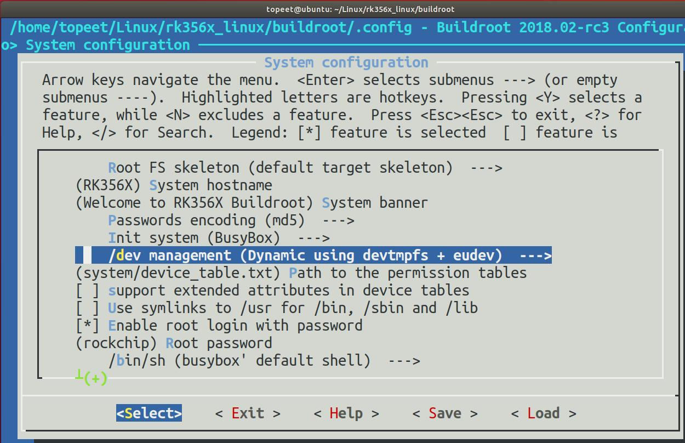
图119.3配置好以后保存退出并编译整体镜像。本实验编译好的镜像放在了iTOP-RK3568 开发板\07_学习教程配套资料\03_Linux 驱动配套资料\04_Linux 驱动程序\82_udev_u 盘_TF 卡”网盘
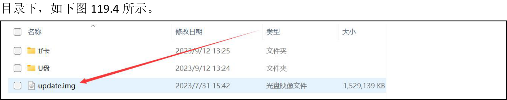
图119.4步骤2：烧写该镜像后在串口终端输入ps -aux | grep -nR udev 命令来查看udev 是否已经启用，如图119.5 所示。
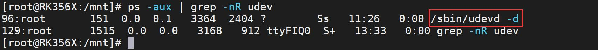

图119.5如果看到/sbin/udevd 进程就表示当前系统已经使用udev，至此配置buildroot 文件系统支持udev 就配置完成了。在学习使用udev 挂载U 盘和TF 卡时均在该镜像基础上进行。
## 119.2 使用udev 挂载U 盘
本实验代码存放在iTOP-RK3568 开发板\07_学习教程配套资料\03_Linux 驱动配套资料\04_Linux 驱动程序\82_udev_u 盘_TF 卡\U 盘网盘路径下。在iTOP-RK3568 开发板的/etc/udev/rules.d 目录下创建一个名为001.rules 规则文件（如果/etc/udev/rules.d 目录不存在可以手动创建），如图119.6 所示。
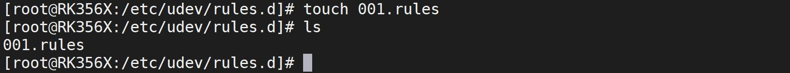
图119.6然后向该文件中添加如代码清单119.1 中代码。代码清单119.1
```c
KERNEL=="sd[a-z][0-9]", SUBSYSTEM=="block", ACTION=="add", RUN+="/etc/udev/rules.d/usb/usb-add.sh %k"
SUBSYSTEM=="block", ACTION=="remove", RUN+="/etc/udev/rules.d/usb/usb-remove.sh"
```
代码清单119.1 中代码解释如下。（1）KERNEL=="sd[a-z][0-9]"KERNEL：表示匹配设备节点的名称。sd[a-z][0-9]用于匹配以sd 开头的存储设备（如U 盘），例如匹配节点/dev/sda1。（2）SUBSYSTEM=="block"SUBSYSTEM：表示匹配设备的子系统名称。block 指的是块设备子系统，即与存储介质相关的设备。因为U 盘属于块设备，因此使用该语句可以确保只匹配存储类设备。（3）ACTION=="add"和ACTION=="remove"ACTION：表示匹配设备的动作。其中"add"：表示设备被添加。"remove"：表示设备被yichu。（5）RUN+="/etc/udev/rules.d/usb/usb-add.sh %k"RUN+="..."：表示在匹配的设备上执行指定的命令。"/etc/udev/rules.d/usb/usb-add.sh"：是要执行的命令的路径，即在设备添加时执行/etc/udev/rules.d/usb/usb-add.sh 脚本文件。%k 是udev 提供的一个变量，表示匹配的设备名称，如sdb1，mmcblk1p1 等，它会作为参数传递给脚本文件。

当块设备被添加的时候会执行/etc/udev/rules.d/usb/usb-add.sh 脚本，块设备被删除的时候会执行/etc/udev/rules.d/usb/usb-remove.sh 脚本，所以接下来我们要完善这两个脚本内容，首先在/etc/udev/rules.d/目录下创建名为usb 的文件夹，并在usb 目录下创建usb-add.sh 和usb-remove.sh 脚本，如图119.7 所示
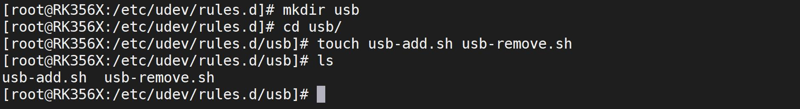
图119.7然后在/etc/udev/rules.d/usb/usb-add.sh 文件中写入代码清单119.2 中内容。代码清单119.2
```c
#!/bin/sh
/bin/mount -t vfat /dev/$1 /mnt
```
在/etc/udev/rules.d/usb/usb-remove.sh 文件中写入代码清单119.3 中内容。代码清单119.3
```c
#!/bin/sh
sync
/bin/umount -l /mnt
```
添加完成如图119.8 所示。
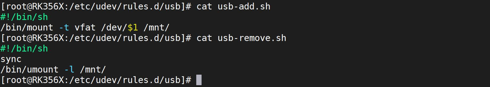
图119.8然后使用chmod 命令赋予两个脚本的可执行权限，如图119.9 所示。
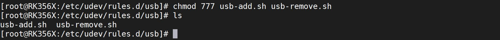
图119.9使用udev 自动挂载U 盘的配置文件完成了，然后输入df -h 命令查看当前的挂载情况，如图119.10 所示。

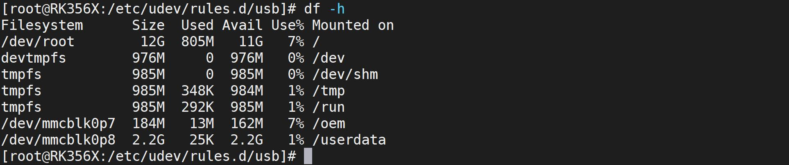
图119.10图119.10 中并没有关于U 盘相关的挂载信息，然后插入U 盘，相关打印如图119.11 所示。
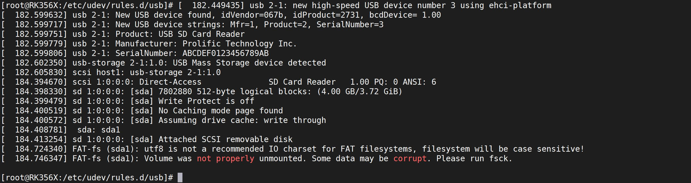
图119.11然后重新使用df -h 命令查看当前的挂载情况，如图119.12 所示。
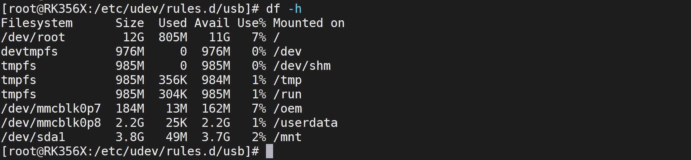
图119.12如果实验成功可以看到U 盘sda1 分区已经成功挂载到了/mnt 目录上，然后拔掉U 盘，重新使用df -h 命令查看当前挂载情况，如果实验成功可以发现/dev/sda1 设备已经消失了，如图119.13 所示。
图119.13

至此，使用udev 自动挂载U 盘实验就完成了。
## 119.3 使用udev 挂载TF 卡
本实验代码存放在iTOP-RK3568 开发板\07_学习教程配套资料\03_Linux 驱动配套资料\04_Linux 驱动程序\82_udev_u 盘_TF 卡\TF 卡网盘路径ia。本小节要使用udev 实现将TF 卡自动挂载到/mnt 目录下，在不对iTOP-RK3568 开发板做任何修改的情况下，直接插入TF 卡，会发现TF 卡直接挂载到了/mnt/sdcard 目录，如图119.14所示。
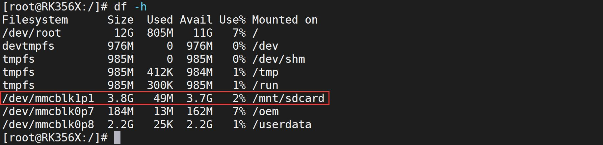
图119.14这是因为在/lib/udev/rules.d 目录下有对应的规则，如图119.15 所示。
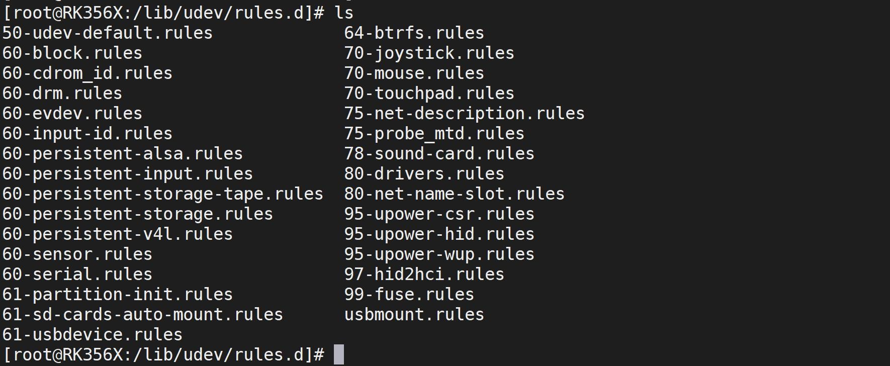
图119.15因为/etc/udev/rules.d/目录的规则文件比/lib/udev/rules.d 目录的规则文件优先级高。所以要实现TF 卡自动挂载到/mnt，可以在/etc/udev/rules.d/目录下创建规则文件，这次我们创建一个名为002.rules 的文件，如图119.16 所示。

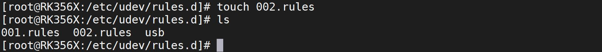
图119.16然后向该文件中添加代码清单119.4 中的内容。代码清单119.4
```c
KERNEL=="mmcblk[0-9]p[0-9]", SUBSYSTEM=="block", ACTION=="add", RUN+="/etc/udev/rules.d/tf/tf-add.sh %k"
SUBSYSTEM=="block", ACTION=="remove", RUN+="/etc/udev/rules.d/tf/tf-remove.sh"
```
（1）KERNEL=="mmcblk[0-9]p[0-9]"KERNEL：表示匹配设备节点的名称。mmcblk[0-9]p[0-9]用于匹配以mmcblk 开头的TF 卡设备，例如匹配/dev/mmcblk1p1。（2）SUBSYSTEM=="block"SUBSYSTEM 表示匹配设备所属子系统的名称。block 指的是块设备子系统，即与存储介质相关的设备。因为TF 卡均属于块设备，因此使用该语句可以确保只匹配存储类设备。（3）ACTION=="add"和ACTION=="remove"ACTION：表示匹配设备的动作。其中，"add"：表示设备被添加。"remove"：表示设备被yichu。这部分规则是为了处理设备被添加和被删除的事件。（5）RUN+="/etc/udev/rules.d/tf/tf-add.sh %k"RUN+="..."：表示在匹配的设备上执行指定的命令。"/etc/udev/rules.d/tf/tf-add.sh"：是要执行的命令的路径，即在设备添加时执行/etc/udev/rules.d/tf/tf-add.sh 脚本文件。%k 是udev提供的一个变量，表示匹配的设备名称，如sdb1，mmcblk1p1 等，它会作为参数传递给脚本。当TF 卡块设备被添加的时候会执行/etc/udev/rules.d/usb/tf-add.sh 脚本，TF 卡块设备被删除的时候会执行/etc/udev/rules.d/tf/tf-remove.sh 脚本，所以接下来我们要完善这两个脚本内容，首先在/etc/udev/rules.d/目录下创建名为tf 的文件夹，并在tf 目录下创建tf-add.sh 和tf-remove.sh 脚本，如图119.17 所示。
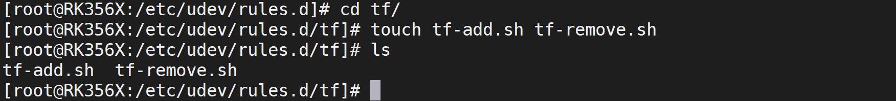
图119.17然后在/etc/udev/rules.d/usb/tf-add.sh 文件中写入代码清单119.5 中内容。代码清单119.5

```c
#!/bin/sh
/bin/mount -t vfat /dev/$1 /mnt
```
在/etc/udev/rules.d/usb/tf-remove.sh 文件中写入代码清单119.6 中内容。代码清单119.6
```c
#!/bin/sh
sync
/bin/umount -l /mnt
```
添加完成如图119.18 所示。
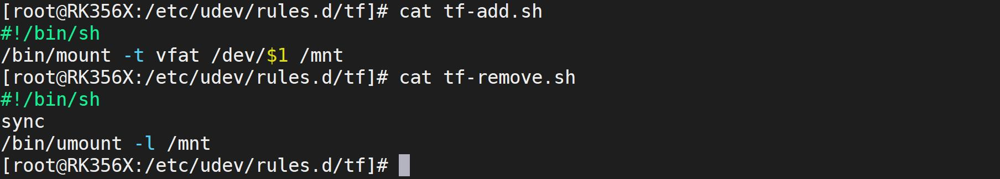
图119.18添加完成之后还需要使用chmod 命令赋予两个脚本的可执行权限，如图119.19 所示。
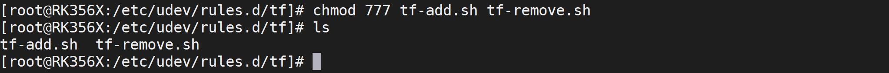
图119.19至此关于udev 实现自动挂载TF 卡的配置文件就编写完成了，输入以下df -h 命令查看当前系统的挂载情况，如图119.20 所示。

图119.20可以看到当前并没有关于TF 卡相关的挂载信息，然后插入U 盘，相关打印如图119.21 所示。
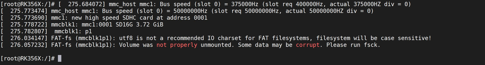
图119.21然后重新使用df -h 命令查看当前的挂载情况，如图119.22 所示。

