# 第120章使用mdev挂载U盘和T卡实验

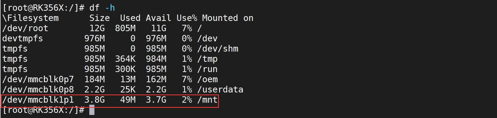
图119.22在图119.22 中看到TF 卡mmcblk1p1 分区成功挂载到了/mnt 目录，然后拔掉U 盘，重新使用df -h 命令查看当前挂载情况，可以发现/dev/mmcblk1p1 设备已经消失了，说明自动挂载TF 卡成功，如图119.23 所示。
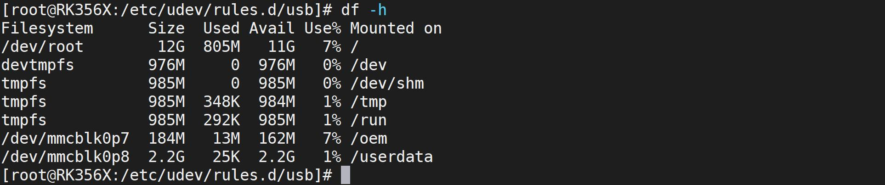
图119.23
本章节学习使用mdev 来实现U 盘和TF 卡的自动挂载。
## 120.1 配置buildroot 文件系统支持mdev
首先来到buildroot 的源码目录下，如图120.1 所示。

图120.1然后使用以下命令加载rk3568 的默认配置文件并进入到图形化配置界面：make rockchip_rk3568_defconfigmake menuconfig
如图120.2 所示。

/
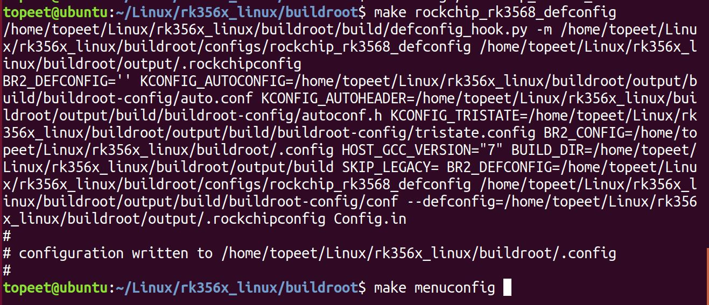
图120.2在图形化配置界面中的System configuration 菜单中选择/dev management (Dynamic usingdevtmpfs + mdev) 配置，如图120.3 所示。
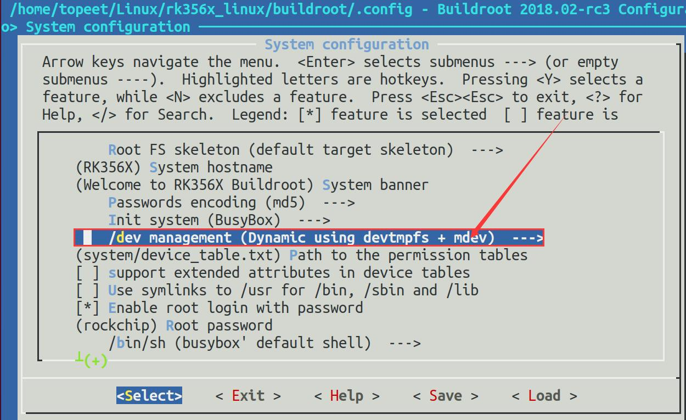
图120.3在buildroot 源码顶层目录下使用make busybox-menuconfig 命令打开buildroot 中的busybox配置界面，然后检查Linux System Utilities 选项下的mdev 是否配置。如未配置则需要按照图

120.4 配置。
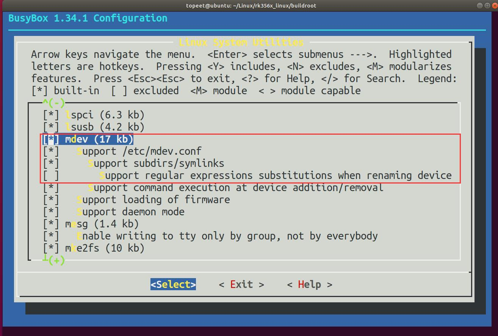
图120.4
配置完成后整体编译源码，编译完成的镜像已经放在了“iTOP-RK3568 开发板\07_学习教

图120.5然后烧写该镜像，系统启动成功后在串口终端输入ps -aux | grep -nR mdev 命令查看mdev是否已经开始，如启动成功如图120.6 所示。后续mdevi 实验均在此镜像上进行。
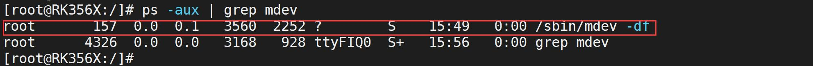
图120.6图120.6 中的/sbin/mdev 进程表示当前系统使用的是mdev，至此配置buildroot 文件系统

支持mdev 就完成了。
## 120.2 使用mdev 挂载U 盘
本实验代码存放在iTOP-RK3568 开发板\07_学习教程配套资料\03_Linux 驱动配套资料\04_Linux 驱动程序\83_mdev_u 盘_TF 卡\U 盘网盘路径下。与udev 相同，mdev 也需要添加相应的规则，不同的是mdev 使用/etc/mdev.conf 文件来配置mdev 的规则和行为，在/etc/mdev.conf 文件中添加如代码清单120.1 中的两条规则。代码清单120.1
```c
sd[a-z][0-9] 0:0 666 @/etc/mdev/usb_insert.sh
sd[a-z] 0:0 666 $/etc/mdev/usb_remove.sh
```
这两个规则用于处理U 盘的热插拔事件，并执行相应的操作。在/etc/mdev.conf 文件中，每一行都是一个规则，具有格式如下：
```c
<设备节点正则表达式> <设备的所有者:设备的所属组> <设备的权限> <设备插入或移除时需要执行的命令>
```
代码清单120.1 中规则介绍如下：1.语句sd[a-z][0-9]和mmcblk[0-9]p[0-9]该语句是一个正则表达式，用于匹配以sd 开头的块设备节点名称，[a-z]表示设备名有小写字母a 到z，[0-9]表示设备名有数字0 到9。例如匹配设备节点/dev/sda1。2.语句0:0 666该语句用于设置设备节点的所有者和访问权限。0:0 表示所有者和所属组的用户ID 和组ID均为0，即root 用户。666 表示权限为可读可写。3.语句@/etc/mdev/usb_insert.sh该语句表示当符合规则的设备插入时，mdev 会执行/etc/mdev/usb_insert.sh 脚本。@ 符号表示执行的是一个shell 命令。4.语句$/etc/mdev/usb_remove.sh该语句表示当符合规则的设备移除时，mdev 会执行/etc/mdev/usb_remove.sh 脚本。$ 符号表示执行的是一个内部命令。规则添加完成之后在对应的目录下添加usb_insert.sh 和usb_remove.sh 脚本文件，首先创建/etc/mdev 目录并进入到该目录，在该目录下创建usb_insert.sh 和usb_remove.sh 两个文件如图120.7 所示。

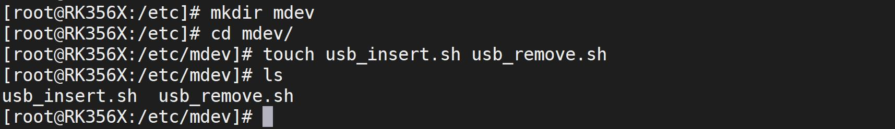
图120.7在/etc/mdev/usb_insert.sh 文件中写入代码清单120.2 中内容。代码清单120.2
```c
#!/bin/sh
if [ -d /sys/block/*/$MDEV ]; then
    mount /dev/$MDEV /mnt
    sync
fi
```
在/etc/mdev/usb_remove.sh 文件中写入代码清单120.3 中内容。代码清单120.3#!/bin/shsync/bin/umount -l /mnt添加完成如下图120.8 所示。
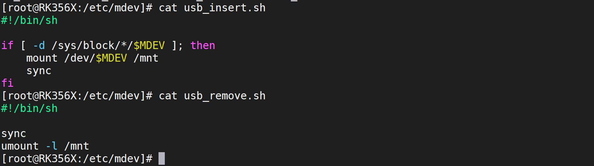
图120.8添加完成之后还需要使用chmod 命令赋予两个脚本的可执行权限，如图120.9 所示。
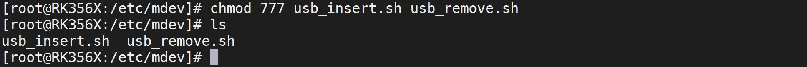
图120.9至此关于mdev 自动挂载U 盘的配置文件就编写完成了，然后输入以下df -h 命令查看当前的挂载情况，如图120.10 所示。

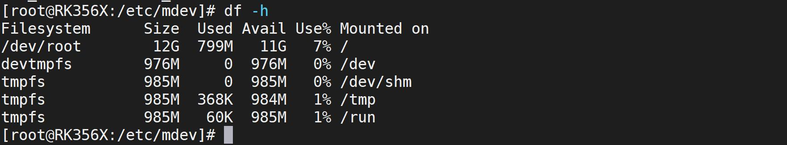
图120.10可以看到当前并没有关于U 盘相关的挂载信息，然后插入U 盘，打印信息如图120.11 所示。
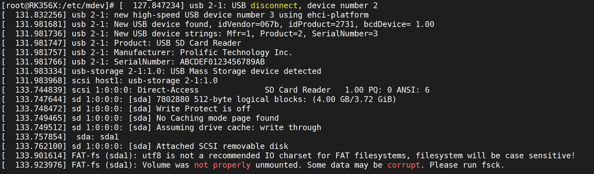
图120.11然后重新使用df -h 命令查看当前的挂载情况，如图120.12 所示。
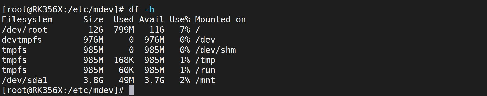
图120.12可以看到U 盘sda1 分区成功挂载到了/mnt 目录上，然后拔掉U 盘，重新使用df -h 命令查看当前挂载情况，可以发现/dev/sda1 设备已经消失了，如图120.13 所示。
图120.13至此，使用mdev 自动挂载U 盘实验就完成了。

## 120.3 使用mdev 挂载TF 卡
本实验代码存放在网盘iTOP-RK3568 开发板\07_学习教程配套资料\03_Linux 驱动配套资料\04_Linux 驱动程序\83_mdev_u 盘_TF 卡\TF 卡路径下。本小节要使用mdev 实现将TF 卡自动挂载到/mnt 目录下，TF 卡自动挂载也需要向/etc/mdev.conf 文件中如添加代码清单120.4 中的规则。代码清单120.4
```c
mmcblk[0-9]p[0-9] 0:0 666 @/etc/mdev/tf_insert.sh
mmcblk[0-9] 0:0 666 $/etc/mdev/tf_remove.sh
```
这两个规则用于处理TF 卡的热插拔事件，并执行相应的操作。在/etc/mdev.conf 文件中，每一行都是一个规则，具有以下格式：
```c
<设备节点正则表达式> <设备的所有者:设备的所属组> <设备的权限> <设备插入或移除时需要执行的命令>
```
代码清单120.4 中规则介绍如下：1.语句mmcblk[0-9]p[0-9]该语句是一个正则表达式，用于匹配以mmcblk 开头的块设备节点名称，[0-9]表示设备名有数字0 到9。例如设备节点/dev/mmcblk1p1。2.语句0:0 666该语句用于设置设备节点的所有者和访问权限。0:0 表示所有者和所属组的用户ID 和组ID均为0，即root 用户。666 表示权限为可读可写。3.语句@/etc/mdev/tf_insert.sh该语句表示当符合规则的设备插入时，mdev 会执行/etc/mdev/tf_insert.sh 脚本。@ 符号表示执行的是一个shell 命令。4.语句$/etc/mdev/tf_remove.sh该语句表示当符合规则的设备移除时，mdev 会执行/etc/mdev/tf_insert.sh 脚本。$ 符号表示执行的是一个内部命令。规则添加完成之后需要在对应的目录下添加tf_insert.sh 和tf_remove.sh 脚本文件，进入到/etc/mdev 目录下并创建tf_insert.sh 和tf_remove.sh 两个文件，如图120.14 所示。
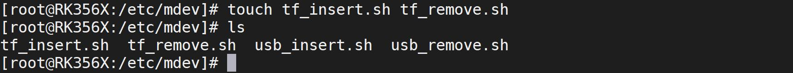
图120.14在/etc/mdev/tf_insert.sh 文件中写入代码清单120.5 中的内容。

代码清单120.5
```c
#!/bin/sh
if [ -d /sys/block/*/$MDEV ]; then
    mount /dev/$MDEV /mnt
    sync
fi
```
在/etc/mdev/tf_remove.sh 文件中写入代码清单120.6 中的内容。代码清单120.6
```c
#!/bin/sh
sync
/bin/umount -l /mnt
```
添加完成如图120.15 所示。
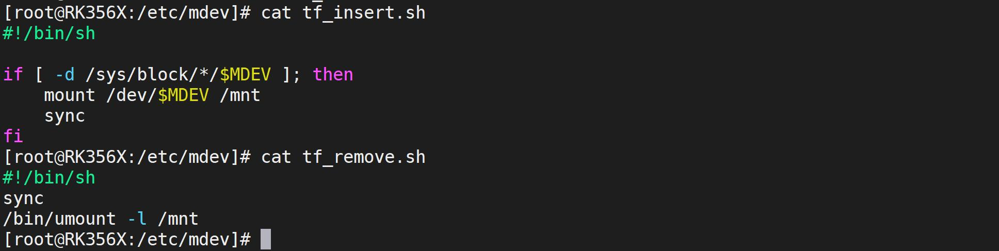
图120.15添加完成之后还需要使用chmod 命令赋予两个脚本的可执行权限，如图120.16 所示。
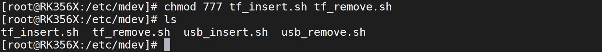
图120.16至此关于mdev 自动挂载TF 卡的配置文件就编写完成了，输入df -h 命令查看当前的挂载情况，如图120.17 所示。

图120.17可以看到当前并没有关于TF 卡相关的挂载信息，然后插入TF 卡，打印信息如图120.18 所示。

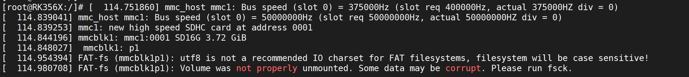
图120.18然后重新使用df -h 命令查看当前的挂载情况，如图120.19 所示。
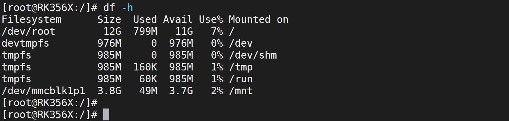
图120.19可以看到TF 卡mmcblk1p1 分区成功挂载到了/mnt 目录，然后拔掉TF 卡，重新使用df -h命令查看当前挂载情况，可以发现/dev/mmcblk1p1 设备已经消失了，如图120.20 所示。
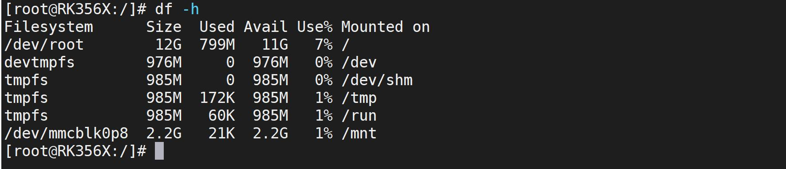
图120.20图120.20 中虽然TF 卡设备已经消失了，但是又出现了一个/dev/mmcblk0p8 的设备并挂载到了/mnt 目录，这里是正常的，mmcblk0p8 是emmc 里的一个分区，也符合上面我们添加的热插拔规则。至此，使用mdev 自动挂载TF 卡实验就完成了。

本篇讲解pinctrl 子系统，本篇所有内容均涉及到了源码分析，因为需要理解代码，所以本篇比较晦涩，如果是初学者在初学阶段掌握pinctrl 在设备树中的使用即可，可跳过该部分。如果想深入研究，可以配合视频教程与本篇文档进行学习。
第121 章pinctrl 子系统的引入Linux 中的pinctrl 子系统（Pin Control Subsystem）是一个用于管理和配置通用输入/输出（GPIO）引脚的框架。
## 121.1 pinctrl 子系统概述
现代处理器基本都可以通过配置内部寄存器来配置引脚功能与特性。如图121.1 是某处理器部分引脚，其中每一个引脚有多种复用功能，如图121.1 中GPIO3_C4 引脚既可以配置成GPIO引脚使用，又可以配置成VO_LCDC_D3、I2S1_MCLK_M0 或UART7_TX_M0 引脚使用。
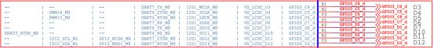
图121.1如果工程师需要手动通过寄存器配置每一个引脚的功能和特性，将会非常繁琐。因此Linux使用pinctrl 子系统统一管理各芯片厂的处理器引脚。借助pinctrl 子系统，工程师无需直接操作寄存器，仅通过设备树即可完成引脚的功能和特性配置，大大提高了开发效率，降低了工程师学习成本与开发难度。Linux 中pinctrl 子系统提供以下3 种功能：1.管理Linux 系统中通过设备树配置的引脚。2.管理引脚复用。3.配置引脚特性。例如上拉/下拉、驱动能力等。不同处理器的引脚组织和管理方式各不相同，那么pinctrl 子系统是如何实现统一管理的呢？Linux 通过pinctrl 子系统对管理方式进行了抽象，它将底层对寄存器的操作封装为一个通用模型pin controller。pin controller 驱动由芯片厂商提供，该驱动实现了具体平台的引脚配置

方法。pin controller 使用pinctrl_desc 结构体表示，该结构体定义在内核源码/include/linux/pinctrl/pinctrl.h 文件中，部分代码如代码清单121.1 所示。代码清单121.1
```c
struct pinctrl_desc {
    const char *name;//引脚控制器的名称
    const struct pinctrl_pin_desc *pins;//引脚描述符数组
    unsigned int npins;//引脚描述符数组的大小
    const struct pinctrl_ops *pctlops;//引脚控制操作函数指针
    const struct pinmux_ops *pmxops;//引脚复用操作函数指针
    const struct pinconf_ops *confops;//引脚配置操作函数指针
    ......
};
```
其中，pctlops 是引脚控制相关的函数操作集，pmxops 是引脚复用控制的函数操作集，confops 是配置引脚电气特性的函数操作集。代码清单121.2 以瑞芯微处理器的pin controller驱动为例，展示了芯片厂家工程师如何填充pinctrl_desc 结构体，并实现pctlops、pmxops 和confops 等函数操作集。代码清单121.2
```c
static int rockchip_pinctrl_register(struct platform_device *pdev,struct rockchip_pinctrl *info)
{
    struct pinctrl_desc *ctrldesc = &info->pctl;
    ctrldesc->name = "rockchip-pinctrl";
    ctrldesc->pctlops = &rockchip_pctrl_ops;
    ctrldesc->pmxops = &rockchip_pmx_ops;
    ctrldesc->confops = &rockchip_pinconf_ops;
    ctrldesc->pins = pindesc;
    ctrldesc->npins = info->ctrl->nr_pins;
    ......
    }
    static const struct pinctrl_ops rockchip_pctrl_ops = {
    .get_groups_count = rockchip_get_groups_count,
    .get_group_name= rockchip_get_group_name,
    .get_group_pins= rockchip_get_group_pins,
    .dt_node_to_map= rockchip_dt_node_to_map,
    .dt_free_map= rockchip_dt_free_map,
    };
    static const struct pinmux_ops rockchip_pmx_ops = {
    .get_functions_count= rockchip_pmx_get_funcs_count,
    .get_function_name = rockchip_pmx_get_func_name,
    .get_function_groups= rockchip_pmx_get_groups,
    .set_mux= rockchip_pmx_set,
    };
```

```c
static const struct pinconf_ops rockchip_pinconf_ops = {
.pin_config_get= rockchip_pinconf_get,
.pin_config_set= rockchip_pinconf_set,
.is_generic= true,
};
```
不同处理器的pin controller 驱动实现可能略有差异，但目标是一致的，那就是将引脚信息及其控制接口封装为pinctrl_desc，并注册到pinctrl 子系统的核心框架中，pinctrl 子系统的核心层对pin controller 驱动提供底层接口通信的能力，同时向其他驱动程序提供引脚复用与特性配置的能力。需要注意的是，pin controller 驱动中使用的引脚信息属于硬件资源，通常通过设备树进行描述。代码清单121.3 展示了瑞芯微处理器中一个典型的pinctrl 节点配置示例。代码清单121.3
```c
pinctrl: pinctrl {
    compatible = "rockchip,rk3568-pinctrl";
    rockchip,grf = <&grf>;
    rockchip,pmu = <&pmugrf>;
    #address-cells = <2>;
    #size-cells = <2>;
    ranges;
    gpio0: gpio@fdd60000 {
        compatible = "rockchip,gpio-bank";
        reg = <0x0 0xfdd60000 0x0 0x100>;
        interrupts = <GIC_SPI 33 IRQ_TYPE_LEVEL_HIGH>;
        clocks = <&pmucru PCLK_GPIO0>, <&pmucru DBCLK_GPIO0>;
        gpio-controller;
        #gpio-cells = <2>;
        gpio-ranges = <&pinctrl 0 0 32>;
        interrupt-controller;
        #interrupt-cells = <2>;
    };
    ......
    };
    &pinctrl {
    uart0 {
        /omit-if-no-ref/
        uart0_xfer: uart0-xfer {
             rockchip,pins =<0 RK_PC0 3 &pcfg_pull_up>,/* uart0_rx */
                            <0 RK_PC1 3 &pcfg_pull_up>;/* uart0_tx */
        };
        /omit-if-no-ref/
```

