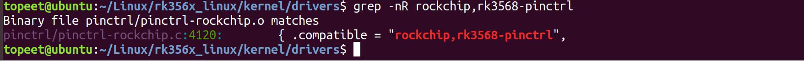

# 第122章 pinctrl子系统注册流程

```c
uart0_ctsn: uart0-ctsn {
    rockchip,pins =<0 RK_PC7 3 &pcfg_pull_none>;/* uart0_ctsn */
};
/omit-if-no-ref/
uart0_rtsn: uart0-rtsn {
    rockchip,pins =<0 RK_PC4 3 &pcfg_pull_none>;/* uart0_rtsn */
};
};
};
```
在第22 至36 行中描述的是uart0 所使用的引脚，其中uart0 节点下包含三个子节点uart0_xfer、uart0_ctsn 和uart0_rtsn，每个子节点定义了一组引脚。每组引脚可以包含一个或多个具体引脚，用于表示某一特定功能。例如，uart0_xfer 表示uart0 的收发引脚RX 和TX。一组引脚又叫做group，设备树中的group 节点除了标识引脚编号外，还定义了引脚的电气特性，如是否上拉、下拉、浮空等。例如，pcfg-pull-none 表示引脚内部浮空，pcfg_pull_up 表示开启内部上拉。uart0 节点也叫做function，function 表示引脚功能，如uart0 这个function 表示uart0所需引脚的复用设置和电气属性。在设备树中，function 和group 节点的配置通常由芯片厂商工程师编写并提供。设备树中只是设备的描述信息，pinctrl 驱动会获取设备树中pinctrl 的描述信息。根据rk3568.dtsi 设备树中pinctrl 节点的compatible 属性进行查找，可以查找到pinctrl 的驱动文件是内核源码的“/driver/pinctrl/pinctrl-rockchip.c”如图121.2 所示。

图121.2
本章节以iTOP-RK3568 开发板的SDK 为例分析pinctrl 子系统的注册流程。
## 122.1 probe 函数分析
打开内核源码目录下的“/drivers/pinctrl/pinctrl-rockchip.c”驱动文件，找到驱动的入口函数rockchip_pinctrl_drv_register()，如代码清单122.1 所示。代码清单122.1

```c
static struct platform_driver rockchip_pinctrl_driver = {
    .probe= rockchip_pinctrl_probe,
    .driver = {
        .name= "rockchip-pinctrl",
        .pm = &rockchip_pinctrl_dev_pm_ops,
        .of_match_table = rockchip_pinctrl_dt_match,
    },
};
static int __init rockchip_pinctrl_drv_register(void)
{
    return platform_driver_register(&rockchip_pinctrl_driver);
}
postcore_initcall(rockchip_pinctrl_drv_register);
static void __exit rockchip_pinctrl_drv_unregister(void)
{
    platform_driver_unregister(&rockchip_pinctrl_driver);
}
```
通过代码清单122.1 可以才看出pinctrl 驱动使用的是platform 总线，因此当pinctrl 设备和pinctrl 驱动匹配成功之后会执行rockchip_pinctrl_probe()函数，probe 函数如代码清单122.2 所示。代码清单122.2
```c
static int rockchip_pinctrl_probe(struct platform_device *pdev)
{
    struct rockchip_pinctrl *info;// Rockchip GPIO 控制器的信息结构体指针
    struct device *dev = &pdev->dev;// 设备结构体指针
    struct rockchip_pin_ctrl *ctrl;// Rockchip GPIO 控制器的配置结构体指针
    struct device_node *np = pdev->dev.of_node, *node;// 设备节点指针
    struct resource *res;// 设备资源指针
    void __iomem *base;// 寄存器基地址指针
    int ret;// 返回值
    if (!dev->of_node) {
        dev_err(dev, "device tree node not found\n");
        return -ENODEV;
    }
    // 分配并初始化一个rockchip_pinctrl 结构体
    info = devm_kzalloc(dev, sizeof(*info), GFP_KERNEL);
    if (!info)
        return -ENOMEM;
```

```c
info->dev = dev;
// 获取并设置与pdev 相关的rockchip_pin_ctrl 结构体
ctrl = rockchip_pinctrl_get_soc_data(info, pdev);
if (!ctrl) {
    dev_err(dev, "driver data not available\n");
    return -EINVAL;
}
info->ctrl = ctrl;
// 解析设备树中的"rockchip,grf"节点，获取寄存器映射基地址
node = of_parse_phandle(np, "rockchip,grf", 0);
if (node) {
    info->regmap_base = syscon_node_to_regmap(node);
    if (IS_ERR(info->regmap_base))
        return PTR_ERR(info->regmap_base);
    } else {
    // 如果找不到"rockchip,grf"节点，则获取IORESOURCE_MEM 类型的资源，得到寄存器基地址
    res = platform_get_resource(pdev, IORESOURCE_MEM, 0);
    base = devm_ioremap_resource(&pdev->dev, res);
    if (IS_ERR(base))
        return PTR_ERR(base);
    // 配置寄存器映射的最大寄存器地址和名称
    rockchip_regmap_config.max_register = resource_size(res) - 4;
    rockchip_regmap_config.name = "rockchip,pinctrl";
    info->regmap_base = devm_regmap_init_mmio(&pdev->dev, base,
                        &rockchip_regmap_config);
    // 检查旧的dt-bindings
    info->reg_size = resource_size(res);
    // 如果控制器类型为RK3188 且reg_size 小于0x200，则获取第二个IORESOURCE_MEM 类型的资
源，作为pull 寄存器的基地址
    if (ctrl->type == RK3188 && info->reg_size < 0x200) {
        res = platform_get_resource(pdev, IORESOURCE_MEM, 1);
        base = devm_ioremap_resource(&pdev->dev, res);
        if (IS_ERR(base))
            return PTR_ERR(base);
        // 配置pull 寄存器映射的最大寄存器地址和名称
        rockchip_regmap_config.max_register =
                        resource_size(res) - 4;
```

```c
rockchip_regmap_config.name = "rockchip,pinctrl-pull";
info->regmap_pull = devm_regmap_init_mmio(&pdev->dev,
                base,
                &rockchip_regmap_config);
}
}
// 尝试查找可选的pmu syscon 引用
node = of_parse_phandle(np, "rockchip,pmu", 0);
if (node) {
info->regmap_pmu = syscon_node_to_regmap(node);
if (IS_ERR(info->regmap_pmu))
return PTR_ERR(info->regmap_pmu);
}
// 对于某些SoC 进行特殊处理
if (ctrl->soc_data_init) {
ret = ctrl->soc_data_init(info);
if (ret)
return ret;
}
// 注册rockchip_pinctrl 设备
ret = rockchip_pinctrl_register(pdev, info);
if (ret)
return ret;
// 设置pdev 的私有数据为info
platform_set_drvdata(pdev, info);
// 注册GPIO 设备
ret = of_platform_populate(np, rockchip_bank_match, NULL, NULL);
if (ret) {
dev_err(&pdev->dev, "failed to register gpio device\n");
return ret;
}
dev_info(dev, "probed %s\n", dev_name(dev));
return 0;
}
```
代码清单122.2 中第2 行出现的结构体struct rockchip_pinctrl 是瑞芯微公司为了适应瑞芯微芯片的特定需求和功能，对struct pinctrl_desc 结构体进行了再一次封装。封装后的structrockchip_pinctrl 结构体在struct pinctrl_desc 的基础上增加了与瑞芯微芯片相关结构体成员。因

此struct pinctrl_desc 结构体可以看作是的struct rockchip_pinctrl 结构体的父类。通过这种方式Linux 的pinctrl 子系统对不同厂家的不同芯片都可以有很好的兼容性。rockchip_pinctrl 结构体定义在内核源码目录下的“/drivers/pinctrl/pinctrl-rockchip.h”文件中。如代码清单122.3 所示。代码清单122.3
```c
struct rockchip_pinctrl {
    struct regmap*regmap_base;// 基本寄存器映射指针
    intreg_size;// 寄存器大小
    struct regmap*regmap_pull;// 拉取寄存器映射指针
    struct regmap*regmap_pmu;// 电源管理单元寄存器映射指针
    struct device*dev;// 设备指针
    struct rockchip_pin_ctrl *ctrl;// 瑞芯微芯片引脚控制器指针
    struct pinctrl_descpctl;// 引脚控制器描述符
    struct pinctrl_dev*pctl_dev;// 引脚控制器设备指针
    struct rockchip_pin_group *groups;// 瑞芯微芯片引脚组指针
    unsigned intngroups;// 引脚组数量
    struct rockchip_pmx_func *functions;// 瑞芯微芯片引脚功能指针
    unsigned intnfunctions;// 引脚功能数量
};
```
rockchip_pinctrl 结构体中关键成员介绍如下：1.struct device *dev：指向设备结构体的指针，并接入到设备模型中。2.struct rockchip_pin_ctrl *ctrl：指向rockchip_pin_ctrl 结构体类型的指针。rockchip_pin_ctrl 结构体保存了瑞芯微芯片的引脚信息和操作。如代码清单122.4 所示。代码清单122.4
```c
struct rockchip_pin_ctrl {
        /* 引脚（Bank）信息*/
        struct rockchip_pin_bank*pin_banks;// 指向bank 的结构体指针，如GPIO0 一组gpio 就
是看作是一个bank
        u32nr_banks;// bank 的数量
        u32nr_pins;// 控制器管理的总引脚数
        char*label;// 控制器名称标识（如"RK3568 pinctrl Control"）
        /* 硬件类型标识*/
        enum rockchip_pinctrl_typetype;// 芯片平台类型（如RK3568/RK3399）
        /* 寄存器偏移量配置*/
        intgrf_mux_offset;
        intpmu_mux_offset;
        intgrf_drv_offset;
        intpmu_drv_offset;
```

```c
/* 特殊引脚复用配置*/
struct rockchip_mux_recalced_data *iomux_recalced;
u32niomux_recalced;
struct rockchip_mux_route_data *iomux_routes;
u32niomux_routes;
int (*ctrl_data_re_init)(struct rockchip_pin_ctrl *ctrl);
int (*soc_data_init)(struct rockchip_pinctrl *info);
/* 电气属性计算函数*/
void (*pull_calc_reg)(struct rockchip_pin_bank *bank,
                      int pin_num,
                      struct regmap **regmap,
                      int *reg,
                      u8 *bit);
void (*drv_calc_reg)(struct rockchip_pin_bank *bank,
                     int pin_num,
                     struct regmap **regmap,
                     int *reg,
                     u8 *bit);
int (*schmitt_calc_reg)(struct rockchip_pin_bank *bank,
                         int pin_num,
                         struct regmap **regmap,
                         int *reg,
                         u8 *bit);
int (*slew_rate_calc_reg)(struct rockchip_pin_bank *bank,
                           int pin_num,
                           struct regmap **regmap,
                           int *reg,
                           u8 *bit);
};
```
3.struct pinctrl_desc pctl：该结构体中的pctlops 成员是引脚控制相关的函数操作集，pmxops 成员是引脚复用控制的函数操作集，confops 成员是配置引脚电气特性的函数操作集。4.struct pinctrl_dev *pctl_dev：struct pinctrl_dev 用来表示一个pinctrl 设备。如代码清单122.5

所示。代码清单122.5
```c
struct pinctrl_dev {
            struct list_head node;/* 通过该成员可以把pinctrl_dev 添加到全
局链表pinctrldev_list 中*/
            struct pinctrl_desc *desc;/* pin controller */
            struct radix_tree_root pin_desc_tree;/* 存储此pincontroller 下每个pin 对应的radix
树*/
    #ifdef CONFIG_GENERIC_PINCTRL_GROUPS/* 可选*/
            struct radix_tree_root pin_group_tree;
            unsigned int num_groups;
    #endif
    #ifdef CONFIG_GENERIC_PINMUX_FUNCTIONS/* 可选*/
            struct radix_tree_root pin_function_tree;
            unsigned int num_functions;
    #endif
            struct list_head gpio_ranges;
            struct device *dev;
            struct module *owner;
            void *driver_data;
            struct pinctrl *p;/* pinctrl_get(dev) 结果*/
            struct pinctrl_state *hog_default;/* 引脚的默认状态*/
            struct pinctrl_state *hog_sleep;/* 引脚的睡眠状态*/
            struct mutex mutex;
    #ifdef CONFIG_DEBUG_FS
            struct dentry *device_root;
    #endif
};
```
5. struct rockchip_pin_group *groups：指向struct rockchip_pin_group 结构体类型的指针。该结构体表示一个引脚复用功能的引脚组。如代码清单122.6 所示代码清单122.6
```c
/**
     * struct rockchip_pin_group: represent group of pins of a pinmux function.
     * @name: name of the pin group, used to lookup the group.
     * @pins: the pins included in this group.
     * @npins: number of pins included in this group.
     * @func: the mux function number to be programmed when selected.
     * @configs: the config values to be set for each pin
     * @nconfigs: number of configs for each pin
*/
struct rockchip_pin_group {
```

```c
const char*name;
unsigned intnpins;
unsigned int*pins;
struct rockchip_pin_config*data;
};
```
6.unsigned int ngroups：表示引脚组的大小。7.struct rockchip_pmx_func *functions：指向struct rockchip_pmx_func 结构体类型的指针。该结构体表示引脚可以设置的不同复用，例如UART、SPI、I2C 等。如代码清单122.7 所示。代码清单122.7
```c
/**
 * struct rockchip_pmx_func: represent a pin function.
 * @name: name of the pin function, used to lookup the function.
 * @groups: one or more names of pin groups that provide this function.
 * @num_groups: number of groups included in @groups.
 */
struct rockchip_pmx_func {
const char*name;
const char**groups;
u8ngroups;
};
```
8. unsigned int nfunctions：引脚对应的复用功能的数量。至此rockchip_pinctrl 结构体分析完毕。在代码清单122.2 中调用rockchip_pinctrl_register()函数注册rockchip_pinctrl 设备。传入的参数分别为pdev 和rockchip_pinctrl 类型的info，rockchip_pinctrl_register()函数如代码清单122.8 所示。代码清单122.8
```c
static int rockchip_pinctrl_register(struct platform_device *pdev,
                     struct rockchip_pinctrl *info)
{
    struct pinctrl_desc *ctrldesc = &info->pctl;
    struct pinctrl_pin_desc *pindesc, *pdesc;
    struct rockchip_pin_bank *pin_bank;
    int pin, bank, ret;
    int k;
    // 初始化pinctrl 描述结构体
    ctrldesc->name = "rockchip-pinctrl";
    ctrldesc->owner = THIS_MODULE;
    ctrldesc->pctlops = &rockchip_pctrl_ops;
    ctrldesc->pmxops = &rockchip_pmx_ops;
```

```c
ctrldesc->confops = &rockchip_pinconf_ops;
// 为每个引脚分配内存
pindesc = devm_kcalloc(&pdev->dev,
                info->ctrl->nr_pins, sizeof(*pindesc),
                GFP_KERNEL);
if (!pindesc)
    return -ENOMEM;
ctrldesc->pins = pindesc;
ctrldesc->npins = info->ctrl->nr_pins;
pdesc = pindesc;
// 遍历每个引脚所属的bank，为每个引脚设置编号和名称
for (bank = 0, k = 0; bank < info->ctrl->nr_banks; bank++) {
    pin_bank = &info->ctrl->pin_banks[bank];
    for (pin = 0; pin < pin_bank->nr_pins; pin++, k++) {
        pdesc->number = k;
        pdesc->name = kasprintf(GFP_KERNEL, "%s-%d",
                     pin_bank->name, pin);
        pdesc++;
    }
}
// 解析设备树中的pinctrl 信息
ret = rockchip_pinctrl_parse_dt(pdev, info);
if (ret)
    return ret;
// 注册pinctrl 设备
info->pctl_dev = devm_pinctrl_register(&pdev->dev, ctrldesc, info);
if (IS_ERR(info->pctl_dev)) {
    dev_err(&pdev->dev, "could not register pinctrl driver\n");
    return PTR_ERR(info->pctl_dev);
}
return 0;
}
```
rockchip_pinctrl_register()关键部分讲解如下：第4 行：将info 的pctl 参数传递给了struct pinctrl_desc *类型的变量ctrldesc，从而使得rockchip_pinctrl 结构体和pinctrl_desc 结构体建立了联系。第11-15 行，对pinctrl_desc 结构体进行初始化。这些结构体成员包括name（pinctrl 控制

器的名称），owner（拥有该pinctrl 控制器的模块），pctlops（pinctrl 控制操作函数），pmxops（pinctrl 引脚复用操作函数）和confops（pinctrl 引脚配置操作函数）。第18-22 行，使用devm_kcalloc 函数在设备的内存上分配一块连续的内存区域，用于存储pinctrl_pin_desc 结构体。该函数分配的内存大小为info->ctrl->nr_pins * sizeof(*pindesc)字节。如果内存分配失败，则返回-ENOMEM 错误码。第24-25 行：将pinctrl_pin_desc 结构体的指针pindesc 赋值给pinctrl 描述结构体的pins 成员，将引脚数量info->ctrl->nr_pins 赋值给pinctrl 描述结构体的npins 成员。第27-37 行：通过遍历每个引脚所属的bank，为每个引脚设置编号和名称。首先，定义变量pdesc 指向引脚描述结构体的起始地址。然后，使用两个嵌套的循环，外层循环遍历每个引脚所属的bank，内层循环遍历每个bank 中的引脚。在内层循环中，首先将当前引脚的编号k 赋值给pinctrl_pin_desc 结构体的number 成员，然后使用kasprintf 函数动态分配内存储引脚名称的字符串，并将该字符串赋值给pinctrl_pin_desc 结构体的name 成员。kasprintf 函数在内核堆中分配内存，并格式化生成字符串。格式化的字符串为"%s-%d"，其中pin_bank->name 是当前bank 的名称，pin 是当前引脚在bank 中的索引。第39-42 行：调用rockchip_pinctrl_parse_dt()函数来解析设备树中的pinctrl 信息。该函数根据设备树中的描述，设置引脚的默认配置。第45-49 行：调用devm_pinctrl_register()函数注册pinctrl 设备。其中devm_pinctrl_register()函数定义在内核源码目录下的“drivers/pinctrl/core.c”文件中，如代码清单122.9 所示。代码清单122.9
```c
struct pinctrl_dev *devm_pinctrl_register(struct device *dev,
                       struct pinctrl_desc *pctldesc,
                       void *driver_data)
{
    struct pinctrl_dev **ptr, *pctldev;
    // 分配用于存储pinctrl_dev 指针的内存
    ptr = devres_alloc(devm_pinctrl_dev_release, sizeof(*ptr), GFP_KERNEL);
    if (!ptr)
        return ERR_PTR(-ENOMEM);
    // 注册pinctrl 设备
```

```c
pctldev = pinctrl_register(pctldesc, dev, driver_data);
if (IS_ERR(pctldev)) {
    devres_free(ptr);
    return pctldev;
}
// 将pinctrl_dev 指针存储到devres 中
*ptr = pctldev;
devres_add(dev, ptr);
return pctldev;
}
```
devm_pinctrl_register()函数关键部分解释如下：第8-10 行：使用devres_alloc()函数为存储pinctrl_dev 指针的变量ptr 分配内存。devres_alloc 函数是用于管理设备资源的函数。这里分配的内存大小为sizeof(*ptr)字节，即一个pinctrl_dev 指针的大小。如果内存分配失败，则返回-ENOMEM 错误码。第13-17 行：调用pinctrl_register()函数注册pinctrl 设备。该函数将pinctrl_desc 结构体、设备指针dev 和驱动程序数据driver_data 作为参数，注册成功返回注册后的pinctrl_dev 指针。如果注册失败（返回错误码），则释放之前分配的内存，并返回相应的错误码。第20-21 行：将pinctrl_dev 指针存储到ptr 指向的内存位置。接下来，使用devres_add()函数将ptr 添加到设备的资源列表中。这样，在设备释放时，会自动释放之前分配的内存。然后我们继续关注第13 行的pinctrl 设备注册函数pinctrl_register()注册pinctrl 设备，如代码清单122.10 所示。代码清单122.10
```c
struct pinctrl_dev *pinctrl_register(struct pinctrl_desc *pctldesc,
                     struct device *dev, void *driver_data)
{
    struct pinctrl_dev *pctldev;
    int error;
    // 初始化pinctrl 控制器
    pctldev = pinctrl_init_controller(pctldesc, dev, driver_data);
    if (IS_ERR(pctldev))
        return pctldev;
    // 启用pinctrl 控制器
    error = pinctrl_enable(pctldev);
    if (error)
```

```c
return ERR_PTR(error);
return pctldev;
}
```
pinctrl_register()函数关键部分解释如下：第8-10 行：调用pinctrl_init_controller()函数初始化pinctrl 控制器。该函数接受pinctrl_desc结构体、设备指针dev 和驱动程序数据driver_data 作为参数，并返回一个指向已初始化的pinctrl_dev 结构体的指针。第13-15 行：调用pinctrl_enable()函数启用pinctrl 控制器。该函数接受一个pinctrl_dev 结构体指针作为参数，并返回一个代表错误码的整数值。至此，probe 函数的分析就完成了，这个时候可能大家还是感觉乱乱的，不知道probe 函数中到底是做了什么，大家不要着急，会在下面的章节中继续梳理pinctrl 子系统的框架。

