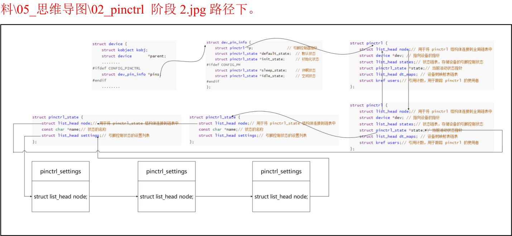

# 第126章 add_setting函数分析

```c
if (!maps_node)
    return -ENOMEM;
// 填充pinctrl_map 结构体中的maps 和num_maps 成员
maps_node->maps = maps;
maps_node->num_maps = num_maps;
// 插入到链表中
mutex_lock(&pinctrl_maps_mutex);
list_add_tail(&maps_node->node, &pinctrl_maps);
mutex_unlock(&pinctrl_maps_mutex);
return 0;
}
```
pinctrl_register_mappings ()函数核心作用是把pinctrl_maps 添加到pinctrl_maps 链表当中。到这里关于pinctrl_bind_pins()函数讲解就完成了，但分析到这里我们仍旧没有找到structpinctrl_state *default_state 和pinctrl_map 结构体是在什么地方进行的绑定，所以在下个章节我们将继续分析create_pinctrl()函数。
本章分析add_setting()函数。
在create_pinctrl() 函数中会调用add_setting() 函数。在add_setting() 函数使用了structpinctrl_state 和struct pinctrl_setting 结构体，struct pinctrl_state 结构体定义在内核源码目录下的“drivers/pinctrl/core.h”文件中，如代码清单126.1 所示。代码清单126.1
```c
struct pinctrl_state {
    struct list_head node;// 链表节点
    const char *name;// 状态对象的名称
    struct list_head settings;// 设置对象链表，包含该状态的所有设置对象
};
```
而struct pinctrl_setting 结构体定义在内核源码目录下的“drivers/pinctrl/core.h”文件中，如代码清单126.2 所示。代码清单126.2

```c
struct pinctrl_setting {
    struct list_head node;// 链表节点，
    enum pinctrl_map_type type;// 映射类型，表示设置对象的类型
    struct pinctrl_dev *pctldev;/
    const char *dev_name;// 设备名称字符串指针
    union {
        struct pinctrl_setting_mux mux;// 复用组映射类型的数据结构
        struct pinctrl_setting_configs configs;// 配置映射类型的数据结构
    } data;
};
```
create_pinctrl 函数如代码清单126.3 所示。代码清单126.3
```c
static struct pinctrl *create_pinctrl(struct device *dev,
                       struct pinctrl_dev *pctldev)
{
    struct pinctrl *p;
    const char *devname;
    struct pinctrl_maps *maps_node;
    int i;
    const struct pinctrl_map *map;
    int ret;
    p = kzalloc(sizeof(*p), GFP_KERNEL);
    if (!p)
        return ERR_PTR(-ENOMEM);
    p->dev = dev;
    INIT_LIST_HEAD(&p->states);
    INIT_LIST_HEAD(&p->dt_maps);
    ret = pinctrl_dt_to_map(p, pctldev);
    if (ret < 0) {
        kfree(p);
        return ERR_PTR(ret);
    }
    devname = dev_name(dev);
    mutex_lock(&pinctrl_maps_mutex);
    for_each_maps(maps_node, i, map) {
        if (strcmp(map->dev_name, devname))
             continue;
```

```c
if (pctldev &&
    strcmp(dev_name(pctldev->dev), map->ctrl_dev_name))
    continue;
ret = add_setting(p, pctldev, map);
if (ret == -Eprobe_DEFER) {
    pinctrl_free(p, false);
    mutex_unlock(&pinctrl_maps_mutex);
    return ERR_PTR(ret);
}
}
mutex_unlock(&pinctrl_maps_mutex);
if (ret < 0) {
    pinctrl_free(p, false);
return ERR_PTR(ret);
}
kref_init(&p->users);
mutex_lock(&pinctrl_list_mutex);
list_add_tail(&p->node, &pinctrl_list);
mutex_unlock(&pinctrl_list_mutex);
return p;
}
```
在create_pinctrl()函数第27 行使用for_each_maps 宏定义对pinctrl_map 进行了遍历，for_each_maps 宏定义定义在内核源码目录下的“drivers/pinctrl/core.h”文件中，如代码清单126.4所示。代码清单126.4
```c
// 宏定义：用于遍历pinctrl_maps 链表中的每个pinctrl_map
#define for_each_maps(_maps_node_, _i_, _map_) \
    list_for_each_entry(_maps_node_, &pinctrl_maps, node)
        for (_i_ = 0, _map_ = &_maps_node_->maps[_i_];
             _i_ < _maps_node_->num_maps; \
             _i_++, _map_ = &_maps_node_->maps[_i_])
```
在遍历过程中调用add_setting()函数，该函数如代码清单126.5 所示。代码清单126.5
```c
static int add_setting(struct pinctrl *p, struct pinctrl_dev *pctldev,
                const struct pinctrl_map *map)
{
```

```c
struct pinctrl_state *state; // 状态指针
struct pinctrl_setting *setting; // 设置指针
int ret;
// 查找状态，如果不存在则创建新的状态对象
state = find_state(p, map->name);
if (!state)
    state = create_state(p, map->name);
if (IS_ERR(state))
    return PTR_ERR(state);
// 如果映射类型为虚拟状态映射类型，直接返回
if (map->type == PIN_MAP_TYPE_DUMMY_STATE)
    return 0;
// 分配设置对象的内存空间
setting = kzalloc(sizeof(*setting), GFP_KERNEL);
if (!setting)
    return -ENOMEM;
setting->type = map->type; // 设置设置对象的映射类型
// 设置设置对象的引脚控制设备
if (pctldev)
    setting->pctldev = pctldev;
else
    setting->pctldev =
        get_pinctrl_dev_from_devname(map->ctrl_dev_name);
if(!setting->pctldev) {
    kfree(setting);
    // 如果引脚控制设备不存在，返回错误
    // 注意：不推迟探测hogs（循环依赖）
    if (!strcmp(map->ctrl_dev_name, map->dev_name))
        return -ENODEV;
    dev_info(p->dev, "unknown pinctrl device %s in map entry, deferring probe",
        map->ctrl_dev_name);
    return -Eprobe_DEFER;
}
// 设置设置对象的设备名称
setting->dev_name = map->dev_name;
switch (map->type) {
case PIN_MAP_TYPE_MUX_GROUP:
```

```c
// 对于复用组映射类型，执行引脚复用映射到设置对象的转换
ret = pinmux_map_to_setting(map, setting);
break;
case PIN_MAP_TYPE_CONFIGS_PIN:
case PIN_MAP_TYPE_CONFIGS_GROUP:
// 对于配置映射类型，执行引脚配置映射到设置对象的转换
ret = pinconf_map_to_setting(map, setting);
break;
default:
ret = -EINVAL;
break;
}
if (ret < 0) {
kfree(setting);
return ret;
}
// 将设置对象插入状态对象的设置链表末尾
list_add_tail(&setting->node, &state->settings);
return 0;
}
```
add_setting()函数核心操作如下：第8-13 行：根据pinctrl_map 的名称，使用find_state()函数在pinctrl 中查找对应的pinctrl_state，由于并没有设置状态对象，所以会进入到第二个if 判断，使用create_state()函数创建新的状态对象。create_state()函数如代码清单126.6 所示。代码清单126.6
```c
static struct pinctrl_state *create_state(struct pinctrl *p,
                   const char *name)
{
struct pinctrl_state *state;
// 为pinctrl_state 结构体分配内存
state = kzalloc(sizeof(*state), GFP_KERNEL);
if (!state)
    // 内存分配失败，返回错误指针
    return ERR_PTR(-ENOMEM);
// 设置状态的名称
state->name = name;
// 初始化状态的设置列表
```

```c
INIT_LIST_HEAD(&state->settings);
// 将状态添加到pinctrl 的状态链表中
list_add_tail(&state->node, &p->states);
return state;
}
```
create_state()函数的核心操作为创建并填充一个pinctrl_state 结构体，然后初始pinctrl_state 化结构体中的pinctrl_setting 链表头。最后将新创建的pinctrl_state 结构体添加到pinctrl 结构体的pinctrl_state 链表中。然后继续看add_setting()函数，add_setting()函数第49 和54 行调用了pinmux_map_to_setting() 函数和pinconf_map_to_setting ()函数。pinmux_map_to_setting() 函数定义在内核源码目录下的“drivers/pinctrl/pinmux.c”文件中，如代码清单126.7 所示。代码清单126.7
```c
/**
 * pinmux_map_to_setting - 将引脚映射转换为设置对象
 *
 * @map: 引脚映射结构指针
 * @setting: 引脚设置结构指针
 *
 * 返回值：0 表示转换成功，负值表示转换失败
 */
int pinmux_map_to_setting(const struct pinctrl_map *map,
                           struct pinctrl_setting *setting)
{
        struct pinctrl_dev *pctldev = setting->pctldev; // 获取引脚控制设备指针
        const struct pinmux_ops *pmxops = pctldev->desc->pmxops; // 获取引脚复用操作指针
        char const * const *groups; // 引脚复用组数组
        unsigned num_groups; // 引脚复用组数量
        int ret;
        const char *group; // 引脚复用组名称
        if (!pmxops) {
            dev_err(pctldev->dev, "does not support mux function\n");
            return -EINVAL;
        }
        // 将复用函数名称转换为选择器
        ret = pinmux_func_name_to_selector(pctldev, map->data.mux.function);
```

```c
if (ret < 0) {
    dev_err(pctldev->dev, "invalid function %s in map table\n",
            map->data.mux.function);
    return ret;
}
setting->data.mux.func = ret; // 设置设置对象的复用函数选择器
// 查询函数对应的复用组信息
ret = pmxops->get_function_groups(pctldev, setting->data.mux.func,
                                   &groups, &num_groups);
if (ret < 0) {
    dev_err(pctldev->dev, "can't query groups for function %s\n",
            map->data.mux.function);
    return ret;
}
if (!num_groups) {
    dev_err(pctldev->dev,
            "function %s can't be selected on any group\n",
            map->data.mux.function);
    return -EINVAL;
}
if (map->data.mux.group) {
    group = map->data.mux.group;
    ret = match_string(groups, num_groups, group);
    if (ret < 0) {
        dev_err(pctldev->dev,
                "invalid group \"%s\" for function \"%s\"\n",
                map->data.mux.function, group);
        return ret;
    }
} else {
    group = groups[0];
}
// 获取复用组的选择器
ret = pinctrl_get_group_selector(pctldev, group);
if (ret < 0) {
    dev_err(pctldev->dev, "invalid group %s in map table\n",
            map->data.mux.group);
    return ret;
}
setting->data.mux.group = ret; // 设置设置对象的复用组选择器
return 0;
```

```c
}
```
pinconf_map_to_setting() 函数定义在内核源码目录下的“drivers/pinctrl/pinconf.c”文件中，如代码清单126.8 所示。代码清单126.8
```c
/**
 * pinconf_map_to_setting - 将引脚配置映射转换为设置对象
 *
 * @map: 引脚映射结构指针
 * @setting: 引脚设置结构指针
 *
 * 返回值：0 表示转换成功，负值表示转换失败
 */
int pinconf_map_to_setting(const struct pinctrl_map *map,
                                struct pinctrl_setting *setting)
    {
        struct pinctrl_dev *pctldev = setting->pctldev; // 获取引脚控制设备指针
        int pin;
        switch (setting->type) {
            case PIN_MAP_TYPE_CONFIGS_PIN: // 针对单个引脚的配置
                pin = pin_get_from_name(pctldev, map->data.configs.group_or_pin); // 通过引脚名称获取
引脚号
                if (pin < 0) {
                    dev_err(pctldev->dev, "could not map pin config for \"%s\"",
                             map->data.configs.group_or_pin);
                    return pin;
                }
                setting->data.configs.group_or_pin = pin; // 设置设置对象的引脚号
                break;
            case PIN_MAP_TYPE_CONFIGS_GROUP: // 针对引脚组的配置
                pin = pinctrl_get_group_selector(pctldev, map->data.configs.group_or_pin); // 获取引脚组
的选择器
                if (pin < 0) {
                    dev_err(pctldev->dev, "could not map pin config for \"%s\"",
                             map->data.configs.group_or_pin);
                    return pin;
                }
                setting->data.configs.group_or_pin = pin; // 设置设置对象的引脚组选择器
                break;
            default:
                return -EINVAL;
        }
```

```c
setting->data.configs.num_configs = map->data.configs.num_configs; // 设置设置对象的配置数量
setting->data.configs.configs = map->data.configs.configs; // 设置设置对象的配置指针
return 0;
}
```
pinmux_map_to_setting() 函数和pinconf_map_to_setting ()函数根据不同类型进行不同的操作：如果pinctrl_map 类型为PIN_MAP_TYPE_MUX_GROUP，则将pinctrl_map 转换pinctrl_setting 结构体。如果pinctrl_map 类型为PIN_MAP_TYPE_CONFIGS_PIN 或PIN_MAP_TYPE_CONFIGS_GROUP，则将pinctrl_map 转换为pinctrl_setting 结构体.接着继续看add_setting()的第66 行代码list_add_tail(&setting->node, &state->settings)，第66 行代码将pinctrl_setting 结构体添加到了pinctrl_state 结构体的setting 链表中。在create_state()函数中将pinctrl_state 结构体添加到pinctrl 结构体的pinctrl_state 链表中。在pinctrl 结构体中又记录了dt_maps 信息，所以pinctrl_state 结构体便可以和pinctrl_map 结构体建立联系。如思维导图1.1 所示。注：该思维导图存放在网盘iTOP-RK3568 开发板\07_学习教程配套资料\03_Linux 驱动配套资

图126.1

