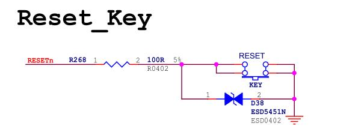
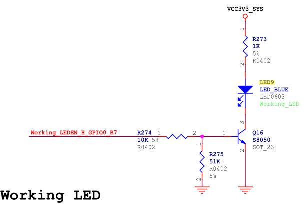
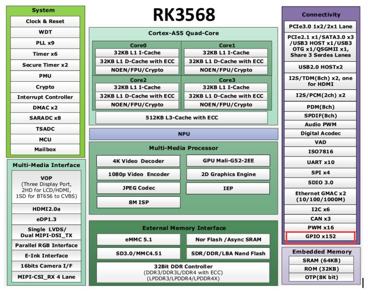
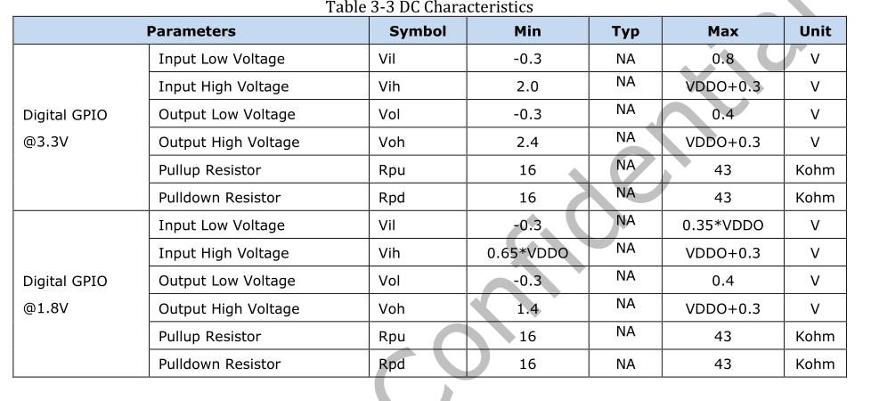
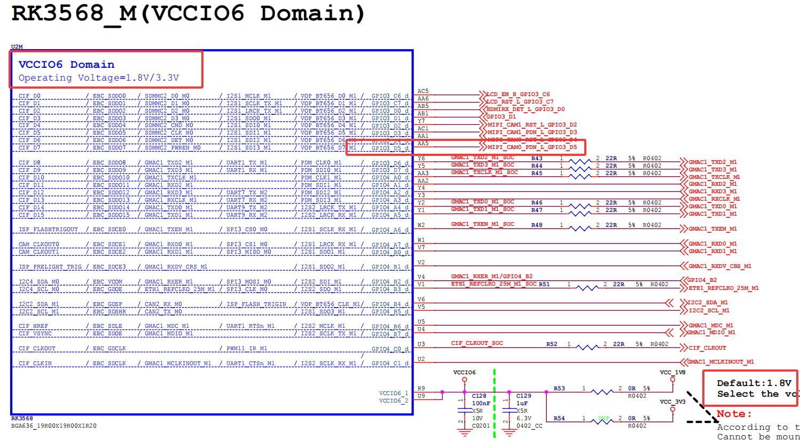
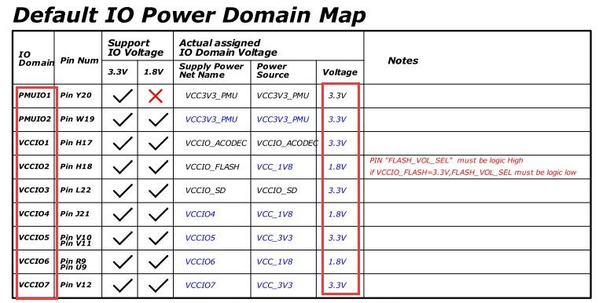
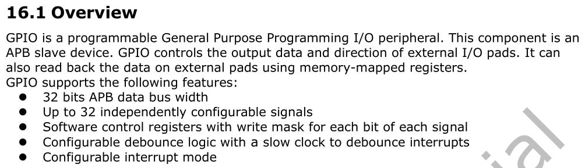

# 第128章 实验-pinctrl是什么时候设置复用的

假如要配置一个LED 外设，该LED 需要使用一个GPIO 进行亮灭的控制，那这个控制引脚需要复用成GPIO 之后才能完成相应的功能，如果使用pinctrl 设置这个gpio 的引脚复用，那pinctrl 子系统是什么时候对该引脚进行的复用呢？首先我们可以提出两种猜想，第一个猜想是在加载LED 驱动的时候进行的pinctrl 引脚复用，第二种猜想是在加载pinctrl 驱动的时候完成的引脚复用。下面对这两种猜想进行验证。1.猜想1 验证第一个猜想是在加载LED 驱动的时候进行的pinctrl 引脚复用。当LED 灯的设备树和驱动匹配之后，会执行LED 灯驱动的probe 函数，在此之前会执行“drivers/base/dd.c”文件中的reallyprobe 函数中的子函数pinctrl_bind_pins()函数会进行复用设置。2.猜想2 验证第二种猜想是在加载pinctrl 驱动的时候完成的引脚复用，因为pinctrl 子系统也符合设备模型的规范，也会执行相应的probe 函数，所以同样的加在pinctrl 驱动时也会执行“drivers/base/dd.c”文件中的really probe 函数中的子函数pinctrl_bind_pins()，那这时会进行pinctrl 管脚的复用设置吗，接下来我们对此进行深入的分析。在pinctrl 驱动的probe 函数执行之前，会按照pinctrl_bind_pins-->create_pinctrl-> pinctrl_dt_to_map 函数调用关系调用pinctrl_dt_to_map 函数。pinctrl_dt_to_map 函数如代码清单128.1 所示。代码清单128.1
```c
int pinctrl_dt_to_map(struct pinctrl *p, struct pinctrl_dev *pctldev)
{
        struct device_node *np = p->dev->of_node;// 获取引脚控制器关联设备的设备树节点
        int state, ret;
        char *propname;
        struct property *prop;
        const char *statename;
        const __be32 *list;
        int size, config;
        phandle phandle;
        struct device_node *np_config;
```

```c
/* 如果CONFIG_OF 启用，且p->dev 不是从设备树实例化而来*/
if (!np) {
    if (of_have_populated_dt())
        dev_dbg(p->dev, "no of_node; not parsing pinctrl DT\n");
    return 0;
}
/* 节点内部存储属性名称的指针*/
of_node_get(np);
/* 对于每个定义的状态ID */
for (state = 0;; state++) {
    /* 获取pinctrl-* 属性*/
    propname = kasprintf(GFP_KERNEL, "pinctrl-%d", state);
    prop = of_find_property(np, propname, &size);
    kfree(propname);
    if (!prop) {
        if (state == 0) {
            of_node_put(np);
            return -ENODEV;
        }
        break;
    }
    list = prop->value;
    size /= sizeof(*list);
    /* 判断pinctrl-names 属性是否命名了该状态*/
    ret = of_property_read_string_index(np, "pinctrl-names", state, &statename);
    /*
     * 如果未命名，则statename 仅是整数状态ID。但是，为了避免动态分配和之后要释放的
麻烦，
     * 可以直接将statename 指向属性名称的一部分。
     */
    if (ret < 0) {
        /* strlen("pinctrl-") == 8 */
        statename = prop->name + 8;
    }
    /* 对于其中的每个引用的引脚配置节点*/
    for (config = 0; config < size; config++) {
        phandle = be32_to_cpup(list++);
        /* 查找引脚配置节点*/
```

```c
np_config = of_find_node_by_phandle(phandle);
if (!np_config) {
    dev_err(p->dev, "prop %s index %i invalid phandle\n", prop->name, config);
    ret = -EINVAL;
    goto err;
}
/* 解析节点*/
ret = dt_to_map_one_config(p, pctldev, statename, np_config);
of_node_put(np_config);
if (ret < 0)
    goto err;
}
/* 如果在设备树中没有条目，则生成一个虚拟状态表条目*/
if (!size) {
ret = dt_remember_dummy_state(p, statename);
if (ret < 0)
    goto err;
}
}
return 0;
err:
pinctrl_dt_free_maps(p);
return ret;
}
```
pinctrl_dt_to_map 函数中第24-76 行代码会解析设备树中的pinctrl-x(x=0,1,2...) 和pinctrl-name 属性。但是对于pinctrl 节点本身来说，其中并没有这些属性，pinctrl-* 属性是外设节点中添加的，所以会在这里返回错误，同样的错误会一层层的向上级函数传递，最终导致pinctrl_bind_pins()函数返回错误，或者说只要在pinctrl 的probe 函数中只要调用create_pinctrl函数就不能设置引脚的复用，所以猜想2 不正确。

第129 章GPIO 入门实验
## 129.1 什么是GPIO
GPIO 的全称是General-Purpose Input/Output，即通用输入输出端口，既可以作为输入使用，也可以作为输出控制。它本质是处理器上的一个可编程引脚。。在学习linux 或单片机时，接触的第一个硬件操作往往是点亮一个LED，也就是控制GPIO的高低电平。在单片机中通常通过直接操作寄存器实现，而在linux 系统中，得益于成熟的驱动框架，我们甚至可以不用写驱动程序，直接通过命令行操作GPIO。GPIO 的典型应用包括控制LED、读取按键状态。比如按键输入，当按下按键的时候，GPIO引脚的状态会发生变化，可以通过读取GPIO 引脚的状态来检测按键事件，并进行相应的处理。按键原理图如图129.1 所示。

图129.1GPIO 可以控制LED 的状态，通过设置GPIO 引脚的输出状态，可以控制LED 的亮灭，实现指示灯、状态指示等功能。LED 原理图如图129.2 所示。


图128.2
## 129.2 GPIO 引脚分布
RK3568 有5 组GPIO，分别为GPIO0 到GPIO4。每组GPIO 又以A0 到A7、B0 到B7、C0 到C7、D0 到D7，作为区分的编号。所以RK3568 处理器上的GPIO 应该有5*4*8=160 个。但是实际上RK3568 处理器一共有152 个GPIO，如图129.3 所示，其中GPIO0_D2、GPIO0_D7、GPIO2_C7 以及GPIO4_D3~GPIO4_D7（共8 各引脚）是没有的，未在芯片中封装，因此不可用，所以是152 个GPIO。


图129.3
## 129.3 GPIO 电气属性
GPIO 电气属性以具体CPU 的数据手册为准，本节以RK3568 处理器为例，RK3568 处理器上的GPIO 可以设置为3.3V，也可以设置为1.8V，如图129.4 所示。在实际编程时，高电平（3.3V 或1.8V）用1 表示，低电平用0 表示。


图129.4那么我们如何确定RK3568 处理器的GPIO 电平是3.3V 还是1.8V 呢？具体操作方法如下：1.打开iTOP-RK3568 开发板的底板原理图，在底板原理图上查找到要确定引脚电平的网络标号。2.打开iTOP-RK3568 开发板的核心板原理图，在核心板原理图上查找在上一步骤中找到的引脚网络标号确定GPIO 对应的电源域。，假设引脚对应的电源域是VCCIO6。如图129.5 所示。

图129.53.在核心板原理图中的电源域表中查找在上一步中确定的电源域电压，即VCCIO6 电源域的电

压，图129.6 中VCCIO6 的电源域是1.8v，所以位于VCCIO6 电压域中的GPIO 电平均为1.8v。即确定GPIO 电平。

图129.6
## 129.4 GPIO 电气特性
本节以RK3568 处理器为例，打开RK3568 处理器的数据手册，找到第16.1 GPIO 章节，如图129.7 所示。

图129.7通过图129.7，即数据手册可知，GPIO 是可编程的通用引脚，除了基本的输入输出功能，还支持设置驱动强度、上下拉、中断、多功能复用等特性。涉及到的概念解释如下：驱动强度（Drive Strength）：决定GPIO 输出时所能提供的电流大小。可以选择合适的驱动强度，以确保GPIO 能够驱动所连接的外部设备或电路。上拉（Pull-up）和下拉（Pull-down）：用于设置引脚在悬空状态下的默认电平，以确保GPIO在未连接外部设备时保持稳定的默认状态。中断（Interrupt）：可配置为在电平或边沿变化时触发中断，便于对外部事件（如按键）进行响应。多功能引脚（Multipurpose Pins）：一个引脚可以复用为GPIO、PWM、I2C、SPI 等不同功

