# 第130章 GPIO控制和操作实验

能，通过软件或设备树配置选择所需功能。如何设置GPIO 的电器属性呢，以iTOP-RK3568 开发板为例，在iTOP-RK3568 开发板的SDK中通过设备树中的pinctl 节点，如图129.8 所示。
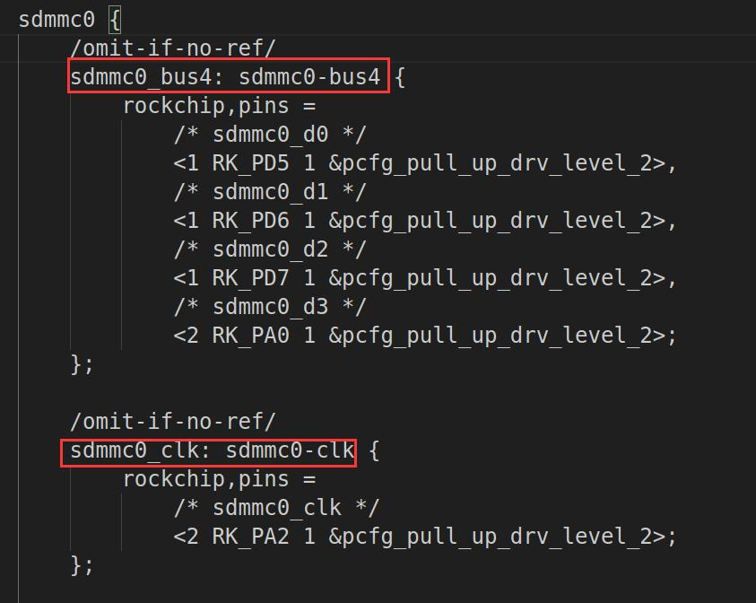
图129.8图129.8 中sdmmc0-bus4 节点中通过引用&pcfg_pull_up_drv_level_2 节点设置GPIO 引脚的上拉驱动强度等级为2。即通过pinctrl 节点可以设置GPIO 的电器属性。

GPIO 软件编程方式有多种，可以写驱动程序调用GPIO 的API 函数操作GPIO，也可以直接通过操作寄存器的方式操作GPIO，还可以通过sysfs 方式实现对GPIO 的控制。本章学习如何使用sysfs 方式实现对GPIO 的控制。
## 130.1 使用命令通过sysfs 文件系统控制GPIO
通过sysfs 文件系统控制GPIO 需要内核支持，因此第一步先配置内核。内核支持sysfs 后需要继续要控制的GPIO 对应的引脚编号。
### 130.1.1 内核配置
使用sysfs 方式控制GPIO 需要底层驱动的支持，打开内核make menuconfig 图形化配置界面，在Device Drivers->GPIO Support 路径下添加/sys/class/gpio/xxxx 配置，如图130.1 所示。
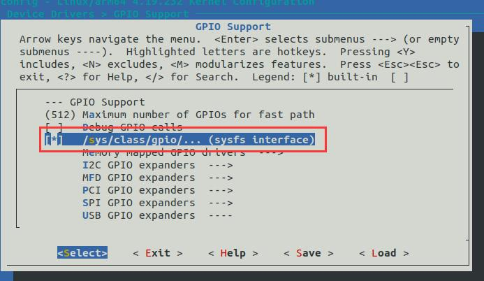
图130.1
### 130.1.2 GPIO 编号计算
引脚编号计算公式：n*32 +K*8 + x。其中n 为bank(0，1，2，3，4)，K 为group(A=0，B=1，C=2，D=3)，x 为该group 的第x（0，1，2，...，7）个引脚。以iTOP-RK3568 开发板为例，RK3568 处理器有5 组GPIO ，分别是GPIO0~GPIO4，每

组又以A0~A7、B0~B7、C0~C7、D0~D7 作为编号区分。下面演示iTOP-RK3568 开发板的LED 灯控制引脚对应的GPIO0_B7 引脚计算过程，如代码清单130.1 所示。代码清单130.1
```c
bank = 0;//GPIO0_B7=> 0, bank ∈[0,4]
group = 1;//GPIO0_B7 => 1, group ∈{(A=0), (B=1), (C=2), (D=3)}
X = 7;//GPIO4_D7 => 7, X ∈[0,7]
pin = bank*32 +group * 8 + X= 0 * 32 + 1 * 8 + 7= 15;
```
接下来以iTOP-RK3568 开发板的LED 灯控制引脚为例讲解sysyfs 控制GPIO 流程。
### 130.1.3 使用sysfs 控制接口控制GPIO 流程
sysfs 控制接口为/sys/class/gpio/export 和/sys/class/gpio/unexport，如图130.2 所示。
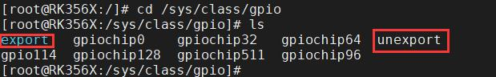
图130.2export：用于将指定编号的GPIO 引脚导出。注意export 文件是只写文件，不能读取，将一个指定的引脚编号写入到export 文件中即可将对应的GPIO 引脚导出，以GPIO0_B7 为例（引脚编号为15）使用echo 15 > export 命令即可把GPIO0_B7 进行导出，导出成功后会生成gpio15目录，如图130.3 所示。
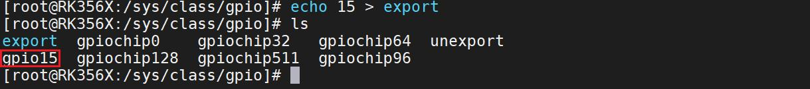
图130.3如图130.3 中的gpio15 文件夹即导出来的GPIO0_B7 引脚对应的文件夹，用于管理、控制该引脚。unexport：将导出的GPIO 引脚删除。该文件也是只写文件、不可读，使用echo 15 > unexport命令删除GPIO0_B7，删除成功如图130.4 所示。
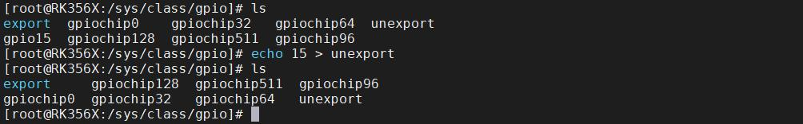
图130.4图130.4 中GPIO0_B7 对应的gpio15 目录已经被删除。需要注意的是，并不是所有GPIO 引脚都可以成功导出，如果对应的GPIO 已经被导出或者在内核中被使用了，那便无法成功导出，导出失败如图130.5 所示。

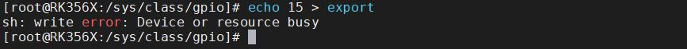
图130.5所以同学们如果直接在开发板上导出GPIO0_B7 会导出失败。因为内核中LED 子系统使用了该引脚。要解决图130.5 中这个报错需要在内核中找到使用该引脚的的驱动或节点，取消对应驱动或关闭对应节点即可解决该错误。所以需要在开发板对应的SDK 中注释掉设备树中LED 子系统对应的节点，该节点如图130.6 所示。
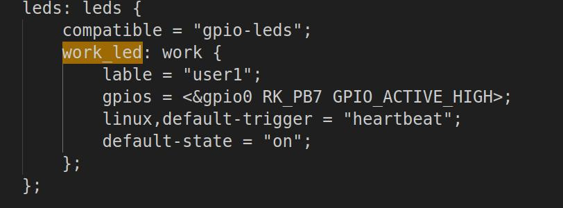
图130.6注释图130.6 中的节点后，重新编译内核源码并烧写到开发板后，再次导出GPIO0_B7 引脚即可成功，导出成功之后可以进入gpio15 目录中进行下一步操作，如图130.7 所示。
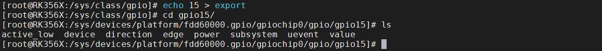
图130.7gpio15 目录下分别有active_low、device、direction、edge、power、subsystem、uevent、value八个文件，需要关心的文件是active_low、direction、edge 以及value 这四个属性文件，接下来分别介绍这四个属性文件的作用：direction：配置GPIO 引脚为输入或输出模式。该文件可读、可写。读取或写入的操作可取的值为“out”（输出模式）和“in”（输入模式）。在/sys/class/gpio/gpio15 目录下使用cat direction 命令可以查看当前是输入还是输出模式，如图130.8 所示。
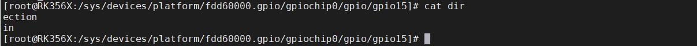
图130.8

由图130.8 看到该引脚默认为输入模式，使用echo out > direction 命令可以将模式配置为输出，配置完成如图130.9 所示。
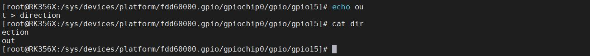
图130.9active_low：用于控制极性的属性文件，可读可写，默认情况下为0，使用cat active_low命令可以查看当前极性，如图130.10 所示。
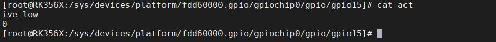
图130.10当active_low 等于0 时，value 值为1 则引脚输出高电平，value 值为0 则引脚输出低电平。当active_low 等于1 时，value 值为0 则引脚输出高电平，value 值为1 则引脚输出低电平。value：设置引脚高低电平，如果要把该引脚设置成高电平，需使用echo 1 > value 命令将value 值设置成1（active_low=0 的条件下），反之，则使用echo 0 > value 命令将value 值设置成0（active_low=0 的条件下）。设置引脚高低电平如图130.11 所示。
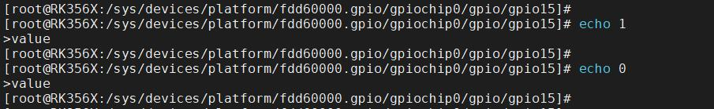
图130.11edge：控制中断的触发模式，该文件可读可写。在配置GPIO 引脚的中断触发模式之前，需将其设置为输入模式，四种触发模式的设置如代码清单130.2 所示。代码清单130.2
```c
非中断引脚：echo "none" > edge
上升沿触发：echo "rising" > edge
下降沿触发：echo "falling" > edge
边沿触发：echo "both" > edge
```
## 130.2 使用C 程序通过sysfs 文件系统控制GPIO
在上一节使用命令通过sysyfs 操作GPIO 成功的基础上，本节学习编写C 程序，使用sysfs的方式控制GPIO。
### 130.2.1 控制GPIO 输出实验
本实验代码存放在网盘iTOP-RK3568 开发板\07_学习教程配套资料\03_Linux 驱动配套资料\04_Linux 驱动程序\82_gpioctrl01 路径下。

实验要求：应用程序使用sysfs 控制GPIO 引脚输出高低电平，以此来控制LED 的亮灭。实验步骤：首先输入touch gpioctrl.c 命令来创建gpioctrl.c 文件，如图130.12 所示。

图130.12实验代码gpioctrl.c 如代码清单130.3 所示。代码清单130.3
```c
#include <stdio.h>
#include <stdlib.h>
#include <sys/types.h>
#include <sys/stat.h>
#include <fcntl.h>
#include <unistd.h>
#include <string.h>
int fd;//文件描述符
int ret;//返回值
char gpio_path[100];// GPIO 路径
int len;//字符串长度
//导出GPIO 引脚
int gpio_export(char *argv)
{
    fd = open("/sys/class/gpio/export", O_WRONLY); //打开export 文件
    if (fd < 0)
    {
        printf("open /sys/class/gpio/export error \n"); //打开文件失败
        return -1;
    }
    len = strlen(argv); //获取参数字符串的长度
    ret = write(fd, argv, len); //将参数字符串写入文件，导出GPIO 引脚
    if (ret < 0)
    {
        printf("write /sys/class/gpio/export error \n"); //写入文件失败
        return -2;
    }
    close(fd); //关闭文件
```

```c
}
//取消导出GPIO 引脚
int gpio_unexport(char *argv)
{
    fd = open("/sys/class/gpio/unexport", O_WRONLY); //打开unexport 文件
    if (fd < 0)
    {
        printf("open /sys/class/gpio/unexport error \n"); //打开文件失败
        return -1;
    }
    len = strlen(argv); //获取参数字符串的长度
    ret = write(fd, argv, len); //将参数字符串写入文件，取消导出GPIO 引脚
    if (ret < 0)
    {
        printf("write /sys/class/gpio/unexport error \n"); //写入文件失败
        return -2;
    }
    close(fd); //关闭文件
}
//控制GPIO 引脚的属性
int gpio_ctrl(char *arg, char *val)
{
    char file_path[100]; //文件路径
    sprintf(file_path, "%s/%s", gpio_path, arg); //构建文件路径
    fd = open(file_path, O_WRONLY); //打开文件
    if (fd < 0)
    {
        printf("open file_path error \n"); //打开文件失败
        return -1;
    }
    len = strlen(val); //获取参数字符串的长度
    ret = write(fd, val, len); //将参数字符串写入文件，控制GPIO 引脚的属性
    if (ret < 0)
    {
        printf("write file_path error\n"); //写入文件失败
        return -2;
    }
    close(fd); //关闭文件
}
int main(int argc, char *argv[]) //主函数
{
```

```c
sprintf(gpio_path, "/sys/class/gpio/gpio%s", argv[1]); //构建GPIO 路径，格式为“/sys/class/gpio/gpio
引脚号”
if (access(gpio_path, F_OK)) //检查GPIO 路径是否存在
{
    gpio_export(argv[1]); //不存在则导出GPIO 引脚
}
else
{
    gpio_unexport(argv[1]); //存在则取消导出GPIO 引脚
}
gpio_ctrl("direction", "out"); //配置GPIO 为输出模式
gpio_ctrl("value", argv[2]);//控制GPIO 输出高低电平
gpio_unexport(argv[1]); //最后取消导出GPIO 引脚
return 0; //返回0 表示程序正常退出
}
```
使用aarch64-linux-gnu-gcc gpioctrl.c -o gpioctrl 命令对gpioctrl.c 进行交叉编译，编译完成如图130.13 所示。
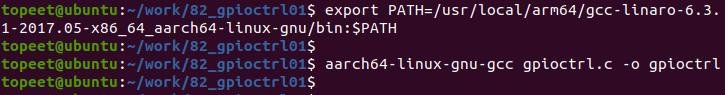
图130.13最后将交叉编译生成的gpioctrl 文件拷贝到开发板目录下运行，如图130.14 所示。
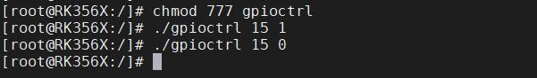
图130.14输入./gpioctrl 15 1 命令点亮LED 灯，输入./gpioctrl 15 0 命令熄灭LED 灯，如果iTOP-RK3568开发板上LED 灯点亮或者熄灭，说明实验成功。
### 130.2.2 控制GPIO 输入实验
本实验代码存储在网盘iTOP-RK3568 开发板\07_学习教程配套资料\03_Linux 驱动配套资料\04_Linux 驱动例程\83_gpioctrl02 路径下。
实验要求：通过GPIO 应用程序读取GPIO 引脚的输入电平。实验硬件连接：

使用iTOP-RK3568 开发板，将开发板背面的GPIO1_B2 引脚通过杜邦线连接到3.3v 电源或者GND 上。实验步骤：首先输入touch gpioctrl.c 命令来创建gpioctrl.c 文件，如图130.15 所示。

图130.15实验代码gpioctrl.c 如代码清单130.4 所示。代码清单130.4
```c
#include <stdio.h>
#include <stdlib.h>
#include <sys/types.h>
#include <sys/stat.h>
#include <fcntl.h>
#include <unistd.h>
#include <string.h>
int fd;// 文件描述符
int ret;// 返回值
char gpio_path[100]; // GPIO 路径
int len;// 字符串长度
char file_path[100]; // 文件路径
char buf[2];// 用于读取GPIO 值的缓冲区
// 导出GPIO 引脚
int gpio_export(char *argv)
{
    fd = open("/sys/class/gpio/export", O_WRONLY); // 打开export 文件
    if (fd < 0)
    {
        printf("open /sys/class/gpio/export error\n"); // 打开文件失败
        return -1;
    }
    len = strlen(argv);// 获取参数字符串的长度
    ret = write(fd, argv, len); // 将参数字符串写入文件，导出GPIO 引脚
    if (ret < 0)
    {
        printf("write /sys/class/gpio/export error\n"); // 写入文件失败
        return -2;
    }
```

```c
close(fd); // 关闭文件
}
// 取消导出GPIO 引脚
int gpio_unexport(char *argv)
{
fd = open("/sys/class/gpio/unexport", O_WRONLY); // 打开unexport 文件
if (fd < 0)
{
    printf("open /sys/class/gpio/unexport error\n"); // 打开文件失败
    return -1;
}
len = strlen(argv);// 获取参数字符串的长度
ret = write(fd, argv, len); // 将参数字符串写入文件，取消导出GPIO 引脚
if (ret < 0)
{
    printf("write /sys/class/gpio/unexport error\n"); // 写入文件失败
    return -2;
}
close(fd); // 关闭文件
}
// 控制GPIO 引脚的属性
int gpio_ctrl(char *arg, char *val)
{
sprintf(file_path, "%s/%s", gpio_path, arg); // 构建文件路径，格式为"gpio_path/arg"
fd = open(file_path, O_WRONLY);// 打开文件
if (fd < 0)
{
    printf("open file_path error\n"); // 打开文件失败
    return -1;
}
len = strlen(val);// 获取参数字符串的长度
ret = write(fd, val, len); // 将参数字符串写入文件，控制GPIO 引脚的属性
if (ret < 0)
{
    printf("write file_path error\n"); // 写入文件失败
    return -2;
}
close(fd); // 关闭文件
}
// 读取GPIO 引脚的值
int gpio_read_value(char *arg)
```

```c
{
    sprintf(file_path, "%s/%s", gpio_path, arg); // 构建文件路径，格式为"gpio_path/arg"
    fd = open(file_path, O_RDONLY);// 打开文件
    if (fd < 0)
    {
        printf("open file_path error\n"); // 打开文件失败
        return -1;
    }
    ret = read(fd, buf, 1); // 读取文件内容到缓冲区
    if (!strcmp(buf, "1"))
    {
        printf("The value is high\n"); // GPIO 引脚值为高电平
        return 1;
    }
    else if (!strcmp(buf,"0"))
    {
        printf("The value is low\n"); // GPIO 引脚值为低电平
        return 0;
    }
    close(fd); // 关闭文件
return -1;
}
int main(int argc, char *argv[]) // 主函数
{
    int value;
    sprintf(gpio_path, "/sys/class/gpio/gpio%s", argv[1]); // 构建GPIO 路径，格式为
"/sys/class/gpio/gpio 引脚号"
    if (access(gpio_path, F_OK))// 检查GPIO 路径是否存在
    {
        gpio_export(argv[1]); // 不存在则导出GPIO 引脚
    }
    else
    {
        gpio_unexport(argv[1]); // 存在则取消导出GPIO 引脚
    }
    gpio_ctrl("direction", "in");// 配置GPIO 为输入模式
    value = gpio_read_value("value");// 读取GPIO 引脚的值
    printf("The value is %d\n", value); // 打印读取的GPIO 引脚的值
    gpio_unexport(argv[1]);// 最后取消导出GPIO 引脚
```

```c
return 0; // 返回0 表示程序正常退出
}
```
使用aarch64-linux-gnu-gcc gpioctrl.c -o gpioctrl 命令对gpioctrl.c 进行交叉编译，编译完成如图130.16 所示。
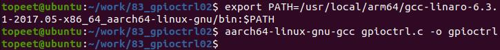
图130.16将交叉编译生成的gpioctrl 文件拷贝到开发板上。为了测试输入的是高电平，作者使用了杜邦线将开发板背面的3.3V 接到了GPIO1_B2 引脚上，然后使用./gpioctrl 42 命令运行应用程序读取引脚电平，42 为GPIO1_B2 对应的引脚编号，如图130.17 所示。
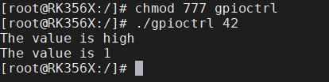
图130.17由图130.17 可以看到GPIO1_B2 引脚打印的value 值为高，所以读取GPIO1_B2 引脚状态成功。同理，我们将GPIO1_B2 引脚接到开发板背面对应的GND 上，再次运行程序，如图130.18所示。
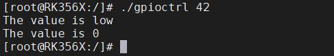
图130.18由图130.18 可以看到GPIO1_B2 引脚对应的value 值为0，所以GPIO 的状态打印正确。至此GPIO 输入应用程序在开发板的测试就完成了。
## 130.3 使用C 程序通过sysfs 文件系统使用GPIO 中断
本实验代码存储在网盘iTOP-RK3568 开发板\07_学习教程配套资料\03_Linux 驱动配套资料\04_Linux 驱动例程\84_gpioctrl03 路径下。实验要求：本实验将GPIO 中断触发方式设置为边沿触发，每当触发中断会打印value 的值，即引脚电平的值。

### 130.3.1 编写应用程序
实验步骤：首先输入touch gpioctrl.c 命令来创建gpioctrl.c 文件，如图130.19 所示。

图130.19实验代码gpioctrl.c 如代码清单130.5 所示。代码清单130.5
```c
#include <stdio.h>
#include <stdlib.h>
#include <sys/types.h>
#include <sys/stat.h>
#include <fcntl.h>
#include <unistd.h>
#include <string.h>
#include <poll.h>
int fd;//文件描述符
int ret;//返回值
char gpio_path[100]; // GPIO 路径
int len;//字符串长度
char file_path[100]; //文件路径
char buf[2];//缓冲区
struct pollfd fds[1]; // poll 结构体数组
//导出GPIO 引脚
int gpio_export(char *argv)
{
    fd = open("/sys/class/gpio/export", O_WRONLY); //打开export 文件
    if (fd < 0)
    {
        printf("open /sys/class/gpio/export error \n"); //打开文件失败
        return -1;
    }
    len = strlen(argv);//获取字符串长度
    ret = write(fd, argv, len); //写入引脚号到export 文件
    if (ret < 0)
    {
```

```c
printf("write /sys/class/gpio/export error \n"); //写入失败
return -2;
}
close(fd); //关闭文件
}
//取消导出GPIO 引脚
int gpio_unexport(char *argv)
{
fd = open("/sys/class/gpio/unexport", O_WRONLY); //打开unexport 文件
if (fd < 0)
{
printf("open /sys/class/gpio/unexport error \n"); //打开文件失败
return -1;
}
len = strlen(argv);//获取字符串长度
ret = write(fd, argv, len); //写入引脚号到unexport 文件
if (ret < 0)
{
printf("write /sys/class/gpio/unexport error \n"); //写入失败
return -2;
}
close(fd); //关闭文件
}
//控制GPIO 引脚的属性
int gpio_ctrl(char *arg, char *val)
{
sprintf(file_path, "%s/%s", gpio_path, arg); //构建属性文件的路径
fd = open(file_path, O_WRONLY);//打开属性文件
if (fd < 0)
{
printf("open file_path error \n"); //打开文件失败
return -1;
}
len = strlen(val);//获取字符串长度
ret = write(fd, val, len); //写入属性值到属性文件
if (ret < 0)
{
printf("write file_path error\n"); //写入失败
return -2;
}
close(fd); //关闭文件
}
```

```c
//监听GPIO 引脚的中断事件
int gpio_interrupt(char *arg)
{
    sprintf(file_path, "%s/%s", gpio_path, arg); // 构建文件路径
    fd = open(file_path, O_WRONLY);//打开文件
    if (fd < 0)
    {
        printf("open file_path error \n"); //打开文件失败
        return -1;
    }
    memset((void *)fds, 0, sizeof(fds)); // 清空poll 结构体数组
    fds[0].fd = fd;//设置poll 结构体的文件描述符
    fds[0].events = POLLPRI;//设置poll 结构体的事件类型为POLLPRI，表示有紧急数据可读
    read(fd, buf, 2); //读取文件内容，清除中断事件
    ret = poll(fds, 1, -1); //调用poll 函数等待中断事件发生，阻塞直到事件发生
    if (ret <= 0)
    {
        printf("poll error \n"); //调用poll 失败或超时
        return -1;
    }
    if (fds[0].revents & POLLPRI)
    {
        lseek(fd, 0, SEEK_SET); //重新定位文件指针到文件开头
        read(fd, buf, 2);//读取文件内容，获取中断事件的值
        buf[1] = '\0';
        printf("value is %s\n", buf); //输出中断事件的值
    }
}
//读取GPIO 引脚的值
int gpio_read_value(char *arg)
{
    sprintf(file_path, "%s/%s", gpio_path, arg); //构建文件路径
    fd = open(file_path, O_WRONLY); //打开文件，以只写模式打开是一个错误，应该使用只读模式
    if (fd < 0)
    {
        printf("open file_path error\n"); //打开文件失败
        return -1;
    }
    ret = read(fd, buf, 1); //读取文件内容，获取引脚的值
    if (!strcmp(buf, "1"))
```

```c
{
    printf("The value is high\n"); //引脚值为高电平
}
else if (!strcmp(buf, "0"))
{
    printf("The value is low\n"); //引脚值为低电平
}
return -1;
close(fd);
}
int main(int argc, char *argv[]) //主函数
{
int value;
sprintf(gpio_path, "/sys/class/gpio/gpio%s", argv[1]); //构建GPIO 路径
if (access(gpio_path, F_OK))//检查GPIO 路径是否存在
{
    gpio_export(argv[1]); //不存在则导出GPIO 引脚
}
else
{
    gpio_unexport(argv[1]); //存在则取消导出GPIO 引脚
}
gpio_ctrl("direction", "in"); //设置GPIO 引脚为输入模式
gpio_ctrl("edge", "both");//设置GPIO 引脚的中断触发方式为上升沿和下降沿
gpio_interrupt("value");//监听GPIO 引脚的中断事件
gpio_unexport(argv[1]); //最后取消导出GPIO 引脚
return 0; //返回0 表示程序正常退出
}
```
使用aarch64-linux-gnu-gcc -o demo64_interrupt demo64_interrupt.c 命令对gpioctrl.c 进行交叉编译，编译完成如图130.20 所示。
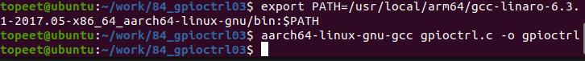
图130.20最后将交叉编译生成的gpioctrl 文件拷贝到开发板中。

### 130.3.2 开发板测试
使用杜邦线先把杜邦线一端连接开发板背面的GPIO1_B2 引脚，然后输入./gpioctrl 42&命令运行程序。由于中断并没有被触发，所以程序会阻塞，然后把杜邦线的另一端连接到开发板背面GPIO座子中3.3V 引脚上，进而触发中断，如果打印value 值为1，说明实验成功，如图130.21 所示。
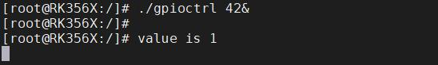
图130.21
## 130.4 使用io 命令操作寄存器控制GPIO
### 130.4.1 io 命令
io 命令是Linux 系统中一个用于访问I/O 端口或内存地址的命令。通过该命令，可以在用户空间对物理地址执行读写操作。该命令的基本语法如下（以下参数并不是都要用到，按需选择参数即可）：io [-v] [-1|-2|-4] [-r|-w] [-l <len>] [-f <file>] <addr> [<value>]具体参数介绍如下：参数含义-v启用verbose 模式，执行前要求用户确认（避免误操作）-1 -2 -4设置访问宽度，分别表示访问1 字节、2 字节、4 字节-r执行读操作（默认）-w执行写操作（若指定<value>也隐含是写操作）-l <len>访问长度，单位为字节（可配合-r 读取多个地址）-f <file>与内存读写结合使用：从文件读取数据写入内存，或将内存数据写入文件<addr>要访问的物理地址（十六进制格式，如0x1000）<value>要写入的十六进制数值（仅用于写操作）以下是使用io 命令的示例：1. 读取一个字节的值：io 0x1000读取地址0x1000 处的一个字节数据。2. 写入一个字节：io 0x1000 0x5A向地址0x1000 写入值0x5A（默认以字节写）。3. 读取8 个字（16 位）数据：io -2 -l 16 0x2000

从地址0x2000 开始读取16 字节，即8 个word（每个2 字节）4. 读取100 字节并保存至文件：io -r -f dump.bin -l 100 0x3000从地址0x3000 开始读取100 字节数据，并保存到dump.bin 文件中。5. 从文件写入内存：io -w -f data.img 0x4000将文件data.img 的全部内容写入内存地址0x4000 开始的位置。6. 以4 字节对齐方式写入一个值：io -4 0x5000 0xDEADBEEF向地址0x5000 写入双字（4 字节）数据0xDEADBEEF。
### 130.4.2 通过寄存器操作LED 灯
上的LED，接下来打开RK3568 处理器的参考手册part1。参考手册part1 存储在网盘
#### 130.4.2.1 确定复用寄存器
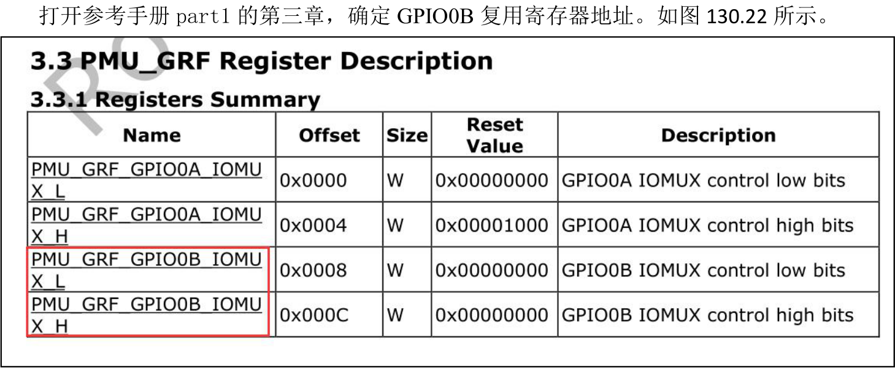
图130.22
通过图130.22 可知GPIO0B 的复用寄存器为PMU_GRF_GPIO0B_IOMUX_H 和PMU_GRF_GPIO0B_IOMUX_L，偏移地址分别为0x000c 和0x0008。
GPIO0B_7 引脚复用控制位于复用寄存器PMU_GRF_GPIO0B_IOMUX_H 上，如图130.23所示。GPIO0B_7 可以通过控制PMU_GRF_GPIO0B_IOMUX_H 寄存器的[14:12]位来选择复用为哪个功能，因为要控制LED ，所以要把该引脚设置为gpio 功能。接下来确定PMU_GRF_GPIO0B_IOMUX_H 复用寄存器地址。

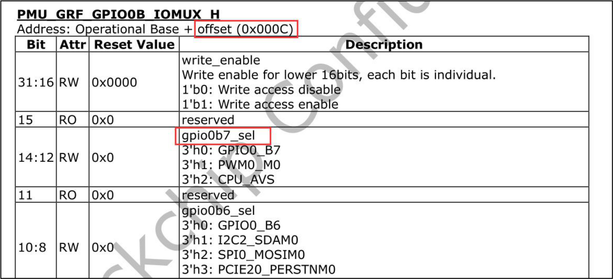
图130.23
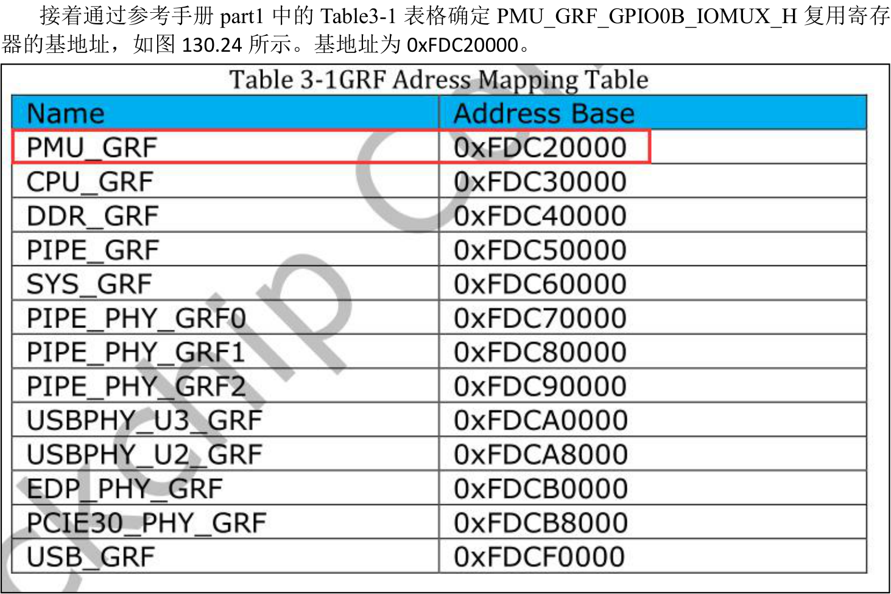
图130.24PMU_GRF_GPIO0B_IOMUX_H 复用寄存器地址=基地址+偏移地址=0xFDC2000C 。使用io-r -4 0xFDC2000C 命令查看此寄存器的值，如图130.25 所示。

图130.25

如图130.25 所示，寄存器值为00000001，[14:12]位为000，如图130.26 所示，所以默认GPIO0B_7 设置的为gpio 功能。因此无需再次设置。
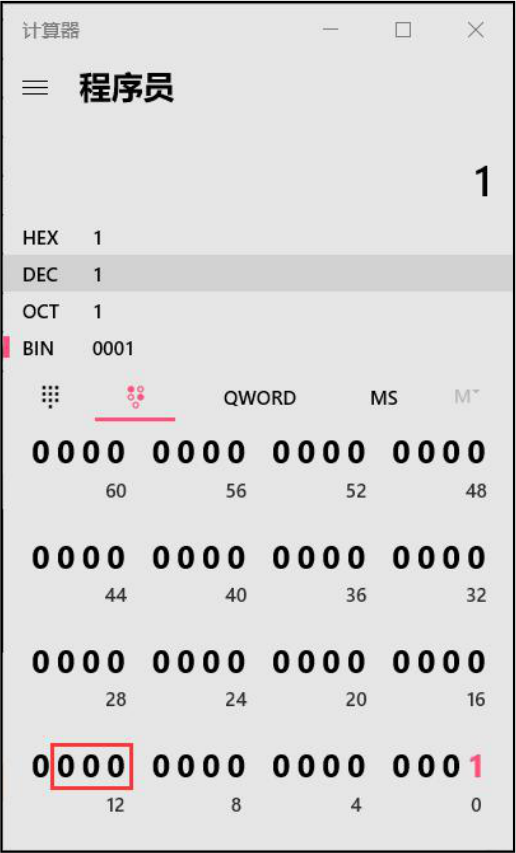
图130.26
#### 130.4.2.2 确定方向寄存器
对iTOP-RK3568 开发板上的LED 操作需要将GPIO0_B7 引脚设置为输出。打开参考手册part1的第16 章节，确定方向寄存器，如图130.27 所示。

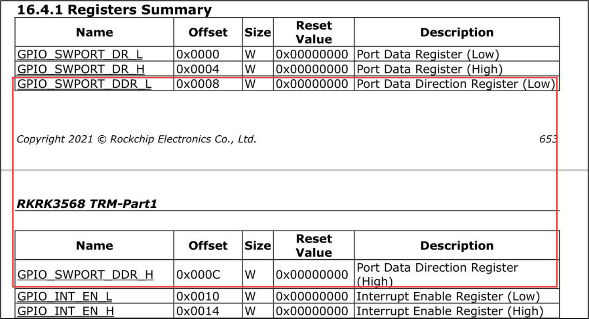
图130.27GPIO 有四组分别是GPIOA，GPIOB，GPIOC，GPIOD，每组又以A0~A7, B0~B7, C0~C7,D0~D7 作为编号区分。其中每组GPIO 的A0~B7 在GPIO_SWPORT_DDR_L 上，C0~D7 在GPIO_SWPORT_DDR_H 上。所以GPIO0_B7 在GPIO_SWPORT_DDR_L 上，因此方向寄存器
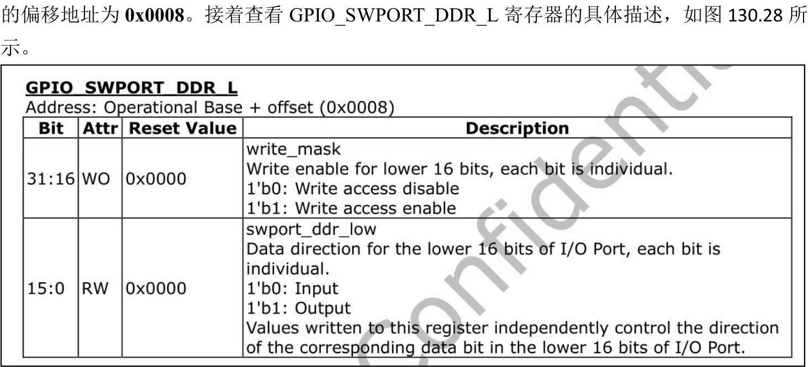
图130.28如图130.28 所示，GPIO_SWPORT_DDR_L 寄存器为32 位宽，其中[15:0]是数据方向控制低位，每一位对应一个GPIO 引脚（A0~B7 一个16 个引脚），对应位写入1 表示配置为输出模式，写入0 表示配置为输入模式。[31:16]是写使能掩码区，写入1 表示对应的低16 位设置将生效，否则写操作无效。

例如，如果我们希望将GPIO0_B7 配置为输出模式，需要设置该引脚对应的方向位（低16位的第15 位）为1，同时对应的写使能位（高16 位的第15 位）也必须写入1 配置才生效。如果要配置为输入，需将低16 位的对应位写为0，高位的写使能仍需设为1 配置才生效。打开参考手册part1 的1.1 小节Address Mapping 确定GPIO0 寄存器的基地址。如图130.29
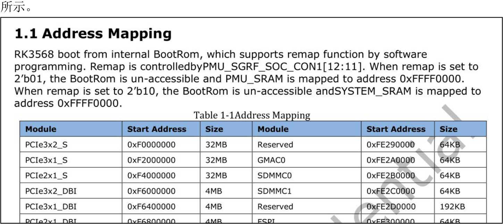
图130.29
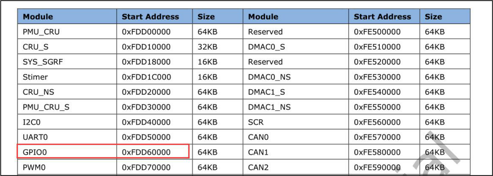
图130.30图130.30 中GPIO0 的基地址为0xFDD60000。因此方向寄存器的地址=基地址+偏移地址=0xFDD60000+0x0008=0xFDD60008。然后使用io -r -4 0xFDD60008 命令查看该寄存器的值，如图130.31 所示。
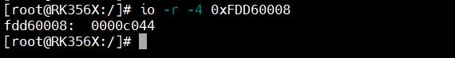
图130.31如图130.32 所示，第15 位默认为1，因此GPIO0_B7 默认为输出。无需额外进行设置。

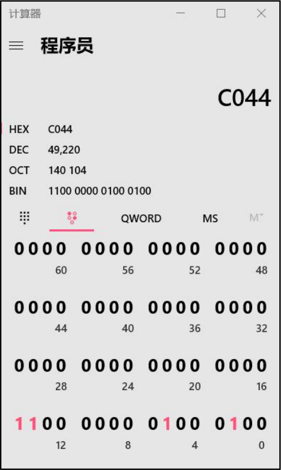
图130.32
#### 130.4.2.3 设置数据寄存器
通过设置GPIO0_B7 对应的数据寄存器，可以控制GPIO0_B7 输出高电平或者低电平，打
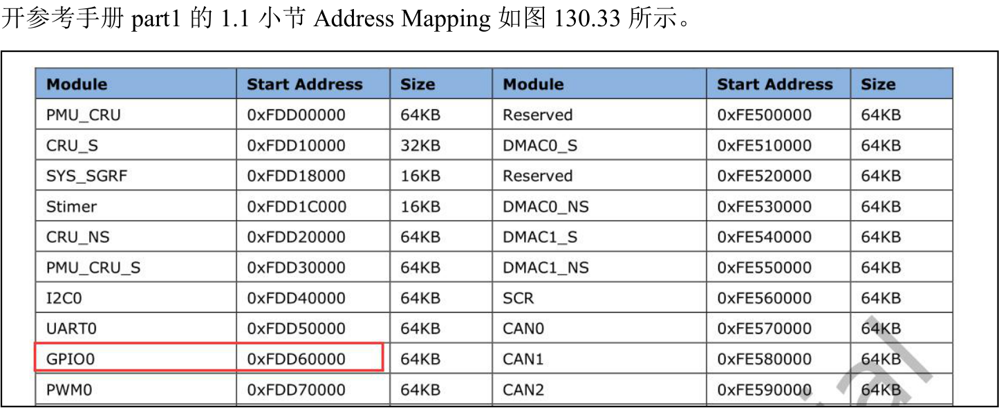
图130.33如图130.33 所示，GPIO0 的基地址为0xFDD60000，然后打到16.4.1 章节，数据寄存器的偏移地址如图130.34 所示。

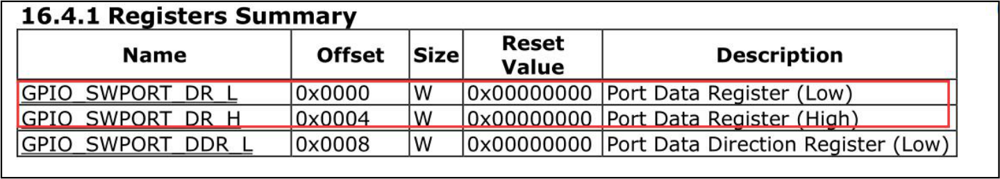
图130.34因为GPIO0_B7 引脚数据是通过GPIO_SWPORT_DR_L 数据寄存器控制，所以对应的数据寄存器的地址为基地址+偏移地址=0xFDD60000。使用io -r -4 0xFDD60000 命令查看地址的值，如图130.35 所示。GPIO_SWPORT_DR_L 数据寄存器默认值为0000c40。
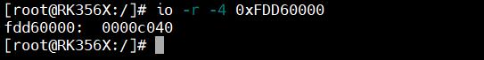
图130.35
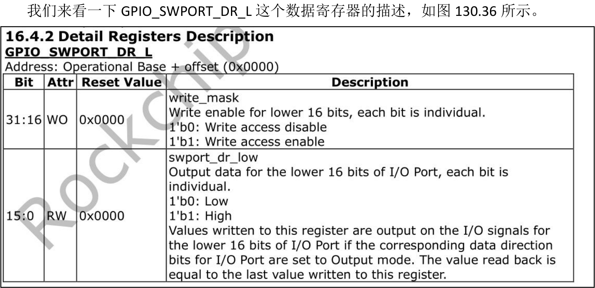
图130.36图130.36 的分析方法与分析方向寄存器的方法同理，如果要控制第15 位为1 或者0（即控制GPIO0_B7 引脚输出高电平或低电平），需要同时设置31 位使能位为1，因此在点亮LED灯时需要向数据寄存器写入0x8000c040，如图130.37 所示。

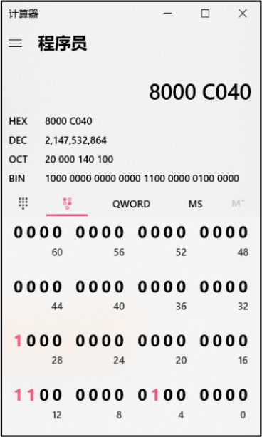
图130.37如果要熄灭LED，需要向数据寄存器中写入0x80004040，如图130.38 所示。
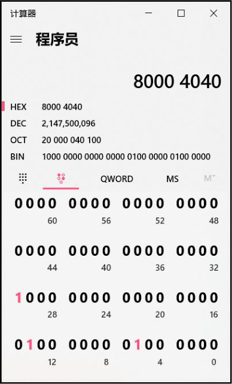
图130.38确定好寄存器地址和要往寄存器中写入的值后，接下来使用io 命令操作寄存器控制LED灯亮灭。
### 130.4.3 IO 命令点灯测试
因为GPIO0_B7 引脚默认是GPIO 模式，所以无需设置复用寄存器，先使用io -w -40xFDD60008 0x80008044 命令将方向寄存器设置为输出。接下来设置数据寄存器使GPIO0_B7引脚输出高电平或者低电平，首先查看数据寄存器的值，输入io -r -4 0xFDD60000 命令，如图130.39 所示。数据寄存器的值为0x00004040，在这个值的基础上对GPIO0_B7 引脚的数据寄存器进行设置。

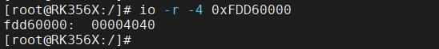
图130.39给数据寄存器写入0x80008040 输出高电平，此时LED 灯亮。io -w -4 0xFDD60000 0x8000c040给数据寄存器写入0x80008040 输出高电平，此时LED 灯灭。io -w -4 0xFDD60000 0x80004040
## 130.5 通过mem 设备控制GPIO
本节学习通过mem 设备控制GPIO。
### 130.5.1 /dev/mem 设备介绍
/dev/mem 是Linux 系统中的一个虚拟设备，通常与mmap 结合使用，可以将设备的物理内存映射到用户态，以实现用户空间对内核态的直接访问。无论是标准Linux 系统还是嵌入式Linux 系统，都支持使用/dev/mem 设备。然而，直接访问内核空间是一项潜在危险的操作，因此只有root 用户才能访问/dev/mem设备。此外有些系统可能需要单独启动/dev/mem 设备的功能。配置启动/dev/mem 设备方法如下所示：打开Linux 内核源码make menuconfi 界面，配置Device Drivers --->Character devices--->[*]/dev/mem virtual device support 选项，如图130.40 所示。

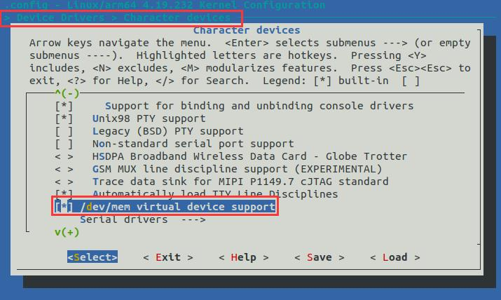
图130.40在上一小节中，我们讲解了io 命令，io 命令实际上就是基于/dev/mem 设备实现的。因此如果Linux 内核源码没有配置支持/dev/mem，io 命令是不能使用的。反之如果io 命令可以用，内核则配置并支持了/dev/mem。
### 130.5.2 /dev/mem 设备的使用方法
使用/dev/mem 设备需要具有root 权限，并且谨慎操作，因为直接访问内核空间是一项潜在的危险操作。以下是使用/dev/mem 设备的基本步骤：步骤一：打开/dev/mem 文件使用open()函数打开/dev/mem 文件描述符，并指定访问权限和阻塞方式。int fd = 0;fd = open("/dev/mem", O_RDWR | O_NDELAY);//以读写权限，非阻塞方式打开也可以根据具体需求使用O_RDONLY（只读）或O_WRONLY（只写）等标志。步骤二：使用mmap()映射物理地址使用mmap()函数将需要访问的物理地址与/dev/mem 文件描述符建立映射。mmap()函数将返回一个指向映射内存区域的指针。char *mmap_addr = NULL;mmap_addr = (char *)mmap(NULL, MMAP_SIZE, PROT_READ | PROT_WRITE, MAP_SHARED, fd,MMAP_ADDR);

在这里，使用mmap()函数将物理内存地址映射到mmap_addr 指针所指向的内存区域。MMAP_SIZE 表示映射的大小，PROT_READ | PROT_WRITE 表示访问权限为读写，MAP_SHARED表示共享映射，fd 是之前打开的/dev/mem 文件描述符，MMAP_ADDR 是要映射的物理地址。步骤三：访问映射地址（读写寄存器）对映射的地址进行访问，即对寄存器进行读写操作。int a = 0;*(int *)mmap_addr = 0xff; // 写入数据到寄存器a = *(int *)mmap_addr; // 读取寄存器数据这里将mmap_addr 强制转换为int *类型指针，执行读写操作。*(int *)mmap_addr = 0xff表示向寄存器写入0xff。a = *(int *)mmap_addr 表示从寄存器读取数据到变量a。通过上述三个步骤，我们就可以使用/dev/mem 设备。接下来我们来了解下mmap()函数。
### 130.5.3 mmap 函数
mmap 函数解释如下所示：函数原型：void* mmap(void* start,size_t length,int prot,int flags,int fd,off_t offset);函数参数：start: 指向要映射到的内存起始地址，通常设置为NULL，表示让系统自动选择地址。映射成功返回该地址。length: 表示要映射的内存大小。prot: 映射区域的参数。可取如下几个值：PROT_READ(映射区域可读)、PROT_EXEC(映射区域可执行)、PROT_WRITE(映射区域可写)、PROT_NONE(映射区域不可访问)。flags: 映射区域的各种特性，可以有以下几种参数：MAP_SHARED，MAP_PRIVATE，MAP_FIXED，其中MAP_SHARED 和MAP_PRIVATE 必选其一。fd: 要映射到内存中的文件描述符。offset: 文件映射的偏移量，offset 的大小必须是页的整数倍，如果设备为0 代表从文件最前方开始映射。函数返回值：成功返回映射到内存区域的实际地址，失败返回值小于0。

### 130.5.4 LED 灯实验
本实验代码存储在网盘iTOP-RK3568 开发板\07_学习教程配套资料\03_Linux 驱动配套资料\04_Linux 驱动例程\85_gpioctrl04 路径下。实验要求：编写通过mem 设备控制LED（GPIO）的应用程序从而实现LED 闪烁的效果。实验硬件连接：使用迅为iTOP-RK3568 开发板上的用户灯LED9。实验步骤：首先输入touch gpioctrl.c 命令来创建gpioctrl.c 文件，如图130.41 所示。

图130.41实验代码gpioctrl.c 如代码清单130.6 所示。代码清单130.6
```c
#include <stdio.h>
#include <stdlib.h>
#include <sys/types.h>
#include <sys/stat.h>
#include <fcntl.h>
#include <unistd.h>
#include <string.h>
#include <sys/mman.h>
#define GPIO_REG_BASE 0xFDD60000
#define GPIO_SWPORT_DDR_L_OFFSET 0x0008
#define GPIO_SWPORT_DR_L_OFFSET 0x0000
#define SIZE_MAP 0x1000
//打开LED 灯
void LED_ON(unsigned char *base)
{
    // 设置LED 灯的方向为输出
    *(volatile unsigned int *)(base + GPIO_SWPORT_DDR_L_OFFSET) = 0x80008044;
    // 将LED 灯打开
    *(volatile unsigned int *)(base + GPIO_SWPORT_DR_L_OFFSET) = 0x80008040;
}
```

```c
//关闭LED 灯
void LED_OFF(unsigned char *base)
{
    // 设置LED 灯的方向为输出
    *(volatile unsigned int *)(base + GPIO_SWPORT_DDR_L_OFFSET) = 0x80008044;
    // 将LED 灯关闭
    *(volatile unsigned int *)(base + GPIO_SWPORT_DR_L_OFFSET) = 0x80000040;
}
int main(int argc, char *argv[])
{
    int fd;
    unsigned char *map_base;
    // 打开/dev/mem 设备
    fd = open("/dev/mem", O_RDWR);
    if (fd < 0)
    {
        printf("open /dev/mem error \n");
        return -1;
    }
    //将物理地址映射到用户空间
    map_base = (unsigned char *)mmap(NULL, SIZE_MAP, PROT_READ | PROT_WRITE, MAP_SHARED, fd,
GPIO_REG_BASE);
    if (map_base == MAP_FAILED)
    {
        printf("map_base error \n");
        return -2;
    }
    while (1)
    {
        //打开LED 灯
        LED_ON(map_base);
        //等待1 秒
        usleep(1000000);
        //关闭LED 灯
        LED_OFF(map_base);
        //等待1 秒
        usleep(1000000);
    }
```

