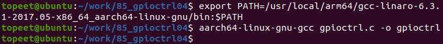
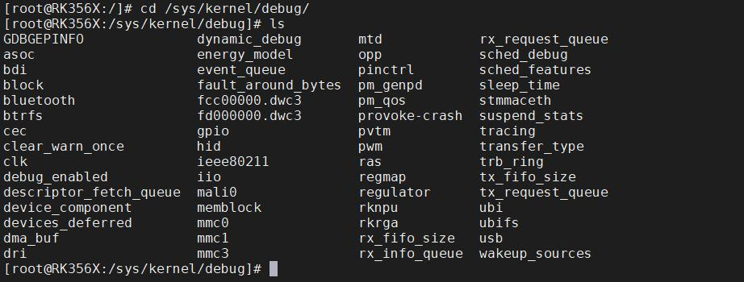
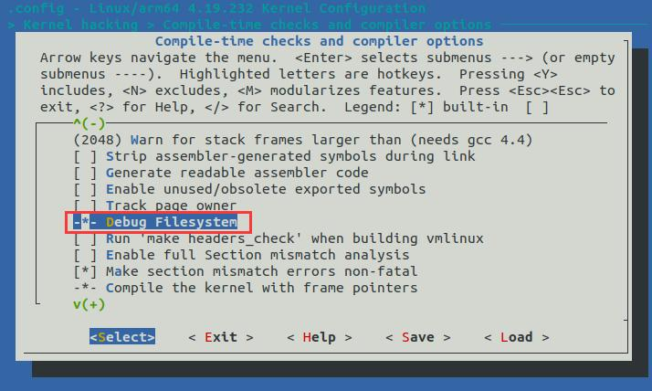
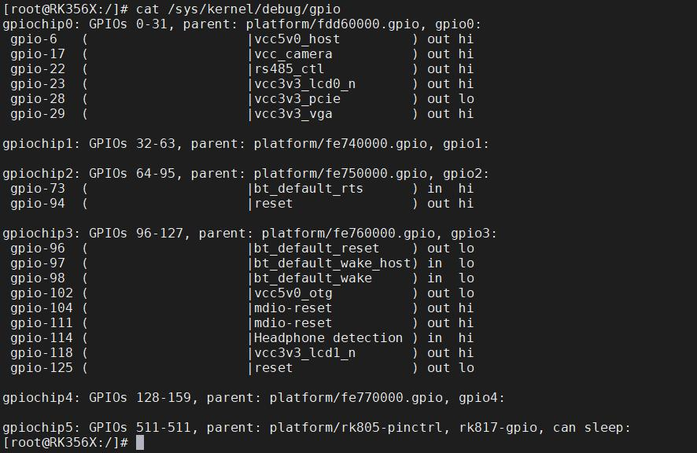
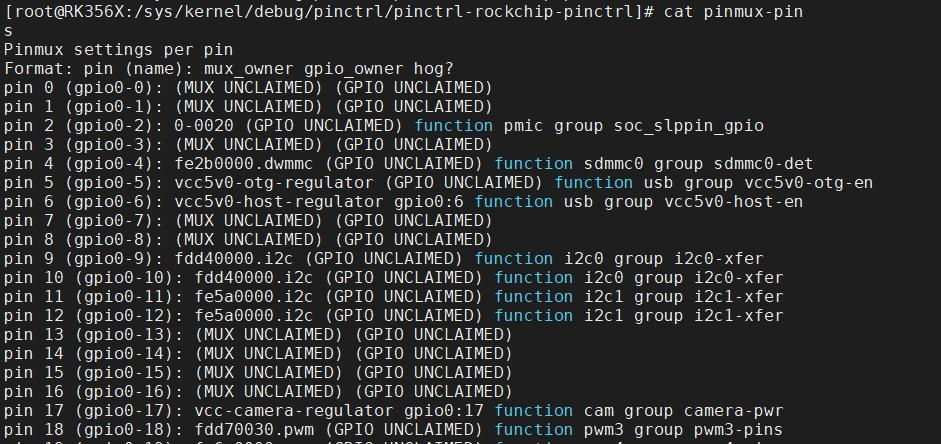
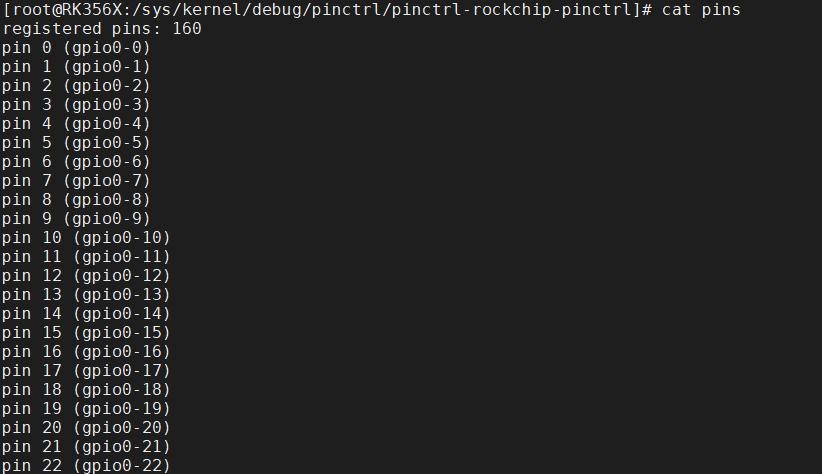
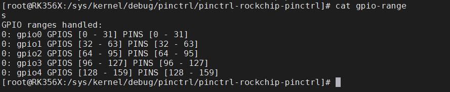
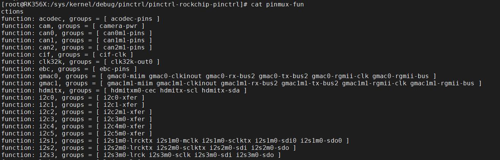
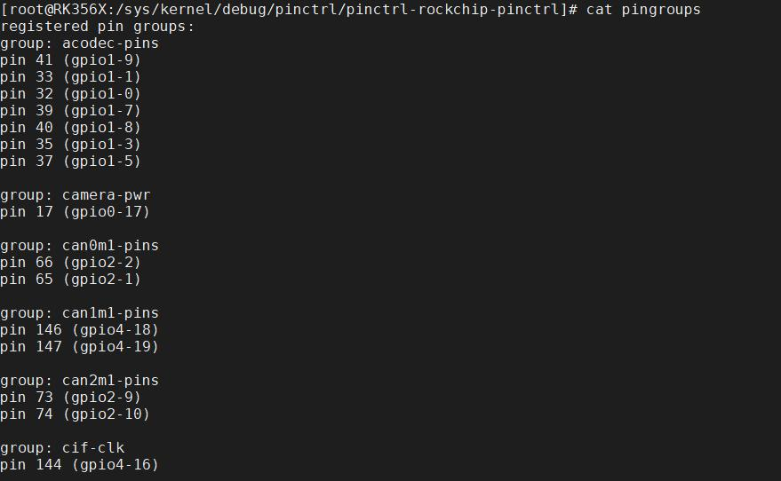
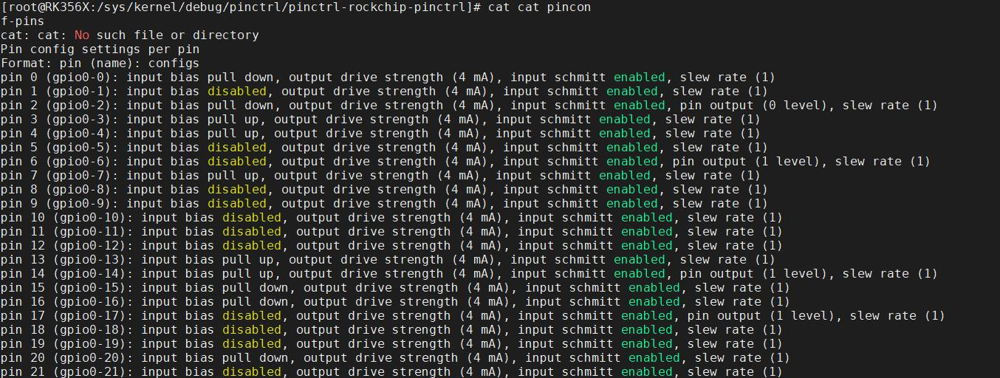

# 第131章 GPIO的调试方法

```c
//解除映射
munmap(map_base, SIZE_MAP);
//关闭文件描述符
close(fd);
return 0; // 返回0 表示程序正常退出
}
```
使用aarch64-linux-gnu-gcc gpioctrl.c -o gpioctrl 命令对gpioctrl.c 进行交叉编译，编译完成如图130.42 所示。

图130.42将交叉编译生成的gpioctrl 文件拷贝到开发板目录下，使用chmo 777 gpioctrl 命令将可执行程序权限修改为777，接着使用./gpioctrl 15 命令运行可执行程序，如图130.43 所示。

图130.43程序运行之后，如实验成功开发板上的用户灯LED 则会闪烁。
本章学习GPIO 的调试方法。
## 131.1 debugfs 介绍
debugfs 是Linux 内核提供的一个调试文件系统，通过debugfs 文件系统查看/sys/kernel/debug/目录下的相关文件，可以获取GPIO 的状态，配置和其他调试信息。如图131.1所示。


图131.1如果系统启动后没有debugfs 目录，可以使用mount -t debugfs none /sys/kernel/debug/命令进行挂载。如果有/sys/kernel/debug 目录但是目录下没有文件，需要在Linux 内核配置debugfs 支持，如图131.2 所示。

图131.2131.1 方法一使用cat /sys/kernel/debug/gpio 命令可以查看GPIO 的信息，如图131.3 所示。


图131.3图131.3 中显示了GPIO 的使用信息，如gpio-6 被用作vcc5v0_host，方向为输出且输出高电平。
## 131.2 方法二
在/sys/kernel/debug/pinctrl 目录下通常会有以下文件和目录：1. /sys/kernel/debug/pinctrl/*/pinmux-pins 目录该目录下列出了每个GPIO 引脚的引脚复用配置。你可以查看每个引脚的功能模式、引脚复用选择以及其他相关的配置信息。进入到/sys/kernel/debug/pinctrl/pinctrl-rockchip-pinctrl/路径下面，输入cat pinmux-pins 命令可以查看引脚被复用成了哪种功能，如图131.4 所示。


图131.42. /sys/kernel/debug/pinctrl/*/pins 目录该目录下列出了GPIO 的引脚编号，可以查看GPIO 对应的引脚编号编号，从而无需使用公式自行计算GPIO 编号。进入到/sys/kernel/debug/pinctrl/pinctrl-rockchip-pinctrl/下面，使用cat pins 命令查看GPIO 对应的引脚编号，如图131.5 所示。

图131.53. /sys/kernel/debug/pinctrl/*/gpio-ranges 目录

该目录下列出了每个GPIO控制器支持的GPIO范围。进入到/sys/kernel/debug/pinctrl/pinctrl-rockchip-pinctrl/下面，使用cat gpio-ranges 命令查看GPIO 范围，如图131.6 所示。

图131.64./sys/kernel/debug/pinctrl/*/pinmux-functions 目录该目录下列出了每个功能模式的名称以及与对应的GPIO 引脚。进入到/sys/kernel/debug/pinctrl/pinctrl-rockchip-pinctrl/下面，输入cat pinmux-functions 命令可以看到每个功能对应的引脚，如图131.7 所示。

图131.75. /sys/kernel/debug/pinctrl/*/pingroups 目录该目录下提供有关用于配置和控制系统上的GPIO 引脚的引脚组的信息。进入到/sys/kernel/debug/pinctrl/pinctrl-rockchip-pinctrl/下面，使用cat pingroups 可以查看引脚组的信息，如图131.8 所示。


图131.86. /sys/kernel/debug/pinctrl/*/pinconf-pins 目录该目录包含了GPIO 引脚的配置信息，如输入/输出模式、上拉/下拉设置等。进入到/sys/kernel/debug/pinctrl/pinctrl-rockchip-pinctrl/下面，输入cat pinconf-pins 命令可以查看引脚配置信息，如图131.9 所示。

图131.9

