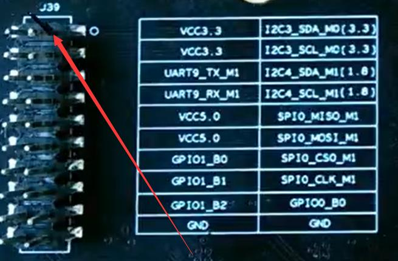
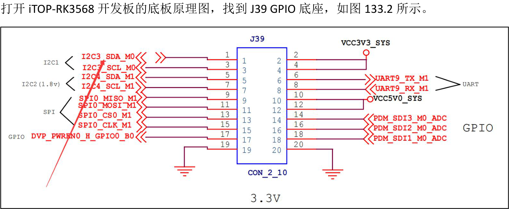
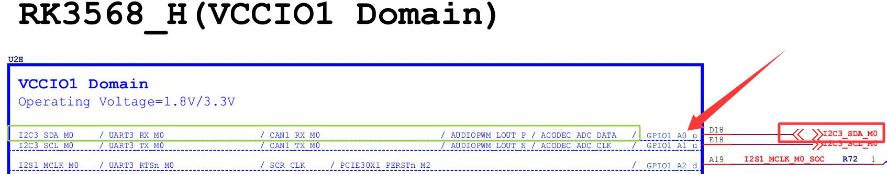
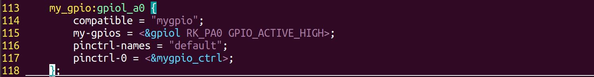
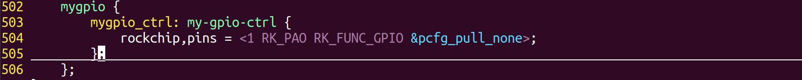
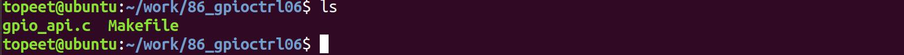
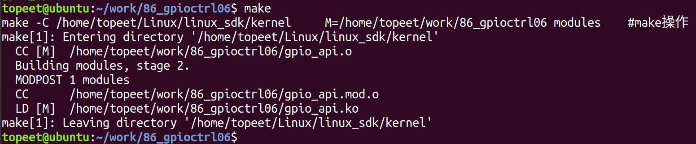
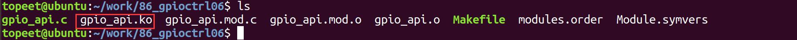
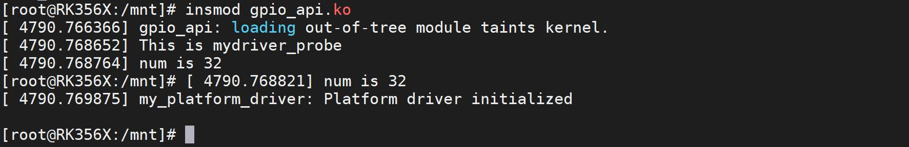
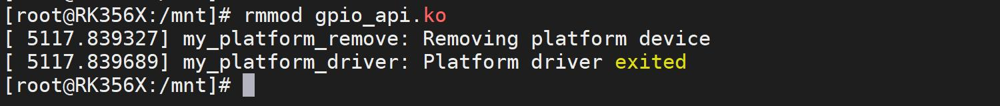

# 第133章 获取单个gpio描述实验

本章对新版本的GPIO 子系统中获取单个GPIO 对应的gpio_desc 结构体的API 函数进行讲解。
## 133.1 函数介绍
（1）获取GPIO 描述符struct gpio_desc *gpiod_get()函数是Linux 内核用于获取GPIO 对应的gpio_desc 结构体的函数。下面是对该函数的详细介绍：函数原型：
```c
struct gpio_desc *__must_check gpiod_get(struct device *dev,const char *con_id,enum gpiod_flags flags);
```
头文件：
```c
#include <linux/gpio/consumer.h>
```
参数：dev：指向设备结构体的指针。con_id：属性名前缀，在设备树中GPIO 属性名要按照<function>-gpios 或<function>-gpio 格式命名，如led-gpios，这里属性名前缀指的就是led。flags：GPIO 描述符的选项标志，用于指定GPIO 的属性和操作模式。以下是一些常用的选项标志：GPIOD_INPUT：将GPIO 配置为输入模式。GPIOD_OUTPUT：将GPIO 配置为输出模式。GPIOD_OPEN_DRAIN：将GPIO 配置为开漏输出模式。GPIOD_OPEN_SOURCE：将GPIO 配置为开源输出模式。GPIOD_OUT_LOW:将GPIO 电平初始化为低电平输出。GPIOD_OUT_HIGH:将GPIO 电平初始化为高电平输出。函数功能：获取指定GPIO 对应的gpio_desc 结构体。返回值：如果成功获取则返回指向struct gpio_desc 的指针；若获取失败则返回一个表示错误的指针。在Linux 内核中还有另外三个同样是获取GPIO 对应的gpio_desc 结构体的函数，如代码清单133.1 所示。代码清单133.1
```c
struct gpio_desc *gpiod_get_index(struct device *dev, const char *con_id, unsigned int idx, enum gpiod_flags
flags);
struct gpio_desc *gpiod_get_optional(struct device *dev, const char *con_id, enum gpiod_flags flags);
struct gpio_desc *gpiod_get_index_optional(struct device *dev, const char *con_id, unsigned int index, enum
```

```c
gpiod_flags flags);
```
相较于gpiod_get()函数，代码清单133.1 中的三个函数多了一个index 和optional 的函数后缀。其中带index 后缀的函数，例如gpiod_get_index()中的idx 表示要获取GPIO 的索引号，当设备树的GPIO 属性值包含多个GPIO 引脚描述时，使用gpiod_get_index()函数，通过索引号选择对应的GPIO 引脚。而带optional 后缀的函数与不带optional 后缀的函数在功能上是相同的，都用于获取GPIO 描述符，两者的区别在于返回值的不同：使用带optional 的函数时，如果获取失败，返回值为NULL。使用不带optional 的函数时，如果获取失败，函数返回的是一个表示错误的指针。（2）释放GPIO 描述符gpiod_put() 函数是Linux 中用于释放GPIO 对应的gpio_desc 结构体的函数。下面是对该函数的详细介绍：函数原型：void gpiod_put(struct gpio_desc *desc);头文件：
```c
#include <linux/gpio/consumer.h>
```
参数：desc：指向要释放的GPIO 对应的gpio_desc 结构体指针。功能：用于释放之前通过gpiod_get() 或类似函数获取的GPIO 对应的gpio_desc 结构体。返回值：无返回值。
## 133.2 修改设备树
本小节修改好的设备树以及编译好的boot.img 镜像存放在网盘iTOP-RK3568 开发板\07_学习教程配套资料\03_Linux 驱动配套资料\04_Linux 驱动例程\86_gpioctrl05\01_内核镜像路径下。在GPIO 子系统API 函数的引入章节提到了新版本的GPIO 子系统API 函数要与设备树结合才能使用，所以需要在设备树中将用于获取GPIO 描述符的引脚复用为GPIO 模式。为了让教程更贴近于实战，这里选择iTOP-RK3568 开发板背面20Pin GPIO 座子的1 号引脚，右边对应的丝印为I2C3_SDA_M0，这里的丝印表示该引脚可以复用为I2C3 的SDA 功能，而在当前的设备树源码中这个引脚没有被使用，该引脚的具体位置如图133.1 所示。


图133.1接下来在设备树中使用pinctrl 将该引脚的复用设置成GPIO，首先确定该引脚的GPIO 编号，

图133.2图133.2 中1 号管脚的网络标号为I2C3_SDA_M0，然后打开iTOP-RK3568 核心板原理图，根据该网络标号进行搜索，查找到的该引脚在核心板上对应的位置，图133.3 所示。

图133.3

图132.3 左侧为该引脚的所有复用功能，本章要使用GPIO 功能，箭头指向的部分为接下来要用到的GPIO 引脚为GPIO1_A0。在rk3568-evb1-ddr4-v10.dtsi 设备树根节点的结尾添加代码清单133.2 中内容。代码清单133.2
```c
my_gpio:gpiol_a0 {
    compatible = "mygpio";
    my-gpios = <&gpio1 RK_PA0 GPIO_ACTIVE_HIGH>;
    pinctrl-names = "default";
    pinctrl-0 = <&mygpio_ctrl>;
};
```
代码清单133.2 中代码解释如下：compatible: 用于指定与驱动程序匹配的字符串，这里与驱动程序中的匹配名称保持一致。my-gpios: 指定使用的GPIO 引脚是GPIO1_A0。&gpio1 表示引用GPIO 控制器gpio1 节点，RK_PA0 是具体的GPIO 引脚，GPIO_ACTIVE_HIGH 表示GPIO 的默认电平为高电平。pinctrl-names 和pinctrl-0: 用于配置引脚复用和引脚状态。pinctrl-names 表示引脚控制状态名称，这里为"default"。pinctrl-0 属性中引用的mygpio_ctrl 节点中的配置对应default 状态使用的引脚配置。添加完成如图133.4 所示。

图133.4在pinctrl 节点尾部添加代码清单133.3 中内容。pinctrl 节点位于rk3568.dtsi 设备树文件中。代码清单133.3
```c
mygpio {
    mygpio_ctrl: my-gpio-ctrl {
        rockchip,pins = <1 RK_PA0 RK_FUNC_GPIO &pcfg_pull_none>;
    };
};
```
代码清单133.3 第三行的内容中，1 表示GPIO 控制器编号，RK_PA0 表示具体引脚，RK _FUNC_GPI0 表示将引脚的复用功能设置为GPIO，&pcfg_pull_none 表示引脚电器属性配置为无上下拉。

添加完成如图133.5 所示。

图133.5至此，关于设备树修改完成，保存退出之后，重新编译内核，然后将生成的boot.img 镜像烧写到开发板上。
## 133.3 驱动程序的编写
本实验代码存储在网盘iTOP-RK3568 开发板\07_学习教程配套资料\03_Linux 驱动配套资料\04_Linux 驱动例程\86_gpioctrl05\02_module 路径下。实验代码gpio_api.c 如代码清单133.4 所示。代码清单133.4
```c
#include <linux/module.h>
#include <linux/platform_device.h>
#include <linux/mod_devicetable.h>
#include <linux/gpio/consumer.h>
#include <linux/gpio.h>
struct gpio_desc *mygpio1;// GPIO 描述符指针
int dir, value, irq;// 方向、值和中断号变量
//平台设备初始化函数
static int my_platform_probe(struct platform_device *dev) {
    printk("This is mydriver_probe\n");
    // 获取GPIO 描述符
    mygpio1 = gpiod_get_optional(&dev->dev, "my", 0);
    if (mygpio1 == NULL) {
        printk("gpiod_get_optional error\n");
        return -1;
    }
    gpiod_direction_output(mygpio1, 0);//将GPIO 设置为输出模式并设置初始值为低电平
    gpiod_set_value(mygpio1, 1);// 设置GPIO 为高电平
    dir = gpiod_get_direction(mygpio1);//获取GPIO 的方向
    if (dir == GPIOF_DIR_IN) {
        printk("dir is GPIOF_DIR_IN\n");//输出方向为输入
    } else if (dir == GPIOF_DIR_OUT) {
```

```c
printk("dir is GPIOF_DIR_OUT\n");//输出方向为输出
}
value = gpiod_get_value(mygpio1);//获取GPIO 的值
printk("value is %d\n", value);// 输出GPIO 的值
irq = gpiod_to_irq(mygpio1);//将GPIO 转换为中断号
printk("irq is %d\n", irq);//输出中断号
return 0;
}
//平台设备的移除函数
static int my_platform_remove(struct platform_device *pdev)
{
printk(KERN_INFO "my_platform_remove: Removing platform device\n");
//清理设备特定的操作
// ...
return 0;
}
const struct of_device_id of_match_table_id[]= {
{.compatible="mygpio"},
};
//定义平台驱动结构体
static struct platform_driver my_platform_driver = {
.probe = my_platform_probe,
.remove = my_platform_remove,
.driver = {
.name = "my_platform_device",
.owner = THIS_MODULE,
.of_match_table =of_match_table_id,
},
};
// 模块初始化函数
static int __init my_platform_driver_init(void)
{
int ret;
```

```c
// 注册平台驱动
ret = platform_driver_register(&my_platform_driver);
if (ret) {
    printk(KERN_ERR "Failed to register platform driver\n");
    return ret;
}
printk(KERN_INFO "my_platform_driver: Platform driver initialized\n");
return 0;
}
//模块退出函数
static void __exit my_platform_driver_exit(void)
{
//注销平台驱动
platform_driver_unregister(&my_platform_driver);
printk(KERN_INFO "my_platform_driver: Platform driver exited\n");
}
module_init(my_platform_driver_init);
module_exit(my_platform_driver_exit);
MODULE_LICENSE("GPL");
MODULE_AUTHOR("topeet");
```
## 133.4 运行测试
### 133.4.1 编译驱动程序
在gpio_api.c 代码同一目录下创建Makefile 文件，如图133.6 所示。

图133.6Makefile 文件内容如代码清单133.5 所示。代码清单133.5
```c
export ARCH=arm64#设置平台架构
export CROSS_COMPILE=aarch64-linux-gnu-#交叉编译器前缀
obj-m += gpio_api.o#此处要和你的驱动源文件同名
KDIR :=/home/topeet/Linux/linux_sdk/kernel#这里是你的内核目录
PWD ?= $(shell pwd)
all:
    make -C $(KDIR) M=$(PWD) modules#make 操作
```

```c
clean:
    make -C $(KDIR) M=$(PWD) clean#make clean 操作
```
在存放gpio_api.c 和Makefile 文件目录下使用make 命令编译驱动程序，编译完成如图133.7所示。

图133.7编译完生成gpio_api.ko 目标文件，如图133.8 所示。

图133.8至此驱动模块就编译成功了。
### 133.4.2 运行测试
首先需要确保当前开发板使用的内核镜像是我们在本章中修改设备树后编译生成的镜像，然后启动开发板，使用insmod gpio_api.ko 命令加载驱动程序，如图133.9 所示。

图133.9由图133.9 可以看到打印出来获取到的gpio 引脚号为32，而GPIO1_A0 的引脚号为32，说明成功获取到了设备树中的GPIO1_A0 引脚，实验成功后使用rmmod gpio_api.ko 命令卸载驱动程序，如图133.10 所示。

图133.10
至此，获取单个gpio 描述实验就完成了。

