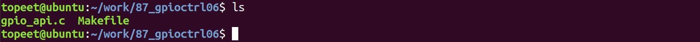
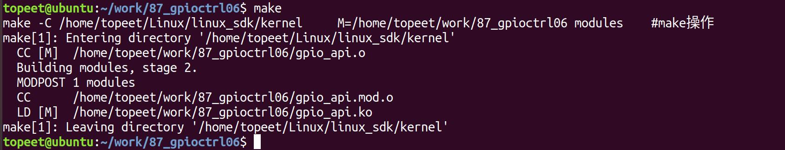
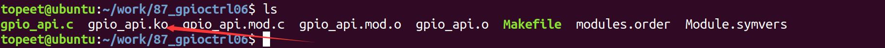
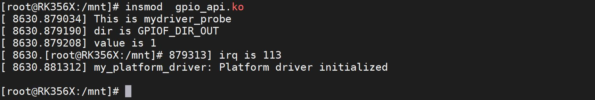
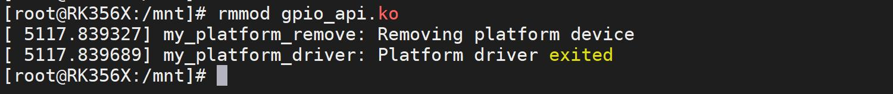

# 第134章 GPIO操作函数实验

本章对新版的GPIO 子系统API 操作函数进行讲解。
## 134.1 函数介绍
1 获取GPIO 方向函数：（1）函数原型：int gpiod_get_direction(struct gpio_desc *desc);（2）头文件：#include <linux/gpio/consumer.h>（3）参数：desc：指向GPIO 对应的gpio_desc 结构体指针。（4）函数功能：用于获取GPIO 的方向，即判断GPIO 是输入还是输出。（5）返回值：返回值为整型，表示GPIO 的方向。如果成功获取到GPIO 方向，返回值为GPIO_LINE_DIRECTION_IN（0）表示输入或GPIO_LINE_DIRECTION_OUT（1）表示输出。如果获取失败，返回值为负数，表示错误码。
2 配置GPIO 的方向函数：（1）函数原型：int gpiod_direction_input(struct gpio_desc *desc);int gpiod_direction_output(struct gpio_desc *desc, int value);（2）头文件：#include <linux/gpio/consumer.h>（3）参数：desc：指向GPIO 对应的gpio_desc 结构体指针。value（仅适用于gpiod_direction_output()函数）：初始输出值，可以是0 或1。（4）函数功能：gpiod_direction_input 函数用于配置GPIO 的方向为输入。gpiod_direction_output 函数用于配置GPIO 的方向为输出，并可指定初始输出值。（5）返回值：

返回值为整型，表示配置GPIO 方向的结果。如果成功配置GPIO 方向，返回值为0。如果配置失败，返回值为负数，表示错误码。
3 读取GPIO 的电平状态函数：（1）函数原型：int gpiod_get_value(const struct gpio_desc *desc);（2）头文件：#include <linux/gpio/consumer.h>（3）参数：desc：指向GPIO 对应的gpio_desc 结构体指针。（4）函数功能：用于读取GPIO 的电平状态。（5）返回值：返回值为整型，表示GPIO 的电平状态。如果成功读取到GPIO 的电平状态，返回值为0 或1，分别表示低电平和高电平。如果读取失败，返回值为负数，表示错误码。
4 设置GPIO 的电平状态函数：（1）函数原型：void gpiod_set_value(struct gpio_desc *desc, int value);（2）头文件：#include <linux/gpio/consumer.h>（3）参数：desc：指向GPIO 对应的gpio_desc 结构体指针。value：要设置的GPIO 的电平状态，可以是0（低电平）或1（高电平）。（4）函数功能：用于设置GPIO 的电平状态。（5）返回值：无（void）返回值。5 将GPIO 描述符转换为中断编号函数：（1）函数原型：int gpiod_to_irq(const struct gpio_desc *desc);（2）头文件：#include <linux/gpio/consumer.h>

（3）参数：desc：指向对应的gpio_desc 结构体指针。（4）函数功能：用于将GPIO 描述符转换为中断号。（5）返回值：返回值为整型，表示中断号。如果成功将GPIO 描述符转换为中断号，返回值为大于等于0 的中断号。如果转换失败，返回值为负数，表示错误码。
## 134.2 驱动程序的编写
本实验代码存储在网盘iTOP-RK3568 开发板\07_学习教程配套资料\03_Linux 驱动配套资料\04_Linux 驱动例程\87_gpioctrl06 路径下。本实验代码演示新版本的GPIO 子系统API 函数的使用方法，实验代码gpio_api.c 如代码清单134.1 所示。代码清单134.1
```c
#include <linux/module.h>
#include <linux/platform_device.h>
#include <linux/mod_devicetable.h>
#include <linux/gpio/consumer.h>
struct gpio_desc *mygpio1;// GPIO 描述符指针
int dir, value, irq;// 方向、值和中断号变量
//平台设备初始化函数
int mydriver_probe(struct platform_device *dev) {
    printk("This is mydriver_probe\n");
    //获取GPIO 描述符
    mygpio1 = gpiod_get_optional(&dev->dev, "my", 0);
    if (mygpio1 == NULL) {
        printk("gpiod_get_optional error\n");
        return -1;
    }
    gpiod_direction_output(mygpio1, 0);//将GPIO 设置为输出模式并设置初始值为低电平
    gpiod_set_value(mygpio1, 1);//设置GPIO 为高电平
    dir = gpiod_get_direction(mygpio1);//获取GPIO 的方向
    if (dir == GPIOF_DIR_IN) {
        printk("dir is GPIOF_DIR_IN\n");//打印方向为输入
```

```c
} else if (dir == GPIOF_DIR_OUT) {
    printk("dir is GPIOF_DIR_OUT\n");//打印方向为输出
}
value = gpiod_get_value(mygpio1);//获取GPIO 的值
printk("value is %d\n", value);// 打印GPIO 的值
irq = gpiod_to_irq(mygpio1);//将GPIO 转换为中断号
printk("irq is %d\n", irq);// 打印中断号
return 0;
}
// 平台设备的移除函数
static int my_platform_remove(struct platform_device *pdev)
{
printk(KERN_INFO "my_platform_remove: Removing platform device\n");
// 清理设备特定的操作
// ...
return 0;
}
const struct of_device_id of_match_table_id[]= {
{.compatible="mygpio"},
};
// 定义平台驱动结构体
static struct platform_driver my_platform_driver = {
.probe = my_platform_probe,
.remove = my_platform_remove,
.driver = {
    .name = "my_platform_device",
    .owner = THIS_MODULE,
    .of_match_table =of_match_table_id,
},
};
// 模块初始化函数
static int __init my_platform_driver_init(void)
{
int ret;
```

```c
// 注册平台驱动
ret = platform_driver_register(&my_platform_driver);
if (ret) {
    printk(KERN_ERR "Failed to register platform driver\n");
    return ret;
}
printk(KERN_INFO "my_platform_driver: Platform driver initialized\n");
return 0;
}
//模块退出函数
static void __exit my_platform_driver_exit(void)
{
//注销平台驱动
gpiod_put(mygpio2);
platform_driver_unregister(&my_platform_driver);
printk(KERN_INFO "my_platform_driver: Platform driver exited\n");
}
module_init(my_platform_driver_init);
module_exit(my_platform_driver_exit);
MODULE_LICENSE("GPL");
MODULE_AUTHOR("topeet");
```
## 134.3 运行测试
### 134.3.1 编译驱动程序
在gpio_api.c 代码同一目录下创建Makefile 文件，如图134.1 所示。

图134.1Makefile 文件内容如代码清单134.2 所示。代码清单134.2
```c
export ARCH=arm64#设置平台架构
export CROSS_COMPILE=aarch64-linux-gnu-#交叉编译器前缀
obj-m += gpio_api.o#此处要和你的驱动源文件同名
KDIR :=/home/topeet/Linux/linux_sdk/kernel#这里是你的内核目录
PWD ?= $(shell pwd)
```

```c
all:
    make -C $(KDIR) M=$(PWD) modules#make 操作
clean:
    make -C $(KDIR) M=$(PWD) clean#make clean 操作
```
在存放gpio_api.c 和Makefile 文件目录下使用make 命令编译驱动程序，编译完成如图134.2所示。

图134.2编译完生成gpio_api.ko 目标文件，如图134.3 所示。

图134.3至此驱动模块就编译成功了。
### 134.3.2 运行测试
首先需要确保当前开发板使用的内核镜像是在获取单个gpio 描述实验章节中修改设备树后编译生成的镜像，然后启动开发板，使用insmod gpio_api.ko 命令加载驱动程序，如图134.4所示。

图134.4
在驱动程序中首先会将GPIO 的方向设置为输出，并且设置为了高电平，所以图134.4 中打印了dir is GPIOF_DIR_OUT，表示IO 口方向为输出，由于已经设置为了高电平，所以打印了valueis 1，其中1 表示引脚为高电平，然后打印了irq is 133，表示gpio 转换的中断号为133。至此实验完成，实验完成后使用rmmod gpio_api.ko 命令进卸载驱动程序，如图134.5 所示。

图134.5

