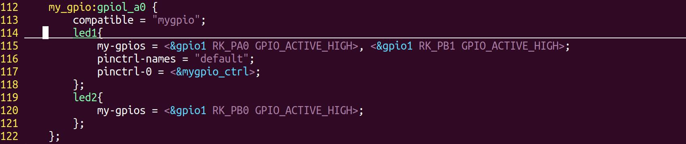
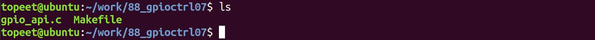
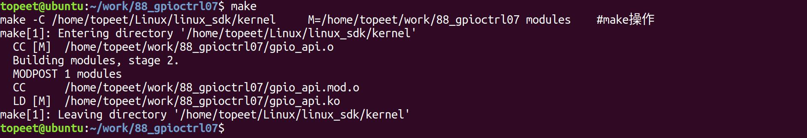
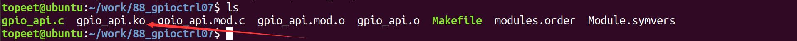
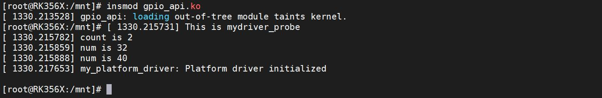
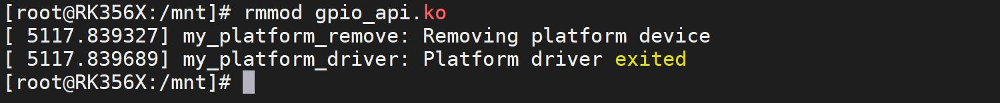

# 第135章 三级节点操作函数实验

至此，GPIO 操作函数实验就完成了。
在使用新版GPIO 子系统API 函数操作GPIO 之前首先要获取对应的gpio_desc 结构体，在前面的示例中获取的都是二级节点的GPIO 对应的gpio_desc 结构体指针，那如何获取代码清单135.1 中led1 和led2 两个三级节点的gpio 描述呢？代码清单135.1
```c
//根节点是一级节点
my_gpio:gpio1_a0 {//二级节点
    compatible = "mygpio";
    led1{//三级节点
        my-gpios = <&gpio1 RK_PA0 GPIO_ACTIVE_HIGH>, <&gpio1 RK_PB1 GPIO_ACTIVE_HIGH>;
        pinctrl-names = "default";
        pinctrl-0 = <&mygpio_ctrl>;
    };
    led2{//三级节点
        my-gpios = <&gpio1 RK_PB0 GPIO_ACTIVE_HIGH>;
    };
};
```
获取三级节点中的GPIO 对应的gpio_desc 结构体如果仍旧使用gpiod_get()函数是获取不成功的，获取三级节点的GPIO 描述要使用什么函数呢，带着疑问，让我们进入本章节的学习吧。
## 135.1 函数介绍
1 计算子节点数量函数原型unsigned int device_get_child_node_count(struct device *dev);头文件<linux/device.h>。参数：struct device 类型的指针dev，表示要计算子节点数量的设备节点。函数功能：用于计算给定设备节点dev 的子节点数量。返回值：如果成功获取子节点数量，返回一个大于的无符号整数，表示设备节点的子节点数量。如果获取

失败，返回值为0。2 获取指定节点的GPIO 结构描述（1）函数原型：struct gpio_desc *fwnode_get_named_gpiod(struct fwnode_handle *fwnode, const char *propname, int index, enum gpiod_flags dflags, const char *label);（2）头文件：<linux/gpio/consumer.h>。（3）参数：fwnode：指向struct fwnode_handle 的指针，表示要获取GPIO 的节点对象地址。propname：属性名，指定要获取的GPIO 的属性名称。index：索引值，用于指定要获取的GPIO 在属性中的索引，用于GPIO 属性值包含多个GPIO 引脚描述时。dflags：获得到GPIO 后的初始化配置，可以使用以下枚举值：GPIOD_ASIS：不进行初始化。GPIOD_IN：初始化为输入模式。GPIOD_OUT_LOW：初始化为输出模式，输出低电平。GPIOD_OUT_HIGH：初始化为输出模式，输出高电平。label：标签，用于标识GPIO 的描述。（4）函数功能：该函数通过指定节点的对象地址获取子节点中的GPIO 对应的gpio_desc 结构体。（5）返回值：返回一个指向struct gpio_desc 的指针，表示获取到的GPIO 结构描述。如果获取失败，返回值为NULL。3 获取下一个子节点对象地址函数原型：struct fwnode_handle *device_get_next_child_node(struct device *dev, struct fwnode_handle *child);头文件：<linux/device.h>。参数：dev：指向struct device 的指针，表示父设备节点。child：指向struct fwnode_handle 的指针，表示当前子设备节点。函数功能：

用于获取给定父设备节点dev 的下一个子设备节点。返回值：返回一个指向struct fwnode_handle 的指针，表示下一个子设备节点。如果没有下一个子设备节点，返回值为NULL。
## 135.2 修改设备树
本小节修改好的设备树以及编译好的boot.img 镜像存放在网盘iTOP-RK3568 开发板\07_学习教程配套资料\03_Linux 驱动配套资料\04_Linux 驱动例程\88_gpioctrl07\01_内核镜像路径下。由于本章节要获取到三级节点的GPIO 描述，所以要对rk3568-evb1-ddr4-v10.dtsi 设备树进行内容的修改，将前面章节中在根节点中添加的gpiol_a0 节点修改为代码清单135.2 中内容。代码清单135.2
```c
my_gpio:gpiol_a0 {
    compatible = "mygpio";
    led1{
        my-gpios = <&gpio1 RK_PA0 GPIO_ACTIVE_HIGH>, <&gpio1 RK_PB1 GPIO_ACTIVE_HIGH>;
        pinctrl-names = "default";
        pinctrl-0 = <&mygpio_ctrl>;
    };
    led2{
        my-gpios = <&gpio1 RK_PB0 GPIO_ACTIVE_HIGH>;
    };
};
```
添加完成如图135.1 所示。

图135.1至此，设备树的修改就完成了，保存退出之后，重新编译内核，然后将生成的boot.img镜像烧写到开发板上即可。

## 135.3 驱动程序的编写
本实验代码存储在网盘iTOP-RK3568 开发板\07_学习教程配套资料\03_Linux 驱动配套资料\04_Linux 驱动例程\88_gpioctrl07\02_module 路径下。实验代码gpio_api.c 如代码清单135.3 所示。代码清单135.3
```c
#include <linux/module.h>
#include <linux/platform_device.h>
#include <linux/mod_devicetable.h>
#include <linux/gpio/consumer.h>
#include <linux/gpio.h>
unsigned int count;
struct fwnode_handle *child_fw = NULL;
struct gpio_desc *led[2];
int i = 0;
int num = 0;
//平台设备初始化函数
static int my_platform_probe(struct platform_device *dev)
{
    printk("This is my_platform_probe\n");
    //获取父设备节点的子设备节点数量
    count = device_get_child_node_count(&dev->dev);
    printk("count is %d\n", count);
    for (i = 0; i < count; i++) {
        //获取下一个子设备节点
        child_fw = device_get_next_child_node(&dev->dev, child_fw);
        if (child_fw) {
            //获取子设备节点中名为"my-gpios" 的GPIO 描述
            led[i] = fwnode_get_named_gpiod(child_fw, "my-gpios", 0, 0, "LED");
        }
        //将GPIO 描述转换为GPIO 号
        num = desc_to_gpio(led[i]);
        printk("num is %d\n", num);
    }
    return 0;
```

```c
}
//平台设备的移除函数
static int my_platform_remove(struct platform_device *pdev)
{
    printk(KERN_INFO "my_platform_remove: Removing platform device\n");
    //清理设备特定的操作
    // ...
    return 0;
}
const struct of_device_id of_match_table_id[]= {
    {.compatible="mygpio"},
};
//定义平台驱动结构体
static struct platform_driver my_platform_driver = {
    .probe = my_platform_probe,
    .remove = my_platform_remove,
    .driver = {
        .name = "my_platform_device",
        .owner = THIS_MODULE,
        .of_match_table =of_match_table_id,
    },
};
//模块初始化函数
static int __init my_platform_driver_init(void)
{
    int ret;
    //注册平台驱动
    ret = platform_driver_register(&my_platform_driver);
    if (ret) {
        printk(KERN_ERR "Failed to register platform driver\n");
        return ret;
    }
    printk(KERN_INFO "my_platform_driver: Platform driver initialized\n");
    return 0;
```

```c
}
//模块退出函数
static void __exit my_platform_driver_exit(void)
{
    //注销平台驱动
    platform_driver_unregister(&my_platform_driver);
    printk(KERN_INFO "my_platform_driver: Platform driver exited\n");
}
module_init(my_platform_driver_init);
module_exit(my_platform_driver_exit);
MODULE_LICENSE("GPL");
MODULE_AUTHOR("topeet");
```
## 135.4 运行测试
### 135.4.1 编译驱动程序
在gpio_api.c 代码同一目录下创建Makefile 文件，如图135.2 所示。

图135.2Makefile 文件内容如代码清单135.4 所示。代码清单135.4
```c
export ARCH=arm64#设置平台架构
export CROSS_COMPILE=aarch64-linux-gnu-#交叉编译器前缀
obj-m += gpio_api.o#此处要和你的驱动源文件同名
KDIR :=/home/topeet/Linux/linux_sdk/kernel#这里是你的内核目录
PWD ?= $(shell pwd)
all:
    make -C $(KDIR) M=$(PWD) modules#make 操作
clean:
    make -C $(KDIR) M=$(PWD) clean#make clean 操作
```
在存放gpio_api.c 和Makefile 文件目录下使用make 命令编译驱动程序，编译完成如图135.3所示。


图135.3编译完生成gpio_api.ko 目标文件，如图135.4 所示。

图135.4至此驱动模块就编译成功了。
### 135.4.2 运行测试
首先需要确保当前开发板使用的内核镜像是我们在本章节中修改设备树后编译生成的镜像，然后启动开发板，使用insmod gpio_api.ko 命令加载驱动程序，如图135.5 所示。

图135.5图135.5 中首先打印出了子节点的数量count is 2，也就是led1 和led2，接下来的两个num值分别为32 和40，分别对应两个节点的第一个GPIO 属性的引脚编号，通过手动计算gpio1RK_PA0 和gpio1 RK_PB0 的引脚编号可知，引脚编号分别对应32 和40，说明实验成功，然后使用rmmod gpio_api.ko 命令卸载驱动，如图135.6 所示。

图135.6至此，三级节点操作函数实验就完成了。

