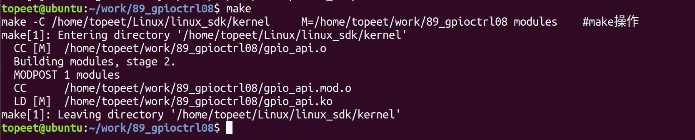
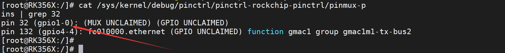
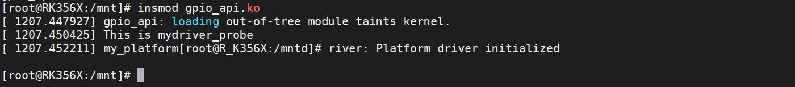
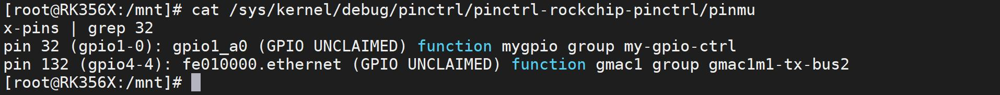
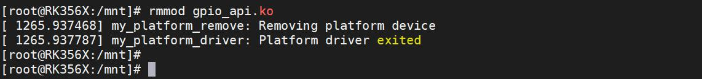

# 第136章 GPIO子系统与pinctrl子系统相结合实验

本章进行GPIO 子系统与pinctrl 子系统相结合的实验。
## 136.1 函数介绍
（1）获取设备对应的pinctrl 结构体指针函数函数原型：struct pinctrl* pinctrl_get(struct device *dev);头文件：<linux/pinctrl/pinctrl.h>。参数：函数接受一个指向struct device 的指针dev，表示设备对象。函数功能：用于获取与给定设备对象dev 相关联的pinctrl（引脚控制器）实例。返回值：返回一个指向struct pinctrl 的指针，表示获取到的pinctrl 实例。如果获取失败或者设备对象不支持pinctrl，则返回NULL。（2）释放pinctrl 指针函数函数原型：void pinctrl_put(struct pinctrl *p);头文件：<linux/pinctrl/pinctrl.h>。参数：函数接受一个指向struct pinctrl 的指针p，表示要释放的pinctrl 实例。函数功能：该函数用于释放由pinctrl_get() 函数获得的pinctrl 实例，以释放相关资源。返回值：无返回值。
（3）查找pinctrl 状态函数函数原型：

struct pinctrl_state *pinctrl_lookup_state(struct pinctrl *p, const char *name);头文件：<linux/pinctrl/pinctrl.h>。参数：struct pinctrl *p：指向pinctrl 实例的指针，表示要进行状态查找的pinctrl。const char *name：指向状态名称的字符串指针，表示要查找的状态名称。函数功能：用于在给定的pinctrl 实例中查找指定名称的pinctrl 状态。返回值：函数返回一个指向struct pinctrl_state 的指针，表示找到的pinctrl 状态。如果未找到或发生错误，则返回NULL。（4）设置pinctrl 状态到硬件函数原型：int pinctrl_select_state(struct pinctrl *p, struct pinctrl_state *s);头文件：<linux/pinctrl/pinctrl.h>。参数：struct pinctrl *p：指向pinctrl 实例的指针，表示要进行状态设置的pinctrl。struct pinctrl_state *s：指向pinctrl 状态的指针，表示要设置的目标状态。函数功能：用于将指定的pinctrl 状态设置到硬件上。返回值：返回一个整数值，表示操作的结果。如果设置成功，则返回0；否则返回负数错误码。
## 136.2 修改设备树
本小节修改好的设备树以及编译好的boot.img 镜像存放在网盘iTOP-RK3568 开发板\07_学习教程配套资料\03_Linux 驱动配套资料\04_Linux 驱动例程\88_gpioctrl07\01_内核镜像路径下。由于本章节要使用pinctrl 子系统相关的API 函数查找并设置相应的pinctrl 状态，所以要对rk3568-evb1-ddr4-v10.dtsi 设备树进行内容的修改，将前面章节中在根节点中添加的gpiol_a0节点修改为如代码清单136.1 中内容。代码清单136.1

```c
my_gpio:gpiol_a0 {
    compatible = "mygpio";
    my-gpios = <&gpio1 RK_PA0 GPIO_ACTIVE_HIGH>;
    pinctrl-names = "myled1";
    pinctrl-0 = <&mygpio_ctrl>;
};
```
添加完成如图136.1 所示。

图136.1至此，设备树修改就完成了，保存退出之后，重新编译内核，然后将生成的boot.img 镜像烧写到开发板上即可。
## 136.3 驱动程序的编写
本实验代码存储在网盘iTOP-RK3568 开发板\07_学习教程配套资料\03_Linux 驱动配套资料\04_Linux 驱动例程\88_gpioctrl07\02_module 路径下。实验代码gpio_api.c 如代码清单136.2 所示。代码清单136.2
```c
#include <linux/module.h>
#include <linux/platform_device.h>
#include <linux/mod_devicetable.h>
#include <linux/gpio/consumer.h>
#include <linux/gpio.h>
struct pinctrl *led_pinctrl; // pinctrl 实例指针
struct pinctrl_state *led_state;// pinctrl 状态指针
int ret;
//平台设备初始化函数
static int my_platform_probe(struct platform_device *dev)
{
    printk("This is mydriver_probe\n");
    led_pinctrl = pinctrl_get(&dev->dev);//获取pinctrl 实例
    if (IS_ERR(led_pinctrl)) {
        printk("pinctrl_get is error\n");
        return -1;
```

```c
}
led_state = pinctrl_lookup_state(led_pinctrl, "myled1");//查找状态
if (IS_ERR(led_state)) {
    printk("pinctrl_lookup_state is error\n");
    return -2;
}
ret = pinctrl_select_state(led_pinctrl, led_state);//设置状态到硬件
if (ret < 0) {
    printk("pinctrl_select_state is error\n");
    return -3;
}
return 0;
}
//平台设备的移除函数
static int my_platform_remove(struct platform_device *pdev)
{
printk(KERN_INFO "my_platform_remove: Removing platform device\n");
//清理设备特定的操作
// ...
return 0;
}
const struct of_device_id of_match_table_id[]= {
{.compatible="mygpio"},
};
// 定义平台驱动结构体
static struct platform_driver my_platform_driver = {
.probe = my_platform_probe,
.remove = my_platform_remove,
.driver = {
    .name = "my_platform_device",
    .owner = THIS_MODULE,
    .of_match_table =of_match_table_id,
},
};
```

```c
//模块初始化函数
static int __init my_platform_driver_init(void)
{
    int ret;
    // 注册平台驱动
    ret = platform_driver_register(&my_platform_driver);
    if (ret) {
        printk(KERN_ERR "Failed to register platform driver\n");
        return ret;
    }
    printk(KERN_INFO "my_platform_driver: Platform driver initialized\n");
    return 0;
}
//模块退出函数
static void __exit my_platform_driver_exit(void)
{
    //注销平台驱动
    platform_driver_unregister(&my_platform_driver);
    printk(KERN_INFO "my_platform_driver: Platform driver exited\n");
}
module_init(my_platform_driver_init);
module_exit(my_platform_driver_exit);
MODULE_LICENSE("GPL");
MODULE_AUTHOR("topeet");
```
## 136.4 运行测试
### 136.4.1 编译驱动程序
在gpio_api.c 代码同一目录下创建Makefile 文件，如图136.2 所示：

图136.2Makefile 文件内容如代码清单136.3 所示。代码清单136.3
```c
export ARCH=arm64#设置平台架构
```

```c
export CROSS_COMPILE=aarch64-linux-gnu-#交叉编译器前缀
obj-m += gpio_api.o#此处要和你的驱动源文件同名
KDIR :=/home/topeet/Linux/linux_sdk/kernel#这里是你的内核目录
PWD ?= $(shell pwd)
all:
    make -C $(KDIR) M=$(PWD) modules#make 操作
clean:
    make -C $(KDIR) M=$(PWD) clean#make clean 操作
```
在存放gpio_api.c 和Makefile 文件目录下使用make 命令编译驱动程序，编译完成如图136.3 所示。

图136.3编译完生成gpio_api.ko 目标文件，如图136.4 所示。

图136.4至此驱动模块就编译成功了。
### 136.4.2 运行测试
首先需要确保当前开发板使用的内核镜像是我们在本章节中修改设备树后编译生成的镜像，然后启动开发板使用cat /sys/kernel/debug/pinctrl/pinctrl-rockchip-pinctrl/pinmux-pins | grep32 命令查看gpio1 RK_PA0 引脚的复用功能，如图136.5 所示。

图136.5由图135.5 可以看到在没有加载驱动之前，gpio1 RK_PA0 引脚是没有进行复用的，然后使用insmod gpio_api.ko 命令加载驱动程序，如图136.6 所示。

图136.6接着重新使用cat /sys/kernel/debug/pinctrl/pinctrl-rockchip-pinctrl/pinmux-pins | grep 32 命令查看gpio1 RK_PA0 引脚的复用功能，如图136.7 所示。


图136.7由图136.7 打印信息可以得到gpio1 RK_PA0 已经被设置为了GPIO 功能，证明已经成功使用了在设备树中添加的pinctrl-names 状态对应的引脚复用配置，实验成功后使用rmmodgpio_api.ko 命令卸载驱动程序，如图136.8 所示。

图136.8至此，GPIO 子系统与pinctrl 子系统相结合实验实验就完成了。

