# 第137章 实战:实现动态切换引脚复用功能

再上一个章中完成了GPIO 子系统与pinctrl 子系统相结合实验，在本章中将更进一步，实现动态切换引脚复用功能。本章仍旧使用iTOP-RK3568 底板背面的20 pin GPIO 底座的1 号管脚来完成本章要进行的动态切换引脚复用功能的实验，该引脚在核心板原理图对应的引脚信息如图137.1 所示。
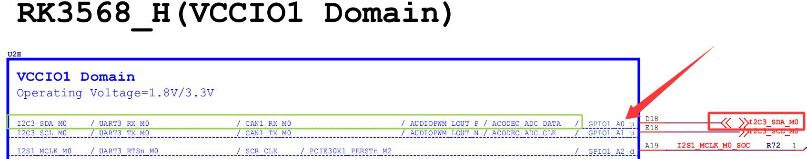
图137.1图137.1 绿色框中为该引脚的其他复用功能，在前面的章节中复用的都是GPIO 功能，而本章节中将实现I2C3_SDA 和GPIO 两个复用功能之间的动态切换。
## 137.1 设备树的修改
本小节修改好的设备树以及编译好的boot.img 镜像存放在网盘iTOP-RK3568 开发板\07_学习教程配套资料\03_Linux 驱动配套资料\04_Linux 驱动例程\90_gpioctrl09\01_内核镜像路径下。在rk3568-evb1-ddr4-v10.dtsi 设备树中将之前章节在根节点下添加的gpiol_a0 节点修改为代码清单137.1 中内容。代码清单137.1
```c
my_gpio:gpiol_a0 {
    compatible = "mygpio";
    my-gpios = <&gpio1 RK_PA0 GPIO_ACTIVE_HIGH>;
    pinctrl-names = "mygpio_func1", "mygpio_func2";
    pinctrl-0 = <&mygpio_ctrl>;
    pinctrl-1 = <&i2c3_sda>;
};
```

代码清单137.1 中pinctrl-names 两个状态分别对应pinctrl-0 和pinctrl-1。pinctrl-0 引用&mygpio_ctrl 节点配置，表示复用为gpio 功能。pinctrl-1 引用&i2c3_sda 节点配置，表示复用为i2c3_sda 功能。添加完成如图137.2 所示。
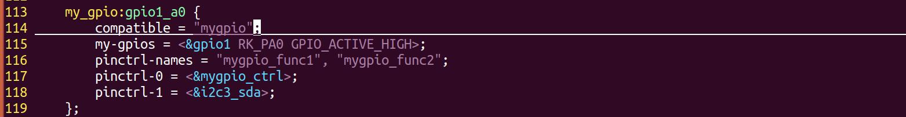
图137.2然后在pinctrl 节点尾部添加如代码清单137.2 所示内容。pinctrl 节点位于arch/arm64/boot/dts/rockchip/rk3568.dtsi 文件中。代码清单137.2
```c
mygpio_func1 {
    mygpio_ctrl: my-gpio-ctrl {
            rockchip,pins = <1 RK_PA0 RK_FUNC_GPIO &pcfg_pull_none>;
    };
};
mygpio_func2 {
    i2c3_sda: i2c3_sda {
            rockchip,pins = <1 RK_PA0 1 &pcfg_pull_none>;
    };
};
```
修改添加完成如图137.3 所示。
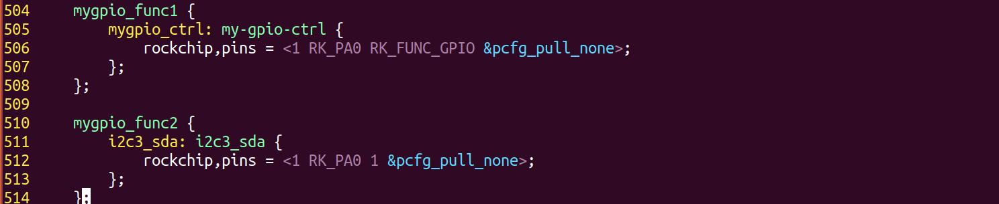
图137.3至此，设备树的修改就完成了，保存退出之后，重新编译内核，然后将生成的boot.img镜像烧写到开发板上。
## 137.2 驱动程序的编写
本实验代码存储在网盘iTOP-RK3568 开发板\07_学习教程配套资料\03_Linux 驱动配套资料\04_Linux 驱动例程\90_gpioctrl09\02_module 路径下。

实验代码gpio_api.c 如代码清单137.3 所示。代码清单137.3
```c
#include <linux/module.h>
#include <linux/platform_device.h>
#include <linux/mod_devicetable.h>
#include <linux/gpio/consumer.h>
#include <linux/gpio.h>
#include <linux/device.h>
struct pinctrl *gpio_pinctrl;// GPIO pinctrl 实例指针
struct pinctrl_state *func1_state;//功能1 状态
struct pinctrl_state *func2_state;//功能2 状态
int ret;
ssize_t selectmux_store(struct device *dev, struct device_attribute *attr, const char *buf, size_t count)
{
    unsigned long select;
    select = simple_strtoul(buf, NULL, 10);
    if (select == 1) {
        pinctrl_select_state(gpio_pinctrl, func1_state);//选择功能1 状态
    } else if (select == 0) {
        pinctrl_select_state(gpio_pinctrl, func2_state);//选择功能2 状态
    }
    return count;
}
DEVICE_ATTR_WO(selectmux);//定义可写的设备属性selectmux
int pinctrl_get_and_lookstate(struct device *dev)
{
    gpio_pinctrl = pinctrl_get(dev);//获取GPIO pinctrl 实例
    if (IS_ERR(gpio_pinctrl)) {
        printk("pinctrl_get is error\n");
        return -1;
    }
    func1_state = pinctrl_lookup_state(gpio_pinctrl, "mygpio_func1");//查找功能1 状态
    if (IS_ERR(func1_state)) {
        printk("pinctrl_lookup_state is error\n");
        return -2;
    }
    func2_state = pinctrl_lookup_state(gpio_pinctrl, "mygpio_func2");//查找功能2 状态
    if (IS_ERR(func2_state)) {
        printk("pinctrl_lookup_state is error\n");
```

```c
return -2;
}
return 0;
}
//平台设备初始化函数
static int my_platform_probe(struct platform_device *dev)
{
printk("This is mydriver_probe\n");
pinctrl_get_and_lookstate(&dev->dev);//获取并查找GPIO pinctrl 实例和状态
device_create_file(&dev->dev, &dev_attr_selectmux);//在设备上创建属性件
return 0;
}
//平台设备的移除函数
static int my_platform_remove(struct platform_device *pdev)
{
printk(KERN_INFO "my_platform_remove: Removing platform device\n");
// 清理设备特定的操作
// ...
return 0;
}
const struct of_device_id of_match_table_id[]= {
{.compatible="mygpio"},
};
//定义平台驱动结构体
static struct platform_driver my_platform_driver = {
.probe = my_platform_probe,
.remove = my_platform_remove,
.driver = {
.name = "my_platform_device",
.owner = THIS_MODULE,
.of_match_table =of_match_table_id,
},
};
//模块初始化函数
static int __init my_platform_driver_init(void)
```

```c
{
    int ret;
    //注册平台驱动
    ret = platform_driver_register(&my_platform_driver);
    if (ret) {
        printk(KERN_ERR "Failed to register platform driver\n");
        return ret;
    }
    printk(KERN_INFO "my_platform_driver: Platform driver initialized\n");
    return 0;
}
//模块退出函数
static void __exit my_platform_driver_exit(void)
{
    //注销平台驱动
    platform_driver_unregister(&my_platform_driver);
    printk(KERN_INFO "my_platform_driver: Platform driver exited\n");
}
module_init(my_platform_driver_init);
module_exit(my_platform_driver_exit);
MODULE_LICENSE("GPL");
MODULE_AUTHOR("topeet");
```
## 137.3 运行测试
### 137.3.1 编译驱动程序
在gpio_api.c 代码同一目录下创建Makefile 文件，如图137.4 所示。

图137.4Makefile 文件内容如代码清单137.4 所示。代码清单137.4
```c
export ARCH=arm64#设置平台架构
export CROSS_COMPILE=aarch64-linux-gnu-#交叉编译器前缀
obj-m += gpio_api.o#此处要和你的驱动源文件同名
```

```c
KDIR :=/home/topeet/Linux/linux_sdk/kernel#这里是你的内核目录
PWD ?= $(shell pwd)
all:
    make -C $(KDIR) M=$(PWD) modules#make 操作
clean:
    make -C $(KDIR) M=$(PWD) clean#make clean 操作
```
在存放gpio_api.c 和Makefile 文件目录下使用make 命令编译驱动程序，编译完成如图137.5所示。
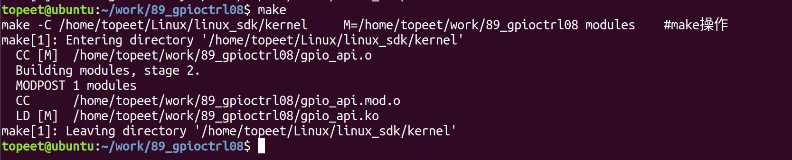
图137.5编译完生成gpio_api.ko 目标文件，如图137.6 所示。

图137.6至此驱动模块就编译成功了。
### 137.3.2 运行测试
首先需要确保当前开发板使用的内核镜像是本章中修改设备树后编译生成的镜像，然后启动开发板，使用cat /sys/kernel/debug/pinctrl/pinctrl-rockchip-pinctrl/pinmux-pins | grep 32 命令查看gpio1 RK_PA0 引脚的复用功能，如图137.7 所示。
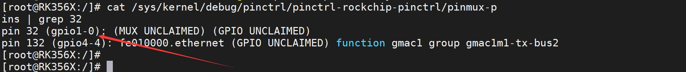
图137.7由图137.7 可以看到在没有加载驱动之前，gpio1 RK_PA0 引脚是没有进行复用的，接着使用insmod gpio_api.ko 命令加载驱动程序，如图137.8 所示。
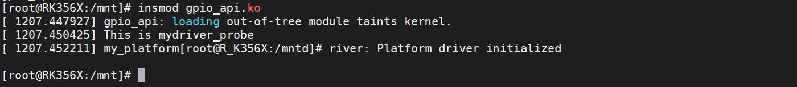
图137.8进入/sys/devices/platform/gpio1_a0/目录，其中的selectmux 属性文件可以动态修改gpio1RK_PA0 引脚复用关系，如图137.9 所示。selectmux 属性文件是在gpio_api.c 驱动程序中创建的。

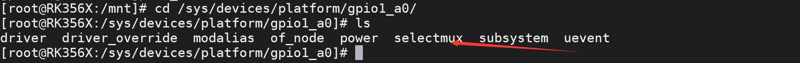
图137.9当向selectmux 属性文件写入0 时表示选择复用功能2，也就是将该引脚复用功能设置为I2C3_SDA，当向selectmux 文件写入1 时表示选择复用功能1，也就是将该引脚复用功能设置为GPIO，这里我们先输入echo 1 > selectmux 命令向selectmux 属性文件写入1，验证是否设置为GPIO 复用功能，如图137.10 所示。

图137.10重新使用cat /sys/kernel/debug/pinctrl/pinctrl-rockchip-pinctrl/pinmux-pins | grep 32 命令查看gpio1 RK_PA0 引脚的复用功能，如图137.11 所示。
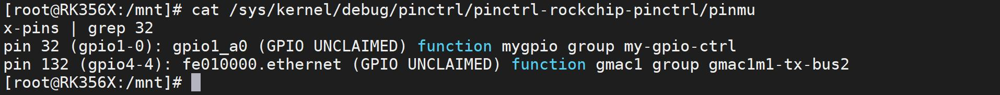
图137.11由图137.11 打印信息可以得到gpio1 RK_PA0 已经被设置为了GPIO 功能，然后输入echo 0 >selectmux 命令向selectmux 属性文件写入0，验证是否设置为I2C3_SDA 复用功能，如图137.12所示。
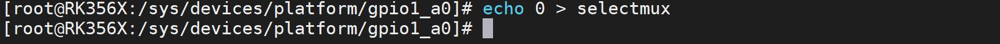
图137.12重新使用cat /sys/kernel/debug/pinctrl/pinctrl-rockchip-pinctrl/pinmux-pins | grep 32 命令查看gpio1 RK_PA0 引脚的复用功能，如图137.13 所示。
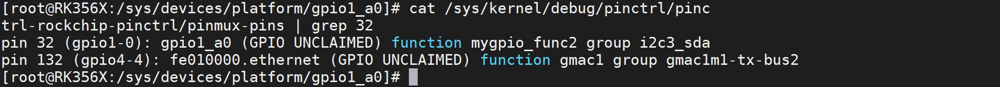
图137.13由图137.16 打印信息可以得到gpio1 RK_PA0 已经被复用为了I2C3_SDA 功能，说明实验成功，实验成功后使用rmmod gpio_api.ko 命令卸载驱动程序，如图137.14 所示。
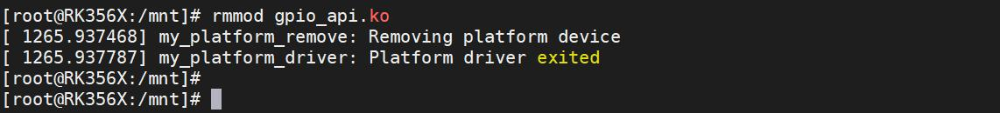
图137.14

