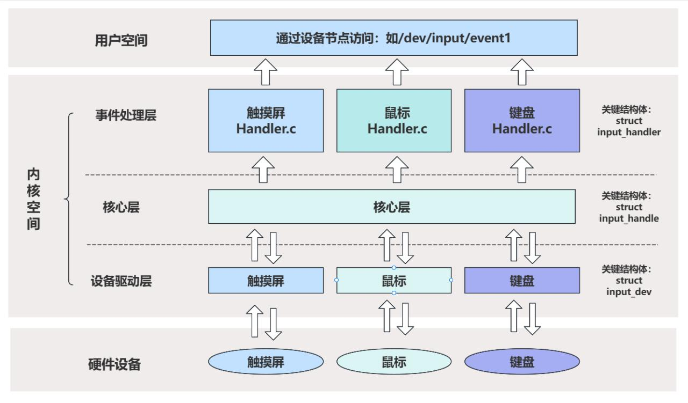
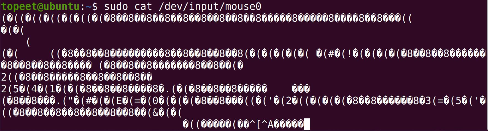
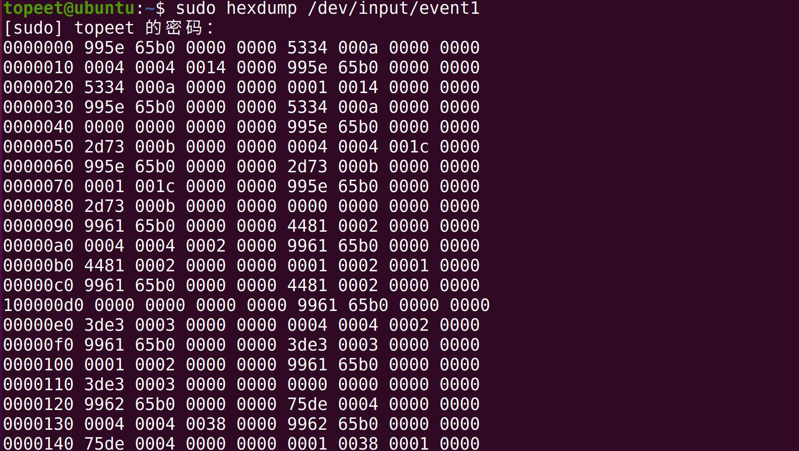
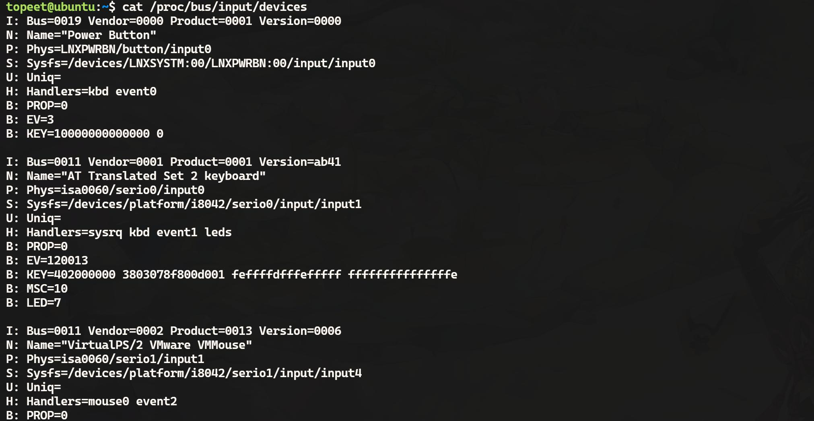
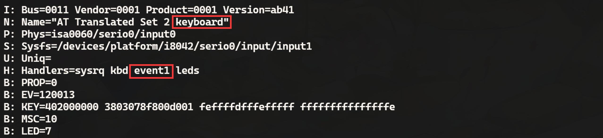
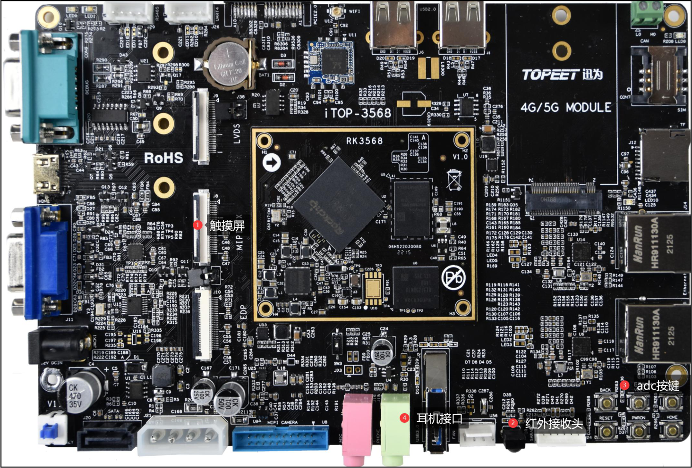
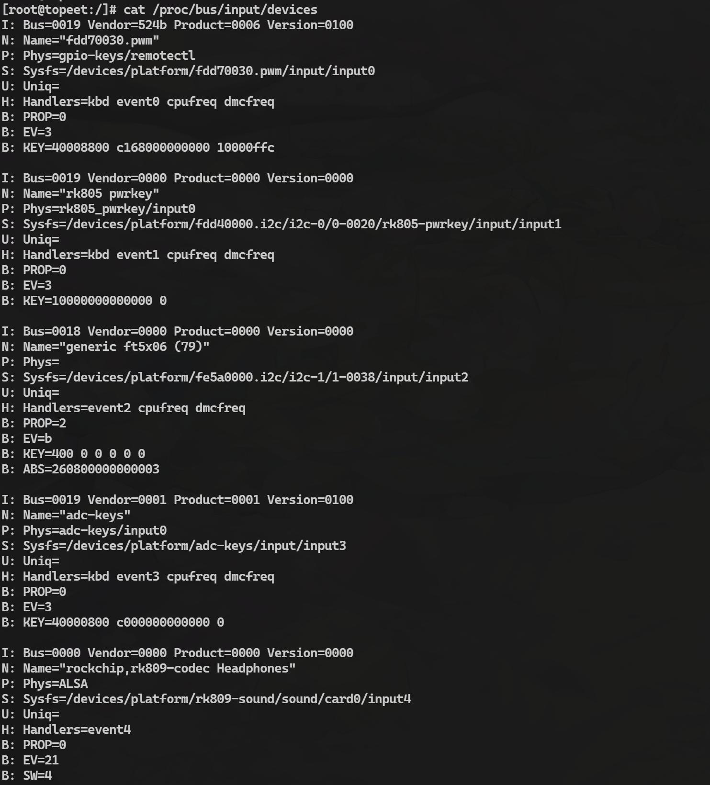

# 第138章 初识input子系统

## 138.1 输入子系统简介
在Linux 系统中，输入子系统是专为键盘、鼠标、触摸屏等输入设备设计的通用驱动框架。输入子系统通过标准化的事件格式和驱动接口，统一了物理形态各异的输入设备的处理方式。例如，统一规定按键状态用1 表示按下，0 表示松开，从而避免了不同驱动之间采用不一致的数值定义造成混乱的情况。在图138.1 所示的输入子系统架构图中，硬件设备层是具体的输入硬件，如鼠标、键盘等。内核空间作为连接硬件设备层与用户空间的核心枢纽，其包含输入设备驱动层、核心层和事件处理层。用户空间通过设备节点与输入设备交互。如应用程序可以通过/dev/input目录下输入设备的设备节点操作输入设备。

图138.1
## 138.2 如何确定输入设备和节点的关系
在输入子系统中，输入设备与设备节点一一对应。应用程序可以通过设备节点操作输入设备，所以确定输入设备对应的设备节点尤为重要。以下是判断设备节点对应的输入设备的方法。138.2.1 通过设备节点判断

输入设备的设备节点可以分为通用设备节点和专用设备节点。专用设备节点通常可以从设备节点名称中直接看出设备类型，例如节点名称"keyboard"（键盘）或"mouse"（鼠标）。而通用设备节点则不能通过设备节点名称直接确定设备类型。如图138.2 中event0-event4 属于通用设备节点，而mouse0 和mouse2 属于专用设备节点。

图138.2138.2.2 试探性方法使用cat 命令打开设备节点后对物理设备进行操作，观察调试终端是否有数据输出。例如，对于键盘设备，你可以运行cat /dev/input/eventX（X=0,1,2...）命令，其中/dev/input/eventX（X=0,1,2...）是设备节点的路径，然后按下键盘按键，观察调试终端是否输出数据。如果有数据输出，则说明该节点对应的输入设备是键盘，如果没有数据输出，则换下一个节点继续测试，直到找到对应的设备节点即可。通过这种试探性的方法，你可以判断设备节点与输入设备之间的对应关系。例如使用sudocat /dev/input/mouse0 命令测试mouse0 节点是否对应当前主板连接的鼠标，如果mouse 节点对应的是当前主板连接鼠标移动鼠标调试中断会有数据输出（乱码数据也算有数据输出），如下图138.3 所示：

图138.3试探性的方法除了使用cat 命令还可以使用hexdump 命令，hexdump 命令可以以十六进制和ASCII 码的形式进行显示数据。使用方法如代码清单138.1 所示。代码清单138.1
```c
hexdump [选项] [文件]...
```
以下是hexdump 常用的命令参数：-C：以规范的格式输出十六进制和ASCII 码。它会按照十六进制的形式显示文件的内容，并在每行的右侧显示相应的ASCII 码。这种格式可以很方便地查看二进制文件的内容。

-b：以单字节八进制的形式显示文件内容。每个字节的值将以八进制数字的形式显示。-c：以单字节字符的形式显示文件内容。每个字节将以字符的形式显示，非可打印字符将显示为"."。-d：以双字节十进制的形式显示文件内容。每个字节对应的十进制值将以十进制数字的形式显示。-o：以双字节八进制的形式显示文件内容。每个字节的值将以八进制数字的形式显示。-x：以双字节十六进制的形式显示文件内容。每个字节的值将以十六进制数字的形式显示。-s offset：从指定的偏移量开始输出文件内容。可以使用十进制或十六进制表示偏移量。如使用sudo hexdump /dev/input/event1 命令查看按下键盘按键时的输出信息，如图138.4所示：

图138.4
### 138.2.3 查看输入设备信息
使用cat /proc/bus/input/devices 命令查看/proc/bus/input/devices 文件中输入设备信息从而确定输入设备与节点的对应关系，部分打印截图如图138.5 如下所示：


图138.5/proc/bus/input/devices 文件记录了当前系统的所有输入设备的信息，例如设备名称、供应商ID、产品ID 等。通过对比设备节点的路径和设备信息中的对应字段，可以确定设备节点与特定输入设备之间的关系，例如键盘对应的设备节点为/dev/input/event1，如图138.6 所示。

图138.6图138.6 中其他相关内容的解释如下所示：I: Bus=0011 Vendor=0001 Product=0001 Version=ab41: 这一行显示了设备的总线类型、供应商ID、产品ID 和固件版本。在这个例子中，该设备的总线类型为0011，供应商ID 为0001，产品ID 为0001，固件版本为ab41。N: Name="AT Translated Set 2 keyboard": 这一行显示了设备的名称。在这个例子中，该设备的名称为"AT Translated Set 2 keyboard"。P: Phys=isa0060/serio0/input0: 这一行显示了设备的物理位置。在这个例子中，该设备的物理位置是isa0060/serio0/input0。S: Sysfs=/devices/platform/i8042/serio0/input/input1: 这一行显示了设备在sysfs 文件系统中

的路径。在这个例子中，该设备的路径是/devices/platform/i8042/serio0/input/input1。U: Uniq=: 这一行显示了设备的唯一标识符。在这个例子中，唯一标识符为空。H: Handlers=sysrq kbd event1 leds: 这一行显示了设备的处理方法。在这个例子中，设备有sysrq、kbd、event1 和leds 这些处理方法，其中event1 表示设备节点为/dev/input/event1。B: PROP=0: 这一行显示了设备的属性。在这个例子中，设备的属性值为0。B: EV=120013: 这一行显示了设备支持的事件类型，事件类型通过位图以16 进制表示。位图即在一串二进制数中每一位如果是1 则表示使能一种功能或者事件。如0x120013 转为二进制为0001 0010 0000 0000 0001 0011，从右向左看，第0、1、4、17、20 位都是1，被置1的位表示设备支持一种功能或者事件，本例中表示设备支持EV_SYN、EV_KEY、EV_MSC、EV_LED、EV_REP 这5 个事件。B: KEY=402000000 3803078f800d001 feffffdfffefffff fffffffffffffffe: 这一行表示设备支持的按键。支持的按键通过位图以16 进制表示。B: MSC=10: 这一行显示了设备支持的杂项事件。在这个例子中，设备支持MSC_SCAN事件。B: LED=7: 通过位图以16 进制表示支持的LED 灯的类型，这一行表示设备支持键盘上的Num Lock、Caps Lock、Scroll Lock 三种LED 灯。
### 138.2.4 实例分析
本节确定iTOP-RK3568 开发板上触摸屏、adc 按键、红外接收头和耳机接口4 个输入设备对应的设备节点，iTOP-RK3568 开发板上触摸屏、adc 按键、红外接收头和耳机接口如图138.7所示：


图138.7本节选择查看输入设备信息的方法确定输入设备对应的设备节点，启动iTOP-RK3568 开发板后首先通过ls /dev/input/命令查看输入设备节点，如下图138.8 所示：

图138.8由图138.8 可以看到总共有event0-event3 四个通用输入设备节点，分别对应iTOP-RK3568开发板上4 个输入设备，接下来使用cat /proc/bus/input/devices 命令查看详细的输入设备信息，设备设备信息如下图138.9 所示：


图138.9图138.9 中从上到下依次是红外接收头、电源power 按键、触摸屏、adc 按键和耳机输入设备信息。通过图138.9 可以确定红外接收头对应event0 节点，电源power 按键对应event1节点，触摸屏对应event2 节点，adc 按键对应event3 节点，耳机输入对应event4 节点。

