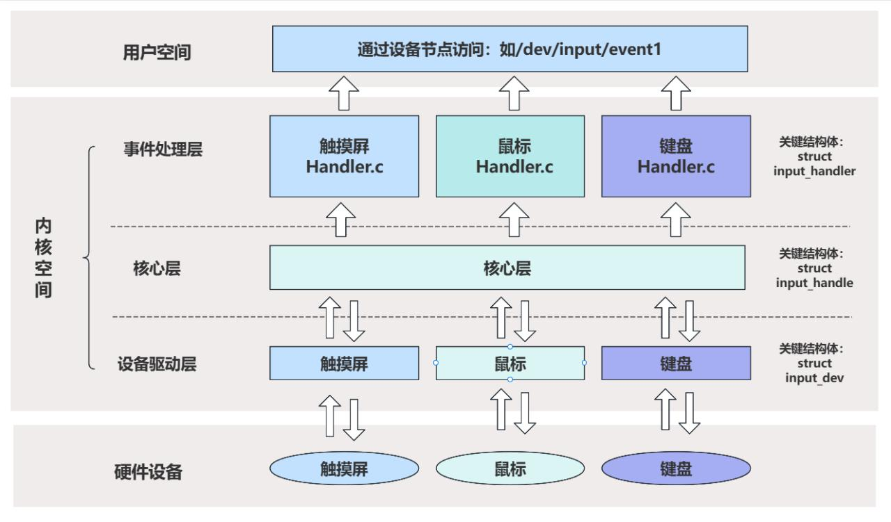

# 第139章 输入子系统框架

内核空间中输入子系统框架可划分为事件处理层、核心层和设备驱动层三个层次，如图139.1 所示。

图139.1下面是对每个层次的详细解释：1.设备驱动层（Device Driver Layer）设备驱动层负责具体输入设备的驱动实现，主要包含硬件操作与接口注册两部分内容。设备驱动层是移植输入设备驱动的核心。在设备驱动层中通过input_dev 结构体描述输入设备，该结构体定义于include/linux/input.h 文件中，核心内容如代码清单139.1 所示。代码清单139.1
```c
struct input_dev {
    const char *name;//设备名称
    const char *phys;//设备在系统中的物理路径
    struct input_id id;//设备ID，在与input handler 匹配时会使用
    unsigned long propbit[BITS_TO_LONGS(INPUT_PROP_CNT)];
    unsigned long evbit[BITS_TO_LONGS(EV_CNT)];//设备支持的事件类型
    unsigned long keybit[BITS_TO_LONGS(KEY_CNT)];//设备支持的按键事件
    unsigned long relbit[BITS_TO_LONGS(REL_CNT)];//设备支持的相对坐标事件
```

```c
unsigned long absbit[BITS_TO_LONGS(ABS_CNT)];//设备支持的绝对坐标事件
unsigned long mscbit[BITS_TO_LONGS(MSC_CNT)];//设备支持的杂项事件
unsigned long ledbit[BITS_TO_LONGS(LED_CNT)];//设备支持的LED 事件
unsigned long sndbit[BITS_TO_LONGS(SND_CNT)];//设备支持的音效事件
unsigned long ffbit[BITS_TO_LONGS(FF_CNT)];//设备支持的力反馈事件
unsigned long swbit[BITS_TO_LONGS(SW_CNT)];//设备支持的开关事件
   //四个设备驱动层操作接口
int (*open)(struct input_dev *dev);
void (*close)(struct input_dev *dev);
int (*flush)(struct input_dev *dev, struct file *file);
int (*event)(struct input_dev *dev, unsigned int type, unsigned int code, int value);
struct device dev;
struct list_head h_list;//记录对应的handle 结构体
struct list_head node;
.......
};
```
2.核心层（Core Layer）：在核心层中创建了名为input 的类，对应的sysfs 目录为/sys/class/input，所有输入设备均会被归类至此。同时，核心层还向内核注册了名为input 的字符设备，主设备号固定为13，所有输入设备共享该主设备号，通过不同的次设备号进行区分。核心层的注册流程实现在drivers/input/input.c 文件中，相关代码如代码清单139.2 所示。代码清单139.2
```c
struct class input_class = {
    .name= "input",
    .devnode = input_devnode,
};
static int __init input_init(void)
{
    //创建输入类
    err = class_register(&input_class);
    //主设备号是13，设备名称为input
    err = register_chrdev_region(MKDEV(INPUT_MAJOR, 0), INPUT_MAX_CHAR_DEVICES, "input");
    .......
}
```
3.事件处理层（Event Handling Layer）
事件处理层中包含不同输入设备的处理方法，如键盘，鼠标等输入设备的处理方法。因为在不同的处理方法中都包含一个名为input_handler 的结构体，所以事件处理层中的关键结构体是input_handler，其定义在include/linux/input.h 文件中，如代码清单139.3 所示。代码清单139.3

```c
struct input_handler {
    void *private;// 私有数据指针
    // 事件处理函数指针
    void (*event)(struct input_handle *handle, unsigned int type, unsigned int code, int value);
    // 批量事件处理函数指针
    void (*events)(struct input_handle *handle, const struct input_value *vals, unsigned int count);
    // 事件过滤函数指针
    bool (*filter)(struct input_handle *handle, unsigned int type, unsigned int code, int value);
    // 匹配函数指针
    bool (*match)(struct input_handler *handler, struct input_dev *dev);
    // 连接函数指针
    int (*connect)(struct input_handler *handler, struct input_dev *dev, const struct input_device_id *id);
    // 断开连接函数指针
    void (*disconnect)(struct input_handle *handle);
    // 启动输入设备函数指针
    void (*start)(struct input_handle *handle);
    bool legacy_minors;// 是否使用旧版次设备号
    int minor;// 设备次设备号
    const char *name;// 设备名称
    const struct input_device_id *id_table;// 输入设备ID 表
    struct list_head h_list;// 处理程序链表头
    struct list_head node;// 处理程序链表节点
};
```

