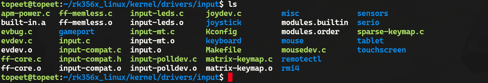
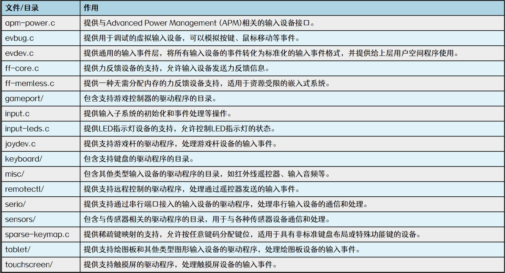
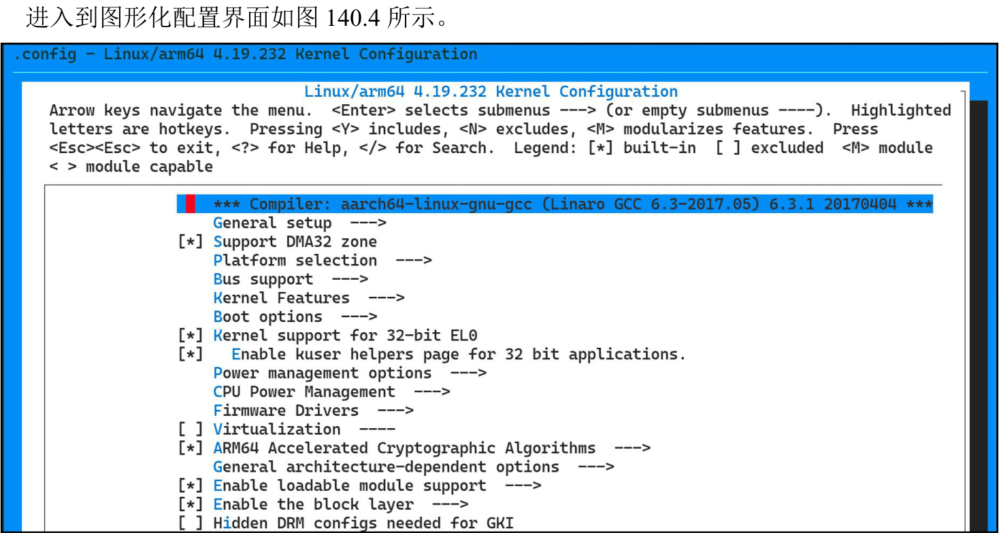
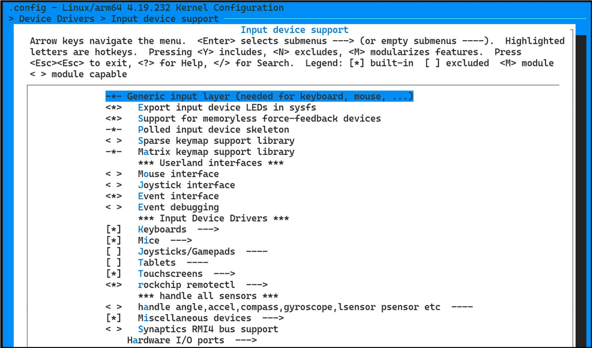

# 第140章 输入子系统源码和裁剪方法介绍

## 140.1 认识内核中输入子系统的源码
输入子系统源码所在内核源码路径为kernel/drivers/input，如图140.1 所示：

图140.1图140.1 中每个文件和文件夹的作用如下表140.1 所示。表140.1

## 140.2 输入子系统源码裁剪方法介绍
默认情况下，linux 内核已经支持了很多输入设备，但是在实际的使用中并不会全部使用，实际应用中如果希望系统尽可能的小，可以对输入子系统进行裁剪，首先在内核源码顶层目录下使用图140.3 中所示命令进入到内核图形化配置界面。


图140.3

图140.4接着进入配置界面如代码清单140.1 所示路径中。代码清单140.1
```c
Device Drivers --->
    Input device support --->
```
如下图140.5 所示


图140.5图140.5 中关键选项注释如代码清单140.2 所示：代码清单140.2
```c
-*- Generic input layer (needed for keyboard, mouse, ...)//input 核心层
││<*>Export input device LEDs in sysfs
││<*>Support for memoryless force-feedback devices
││-*-Polled input device skeleton
││< >Sparse keymap support library
││-*-Matrix keymap support library
││*** Userland interfaces ***
││< >Mouse interface//事件处理层
││< >Joystick interface//事件处理层
││<*>Event interface//事件处理层
││< >Event debugging
││*** Input Device Drivers ***
││[*]Keyboards--->//设备驱动层
││[*]Mice--->//设备驱动层
││[ ]Joysticks/Gamepads----//设备驱动层
││[ ]Tablets----
││[*]Touchscreens--->//设备驱动层
││<*>rockchip remotectl--->
││*** handle all sensors ***
││< >handle angle,accel,compass,gyroscope,lsensor psensor etc
││[*]Miscellaneous devices--->
││< >Synaptics RMI4 bus support
```

```c
││Hardware I/O ports--->
```
代码清单140.2 中注释为设备驱动层的选项对应的是输入设备的驱动程序，如键盘驱动，摇杆驱动等。因此通过图形化配置界面可以把不需要的输入设备驱动取消选中，从而实现对输入子系统的裁剪，达到精简内核的目的。

