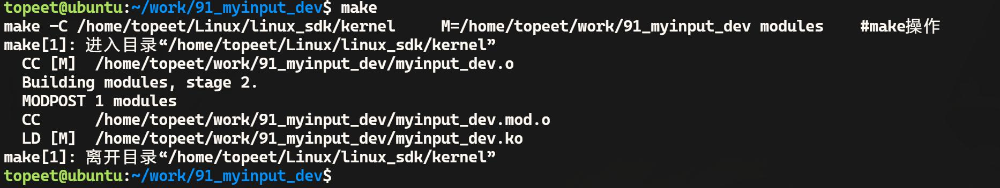
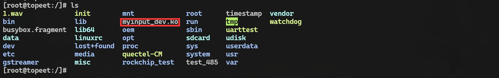
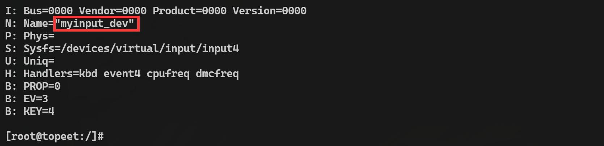

# 第141章 编写最简单的输入设备驱动

在开发输入设备驱动时，事件处理层和核心层的代码一般情况下使用Linux 内核默认提供的即可，因此工程师只需要编写设备驱动层代码，即输入设备驱动即可。本章编写一个最简单的输入设备驱动。
## 141.1 输入设备驱动编写步骤
步骤一：分配input_dev 结构体通过input_allocate_device()函数动态给input_dev 结构体分配内存，该结构体用于描述输入设备。步骤二：初始化input_dev 结构体中的成员初始化内容主要有：（1）设置设备的名称、物理路径等（2）通过__set_bit()声明支持的事件类型及支持的具体事件。（3）若需要自定义事件逻辑，可绑定事件处理函数。步骤三：注册输入设备调用input_register_device()函数将初始化后的input_dev 结构体注册到输入子系统。步骤四：上报事件注册成功后，根据事件类型选择上报事件函数，如上报事件函数input_event()、input_report_key()等。然后调用input_sync()函数同步事件。注：本章实验在编写最简单的输入设备驱动中暂不包含事件上报代码，步骤四具体实现在后续章节中补充。步骤五：注销和资源释放输入设备卸载前，需要调用input_unregister_device()函数从内核注销输入设备。并使用input_free_device()函数释放input_dev 结构体内存，避免资源泄露。

## 141.2 input_allocate_device 函数讲解
input_allocate_device()函数原型在drivers/input/input.c 文件中，具体内容如代码清单141.1所示：代码清单141.1
```c
struct input_dev *input_allocate_device(void)
{
    static atomic_t input_no = ATOMIC_INIT(-1);
    struct input_dev *dev;
    // 分配输入设备结构体的内存
    dev = kzalloc(sizeof(*dev), GFP_KERNEL);
    //初始化输入设备结构体
    if (dev) {
        // 设置设备类型和设备类
        dev->dev.type = &input_dev_type;
        dev->dev.class = &input_class;
        // 初始化设备
        device_initialize(&dev->dev);
        // 初始化互斥锁和事件自旋锁
        mutex_init(&dev->mutex);
        spin_lock_init(&dev->event_lock);
        // 初始化定时器
        timer_setup(&dev->timer, NULL, 0);
        // 初始化链表头
        INIT_LIST_HEAD(&dev->h_list);
        INIT_LIST_HEAD(&dev->node);
        // 设置设备名称，使用原子变量递增来保证唯一性
        dev_set_name(&dev->dev, "input%lu", (unsigned long)atomic_inc_return(&input_no));
        // 增加模块引用计数
        __module_get(THIS_MODULE);
    }
    return dev;
}
```
input_allocate_device()函数的作用是为输入设备结构体input _dev 分配内存并初始化。

## 141.3 初始化input_dev 结构体
input_allocate_device()函数会给input_dev 结构体分配内存，接下来就要初始化input_dev结构体中的成员，初始化input_dev 结构体时必须要初始化的成员作是设置事件类型和设置具体事件类型对应的结构体成员。
### 141.3.1 设置事件类型
在内核源码的include/uapi/linux/input-event-codes.h 头文件中，定义了输入事件类型，常用事件类型如下所示。（1）EV_SYN (0x00): 用于同步事件，表示一组输入事件的结束。（2）EV_KEY (0x01): 用于按键事件，表示按下、释放或重复一个键。（3）EV_REL (0x02): 用于相对位移事件，表示输入设备的相对位置变化，例如鼠标的移动。（4）EV_ABS (0x03): 用于绝对位移事件，表示输入设备的绝对位置变化，例如触摸屏的坐标。（5）EV_MSC (0x04): 用于杂项事件，包含一些特殊目的的事件类型，例如输入设备状态变化等。（6）EV_SW (0x05): 用于开关事件，表示开关的状态变化，例如电源按钮、开合盖等。（7）EV_LED (0x11): 用于LED 事件，表示LED 灯的状态变化。（8）EV_SND (0x12): 用于声音事件，表示声音的播放相关事件。（9）EV_REP (0x14): 用于重复事件，表示键盘重复发送事件。（10）EV_FF (0x15): 用于力反馈事件，表示力反馈设备的输出事件。（11）EV_PWR (0x16): 用于电源事件，表示电源状态变化。（12）EV_FF_STATUS (0x17): 用于力反馈状态事件，表示力反馈设备的状态变化。（13）EV_MAX (0x1f): 输入事件类型的最大值。（14）EV_CNT: 输入事件类型的数量。input_dev 结构体中通过位图表示输入设备支持的功能，位图如代码清单141.2 所示：代码清单141.2
```c
unsigned long propbit[BITS_TO_LONGS(INPUT_PROP_CNT)];// 输入设备的属性位图
unsigned long evbit[BITS_TO_LONGS(EV_CNT)];// 输入设备支持的事件类型位图
unsigned long keybit[BITS_TO_LONGS(KEY_CNT)];// 输入设备支持的按键位图
unsigned long relbit[BITS_TO_LONGS(REL_CNT)];// 输入设备支持的相对坐标位图
unsigned long absbit[BITS_TO_LONGS(ABS_CNT)];// 输入设备支持的绝对坐标位图
unsigned long mscbit[BITS_TO_LONGS(MSC_CNT)];// 输入设备支持的杂项事件位图
```

```c
unsigned long ledbit[BITS_TO_LONGS(LED_CNT)];// 输入设备支持的LED 位图
unsigned long sndbit[BITS_TO_LONGS(SND_CNT)];// 输入设备支持的声音位图
unsigned long ffbit[BITS_TO_LONGS(FF_CNT)];// 输入设备支持的力反馈位图
unsigned long swbit[BITS_TO_LONGS(SW_CNT)];// 输入设备支持的开关位图
```
（1）evbit（事件类型位图）是一个长度为EV_CNT 的数组，每个元素对应一个事件类型。通过设置相应的位，可以指示输入设备支持的事件类型，如按键事件、相对位移事件、绝对位移事件、杂项事件等。（2）keybit（按键类型位图）表示输入设备支持的按键类型，通常与EV_KEY 事件类型相关。通过设置相应的位，可以指示设备支持的按键。（3）relbit（相对位移类型位图）表示输入设备支持的相对位移类型，通常与EV_REL 事件类型相关。通过设置相应的位，可以指示设备支持的相对位移，例如鼠标的移动。（4）absbit（绝对位移类型位图）表示输入设备支持的绝对位移类型，通常与EV_ABS事件类型相关。通过设置相应的位，可以指示设备支持的绝对位移，例如触摸屏的坐标。（5）mscbit（杂项类型位图）表示输入设备支持的杂项类型，通常与EV_MSC 事件类型相关。通过设置相应的位，可以指示设备支持的杂项事件，例如设备状态变化等。（6）ledbit（LED 类型位图）表示输入设备支持的LED 类型，通常与EV_LED 事件类型相关。通过设置相应的位，可以指示设备支持的LED 灯控制。（7）sndbit（声音类型位图）表示输入设备支持的声音类型，通常与EV_SND 事件类型相关。通过设置相应的位，可以指示设备支持的声音事件。（8）ffbit（力反馈类型位图）表示输入设备支持的力反馈类型，通常与EV_FF 事件类型相关。通过设置相应的位，可以指示设备支持的力反馈事件。（9）swbit（开关类型位图）表示输入设备支持的开关类型，通常与EV_SW 事件类型相关。通过设置相应的位，可以指示设备支持的开关状态变化。通过设置位图中相应的位，可以告知输入子系统输入设备所支持的事件类型，使得输入子系统能够正确识别和处理来自输入设备的输入数据。__set_bit 是一个位操作函数，用于设置一个位图中的特定位，例如可以通过下面的代码将输入设备的evbit 位图设置为支持按键事件。
```c
__set_bit(EV_KEY,myinput_dev->evbit)
```
### 141.3.2 设置事件具体类型
什么是事件具体类型呢？如在EV_KEY 按键事件类型中，具体的按键事件类型可以是按

键1，也可以是按键2，按键3 等。事件具体类型定义在头文件include/uapi/linux/input-event-codes.h 中，部分内容如代码清单141.3 所示：代码清单141.3
```c
#define KEY_RESERVED
#define KEY_ESC
#define KEY_1
#define KEY_2
#define KEY_3
#define KEY_4
#define KEY_5
#define KEY_6
#define KEY_7
#define KEY_8
#define KEY_9
```
设置具体事件类型使用__set_bit()函数，例如以下代码设置按键事件的具体事件类型为按键1。
```c
__set_bit(KEY_1,myinput_dev->keybit)
```
## 141.4 驱动程序的编写
本实验代码存放在网盘iTOP-RK3568 开发板\07_学习教程配套资料\03_Linux 驱动配套资料\04_Linux 驱动例程\91_myinput_dev 路径下。本实验代码按照编写最简单的输入设备驱动步骤编写最简单的输入设备驱动代码，实验代码myinput_dev.c 如代码清单141.4 所示。代码清单141.4
```c
#include <linux/input.h>
#include <linux/module.h>
struct input_dev *myinput_dev;
static int myinput_dev_init(void)
{
    int ret;
    步骤1：
    // 分配输入设备结构体
    myinput_dev = input_allocate_device();
    if (myinput_dev == NULL) {
```

```c
printk("input_allocate_device error\n");
return -1;
}
步骤2：
// 设置输入设备的名称
myinput_dev->name = "myinput_dev";
// 设置输入设备支持的事件类型
__set_bit(EV_KEY, myinput_dev->evbit);// 设置支持按键事件
__set_bit(KEY_1, myinput_dev->keybit);// 设置支持按键1
步骤3：
// 注册输入设备
ret = input_register_device(myinput_dev);
if (ret < 0) {
printk("input_register_device error\n");
goto error;
}
return 0;
error:
// 注册失败，释放输入设备结构体
input_free_device(myinput_dev);
return ret;
}
static void myinput_dev_exit(void)
{
步骤5：
// 注销输入设备
input_unregister_device(myinput_dev);
}
module_init(myinput_dev_init);
module_exit(myinput_dev_exit);
MODULE_LICENSE("GPL");
MODULE_AUTHOR("topeet");
```

## 141.5 运行测试
### 141.5.1 编译驱动程序
在上一小节中的myinput_dev.c 代码同一目录下创建Makefile 文件，如图141.1 所示。

图141.1Makefile 文件内容如代码清单141.5 所示。代码清单141.5
```c
export ARCH=arm64#设置平台架构
export CROSS_COMPILE=aarch64-linux-gnu-#交叉编译器前缀
obj-m += myinput_dev.o#此处要和你的驱动源文件同名
KDIR :=/home/topeet/Linux/linux_sdk/kernel#这里是你的内核目录
PWD ?= $(shell pwd)
all:
        make -C $(KDIR) M=$(PWD) modules#make 操作
clean:
        make -C $(KDIR) M=$(PWD) clean#make clean 操作
```
在存放myinput_dev.c 和Makefile 文件目录下使用make 命令编译，编译完成如图141.2 所示。

图141.2编译完生成myinput_dev.ko 目标文件，如下图141.3 所示：

图141.3
### 141.5.2 运行测试
将本章编译好的myinput_dev.ko 驱动文件拷贝到开发板上，拷贝完成如下图141.4 所示：


图141.4在加载驱动之前首先使用ls /dev/input 命令查看当前的输入设备，如下图141.5 所示：

图141.5通过图141.5 可以看到目前有4 个输入设备的设备节点，然后使用insmod myinput_dev.ko命令进行驱动的加载，如下图141.6 所示：

图141.6重新查看设备节点可以看到多出来了一个event4 节点，即event4 节点是最简单的输入设备驱动对应的设备节点，如下图141.7 所示：

图141.7使用cat /proc/bus/input/devices 命令查看设备节点信息，也可以根据名字确定event4 正是最简单的输入设备驱动对应的设备节点，如下图141.8 所示：

图141.8至此，关于最简单的设备驱动程序就测试完成了。

