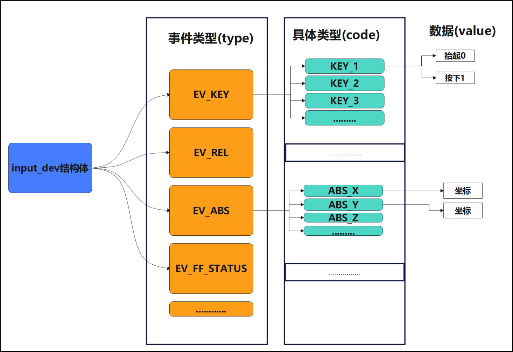
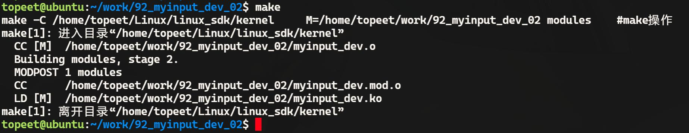
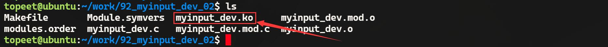
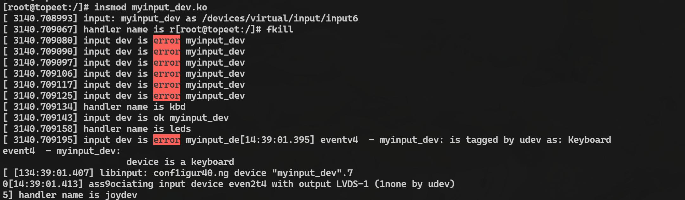
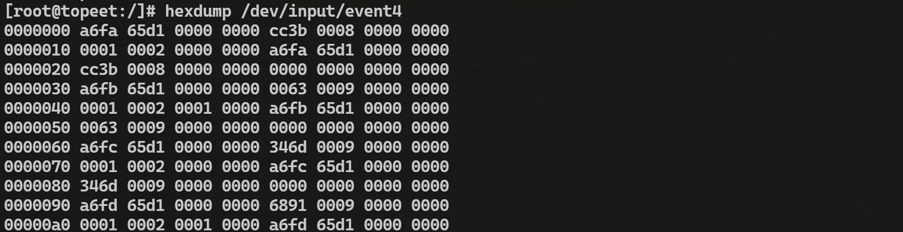
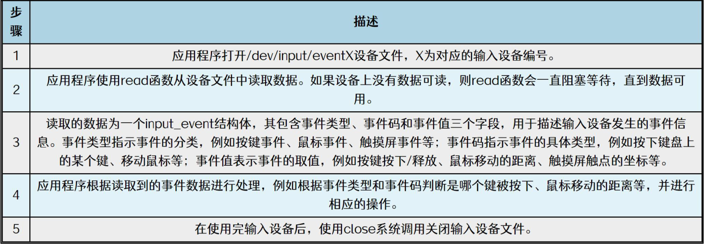
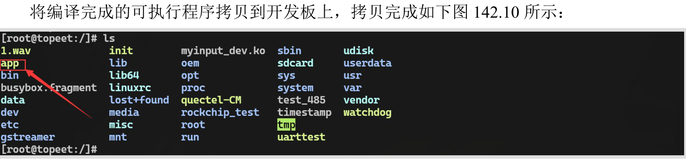

# 第142章 输入设备驱动上报事件代码编写

本章实现上节在最简单的输入设备驱动代码中未实现的步骤4，即上报事件。
## 142.1 上报事件
上报事件当输入设备产生事件时，通过输入设备驱动将该事件上报给输入子系统。在上报事件之前，首先要确定要上报的事件类型和具体事件类型以及具体事件的事件值。图142.1 展示了事件类型与具体事件类型以及事件值的关系。

图142.1常用的上报函数如代码清单142.1 所示：代码清单142.1input_report_key()：上报按键事件，用于通知按键的按下和释放状态。input_report_rel()：上报相对坐标事件，用于通知输入设备的相对位移量，如鼠标的移动。input_report_abs()：上报绝对坐标事件，用于通知输入设备的绝对位置，如触摸屏的坐标。void input_event()：通用上报函数，通用指的是可以上报按键事件，相对坐标事件等所有

事件类型的事件。
## 142.2 常用上报函数介绍
（1）input_report_key()函数函数原型如代码清单142.2 所示。代码清单142.2
```c
input_report_key(struct input_dev *dev, unsigned int code, int value)
```
该函数详细介绍如下：函数功能：上报按键事件。函数参数：dev：输入设备结构体指针，表示要上报事件的输入设备。code 具体按键事件，表示按下或释放的具体按键。value：按键状态，0 表示按键释放，非零值表示按键按下。（2）input_report_rel()函数函数原型如代码清单142.3 所示。代码清单142.3input_report_rel(struct input_dev *dev, unsigned int code, int value)
该函数详细介绍如下：函数功能：上报相对坐标事件。函数参数：dev：输入设备结构体指针，表示要上报事件的输入设备。code：具体相对坐标事件，表示相对坐标的具体类型。如x 轴还是y 轴。value：位置偏移量，表示设备相对于先前坐标的移动量。（2）input_report_abs()函数函数原型如代码清单142.4 所示。代码清单142.4input_report_abs(struct input_dev *dev, unsigned int code, int value)该函数详细介绍如下：函数功能：上报绝对坐标事件。函数参数：dev：输入设备结构体指针，表示要上报事件的输入设备。code：具体绝对坐标事件，表示绝对坐标的具体类型。如x 轴还是y 轴。value：坐标值，表示设备的绝对坐标。（3）input_report_ff_status()函数

函数原型如代码清单142.5 所示。代码清单142.5input_report_ff_status(struct input_dev *dev, unsigned int code, int value)该函数详细介绍如下：函数功能：上报力反馈状态事件。函数参数：dev：输入设备结构体指针，表示要上报事件的输入设备。code：力反馈码，表示力反馈的具体类型。value：力反馈状态，0 表示停止，非零值表示运行中。（4）input_report_switch()函数函数原型如代码清单142.6 所示。代码清单142.6input_report_switch(struct input_dev *dev, unsigned int code, int value)该函数详细介绍如下：函数功能：上报开关事件。函数参数：dev：输入设备结构体指针，表示要上报事件的输入设备。code：开关码，表示开关的具体类型。value：开关状态，0 表示关闭，非零值表示打开。（6）void input_event()函数函数原型如代码清单142.7 所示。代码清单142.7void input_event(struct input_dev *dev,unsigned int type, unsigned int code, int value)该函数详细介绍如下：函数功能：通用上报函数。函数参数：dev：输入设备结构体指针，表示要上报事件的输入设备。type：事件类型。code：具体事件类型。value：具体事件的事件值。（7）input_sync()函数原型如代码清单142.8 所示。代码清单142.8input_sync(struct input_dev *dev)
函数功能：同步事件。函数参数：

dev：输入设备结构体指针，表示要发送同步事件的输入设备。
在使用上报函数之后，需要调用input_sync()函数或者input_event(myinput_dev, EV_SYN,SYN_REPORT, 0)函数进行同步，确保内核及时处理。
## 142.3 驱动程序的编写
本实验代码存储在网盘iTOP-RK3568 开发板\07_学习教程配套资料\03_Linux 驱动配套资料\04_Linux 驱动例程\92_myinput_dev_02\02_module 路径下。在最简单的输入设备驱动中采用定时器循环上报按键事件，实验代码myinput_dev.c 如代码清单142.9 所示。代码清单142.9
```c
#include <linux/module.h>
#include <linux/init.h>
#include <linux/input.h>
#include <linux/timer.h>
struct input_dev *myinput_dev; // 输入设备结构体指针
static void timer_function(struct timer_list *t);
DEFINE_TIMER(test_timer, timer_function); // 定义定时器
static void timer_function(struct timer_list *t) {
    static int value = 0; // 静态变量用于切换键值
    value = value ? 0 : 1;
    input_event(myinput_dev, EV_KEY, KEY_1, value); // 发送按键事件
    input_event(myinput_dev, EV_SYN, SYN_REPORT, 0); // 发送同步事件
    mod_timer(&test_timer, jiffies + msecs_to_jiffies(1000)); // 更新定时器
}
static int myinput_dev_init(void) {
    int ret;
    myinput_dev = input_allocate_device(); // 分配输入设备
    if (myinput_dev == NULL) {
        printk("input_allocate_device error\n");
```

```c
return -ENOMEM;
}
myinput_dev->name = "myinput_dev"; // 设置设备名
set_bit(EV_KEY, myinput_dev->evbit); // 设置支持的事件类型：按键事件
set_bit(EV_SYN, myinput_dev->evbit); // 设置支持的事件类型：同步事件
set_bit(KEY_1, myinput_dev->keybit); // 设置支持的按键键值
ret = input_register_device(myinput_dev); // 注册输入设备
if (ret < 0) {
printk("input_register_device error\n");
goto error;
}
mod_timer(&test_timer, jiffies + msecs_to_jiffies(1000)); // 启动定时器
return 0;
error:
input_free_device(myinput_dev);
return ret;
}
static void myinput_dev_exit(void) {
del_timer(&test_timer); // 删除定时器
input_unregister_device(myinput_dev); // 取消注册输入设备
input_free_device(myinput_dev); // 释放输入设备内存
}
module_init(myinput_dev_init);
module_exit(myinput_dev_exit);
MODULE_LICENSE("GPL");
MODULE_AUTHOR("topeet");
```
## 142.4 运行测试
### 142.4.1 编译驱动程序
在上一小节中的myinput_dev.c 代码同一目录下创建Makefile 文件，如图142.2 所示。


图142.2Makefile 文件内容如代码清单142.10 所示。代码清单142.10
```c
export ARCH=arm64#设置平台架构
export CROSS_COMPILE=aarch64-linux-gnu-#交叉编译器前缀
obj-m += myinput_dev.o#此处要和你的驱动源文件同名
KDIR :=/home/topeet/Linux/linux_sdk/kernel#这里是你的内核目录
PWD ?= $(shell pwd)
all:
        make -C $(KDIR) M=$(PWD) modules#make 操作
clean:
        make -C $(KDIR) M=$(PWD) clean#make clean 操作
```
在存放myinput_dev.c 和Makefile 文件目录下使用make 命令编译驱动，编译完成如下图142.3 所示。

图142.3编译完生成myinput_dev.ko 目标文件，如下图142.4 所示：

图142.4
### 142.4.2 运行测试
将本章节编译好的myinput_dev.ko 驱动文件拷贝到开发板上。在加载驱动之前首先使用ls /dev/input 命令查看/dev/input 目录下的设备节点，如图142.5所示：

图142.5通过图142.5 可以看到目前有4 个输入设备的设备节点，然后使用insmod myinput_dev.ko

命令加载驱动程序，如下图142.6 所示：

图142.6接着重新查看设备节点，可以看到多出来了一个event4 节点，即myinput_dev.c 驱动程序对应的设备节点，使用hexdump /dev/input/event4 命令获取even4 设备节点的输出信息，如果实验成功会每隔一秒打印一次数据，如图142.7 所示：

图142.7至此，最简单的输入设备驱动编写完成。
## 142.5 通过应用程序获取上报数据
在上一个节的实验中，通过hexdump 命令从输入对应的备的设备节点获数据。本节学习如何编写应用程序从输入设备的设备节点中获取上报数据。通过应用程序获取上报数据步骤如图142.8 所示。


图142.8struct input_event 结构体用于描述输入事件，定义在<linux/input.h>头文件中，structinput_event 结构体原型如代码清单142.11 所示。代码清单142.11
```c
struct input_event {
   struct timeval time;
   __u16 type;// 类型
   __u16 code;// 具体事件
   __s32 value;// 对应的取值
};
```
下面对struct input_event 结构体中的三个成员进行讲解。type：用于描述发生了哪一种类型的事件，如发生了代码清单142.12 中的同步事件或者按键事件等。代码清单142.12
```c
#define EV_SYN0x00//同步事件，用于同步事件
#define EV_KEY0x01//按键事件
#define EV_REL0x02//相对位移事件(譬如鼠标)
#define EV_ABS0x03//绝对位移事件(譬如触摸屏)
#define EV_MSC0x04//其它杂事件
......
```
code：表示事件中的哪一个具体事件，如键盘上有很多按键，而code 则告知应用程序是哪一个按键发生了输入事件。比如代码清单142.13 中的ESC 按键，数字按键1 等具体事件。代码清单142.13
```c
#define KEY_RESERVED
#define KEY_ESC//ESC 键
#define KEY_1//数字1 键
```

```c
#define KEY_2//数字2 键
#define KEY_3//数字3 键
#define KEY_4//数字4 键
#define KEY_5//数字5 键
#define KEY_6//数字6 键
#define KEY_7//数字7 键
#define KEY_8//数字8 键
#define KEY_910 //数字9 键
#define KEY_011 //数字0 键
#define KEY_MINUS//减号键
#define KEY_EQUAL13//加号键
#define KEY_BACKSPACE14 //回退键
 ................................
```
value：内核每次上报事件都会向应用层发送一个数据value，对value 值的解释随着code的变化而变化。如对于按键来说，如果value 等于1，则表示按键按下；value 等于0 表示按键松开，如果value 等于2 则表示按键长按。而在绝对位移事件中，如果code 是ABS_X，那么value 值等于X 轴坐标值；如果code 是ABS_Y，此时value 值等于Y 轴坐标值。本实验代码存储在网盘iTOP-RK3568 开发板\07_学习教程配套资料\03_Linux 驱动配套资料\04_Linux 驱动例程\93_input_03 路径下，在代码清单142.14 中获取按键事件并且对value 值进行判断。代码清单142.14
```c
#include <stdio.h>
#include <fcntl.h>
#include <unistd.h>
#include <linux/input.h>
int main() {
    int fd;// 文件描述符
    int ret;// 返回值
    struct input_event event;// 输入事件结构体
    fd = open("/dev/input/event4", O_RDWR);// 打开输入设备文件
    if (fd < 0) {
        printf("打开错误\n");
        return -1;
    }
    while (1) {
        ret = read(fd, &event, sizeof(struct input_event));// 读取输入事件
        if (ret < 0) {
```

```c
printf("读取错误\n");
return -2;
}
if (event.type == EV_KEY) {// 判断事件类型为键盘事件
if (event.code == KEY_1) {// 判断键码为1
    if (event.value == 1)
        printf("值为1\n");
    else if (event.value == 0)
        printf("值为0\n");
}
}
}
return 0;
}
```
## 142.6 应用程序测试
使用aarch64-linux-gnu-gcc app.c -o app 命令对app.c 进行编译，编译完成以后会生成一个名为app 的可执行程序，编译完成如图142.9 所示。

图142.9

图142.10先加载本章编译的myinput_dev.驱动，接着输入./app 命令运行该应用程序，如果实验成功运行结果如下图142.11 所示：

