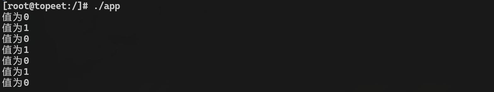
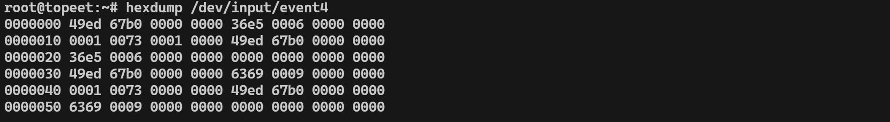

# 第143章 输入子系统上报事件格式分析


图142.11从图142.11 可以看到0 和1 的值每隔一秒钟被交替打印，通过应用程序获取上报事件可以更加直观判断最简单的输入设备驱动是否编写成功。
本章对使用hexdump命令通过输入设备对应的设备节点上报的16 进制数据进行分析。通过hexdump命令获取输入设备通过设备节点上报的16 进制数据如图143.1 所示。

图143.1分析图143.1 中的16 进制数据也涉及到了input_event 结构体，如代码清单143.1 所示。代码清单143.1
```c
struct input_event {
   struct timeval time;
   __u16 type;// 类型
   __u16 code;// 具体事件
   __s32 value;// 对应的取值
};
```
对于input_event 结构体中每个结构体成员，可以根据其字节大小来确定在hexdump 命令输出的数据中对应位置。所以接下来需要确定struct timeval 、__u16 和__s32 类型所占内存大小。这里直接说结论。time.tv_sec 和time.tv_usec 的类型是long int,占8 个字节__u16 type 的类型是unsigned short int,占2 个字节__u16 code 的类型是unsigned short int,占2 个字节__s32 value 的类型是unsigned int，占4 个字节

