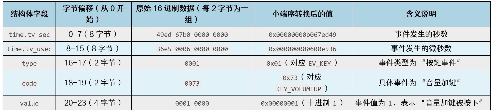
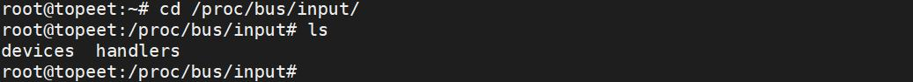

# 第144章 核心层代码分析

所以一个input_event结构体所占字节的大小为8+8+2+2+4 =24 个字节。
以图143.1 中的首个完整事件为例，结合input_event结构体的24 字节固定格式，拆解其硬件事件含义，第一个事件完整的二进制数据为“49ed 67b0 0000 0000 36e5 0006 0000 00000001 0073 0001 0000”，接下来按input_event结构体的字段边界，分析上报数据含义，如图143.2所示。

图143.2
本章对核心层代码input.c 进行分析。输入子系统的核心层代码位于内核源码kernel/drivers/input/input.c 路径下。打开input.c 驱动程序，在input.c 代码中找到驱动入口函数input_init()，如代码清单144.1所示：代码清单144.1
```c
static int __init input_init(void)
{
  int err;
  err = class_register(&input_class);
  if (err) {
    pr_err("unable to register input_dev class\n");
    return err;
    }
  err = input_proc_init();
  if (err)
    goto fail1;
  err = register_chrdev_region(MKDEV(INPUT_MAJOR, 0), INPUT_MAX_CHAR_DEVICES, "input");
  if (err) {
    pr_err("unable to register char major %d", INPUT_MAJOR);
    goto fail2;
    }
    return 0;
```

```c
fail2: input_proc_exit();
fail1: class_unregister(&input_class);
  return err;
}
```
代码清单144.1 中第4 行调用class_register(&input_class)函数向内核注册一个名为input的类，并在/sys/class/路径下创建input 目录。input 目录统一管理所有输入设备。在用户空间中可以通过/sys/class/input 查看输入设备，如图144.1 所示。

图144.1代码清单144.1 中第9 行调用input_proc_init()函数初始化proc 文件系统接口。此函数实现如代码清单144.2 所示。代码清单144.2
```c
static int __init input_proc_init(void)
{
    struct proc_dir_entry *entry;
    proc_bus_input_dir = proc_mkdir("bus/input", NULL);
    if (!proc_bus_input_dir)
      return -ENOMEM;
    entry = proc_create("devices", 0, proc_bus_input_dir, &input_devices_fileops);
    if (!entry)
      goto fail1;
    entry = proc_create("handlers", 0, proc_bus_input_dir, &input_handlers_fileops);
    if (!entry)
      goto fail2;
    return 0;
fail2: remove_proc_entry("devices", proc_bus_input_dir);
fail1: remove_proc_entry("bus/input", NULL);
  return -ENOMEM;
}
```
代码清单144.2 中第4 行调用proc_mkdir()函数创建/proc/bus/input 目录。第7 行和第10行调用proc_create()函数在/proc/bus/input 目录下创建devices 和handlers 文件，如图144.2 所示。

图144.2其中/proc/bus/input/devices 目录列出系统中所有输入设备的详细信息。/proc/bus/input/handlers 目录列出已注册的输入事件处理器。

