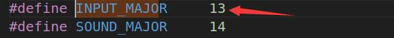
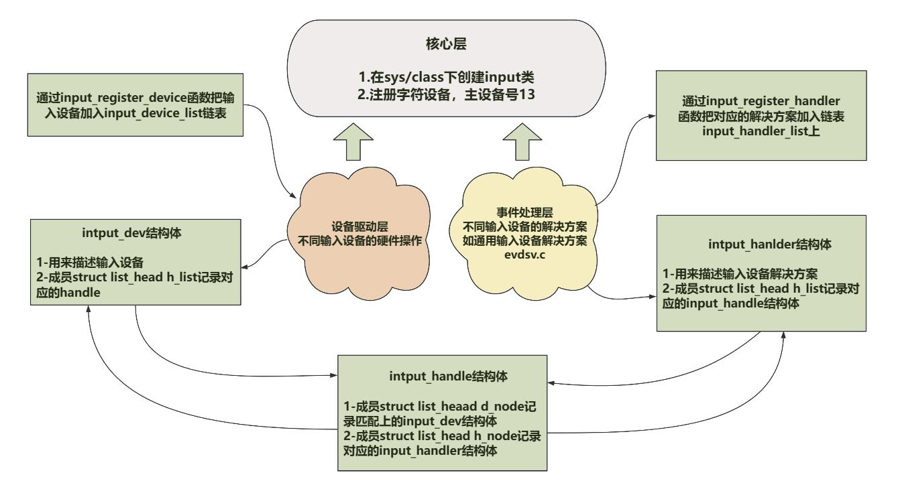

# 第145章 匹配规则

代码清单144.1 中第12 行代码调用register_chrerdev_region()函数向内核注册字符设备号，用于输入设备与用户空间交互。MKDEV(INPUT_MAJOR，0)函数用于生成设备号，主设备号为INPUT_MAJOR（内核预定义为13，如图144.3 所示），次设备号从0 开始。

图144.3核心层的主要作用是初始化输入设备类和注册输入设备号，并提供API 函数。如input_register_device()函数和input_register_handle()函数等
本章从最简单的输入设备驱动入手分析输入设备驱动是如何与事件处理层中的事件解决方法进行匹配的。
## 145.1 核心数据结构分析
匹配过程涉及设备驱动层中的input_dev 结构体、事件处理层中的input_handler 结构体和核心层中的input_handle 结构体。在设备驱动层中，struct input_dev 结构体表示一个输入设备（如键盘，鼠标），部分结构体成员如代码清单145.1 所示。代码清单145.1
```c
struct input_dev {
    const char *name;//设备名称
    const char *phys;//设备在系统中的物理路径
    struct input_id id;//设备ID，在与input handler 匹配时会使用
    unsigned long propbit[BITS_TO_LONGS(INPUT_PROP_CNT)];
    unsigned long evbit[BITS_TO_LONGS(EV_CNT)];//设备支持的事件类型
    unsigned long keybit[BITS_TO_LONGS(KEY_CNT)];//设备支持的按键事件
    unsigned long relbit[BITS_TO_LONGS(REL_CNT)];//设备支持的相对坐标事件
    unsigned long absbit[BITS_TO_LONGS(ABS_CNT)];//设备支持的绝对坐标事件
    unsigned long mscbit[BITS_TO_LONGS(MSC_CNT)];//设备支持的杂项事件
    unsigned long ledbit[BITS_TO_LONGS(LED_CNT)];//设备支持的LED 事件
    unsigned long sndbit[BITS_TO_LONGS(SND_CNT)];//设备支持的音效事件
    unsigned long ffbit[BITS_TO_LONGS(FF_CNT)];//设备支持的力反馈事件
    unsigned long swbit[BITS_TO_LONGS(SW_CNT)];//设备支持的开关事件
```

```c
//四个设备驱动层操作接口
int (*open)(struct input_dev *dev);
void (*close)(struct input_dev *dev);
int (*flush)(struct input_dev *dev, struct file *file);
int (*event)(struct input_dev *dev, unsigned int type, unsigned int code, int value);
struct device dev;
struct list_head h_list;//记录对应的handle 结构体
struct list_head node;
.......
};
```
在事件处理层中，struct input_handler 结构体对应一个事件处理方法（如evdev、mousedev等事件处理方法），结构体成员如代码清单145.2 所示。代码清单145.2
```c
struct input_handler {
    void *private;// 私有数据指针
    // 事件处理函数指针
    void (*event)(struct input_handle *handle, unsigned int type, unsigned int code, int value);
    // 批量事件处理函数指针
    void (*events)(struct input_handle *handle, const struct input_value *vals, unsigned int count);
    // 事件过滤函数指针
    bool (*filter)(struct input_handle *handle, unsigned int type, unsigned int code, int value);
    // 匹配函数指针
    bool (*match)(struct input_handler *handler, struct input_dev *dev);
    // 连接函数指针
    int (*connect)(struct input_handler *handler, struct input_dev *dev, const struct input_device_id *id);
    // 断开连接函数指针
    void (*disconnect)(struct input_handle *handle);
    // 启动输入设备函数指针
    void (*start)(struct input_handle *handle);
    bool legacy_minors;// 是否使用旧版次设备号
    int minor;// 设备次设备号
    const char *name;// 设备名称
    const struct input_device_id *id_table;// 输入设备ID 表
    struct list_head h_list;// 处理程序链表头
    struct list_head node;// 处理程序链表节点
};
```

核心层中的input_handle 结构体用来记录匹配成功的输入设备（input_dev）和事件处理方法（input_handler）。结构体成员如代码清单145.3 所示。代码清单145.3
```c
struct input_handle {
  void *private;
  int open;
  const char *name;
  struct input_dev *dev;//关联的设备
  struct input_handler *handler; //关联的事件处理方法
  struct list_head d_node;//记录匹配上的input_dev 结构体
  struct list_head h_node;//记录handler 结构体
};
```
设备驱动层中的input_dev 结构体、事件处理层中的input_handler 结构体和核心层中的input_handle 结构体之间关系如图145.1 所示：

图145.1
## 145.2 匹配过程分析
设备驱动层的input_dev 结构体由input_register_device()函数注册，该函数的具体内容如代

码清单145.4 所示：代码清单145.4
```c
int input_register_device(struct input_dev *dev)
{
    struct input_devres *devres = NULL;// 输入设备资源结构体指针
    struct input_handler *handler;// 输入处理程序指针
    unsigned int packet_size;// 数据包大小
    const char *path;// 设备路径字符串指针
    int error;
    // ...省略设备初始化检查
    //将设备添加到全局设备链表
    list_add_tail(&dev->node, &input_dev_list);
    //遍历所有已注册的handler，尝试匹配
    list_for_each_entry(handler, &input_handler_list, node)
        input_attach_handler(dev, handler);
    ...
    return error;
}
```
代码清单145.4 中第13 行代码是关键代码，第13 行代码调用input_attach_handler()函数将input_dev 与input_handler 结构体进行匹配。事件处理方法（如evdev）调用input_register_handler()函数注册input_handler 时也会调用input_attach_handler()函数遍历所有已注册的input_dev 并尝试匹配。input_register_handler()函数实现如代码清单145.5 所示。代码清单145.5
```c
int input_register_handler(struct input_handler *handler)
{
  struct input_dev *dev;
  int error;
  error = mutex_lock_interruptible(&input_mutex);
  if (error)
    return error;
  INIT_LIST_HEAD(&handler->h_list);
  //将处理器添加到全局处理器链表
  list_add_tail(&handler->node, &input_handler_list);
  //遍历所有已注册的设备，尝试匹配
  list_for_each_entry(dev, &input_dev_list, node)
      input_attach_handler(dev, handler);
  input_wakeup_procfs_readers();
```

```c
mutex_unlock(&input_mutex);
return 0;
} EXPORT_SYMBOL(input_register_handler);
```
input_attach_handler()函数实现如代码清单145.6 所示。代码清单145.6
```c
static int input_attach_handler(struct input_dev *dev, struct input_handler *handler)
{
    const struct input_device_id *id;
    int error;
    // 步骤一：调用handler 的match 函数检查匹配
    id = input_match_device(handler, dev);
    if (!id)
        return -ENODEV;
    // 步骤二：匹配成功，调用handler 的connect 函数建立连接
    error = handler->connect(handler, dev, id);
    if (error && error != -ENODEV)
        pr_err("failed to attach handler %s to device %s, error: %d\n",
               handler->name, kobject_name(&dev->dev.kobj), error);
    return error;
}
```
代码清单145.6 中第7 行调用input_match_device(handler, dev)函数来确定输入设备和处理程序是否匹配。input_match_device()函数实现如代码清单145.7 所示：代码清单145.7
```c
static const struct input_device_id *input_match_device(struct input_handler *handler, struct input_dev *dev)
{
    const struct input_device_id *id;
    // 遍历处理程序的输入设备ID 表，直到找到匹配的ID 或遍历完所有ID 为止
    for (id = handler->id_table; id->flags || id->driver_info; id++) {
        // 使用输入设备ID 匹配函数判断给定的输入设备是否与当前ID 匹配
        if (input_match_device_id(dev, id) &&
            (!handler->match || handler->match(handler, dev))) {
      // 如果输入设备与ID 匹配，并且处理程序的匹配函数返回true（或者没有匹配函数），则返回
该ID
            return id;
        }
```

```c
}
return NULL;
}
```
input_match_device()函数将input_dev 与input_handler 结构体进行匹配。在进行匹配时用到了input_handler 结构体中的id 列表。input_handler 结构体对应一个事件处理方法（如evdev、mousedev），这里以drivers/input/evdev.c 通用事件处理方法evdev 为例，evdev 通用事件处理方法对应的input_handler 结构体，即evdev_handler 结构体如代码清单145.8 所示：代码清单145.8
```c
static struct input_handler evdev_handler = {
    .event= evdev_event,
    .events= evdev_events,
    .connect = evdev_connect,
    .disconnect= evdev_disconnect,
    .legacy_minors = true,
    .minor= EVDEV_MINOR_BASE,
    .name= "evdev",
    .id_table = evdev_ids,
};
```
代码清单145.8 中evdev_handler 结构体中的id 列表为evdev_ids，evdev_ids 内容如代码清单145.9 所示：代码清单145.9
```c
static const struct input_device_id evdev_ids[] = {
    { .driver_info = 1 },/* Matches all devices */
    { },/* Terminating zero entry */
};
```
通过代码清单145.9 可知，driver_info 为1，因此代码清单145.7 中for 循环的条件总是成立的，在每一次的循环中都会通过id 进行匹配，匹配函数是input_match_device_id()，该函数的内容如代码清单145.10 所示：代码清单145.10
```c
bool input_match_device_id(const struct input_dev *dev,const struct input_device_id *id)
{
        // 检查设备的总线类型是否匹配
        if (id->flags & INPUT_DEVICE_ID_MATCH_BUS)
            if (id->bustype != dev->id.bustype)
                return false;
        // 检查设备的厂商ID 是否匹配
```

```c
if (id->flags & INPUT_DEVICE_ID_MATCH_VENDOR)
    if (id->vendor != dev->id.vendor)
        return false;
// 检查设备的产品ID 是否匹配
if (id->flags & INPUT_DEVICE_ID_MATCH_PRODUCT)
    if (id->product != dev->id.product)
        return false;
// 检查设备的版本号是否匹配
if (id->flags & INPUT_DEVICE_ID_MATCH_VERSION)
    if (id->version != dev->id.version)
        return false;
// 检查设备的事件位图是否是给定ID 的子集
if (!bitmap_subset(id->evbit, dev->evbit, EV_MAX) ||
    !bitmap_subset(id->keybit, dev->keybit, KEY_MAX) ||
    !bitmap_subset(id->relbit, dev->relbit, REL_MAX) ||
    !bitmap_subset(id->absbit, dev->absbit, ABS_MAX) ||
    !bitmap_subset(id->mscbit, dev->mscbit, MSC_MAX) ||
    !bitmap_subset(id->ledbit, dev->ledbit, LED_MAX) ||
    !bitmap_subset(id->sndbit, dev->sndbit, SND_MAX) ||
    !bitmap_subset(id->ffbit, dev->ffbit, FF_MAX) ||
    !bitmap_subset(id->swbit, dev->swbit, SW_MAX) ||
    !bitmap_subset(id->propbit, dev->propbit, INPUT_PROP_MAX)) {
    return false;
}
// 所有匹配条件都满足，返回true
return true;
}
```
以最简单的输入设备驱动实验代码为例，因为通用事件解决方法evdev 中没有设置id 的flags 参数，所以第4、9、14、19 行中的判断都不成立，而bitmap_subset 是一个内联函数，用于判断两个位图是否具有子集关系，而且在id 列表中并未定义evbit、keybit、relbit 等，所以24-33 行的if 判断也不成立，最终该函数会返回true。也就是说evdev 没有通过匹配规则设置限制，所以最简单的输入设备驱动与通用事件处理方法evdev 会直接匹配成功。input_match_device_id()函数返回true 之后继续看input_attach_handler()函数，在该函数中会调用handler->connect 函数把事件处理方法与输入设备建立连接。

