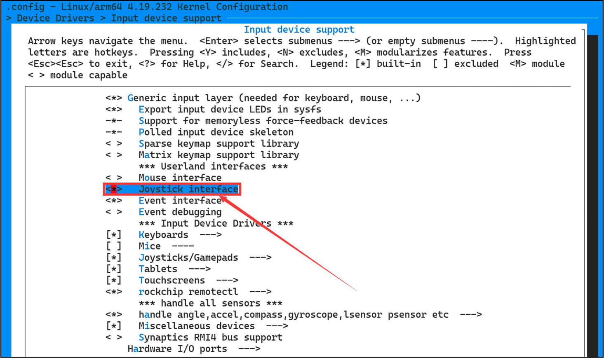
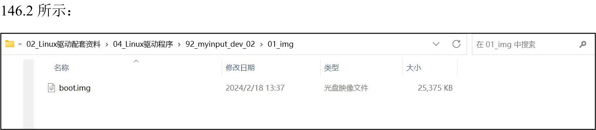

# 第146章 多对多的匹配流程分析

本章通过事件处理方法joydev 分析多对多的匹配关系，多对多的匹配关系指的是多个input_dev 结构体与多个input_handler 结构体进行匹配。
## 146.1 joydev.c 事件处理层匹配分析
drivers/input/joydev.c 驱动中的input_handler 结构体，即joydev_handler 结构体。如代码清单146.1 所示。代码清单146.1
```c
static struct input_handler joydev_handler = {
    .event= joydev_event,
    .match= joydev_match,
    .connect = joydev_connect,
    .disconnect= joydev_disconnect,
    .legacy_minors = true,
    .minor= JOYDEV_MINOR_BASE,
    .name= "joydev",
    .id_table = joydev_ids,
};
static int __init joydev_init(void)
{
    return input_register_handler(&joydev_handler);
}
```
与evdev.c 中的input_handler 结构体类型的evdev_handler 结构体不同的是，input_handler结构体类型joydev_handler 结构体中有匹配函数，即joydev_match 函数，也就是说当输入设备驱动与事件处理层中的事件处理方法joydev 进行匹配的时候，需要joydev_ids 结构体数组和匹配函数共同决定，接下来首先看joydev_handler 结构体中.id_table 成员值joydev_ids，joydev_ids是一个结构体数组，如代码清单146.2 所示：代码清单146.2
```c
static const struct input_device_id joydev_ids[] = {
        // 第一个标识符，匹配X 轴（ABS_X）的绝对事件
{
        .flags = INPUT_DEVICE_ID_MATCH_EVBIT |
                 INPUT_DEVICE_ID_MATCH_ABSBIT,
        .evbit = { BIT_MASK(EV_ABS) },// 匹配的事件类型是EV_ABS（绝对事件）
        .absbit = { BIT_MASK(ABS_X) },// 匹配的绝对事件类型是ABS_X（X 轴）
```

```c
},
    // 第二个标识符，匹配Z 轴（ABS_Z）的绝对事件
{
        .flags = INPUT_DEVICE_ID_MATCH_EVBIT |
                 INPUT_DEVICE_ID_MATCH_ABSBIT,
        .evbit = { BIT_MASK(EV_ABS) },// 匹配的事件类型是EV_ABS（绝对事件）
        .absbit = { BIT_MASK(ABS_Z) },// 匹配的绝对事件类型是ABS_Z（Z 轴）
},
    // 第三个标识符，匹配滚轮（ABS_WHEEL）的绝对事件
{
        .flags = INPUT_DEVICE_ID_MATCH_EVBIT |
                 INPUT_DEVICE_ID_MATCH_ABSBIT,
        .evbit = { BIT_MASK(EV_ABS) },// 匹配的事件类型是EV_ABS（绝对事件）
        .absbit = { BIT_MASK(ABS_WHEEL) },// 匹配的绝对事件类型是ABS_WHEEL（滚轮）
},
    // 第四个标识符，匹配油门（ABS_THROTTLE）的绝对事件
{
        .flags = INPUT_DEVICE_ID_MATCH_EVBIT |
                 INPUT_DEVICE_ID_MATCH_ABSBIT,
        .evbit = { BIT_MASK(EV_ABS) },// 匹配的事件类型是EV_ABS（绝对事件）
        .absbit = { BIT_MASK(ABS_THROTTLE) },// 匹配的绝对事件类型是ABS_THROTTLE（油门）
},
    // 第五个标识符，匹配游戏杆（BTN_JOYSTICK）的按键事件
{
        .flags = INPUT_DEVICE_ID_MATCH_EVBIT |
                 INPUT_DEVICE_ID_MATCH_KEYBIT,
        .evbit = { BIT_MASK(EV_KEY) },// 匹配的事件类型是EV_KEY（按键事件）
        .keybit = { [BIT_WORD(BTN_JOYSTICK)] = BIT_MASK(BTN_JOYSTICK) },// 匹配的按键类型是
BTN_JOYSTICK（游戏杆）
},
    // 第六个标识符，匹配游戏手柄（BTN_GAMEPAD）的按键事件
{
        .flags = INPUT_DEVICE_ID_MATCH_EVBIT |
                 INPUT_DEVICE_ID_MATCH_KEYBIT,
        .evbit = { BIT_MASK(EV_KEY) },// 匹配的事件类型是EV_KEY（按键事件）
        .keybit = { [BIT_WORD(BTN_GAMEPAD)] = BIT_MASK(BTN_GAMEPAD) },// 匹配的按键类型是
BTN_GAMEPAD（游戏手柄）
},
    // 第七个标识符，匹配快乐键（BTN_TRIGGER_HAPPY）的按键事件
{
        .flags = INPUT_DEVICE_ID_MATCH_EVBIT |
                 INPUT_DEVICE_ID_MATCH_KEYBIT,
        .evbit = { BIT_MASK(EV_KEY) },// 匹配的事件类型是EV_KEY（按键事件）
```

```c
.keybit = { [BIT_WORD(BTN_TRIGGER_HAPPY)] = BIT_MASK(BTN_TRIGGER_HAPPY) },// 匹配的按
键类型是BTN_TRIGGER_HAPPY（快乐键）
},
{ }/* 终止项*/
};
```
joydev_ids 是结构体input_device_id 类型的数组，input_device_id 结构体用于描述输入设备的特征，以便内核能够识别和匹配正确的驱动程序。，input_device_id 结构体的主要成员介绍如下：（1 ）flags ：标识符的标志位，用于指定匹配方式。如flags 字段中的INPUT_DEVICE_ID_MATCH_EVBIT 和INPUT_DEVICE_ID_MATCH_ABSBIT 标志表示匹配事件类型和绝对事件类型。（2）evbit：事件类型的位掩码，用于指定要匹配的事件类型。如通过evbit 字段的位掩码表示匹配的事件类型是EV_ABS（绝对事件）或EV_KEY（按键事件）。（3）absbit：具体绝对事件类型的位掩码，用于指定要匹配的具体绝对事件类型。如absbit字段的位掩码表示匹配的具体绝对事件类型是ABS_X（X 轴）、ABS_Z（Z 轴）、ABS_WHEEL（滚轮）或ABS_THROTTLE（油门）。（4）keybit：具体按键类型的位掩码，用于指定要匹配的具体按键类型。如keybit 字段的位掩码表示匹配的具体按键类型是BTN_JOYSTICK（游戏杆）、BTN_GAMEPAD（游戏手柄）或BTN_TRIGGER_HAPPY（快乐键）。在input_attach_handler()函数中会调用input_match_device()函数，其函数原型如代码清单146.3 所示：代码清单146.3
```c
static int input_attach_handler(struct input_dev *dev, struct input_handler *handler)
{
        const struct input_device_id *id;
        int error;
        // 通过输入设备和处理程序的匹配函数来确定是否适用于该设备
        id = input_match_device(handler, dev);
        if (!id)
            return -ENODEV;
        // 调用处理程序的连接函数来建立设备和处理程序之间的连接
        error = handler->connect(handler, dev, id);
        if (error && error != -ENODEV)
```

```c
pr_err("failed to attach handler %s to device %s, error: %d\n",
       handler->name, kobject_name(&dev->dev.kobj), error);
// 如果连接失败且错误码不是-ENODEV，则打印错误消息
return error;
}
```
input_match_device()函数内容如代码清单146.4 所示：代码清单146.4
```c
static const struct input_device_id *input_match_device(struct input_handler *handler, struct input_dev *dev)
{
    const struct input_device_id *id;
    // 遍历处理程序的输入设备ID 表，直到找到匹配的ID 或遍历完所有ID 为止
    for (id = handler->id_table; id->flags || id->driver_info; id++) {
        // 使用输入设备ID 匹配函数判断给定的输入设备是否与当前ID 匹配
        if (input_match_device_id(dev, id) &&
            (!handler->match || handler->match(handler, dev))) {
            // 如果输入设备与ID 匹配，并且处理程序的匹配函数返回true（或者没有匹配函数），则返
回该ID
            return id;
        }
    }
    return NULL;
}
```
代码清单146.4 6-13 行的for 循环中首先会依次取出input_handler 类型的结构体中的id_table 的值一一进行匹配，即joydev_handler 结构体中.id_table 成员值joydev_ids，在for 循环中由于每个joydev_ids 结构体数组中都存在flags 参数且值不为零，所以for 循环的循环条件成立，在for 循环中会调用input_match_device_id()函数判定给定的输入设备是否与当前id 匹配，input_match_device_id()函数内容如代码清单146.5 所示:代码清单146.5
```c
bool input_match_device_id(const struct input_dev *dev,
const struct input_device_id *id)
{
    // 检查设备的总线类型是否匹配
    if (id->flags & INPUT_DEVICE_ID_MATCH_BUS)
        if (id->bustype != dev->id.bustype)
            return false;
```

```c
// 检查设备的厂商ID 是否匹配
if (id->flags & INPUT_DEVICE_ID_MATCH_VENDOR)
    if (id->vendor != dev->id.vendor)
        return false;
// 检查设备的产品ID 是否匹配
if (id->flags & INPUT_DEVICE_ID_MATCH_PRODUCT)
    if (id->product != dev->id.product)
        return false;
// 检查设备的版本号是否匹配
if (id->flags & INPUT_DEVICE_ID_MATCH_VERSION)
    if (id->version != dev->id.version)
        return false;
// 检查设备的事件位图是否是给定ID 的子集
if (!bitmap_subset(id->evbit, dev->evbit, EV_MAX) ||
    !bitmap_subset(id->keybit, dev->keybit, KEY_MAX) ||
    !bitmap_subset(id->relbit, dev->relbit, REL_MAX) ||
    !bitmap_subset(id->absbit, dev->absbit, ABS_MAX) ||
    !bitmap_subset(id->mscbit, dev->mscbit, MSC_MAX) ||
    !bitmap_subset(id->ledbit, dev->ledbit, LED_MAX) ||
    !bitmap_subset(id->sndbit, dev->sndbit, SND_MAX) ||
    !bitmap_subset(id->ffbit, dev->ffbit, FF_MAX) ||
    !bitmap_subset(id->swbit, dev->swbit, SW_MAX) ||
    !bitmap_subset(id->propbit, dev->propbit, INPUT_PROP_MAX)) {
    return false;
}
// 所有匹配条件都满足，返回true
return true;
}
```
在joydev.c 中id->bustype、id->vendor、id->product 和id->version 没有赋值，所以第5 到22 行中的第二层if 判断不成立。然后来看24-35 行的if 判断，bitmap_subset()函数用于判断两个位图是否具有子集关系，只要输入设备满足第24 到35 行中的其中一个，输入设备就会与事件处理方法joydev 匹配成功。joydev_ids 结构体数组中一共描述了7 中不同输入设备的匹配规则用于第24 到35 行中的if 判断。即一个事件处理方法也可以匹配多个输入设备。

## 146.2 多对多匹配实例演示
### 146.2.1 内核源码修改
首先修改内核源码，主要涉及到drivers/input/input.c 文件中的input_match_device_id()函数和input_match_device()函数，修改完成后的input_match_device_id()函数和input_match_device()函数代码内容如代码清单146.6 所示：代码清单146.6
```c
bool input_match_device_id(const struct input_dev *dev,
                const struct input_device_id *id)
{
    if (id->flags & INPUT_DEVICE_ID_MATCH_BUS)
        if (id->bustype != dev->id.bustype)
             return false;
    if (id->flags & INPUT_DEVICE_ID_MATCH_VENDOR)
        if (id->vendor != dev->id.vendor)
             return false;
    if (id->flags & INPUT_DEVICE_ID_MATCH_PRODUCT)
        if (id->product != dev->id.product)
             return false;
    if (id->flags & INPUT_DEVICE_ID_MATCH_VERSION)
        if (id->version != dev->id.version)
             return false;
    if (!bitmap_subset(id->evbit, dev->evbit, EV_MAX) ||
        !bitmap_subset(id->keybit, dev->keybit, KEY_MAX) ||
        !bitmap_subset(id->relbit, dev->relbit, REL_MAX) ||
        !bitmap_subset(id->absbit, dev->absbit, ABS_MAX) ||
        !bitmap_subset(id->mscbit, dev->mscbit, MSC_MAX) ||
        !bitmap_subset(id->ledbit, dev->ledbit, LED_MAX) ||
        !bitmap_subset(id->sndbit, dev->sndbit, SND_MAX) ||
        !bitmap_subset(id->ffbit, dev->ffbit, FF_MAX) ||
        !bitmap_subset(id->swbit, dev->swbit, SW_MAX) ||
        !bitmap_subset(id->propbit, dev->propbit, INPUT_PROP_MAX)) {
             printk("input dev is error %s\n", dev->name);
             return false;
    }
    printk("input dev is ok %s\n", dev->name);
```

```c
return true;
}
EXPORT_SYMBOL(input_match_device_id);
static const struct input_device_id *input_match_device(struct input_handler *handler,
                          struct input_dev *dev)
{
const struct input_device_id *id;
printk("handler name is %s\n", handler->name);
for (id = handler->id_table; id->flags || id->driver_info; id++) {
    if (input_match_device_id(dev, id) &&
        (!handler->match || handler->match(handler, dev))) {
        return id;
    }
}
return NULL;
}
```
相较于原函数只是在第30、33 和42 三行添加了printk 打印，目的是在匹配过程中通过打印更好的了解匹配流程，由于修改的是内核源码，所以需要在修改之后重新编译内核源码，并将编译完成后生成的boot.img 内核镜像烧写到开发板上。注：joydev 事件处理层代码在内核中默认是没有勾选的，需要根据输入子系统的裁剪章节中介绍的方法对内核的默认配置文件进行修改。修改内容为勾选"Joystick interface"选项，勾选完成如下图146.1 所示：


图146.1修改编译完成的boot.img 内核镜像存放在网盘“iTOP-RK3568 开发板\07_学习教程配套资料\03_Linux 驱动配套资料\04_Linux 驱动例程\92_myinput_dev_02\01_img”路径下，如下图

图146.2
### 146.2.2 运行测试
本节测试仍旧使用前面编写的最简单的输入设备驱动对应的ko 文件，使用insmodmyinput_dev.ko 命令加载myinput_dev.ko 文件，打印内容如下图146.3 所示：

