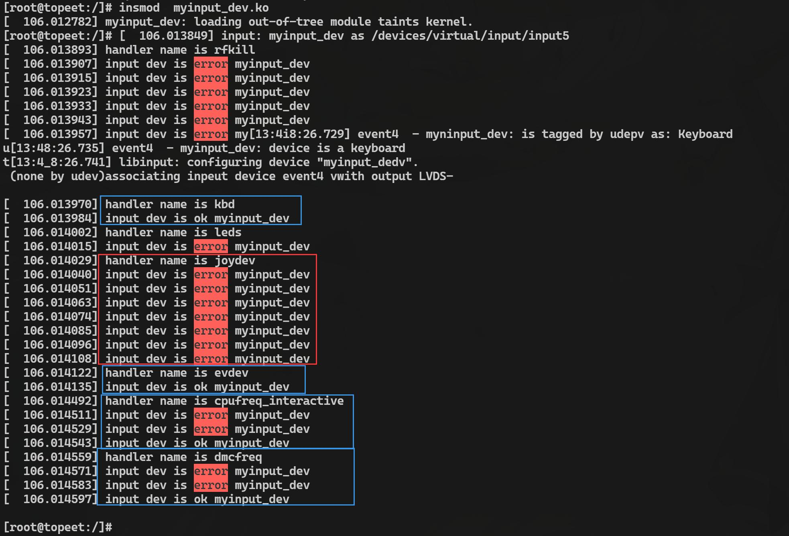

# 第147章 通用事件处理层方案evdev分析


图146.3其中红色框中的是在与joydev 事件处理方法匹配时的打印，通过打印可以看出与joydev事件处理方法匹配失败，而红色框下方的蓝色框中是与evdev 通用事件处理方法进行匹配的打印，通过打印可以看出匹配成功，细心的小伙伴可能会发现最简单的输入设备驱动除与evdev匹配成功以外，还与kbd、cpufreq_interactive 和dmcfreq 匹配成功，这是为什么呢？在Linux 输入子系统中，输入设备（如键盘鼠标）和事件处理方法（如evdev、kbd）之间的匹配关系是多对多的。一个输入设备可以匹配多个事件处理方法，一个事件处理方法也可以匹配多个输入设备。所以除了与evdev 匹配成功以外也匹配成功了kbd、cpufreq_interactive 和dmcfreq 四个事件处理方法。
本章分析通用的事件处理方法evdev.c。

## 147.1 evdev_handler 注册
Linux 内核中提供了一个通用的事件处理方法代码，即driver/input/evdev.c。event.c 也被称为是输入子系统与用户空间交互的“通用翻译官”，它将各类输入设备事件（如按键、坐标、触摸）标准化为统一格式，并通过字符设备节点（/dev/input/eventX）传递给用户空间。在evdev.c 中调用input_register_handler()函数注册evdev_handler，如代码清单147.1 所示。代码清单147.1
```c
static int __init evdev_init(void)
{
  return input_register_handler(&evdev_handler);
}
```
evdev_handler 结构体定义了evdev 的核心行为，在Linux 内核中，evdev_handler 结构体定义在include/linux/input.h 头文件中的evdev.h 中，其结构体原型如代码清单147.2 所示：代码清单147.2
```c
static struct input_handler evdev_handler = {
        .event= evdev_event,// 输入事件处理函数
        .events= evdev_events, // 批量输入事件处理函数
        .connect = evdev_connect,// 当input_dev 和input_handler 匹配成功之后执行的连接处理函数
        .disconnect= evdev_disconnect, // 断开连接处理函数
        .legacy_minors = true, // 设置为true,表示支持传统次设备号，如果设置为false,则使用动态的次设
备号分配方式
        .minor= EVDEV_MINOR_BASE,// 输入设备的基础次设备号
        .name= "evdev",// 输入处理器的名称
        .id_table = evdev_ids,// 输入设备ID 表
    };
```
## 147.2 evdev_connect 函数分析
当input_dev 和evdev_handler 匹配成功之后会执行代码清单146.2 第4 行的回调函数evdev_connect()函数，evdev_connect()函数如代码清单147.3 所示：代码清单147.3
```c
static int evdev_connect(struct input_handler *handler, struct input_dev *dev,const struct input_device_id *id)
{
```

```c
struct evdev *evdev;
int minor;
int dev_no;
int error;
minor = input_get_new_minor(EVDEV_MINOR_BASE, EVDEV_MINORS, true);
if (minor < 0) {
    error = minor;
    pr_err("failed to reserve new minor: %d\n", error);
    return error;
}
//1 分配evdev 结构体内存空间
evdev = kzalloc(sizeof(struct evdev), GFP_KERNEL);
if (!evdev) {
    error = -ENOMEM;
    goto err_free_minor;
}
INIT_LIST_HEAD(&evdev->client_list); //初始化evdev 的客户端链表头
spin_lock_init(&evdev->client_lock);// 初始化evdev 的客户端自旋锁
mutex_init(&evdev->mutex);
init_waitqueue_head(&evdev->wait);// 初始化evdev 的等待队列头
evdev->exist = true;
dev_no = minor;
/* Normalize device number if it falls into legacy range */
if (dev_no < EVDEV_MINOR_BASE + EVDEV_MINORS)
    dev_no -= EVDEV_MINOR_BASE;
dev_set_name(&evdev->dev, "event%d", dev_no); // 设置evdev 的设备名称
//2 初始化evdev 核心成员
evdev->handle.dev = input_get_device(dev);//绑定输入设备
evdev->handle.name = dev_name(&evdev->dev);
evdev->handle.handler = handler;//绑定当前事件处理方法
evdev->handle.private = evdev;
evdev->dev.devt = MKDEV(INPUT_MAJOR, minor); //创建设备节点
evdev->dev.class = &input_class;
evdev->dev.parent = &dev->dev;
evdev->dev.release = evdev_free;
device_initialize(&evdev->dev); // 初始化evdev 的设备结构体
// 3 注册input_handle(连接设备和事件处理器的桥梁)
```

```c
error = input_register_handle(&evdev->handle);
if (error)
    goto err_free_evdev;
cdev_init(&evdev->cdev, &evdev_fops); // 初始化evdev 的字符设备结构体
error = cdev_device_add(&evdev->cdev, &evdev->dev);// 将字符设备添加到系统
if (error)
    goto err_cleanup_evdev;
return 0;
err_cleanup_evdev:
evdev_cleanup(evdev);
input_unregister_handle(&evdev->handle);
err_free_evdev:
put_device(&evdev->dev);
err_free_minor:
input_free_minor(minor);
return error;
}
```
在代码清单147.3 中第3 行定义了一个struct evdev 类型指针。struct evdev 是管理单个输入设备事件生命周期的结构体，定义在drivers/input/evdev.c 文件中。evdev 结构体如代码清单147.4 所示。代码清单147.4
```c
struct evdev {
    int open;//设备打开计数
    struct input_handle handle;//连接输入设备与evdev 的句柄
    wait_queue_head_t wait;//等待队列，阻塞用户空间读操作，事件到达时唤醒
    struct evdev_client __rcu *grab;//客户端链表，管理所有打开该设备的用户进程
    struct list_head client_list;//与evdev 设备关联的客户端链表
    spinlock_t client_lock;//用于保护客户端链表的自旋锁
    struct mutex mutex;// 用于保护对evdev 设备的互斥访问
    struct device dev;//内核设备对象（对应/dev/input/eventX）
    struct cdev cdev;//字符设备结构体
    bool exist;//设备存在标志
};
```
在代码清单清单147.4 中第5 行通过evdev_client 结构体管理与evdev 设备相关联的客户端，在应用程序中每打开一次event 设备节点，就会用一个evdev_client 结构体来表示，系统可以为每个evdev 设备维护多个客户端，并管理每个客户端的状态和属性。在evdev.c 中，也会对这个结构体进行操作，并根据客户端的状态和属性，将接收到的事件写入缓冲区或通知客

户端。evdev_client 结构体如代码清单147.5 所示。代码清单147.5
```c
struct evdev_client {
    unsigned int head;// 缓冲区的头指针，指向下一个可写入的位置
    unsigned int tail;// 缓冲区的尾指针，指向下一个可读取的位置
    unsigned int packet_head;// 下一个数据包的第一个元素的位置
    spinlock_t buffer_lock;// 用于保护对缓冲区、头指针和尾指针的访问的自旋锁
    struct fasync_struct *fasync;// 用于异步通知的结构体指针
    struct evdev *evdev;// 与客户端关联的evdev 设备指针
    struct list_head node;// 与evdev 设备关联的客户端链表节点
    enum input_clock_type clk_type;// 输入时钟类型
    bool revoked;// 标志，指示客户端是否被撤销
    unsigned long *evmasks[EV_CNT];// 用于事件掩码的数组
    unsigned int bufsize;// 缓冲区的大小
    struct input_event buffer[];// 输入事件缓冲区，可变长度数组
};
```
在代码清单147.3 中核心代码是第50-51 行，第50-51 行初始化字符设备，其中evdev_ops是用户空间访问设备的接口，并通过cdev_device_add()函数创建设备节点（/dev/input/eventX）。
## 147.3 evdev_events 函数分析
接下来分析代码清单147.2 中的evdev_event 处理单个输入事件函数和evdev_events 处理多个输入事件函数。在evdev_event()函数中会调用evdev_events 函数，如代码清单147.6 所示。代码清单147.6static void evdev_event(struct input_handle *handle,unsigned int type, unsigned int code, int value){struct input_value vals[] = { { type, code, value } };evdev_events(handle, vals, 1);}所以这里只分析evdev_events 函数即可。evdev_events 函数介绍函数原型：void evdev_events(struct input_handle *handle, const struct input_value *vals,unsigned int count)函数参数：struct input_handle *handle：指向struct input_handle 的结构体指针。const struct input_value *vals：上报的事件对应的数组。unsigned int count：上报的事件对应的数组的大小。其中input_value 结构体用来存放上报事件的type、code 和value 的值。input_value 结构

体原型如代码清单147.7 所示。代码清单147.7struct input_value {__u16 type;__u16 code;__s32 value;};代码清单147.6 中的evdev_event 函数中第4 行代码先定义了一个struct input_value 类型的结构体数组并初始化，然后作为evdev_events 函数的第二个函数参数传递给evdev_events函数。evdev_events 函数如代码清单147.8 所示。代码清单147.8
```c
static void evdev_events(struct input_ handle *handle, const struct input_value *vals, unsigned int count)
{
      struct evdev *evdev = handle->private;// 获取输入句柄的私有数据
      struct evdev_client *client;// 定义evdev 客户端指针
      ktime_t *ev_time = input_get_timestamp(handle->dev);// 获取输入设备的时间戳
      rcu_read_lock();// 开始读取RCU 保护区域
      client = rcu_dereference(evdev->grab);// RCU 安全地获取当前的evdev 客户端
      if (client)
evdev_pass_values(client, vals, count, ev_time);// 如果存在抢占的客户端，则将值传递给抢占的客户端
      else
        list_for_each_entry_rcu(client, &evdev->client_list, node)
             evdev_pass_values(client, vals, count, ev_time);// 否则，将值传递给所有注册的客户端
        rcu_read_unlock();// 结束读取RCU 保护区域
}
```
代码清单147.8 中出现的evdev_client 结构体用来表示客户端，或者说是一个应用程序。应用程序中每打开一次输入设备的设备节点都会在内核中维护一个evdev_client 对象。第9 行代码调用rcu_dereference(evdev->grab)函数获取到了当前正在使用输入设备的应用程序。如成功获取到evdev_client 则调用evdev_pass_values()函数，如何没有获取到evdev_client 则循环遍历evdev->client_list 链表中的每个client 并调用evdev_pass_values()函数。
evdev_pass_values()函数如代码清单147.9 所示。代码清单147.9
```c
static void evdev_pass_values(struct evdev_client *client, const struct input_value *vals, unsigned int count,
ktime_t *ev_time)
    {
        struct evdev *evdev = client->evdev;// 获取evdev 客户端所属的evdev 结构体
```

```c
const struct input_value *v;// 当前处理的输入值
struct input_event event;// 输入事件结构体
struct timespec64 ts;// 时间戳
bool wakeup = false;// 是否需要唤醒等待线程
if (client->revoked)
    return;// 如果客户端已被撤销，则直接返回
ts = ktime_to_timespec64(ev_time[client->clk_type]);// 将ev_time 转换为struct timespec64 类型
的时间戳
event.input_event_sec = ts.tv_sec;// 输入事件的秒字段设置为时间戳的秒值
event.input_event_usec = ts.tv_nsec / NSEC_PER_USEC;// 输入事件的微秒字段设置为时间戳的
纳秒值除以1000 得到的值
/* 关中断，只需获取锁即可。*/
spin_lock(&client->buffer_lock);// 获取客户端的缓冲区锁
for (v = vals; v != vals + count; v++) {
    if (__evdev_is_filtered(client, v->type, v->code))
        continue;// 如果输入值被过滤，则跳过当前值的处理
    if (v->type == EV_SYN && v->code == SYN_REPORT) {
        /* 丢弃空的SYN_REPORT */
        if (client->packet_head == client->head)
            continue;// 如果客户端的数据包头和数据头相同，则跳过当前值的处理
        wakeup = true;// 设置唤醒标志为真
    }
    event.type = v->type;// 设置输入事件的type 字段为当前值的类型
    event.code = v->code;// 设置输入事件的code 字段为当前值的代码
    event.value = v->value;// 设置输入事件的value 字段为当前值的值
    __pass_event(client, &event);// 将输入事件传递给客户端的事件处理函数
}
spin_unlock(&client->buffer_lock);// 释放客户端的缓冲区锁
if (wakeup)
    wake_up_interruptible(&evdev->wait);// 如果需要唤醒等待线程，则唤醒等待队列中的线程
}
```
evdev_pass_values()函数的核心代码是13 到37 行代码，主要是作用是构建输入事件结构

体，即input_event 结构体。然后通过__pass_event(client, &event)函数将输入事件传递给客户端的事件处理函数。_pass_event()函如代码清单147.10 所示。代码清单147.10
```c
static void __pass_event(struct evdev_client *client, const struct input_event *event)
{
   client->buffer[client->head++] = *event;// 将事件复制到客户端的缓冲区中，然后将缓冲区头指针递增
   client->head &= client->bufsize - 1;// 将缓冲区头指针掩码处理，确保其在缓冲区范围内
   if (unlikely(client->head == client->tail)) {
client->tail = (client->head - 2) & (client->bufsize - 1);// 更新缓冲区尾指针，使其指向倒数第二个事件
    client->buffer[client->tail] = (struct input_event) {
                .input_event_sec = event->input_event_sec,
                .input_event_usec = event->input_event_usec,
                .type = EV_SYN,
                .code = SYN_DROPPED,
                .value = 0,
            };// 在缓冲区尾指针位置插入一个EV_SYN/SYN_DROPPED 事件，表示丢弃了事件
            client->packet_head = client->tail;// 更新数据包头指针为缓冲区尾指针
        }
        if (event->type == EV_SYN && event->code == SYN_REPORT) { //遇到事件同步点
            client->packet_head = client->head;// 更新数据包头指针为缓冲区头指针
            kill_fasync(&client->fasync, SIGIO, POLL_IN);// 向注册的异步通知处理函数发送SIGIO 信号，
通知有新的事件可读取
        }
}
```
__pass_event()函数的第4 行代码为核心操作，把输入事件保存client->buffer 缓冲区中。应用程序通过read()函数读取input 设备节点时，最终会从该缓冲区中读取输入事件。

