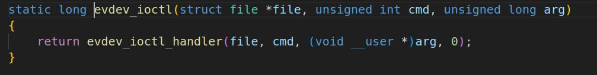
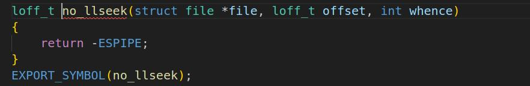

# 第148章 通用事件处理层函数操作集分析

本章分析evdev_ops 函数操作集中的函数。
## 148.1 evdev_ops 函数操作集介绍
evdev.c 驱动中的evdev_ops 是字符设备的函数操作集，即evdev 是字符设备驱动。evdev_ops 结构体如代码清单148.1 所示：代码清单148.1
```c
static const struct file_operations evdev_fops = {
  .owner = THIS_MODULE,
  .read = evdev_read,
  .write = evdev_write,
  .poll = evdev_poll,
   .open = evdev_open,
  .release = evdev_release,
   .unlocked_ioctl = evdev_ioctl,
 #ifdef CONFIG_COMPAT
   .compat_ioctl = evdev_ioctl_compat,
 #endif
  .fasync = evdev_fasync, .llseek = no_llseek,
};
```
evdev_ops 函数操作集中有read()、write() 、poll() 、open()、release()和ioctl()函数。当在应用程序使用read()、write() 、poll() 、open()、release()和ioctl()函数操作evdev.c 驱动生成的设备节点时，会执行evdev_ops 函数操作集中对应的read()、write() 、poll() 、open()、release()和ioctl()函数。
## 148.2 evdev_open 函数分析
evdev_open()函数如代码清单148.2 所示：代码清单148.2
```c
static int evdev_open(struct inode *inode, struct file *file)
{
    // 从inode 的i_cdev 成员中获取evdev 结构体的指针
    struct evdev *evdev = container_of(inode->i_cdev, struct evdev, cdev);
    // 计算缓冲区大小
    unsigned int bufsize = evdev_compute_buffer_size(evdev->handle.dev);
    // 计算分配内存的大小，包括evdev_client 结构体和输入事件缓冲区
    unsigned int size = sizeof(struct evdev_client) + bufsize * sizeof(struct input_event);
    // 定义evdev_client 结构体指针
```

```c
struct evdev_client *client;
int error;
// 分配内存用于存储evdev_client 结构体和输入事件缓冲区
client = kzalloc(size, GFP_KERNEL | __GFP_NOWARN);
if (!client)
    client = vzalloc(size);
if (!client)
    return -ENOMEM;
// 初始化client 结构体的成员变量
client->bufsize = bufsize;
spin_lock_init(&client->buffer_lock);
client->evdev = evdev;
// 将client 添加evdev 的客户端列表中
evdev_attach_client(evdev, client);
// 打开底层设备
error = evdev_open_device(evdev);
if (error)
    goto err_free_client;
// 将client 结构体设置为文件的私有数据
file->private_data = client;
// 使用nonseekable_open 函数打开文件，设置文件为不可寻址的
nonseekable_open(inode, file);
// 返回成功的状态码
return 0;
err_free_client:
// 打开设备失败，需要进行错误处理
// 从evdev 的客户端列表中移除client
evdev_detach_client(evdev, client);
// 释放client 分配的内存
kvfree(client);
// 返回错误码
return error;
}
```
应用程序中使用代码open("/dev/input/eventX")打开输入设备节点时。evdev_open 函数会为每个打开设备的进程创建独立的event_client。对应代码为代码清单148.2 中第13 到26

行。第29 行代码调用evdev_open_device()函数打开输入设备，该函数原型如代码清单148.3所示。代码清单148.3
```c
static int evdev_open_device(struct evdev *evdev)
{
    int retval;
    retval = mutex_lock_interruptible(&evdev->mutex);
    if (retval)
        return retval;
    if (!evdev->exist)
        retval = -ENODEV;
    else if (!evdev->open++) {
        retval = input_open_device(&evdev->handle);
        if (retval)
             evdev->open--;
    }
    mutex_unlock(&evdev->mutex);
    return retval;
}
```
代码清单148.3 第12 行代码调用了input_open_device()函数，input_open_device()函数如代码清单148.4 所示。其中核心代码为第14 和15 行代码，即调用input_dev 结构体中的open 函数打开设备，代码清单148.4
```c
int input_open_device(struct input_handle *handle)
{
  struct input_dev *dev = handle->dev; //从handle 获取关联的输入设备（如键盘的input_dev 实例）
  int retval;
  retval = mutex_lock_interruptible(&dev->mutex); //获取设备互斥锁（可中断）
  if (retval)
    return retval;
  if (dev->going_away) {
    retval = -ENODEV;
    goto out;
  }
  handle->open++; // 当前handle 的打开计数+1（支持同一handle 被多次打开）
  // 若设备首次被打开（users 从0→1），且硬件驱动定义了open 回调
  if (!dev->users++ && dev->open)
    retval = dev->open(dev);// 调用硬件驱动的open 函数（初始化硬件）
```

```c
if (retval) { // 硬件初始化失败（如驱动返回错误）
  dev->users--; // 恢复设备引用计数
  if (!--handle->open) { // 若当前handle 的打开计数归0（无进程使用）
    synchronize_rcu(); // 等待RCU 读临界区结束
  }
}
out:
mutex_unlock(&dev->mutex);
return retval;
}
EXPORT_SYMBOL(input_open_device);
```
## 148.3 evdev_ioctl 函数分析
evdev_ioctl 函数如图148.1 所示。evdev_ioctl 函数中调用了evdev_ioctl_handler()函数。

图148.1evdev_ioctl_handler()函数如代码清单148.5 所示：代码清单148.5
```c
static long evdev_ioctl_handler(struct file *file, unsigned int cmd,void __user *p, int compat_mode)
{
    // 从文件结构获取指向evdev_client 的指针
    struct evdev_client *client = file->private_data;
    // 从evdev_client 获取指向evdev 的指针
    struct evdev *evdev = client->evdev;
    int retval;
    // 尝试获取evdev 的互斥锁，如果无法获取则返回相应的错误码
    retval = mutex_lock_interruptible(&evdev->mutex);
    if (retval)
        return retval;
    // 检查设备是否存在或者客户端是否已被撤销
    if (!evdev->exist || client->revoked) {
        // 如果设备不存在或客户端已被撤销，则返回设备不存在的错误码
```

```c
retval = -ENODEV;
goto out;
}
// 调用evdev_do_ioctl 函数来执行实际的IO 控制操作，并将返回值存储在retval 变量中
retval = evdev_do_ioctl(file, cmd, p, compat_mode);
out:
// 解锁evdev 的互斥锁
mutex_unlock(&evdev->mutex);
// 返回IO 控制操作的结果
return retval;
}
```
evdev_ioctl_handler()函数中第22 行代码调用evdev_do_ioctl()函数来执行实际的IO控制操作,该函数实现如代码清单148.6 所示。代码清单148.6
```c
static long evdev_do_ioctl(struct file *file, unsigned int cmd,void __user *p, int compat_mode)
{
    struct evdev_client *client = file->private_data;
    struct evdev *evdev = client->evdev;
    struct input_dev *dev = evdev->handle.dev;
    struct input_absinfo abs;
    struct input_mask mask;
    struct ff_effect effect;
    int __user *ip = (int __user *)p;
    unsigned int i, t, u, v;
    unsigned int size;
    int error;
    /* First we check for fixed-length commands */
    switch (cmd) {
    case EVIOCGVERSION:
        return put_user(EV_VERSION, ip);
    case EVIOCGID:
        if (copy_to_user(p, &dev->id, sizeof(struct input_id)))
             return -EFAULT;
        return 0;
```

```c
case EVIOCGREP:
    if (!test_bit(EV_REP, dev->evbit))
        return -ENOSYS;
    if (put_user(dev->rep[REP_DELAY], ip))
        return -EFAULT;
    if (put_user(dev->rep[REP_PERIOD], ip + 1))
        return -EFAULT;
    return 0;
case EVIOCSREP:
    if (!test_bit(EV_REP, dev->evbit))
        return -ENOSYS;
    if (get_user(u, ip))
        return -EFAULT;
    if (get_user(v, ip + 1))
        return -EFAULT;
    input_inject_event(&evdev->handle, EV_REP, REP_DELAY, u);
    input_inject_event(&evdev->handle, EV_REP, REP_PERIOD, v);
    return 0;
case EVIOCRMFF:
    return input_ff_erase(dev, (int)(unsigned long) p, file);
case EVIOCGEFFECTS:
    i = test_bit(EV_FF, dev->evbit) ?
             dev->ff->max_effects : 0;
    if (put_user(i, ip))
        return -EFAULT;
    return 0;
case EVIOCGRAB:
    if (p)
        return evdev_grab(evdev, client);
    else
        return evdev_ungrab(evdev, client);
case EVIOCREVOKE:
    if (p)
        return -EINVAL;
    else
        return evdev_revoke(evdev, client, file);
```

```c
case EVIOCGMASK: {
    void __user *codes_ptr;
    if (copy_from_user(&mask, p, sizeof(mask)))
        return -EFAULT;
    codes_ptr = (void __user *)(unsigned long)mask.codes_ptr;
    return evdev_get_mask(client,
                   mask.type, codes_ptr, mask.codes_size,
                   compat_mode);
}
case EVIOCSMASK: {
    const void __user *codes_ptr;
    if (copy_from_user(&mask, p, sizeof(mask)))
        return -EFAULT;
    codes_ptr = (const void __user *)(unsigned long)mask.codes_ptr;
    return evdev_set_mask(client,
                   mask.type, codes_ptr, mask.codes_size,
                   compat_mode);
}
case EVIOCSCLOCKID:
    if (copy_from_user(&i, p, sizeof(unsigned int)))
        return -EFAULT;
    return evdev_set_clk_type(client, i);
case EVIOCGKEYCODE:
    return evdev_handle_get_keycode(dev, p);
case EVIOCSKEYCODE:
    return evdev_handle_set_keycode(dev, p);
case EVIOCGKEYCODE_V2:
    return evdev_handle_get_keycode_v2(dev, p);
case EVIOCSKEYCODE_V2:
    return evdev_handle_set_keycode_v2(dev, p);
}
size = _IOC_SIZE(cmd);
```

```c
/* Now check variable-length commands */
#define EVIOC_MASK_SIZE(nr) ((nr) & ~(_IOC_SIZEMASK << _IOC_SIZESHIFT))
switch (EVIOC_MASK_SIZE(cmd)) {
case EVIOCGPROP(0):
    return bits_to_user(dev->propbit, INPUT_PROP_MAX,
                 size, p, compat_mode);
case EVIOCGMTSLOTS(0):
    return evdev_handle_mt_request(dev, size, ip);
case EVIOCGKEY(0):
    return evdev_handle_get_val(client, dev, EV_KEY, dev->key,
                     KEY_MAX, size, p, compat_mode);
case EVIOCGLED(0):
    return evdev_handle_get_val(client, dev, EV_LED, dev->led,
                     LED_MAX, size, p, compat_mode);
case EVIOCGSND(0):
    return evdev_handle_get_val(client, dev, EV_SND, dev->snd,
                     SND_MAX, size, p, compat_mode);
case EVIOCGSW(0):
    return evdev_handle_get_val(client, dev, EV_SW, dev->sw,
                     SW_MAX, size, p, compat_mode);
case EVIOCGNAME(0):
    return str_to_user(dev->name, size, p);
case EVIOCGPHYS(0):
    return str_to_user(dev->phys, size, p);
case EVIOCGUNIQ(0):
    return str_to_user(dev->uniq, size, p);
case EVIOC_MASK_SIZE(EVIOCSFF):
    if (input_ff_effect_from_user(p, size, &effect))
        return -EFAULT;
    error = input_ff_upload(dev, &effect, file);
    if (error)
        return error;
```

```c
if (put_user(effect.id, &(((struct ff_effect __user *)p)->id)))
    return -EFAULT;
return 0;
}
/* Multi-number variable-length handlers */
if (_IOC_TYPE(cmd) != 'E')
return -EINVAL;
if (_IOC_DIR(cmd) == _IOC_READ) {
if ((_IOC_NR(cmd) & ~EV_MAX) == _IOC_NR(EVIOCGBIT(0, 0)))
    return handle_eviocgbit(dev,
                 _IOC_NR(cmd) & EV_MAX, size,
                 p, compat_mode);
if ((_IOC_NR(cmd) & ~ABS_MAX) == _IOC_NR(EVIOCGABS(0))) {
    if (!dev->absinfo)
        return -EINVAL;
    t = _IOC_NR(cmd) & ABS_MAX;
    abs = dev->absinfo[t];
    if (copy_to_user(p, &abs, min_t(size_t,
             size, sizeof(struct input_absinfo))))
        return -EFAULT;
    return 0;
}
}
if (_IOC_DIR(cmd) == _IOC_WRITE) {
if ((_IOC_NR(cmd) & ~ABS_MAX) == _IOC_NR(EVIOCSABS(0))) {
    if (!dev->absinfo)
        return -EINVAL;
    t = _IOC_NR(cmd) & ABS_MAX;
    if (copy_from_user(&abs, p, min_t(size_t,
```

```c
size, sizeof(struct input_absinfo))))
return -EFAULT;
if (size < sizeof(struct input_absinfo))
abs.resolution = 0;
/* We can't change number of reserved MT slots */
if (t == ABS_MT_SLOT)
return -EINVAL;
/*
* Take event lock to ensure that we are not
* changing device parameters in the middle
* of event.
*/
spin_lock_irq(&dev->event_lock);
dev->absinfo[t] = abs;
spin_unlock_irq(&dev->event_lock);
return 0;
}
}
return -EINVAL;
}
```
evdev_do_ioctl()函数中的ioctl 命令作用如代码清单148.7 所示。根据对应的ioctl 命令即可实现对输入设备的操作。代码清单148.7EVIOCGVERSION: 获取去掉版本号EVIOCGID：获取输入设备的ID 信息EVIOCSREP：获取按键重复设置EVIOCGKEYCODE: 获取按键码EVIOCGKEYCODE_V2: 获取按键映射表EVIOCSKEYCODE：设置按键值EVIOCSKEYCODE_V2：设置按键映射表EVIOCGNAME(len)：获取设备名称EVIOCGPHYS(len)：获取物理位置EVIOCGUNIQ(len)：获取唯一标识符EVIOCGPROP(len)：获取设备属性EVIOCGMTSLOTS(len)：获取多点触控信息EVIOCGKEY(len)：获取全局按键状态EVIOCGLED(len)：获取所有LED 状态

EVIOCGSND(len)：获取所有声音状态EVIOCGSW(len)：获取所有开关状态EVIOCGBIT(ev,len)：获取事件位图EVIOCGABS(abs)：获取绝对值/范围EVIOCSABS(abs)：设置绝对值/范围EVIOCSFF：发送力反馈效果到力反馈设备EVIOCRMFF：删除力反馈效果EVIOCGEFFECTS：报告同时可播放的效果数量EVIOCGRAB：占用/释放输入设备EVIOCREVOKE：撤销设备访问权限EVIOCGMASK：检索当前事件掩码EVIOCSMASK：设置事件掩码EVIOCSCLOCKID：设置用于时间戳的时钟标识
## 148.4 evdev_poll 函数分析
evdev_poll()函数如代码清单148.8 所示：代码清单148.8
```c
static __poll_t evdev_poll(struct file *file, poll_table *wait)
{
        // 获取文件私有数据中的evdev_client 结构体指针
        struct evdev_client *client = file->private_data;
        // 获取evdev_client 结构体中的evdev 指针
        struct evdev *evdev = client->evdev;
        __poll_t mask;
        // 将当前进程加入到等待队列中，等待evdev->wait 的唤醒事件
        poll_wait(file, &evdev->wait, wait);
        // 检查evdev->exist 和client->revoked 的值
        if (evdev->exist && !client->revoked)
            // 如果evdev 存在且client 未被撤销，设置mask 为EPOLLOUT | EPOLLWRNORM
            mask = EPOLLOUT | EPOLLWRNORM;
        else
            // 否则，设置mask 为EPOLLHUP | EPOLLERR
            mask = EPOLLHUP | EPOLLERR;
        // 检查client 中的packet_head 和tail 的值
        if (client->packet_head != client->tail)
            // 如果packet_head 和tail 不相等，设置mask 为mask | EPOLLIN | EPOLLRDNORM
            mask |= EPOLLIN | EPOLLRDNORM;
```

```c
// 返回最终的mask 值
return mask;
}
```
evdev_poll()函数中首先将当前进程添加到等待队列中。然后根据evdev->exist 和client->revoked 的值设置mask 的值。如果evdev 存在且client 未被撤销，则将mask 设置为EPOLLOUT | EPOLLWRNORM，表示可写入。否则，将mask 设置为EPOLLHUP | EPOLLERR，表示发生错误或连接已挂断。接下来，函数检查client 中的packet_head 和tail 的值，如果它们不相等，则将mask 设置为mask | EPOLLIN | EPOLLRDNORM，表示可读取。最后，函数返回最终的mask 值。evdev_poll()函数是evdev 驱动中响应用户空间poll()/select()/epoll()系统调用的回调函数，用于告知用户进程当前是否有可读取的输入事件（如按键、触摸坐标），或是否需要阻塞等待事件。
## 148.5 evdev_fasync 函数分析
evdev_fasync()函数如代码清单148.9 所示：代码清单148.9
```c
static int evdev_fasync(int fd, struct file *file, int on)
{
        // 获取文件私有数据中的evdev_client 结构体指针
          struct evdev_client *client = file->private_data;
        return fasync_helper(fd, file, on, &client->fasync);
}
```
evdev_fasync()函数首先从文件的私有数据中获取evdev_client 结构体指针。然后调用fasync_helper()函数进行fasync_struct 结构体初始化。
## 148.6 no_llseek 函数分析
no_llseek()函数如图148.2 所示：


图148.2no_llseek()函数将-ESPIPE 作为返回值直接返回。这个函数的作用是阻止对设备文件执行llseek 操作，也就是不允许通过改变文件位置指针来访问设备文件。
## 148.7 evdev_release 函数分析
evdev_release()函数如代码清单148.10 所示：代码清单148.10
```c
static int evdev_release(struct inode *inode, struct file *file)
{
        // 获取文件私有数据中的evdev_client 结构体指针
        struct evdev_client *client = file->private_data;
        // 获取evdev_client 结构体中的evdev 指针
        struct evdev *evdev = client->evdev;
        unsigned int i;
        // 获取evdev 的互斥锁，确保对evdev 的操作是原子的
        mutex_lock(&evdev->mutex);
        // 检查evdev->exist 和client->revoked 的值
        if (evdev->exist && !client->revoked)
            // 如果evdev 存在且client 未被撤销，调用input_flush_device 函数刷新设备的输入缓冲区
            input_flush_device(&evdev->handle, file);
        // 释放evdev 的抢占状态，将客户端从抢占列表中移除
        evdev_ungrab(evdev, client);
        // 解锁evdev 的互斥锁
        mutex_unlock(&evdev->mutex);
        // 从evdev 中分离并释放客户端
        evdev_detach_client(evdev, client);
        // 释放客户端的事件掩码内存
        for (i = 0; i < EV_CNT; ++i)
            bitmap_free(client->evmasks[i]);
        // 释放客户端的内存
        kvfree(client);
        // 关闭evdev 设备
        evdev_close_device(evdev);
```

```c
// 返回0 表示成功释放资源
return 0;
}
```
evdev_release()函数主要作用是当用户进程关闭输入设备文件描述符时，清理客户端资源，释放设备抢占状态，并最终通过引用计数触发底层硬件的关闭。
## 148.8 evdev_read 函数分析
evdev_read()函数如代码清单148.11 所示：代码清单148.11
```c
static ssize_t evdev_read(struct file *file, char __user *buffer,size_t count, loff_t *ppos)
{
    // 获取当前文件对应的客户端实例（存储用户会话信息）
    struct evdev_client *client = file->private_data;
    // 从客户端获取关联的evdev 设备结构体
    struct evdev *evdev = client->evdev;
    // 临时存储读取到的输入事件（如按键、坐标等）
    struct input_event event;
    // 记录已成功读取到用户空间的字节数
    size_t read = 0;
    // 错误码存储
    int error;
    // 检查读取大小合法性：若非零则必须至少能容纳一个完整事件（通常16 字节）
    if (count != 0 && count < input_event_size())
        return -EINVAL;
    // 主循环：持续读取事件直到满足条件
    for (;;) {
        // 若设备已移除或客户端被撤销（如设备断开），返回设备不存在错误
        if (!evdev->exist || client->revoked)
             return -ENODEV;
        // 非阻塞模式下：若缓冲区为空，返回"重试"错误（EAGAIN）
        if (client->packet_head == client->tail &&
            (file->f_flags & O_NONBLOCK))
             return -EAGAIN;
        /*
         * 特殊情况：count=0 时不读取数据，仅检查设备状态（如用户调用read(fd, NULL, 0)）
```

```c
*/
if (count == 0)
   break;
// 循环读取事件：直到缓冲区为空或达到用户请求的读取大小
while (read + input_event_size() <= count &&
      evdev_fetch_next_event(client, &event)) {
   // 将事件数据复制到用户空间缓冲区，失败返回内存访问错误
   if (input_event_to_user(buffer + read, &event))
       return -EFAULT;
   // 累加已读取的字节数（每个事件固定大小）
   read += input_event_size();
}
// 若已读取到数据，跳出循环并返回结果
if (read)
   break;
// 阻塞模式下：等待事件到来（可被信号中断）
if (!(file->f_flags & O_NONBLOCK)) {
   // 等待队列：当缓冲区有数据/设备移除/客户端撤销时唤醒
   error = wait_event_interruptible(evdev->wait,
            client->packet_head != client->tail ||
            !evdev->exist || client->revoked);
   if (error)
       return error;// 被信号中断，返回错误码（如-EINTR）
}
}
// 返回实际读取的字节数（可能为0，对应count=0 的情况）
return read;
}
```
evdev_read()函数中最重要的代码是第35 行-45 行，这段代码通过while 循环调用evdev_fetch_next_event()函数从缓冲区中读取输入事件。
## 148.9 evdev_write 函数分析
evdev_write()函数如代码清单148.12 所示：

代码清单148.12
```c
static ssize_t evdev_write(struct file *file, const char __user *buffer, size_t count, loff_t *ppos)
{
    struct evdev_client *client = file->private_data;// 从文件对象获取客户端实例（用户会话）
    struct evdev *evdev = client->evdev;// 获取客户端关联的evdev 设备
    struct input_event event;// 输入事件结构体（时间戳、类型、代码、值）
    int retval = 0;// 函数返回值（实际写入字节数或错误码）
    //校验写入大小，非0 时必须至少容纳一个完整事件（input_event 结构体固定大小）
    if (count != 0 && count < input_event_size())
        return -EINVAL;//写入大小不合法，返回参数错误
    //获取设备互斥锁（可被信号中断），保护设备状态和事件注入过程
    retval = mutex_lock_interruptible(&evdev->mutex);
    if (retval)
        return retval;// 锁获取失败（如被信号中断），返回错误码
    // 检查设备是否存在及客户端是否有效（如设备未断开且未被内核撤销）
    if (!evdev->exist || client->revoked) {
        retval = -ENODEV;// 设备不存在或客户端失效，返回错误码
        goto out;// 跳转到解锁逻辑
    }
    // 循环读取用户缓冲区事件，直到剩余空间不足一个事件或数据处理完成
    while (retval + input_event_size() <= count) {
        // 从用户空间复制事件数据到内核（反向验证用户输入合法性）
        if (input_event_from_user(buffer + retval, &event)) {
             retval = -EFAULT;// 用户缓冲区地址无效（如野指针），返回段错误
             goto out;
        }
        retval += input_event_size();// 更新已处理字节数
        // 将事件注入到输入子系统，由底层硬件驱动模拟输入（如模拟按键按下）
        input_inject_event(&evdev->handle, event.type, event.code, event.value);
        cond_resched();// 主动调度，避免批量写入时长时间占用CPU
    }
    out:
    mutex_unlock(&evdev->mutex);// 释放设备互斥锁
    return retval;// 返回实际写入字节数（或错误码）
}
```
evdev_write()函数中最重要的代码是第23 行到第35 行代码，第23 到35 行代码首先通

