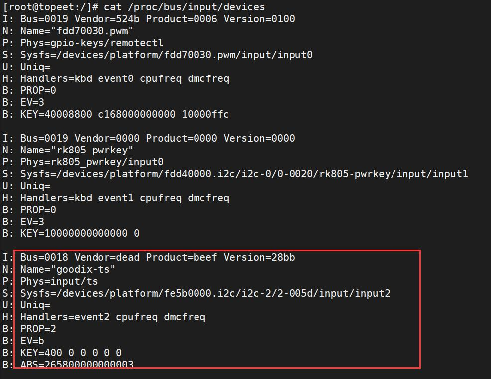
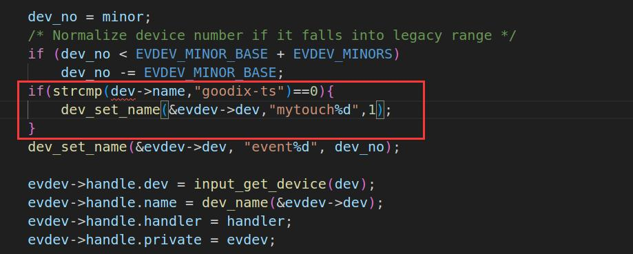

# 第149章 固定输入设备的设备节点实验

过循环条件确保剩余缓冲区可容纳至少一个完整事件（input_event 结构体），然后调用input_event_from_user()函数从用户空间复制事件数据到内核，接着通过input_inject_event()函数把数据写入到client->buffer 中。
本章学习如何固定输入设备的设备节点，在嵌入式Linux 开发中，外设驱动的动态加载顺序可能因厂商、设备型号差异发生变化（例如触摸板、USB 转串口等输入设备），这会导致相同的输入设备在/dev/input 目录下的evdev 节点（如event0、event1）编号动态改变。但是应用程序通常依赖固定节点路径进行设备访问，节点编号的不确定性将直接引发设备访问失败。
## 149.1 处理方法
本节以iTOP-RK3568 开发板和10.1 寸LVDS 高清屏幕为例，讲解如何固定10.1 寸LVDS 高清屏幕触摸芯片对应的设备节点。步骤1：先确定想要固定设备节点的设备节点。使用cat /proc/bus/input/devices 命令找到10.1 寸LVDS 高清屏幕触摸芯片对应的设备节点,如下图149.1 所示10.1 寸LVDS 高清屏幕触摸芯片对应的设备节点为/dev/input/event2。

图149.1步骤2：触摸芯片对应的事件处理方法为evdev，所以接下来修改evdev.c 中的evdev_connect()函数。在evdev_connect()函数中会根据设备名称进行条件判断,如图149.2 所示。所以只需要通过if 判断当输入设备是10.1 寸LVDS 屏幕对应的触摸芯片时就使用dev_set_name 函数设置一个固定的设备节点名即可。设备节点的名称可以根据需求进行自定义设置。

图149.2

