# 第150章 固定usb设备的设备节点实验

按照图149.2 修改完成之后，重新烧写内核镜像。连接好硬件后进入/dev/input 目录下，如果按照图149.2 方法修改成功，在该目录下会生成mytouch1 节点，如图149.3 所示：

图149.3接下来hexdump mytouch1 命令，然后按触摸屏，如果实验成功会发现有数据上报，如下图149.4 所示：
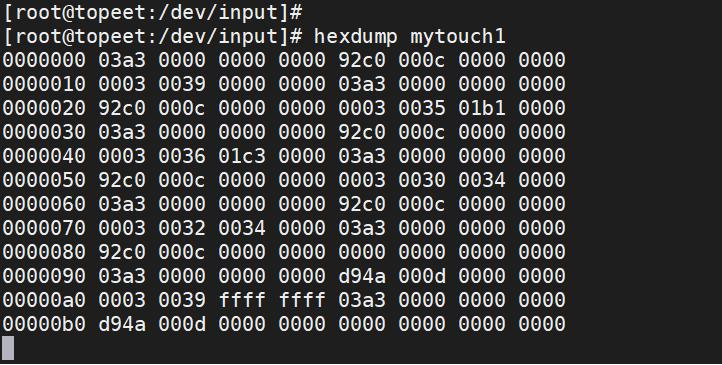
图149.4
本章学习如何固定usb 设备的设备节点。如Linux 系统接入多个usb 转串口设备时，usb转串口设备的插拔顺序的变化会导致/dev/ttyUSBx 或/dev/ttyACMx 等节点名称动态改变，进而造成应用程序因固定节点路径失效而无法正常访问设备。解决该问题的方法是通过udev 设备管理规则实现节点静态命名，确保设备节点路径不受物理连接顺序影响。
## 150.1 处理方法
我们先复现问题。首先将iTOP-RK3568 开发板上的拨码开关向上拨动，此时USB3.0 可以

接USB 设备。J6 usb 接口也可以连接USB 设备。如图150.1 所示，
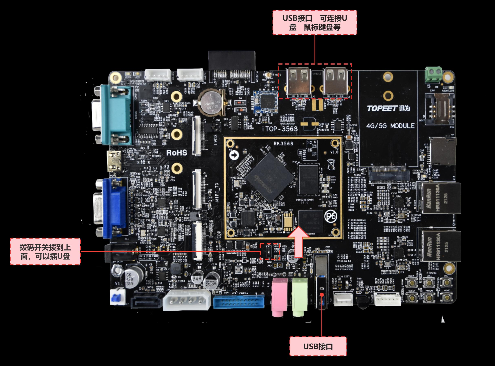
图150.1
本实验uildroot 系统，首先确保内核支持ch34x 驱动，如果内核不支持的，需要在内核make menuconfig 中配置如图150.2 所示的选项并编译内核。
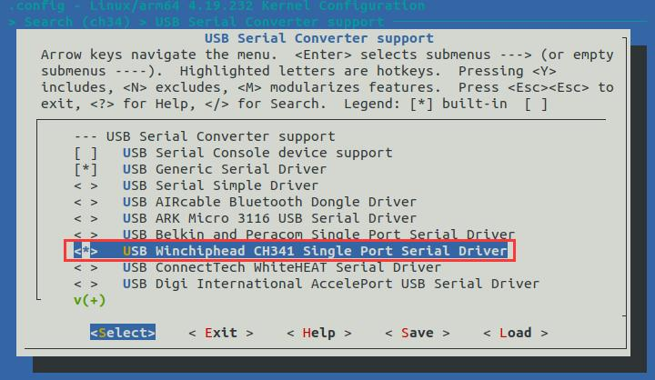

图150.2接着在usb3.0 接口插入usb 转串口模块，打印如下图150.3 所示：
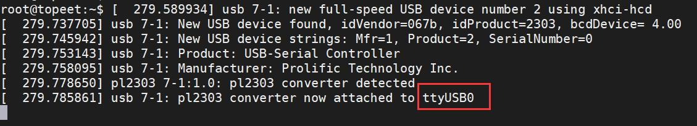
图150.3然后再J6 usb 接口插入另一个usb 转串口模块，打印如下图150.4 所示：
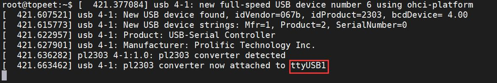
图150.4
跟着老师往下走即可，不必纠结。通过图150.3 和图150.4 可知在usb3.0 接口插入的usb 转串口模块的设备节点是ttyUSB0,在usbJ6 接口插入的USB 转串口模块的设备节点是ttyUSB1,但是如果我们先插usbJ6 接口的usb转串口模块，再插入usb3.0 接口插入的usb 转串口模块。usb 转串口模块对应的设备节点就会发生变化。如图150.5 和图150.6 所示。J6 usb 接口插入另一个usb 转串口模块，打印如下图150.5 所示：
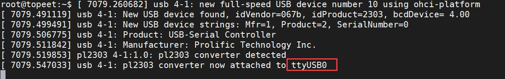
图150.5在usb3.0 接口插入usb 转串口模块，打印如下图150.6 所示：
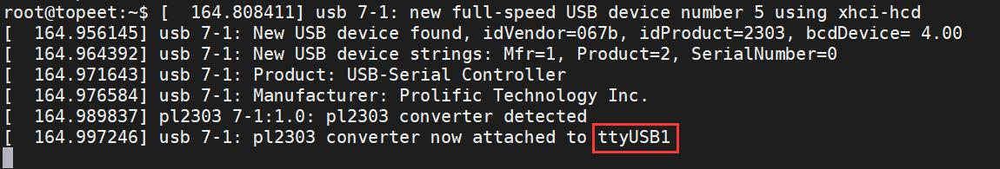
图150.6所以复现了插拔usb 转串口模块的顺序变化导致设备节点发生变化的情况。然后我们看如何解决这个问题。

在iTOP-RK3568 开发板的usb3.0 接口上插上usb 转串口模块，节点为/dev/ttyUSB0，然后输入udevadm info -a -n /dev/ttyUSB0 命令，注意命令中的ttyUSB0 节点需要根据实际情况修改，如下图150.7 所示。
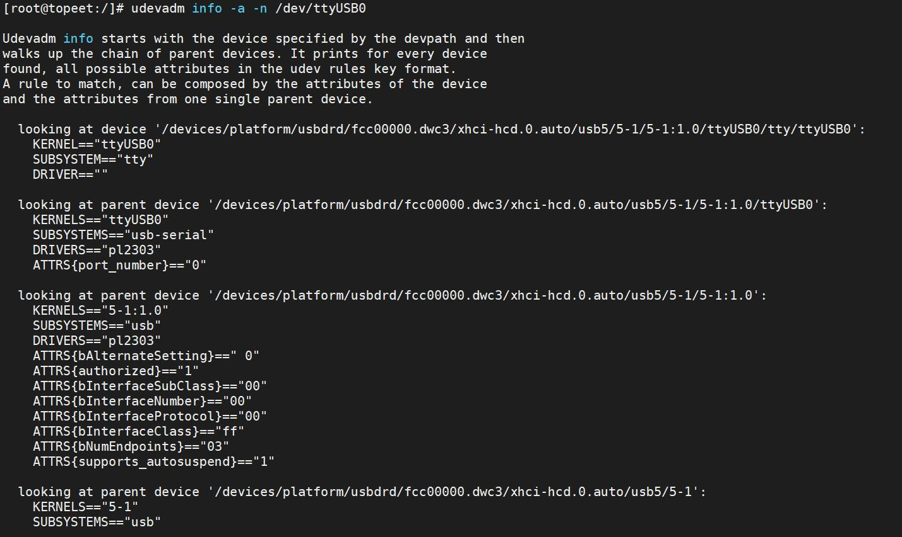
图150.7图150.7 中udevadm info -a -n /dev/ttyUSB0 是一个用于获取设备节点详细信息的命令，如获取设备的属性、驱动程序、设备路径等。-a 和-n 参数含义如下所示：-a：显示与指定设备节点相关联的所有属性。-n：指定设备节点的路径或名称。通过图150.7 中的内容可知ttyUSB0 对应的usb 转串口设备路径如图150.8 所示。

图150.8设备类型即图150.7 中的SUBSYSTEM，为usb。接下来通过这俩个信息编写udev 规则。在开发板的etc/udev/rules.d/目录下创建一个名为001.rules 的规则文件，并写入代码150.7 中的代码，如下图150.9 所示：

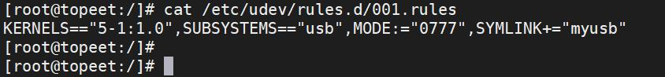
图150.9代码清单150.1KERNELS==”5-1:1.0”,SUBSYSTEMS==”usb”,MODE:=”0777”,SYMLINK+=”myusb”代码清单150.7 中SYMLINK 是创建一个符号链接，当插入一个USB 设备时，udev 规则可以自动创建一个符号链接，指向USB 设备上的系统路径，从而创建名为myusb 的设备节点。修改完毕之后，重新启动开发板。首先在usb3.0 接口插上usb 转串口模块，打印的节点为ttyUSB0,如下图150.10 所示：
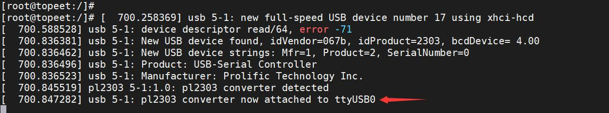
图150.10然后在usbJ6 接口插上usb 转串口模块，打印如下图150.11 所示：
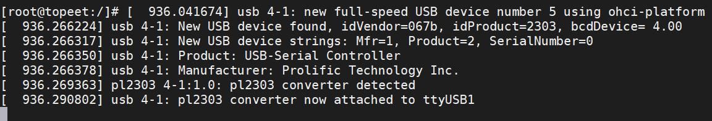
图150.11usb3.0 连接的usb 转串口模块的设备节点设置了软链接到/dev/myusb，如下图150.12 所示：
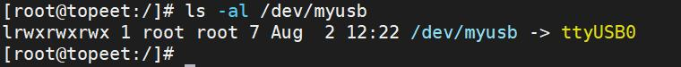
图150.12然后改变usb 转串口的插入顺序。我们先把usb 转串口插入usbJ6 接口，此时对应节点为ttyUSB0，再把另一个usb 转串口插入usb3.0 接口，此时对应节点为ttyUSB1。然后再次查看usb3.0 连接的usb 转串口模块的设备节点,如下图150.13 所示：

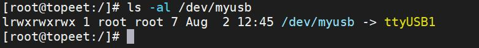
图150.13由此可见，应用程序只需要打开/dev/myusb 节点就可以操作对应的usb 转串口设备，并且不受顺序影响。

