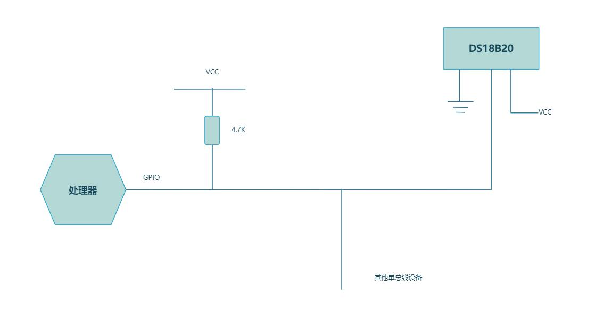

# 第151章 单总线简介

单总线（One-Wire）是一种串行通信协议，用于电子设备之间的数据和控制信号传输。顾名思义，单总线仅需一根信号线即可实现数据的双向传输，即这根信号线既可以发送数据也可以接收数据。单总线具有节省IO 口资源、结构简单、易于扩展等特点，广泛应用在温湿度传感器、EEPROM存储器等外设中。本篇以温度传感器ds18b20 为例，学习单总线通信原理及其驱动开发。ds18b20 是一种基于单总线协议的数字温度传感器，其通过单总线与处理器连接，典型硬件连接如图151.1 所示。

图151.1为确保可以正常通信和设备识别，ds18b20 的数据线在空闲状态下必须维持高电平，然而ds18b20 本身无法主动驱动其为高电平，因此需要通过外接上拉电阻将数据线默认维持在高电平状态。需要注意的是，不同的单总线外设对应的时序不一样，所以在编写对应单总线驱动程序时要根据对应的时序图与单总线外设进行通信。

