# 第152章 ds18b20介绍

## 第151 章单总线简介
单总线（One-Wire）是一种串行通信协议，用于电子设备之间的数据和控制信号传输。顾名思义，单总线仅需一根信号线即可实现数据的双向传输，即这根信号线既可以发送数据也可以接收数据。单总线具有节省IO 口资源、结构简单、易于扩展等特点，广泛应用在温湿度传感器、EEPROM存储器等外设中。本篇以温度传感器ds18b20 为例，学习单总线通信原理及其驱动开发。ds18b20 是一种基于单总线协议的数字温度传感器，其通过单总线与处理器连接，典型硬件连接如图151.1 所示。
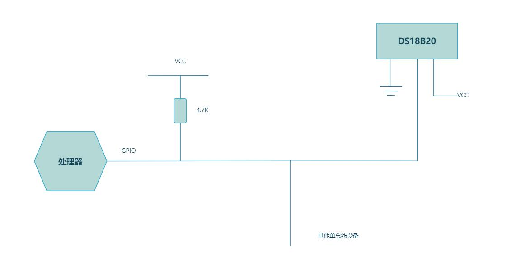
图151.1为确保可以正常通信和设备识别，ds18b20 的数据线在空闲状态下必须维持高电平，然而ds18b20 本身无法主动驱动其为高电平，因此需要通过外接上拉电阻将数据线默认维持在高电平状态。需要注意的是，不同的单总线外设对应的时序不一样，所以在编写对应单总线驱动程序时要根据对应的时序图与单总线外设进行通信。

本节对ds18b20 进行介绍。
## 152.1 ds18b20 概述
ds18b20 是一种数字温度传感器芯片，提供9 到12bit 分辨率的温度测量，可以通过可编程非易失性存储单元实现温度的下限和上限报警。它是基于单总线通信协议的设备，因此只需要一根信号线和一根地线。它的温度测量范围为-55℃到+125℃。在-10℃~70℃范围内的测试精度可以达到士0.4℃。此外它还可以工作在寄生模式下，即直接通过信号线对芯片供电，从而不需要额外的电源。每个ds18b20 都会有一个全球唯一的64 位序列号，可以将多个ds18b20串联在同一根单总线上进行组网，因此只需要一个处理器就可以控制分布在大面积区域中的多颗ds18b20。这种组网方式特别适合HVAC 环境控制，建筑，设备，粮情测温和工业测温以及过程监测控制等应用领域。
## 152.2 ds18b20 基本性能
ds18b20 是一款数字温度传感器芯片，具有以下基本性能特点：采用单总线接口仅需一个引脚进行通信每颗芯片具有全球唯一的64 位的序列号具有多点分布式测温功能，无需外围元器件可通过数据线供电，供电电压范围为2.5V~5.5V测度测量范围为-55℃到+125℃在-10℃~ 70℃范围内精确度为±0.4℃温度分辨率9-12 位可选最高12 位精度下，温度转换速度小于750ms具有用户自定义的非易失性温度报警设置超强静电保护能力：HBM 8000V MM 800V可提供贴片的MSOP8，SOP8 封装和3 脚的TO-92、TO-92S 封装

## 152.3 ds18b20 应用场景
ds18b20 广泛应用于各种温度监测和控制场景。以下是一些常见的应用场景：室内温度监测：ds18b20 可以用于监测室内温度，例如住宅、办公室、实验室等。它可以提供精确的温度数据，帮助调整空调、采暖系统或其他温度控制设备。温室和农业：在温室和农业领域，ds18b20 可以用于监测植物生长环境的温度。这有助于优化种植条件，提高作物的生长效率和产量。水族箱温度控制：ds18b20 可用于监测水族箱的水温，确保鱼类和其他水生生物的舒适和健康。工业自动化：在工业自动化中，ds18b20 可以用于监测机器、设备或工艺过程中的温度。这有助于实现温度控制、故障监测和预警等功能。太阳能热水器：ds18b20 可以用于太阳能热水器系统中的温度监测和控制。它可以测量太阳能收集器和水箱中的温度，以优化热水的供应和节约能源。冷链物流：在冷链物流中，ds18b20 可用于监测货物运输过程中的温度。它可以确保货物在适宜的温度条件下运输，以保持产品的质量和安全性。气象站：ds18b20 可以用于气象站中的温度测量。它可以提供准确的环境温度数据，用于天气观测和气候研究。
## 152.4 ds18b20 引脚配置和封装
ds18b20 提供多种封装形式，以适应不同应用环境。最常见的是TO-92 和TO-92S 两种三引脚直插封装。对于空间有限或需贴片安装的场景，ds18b20 还提供SOP8 和MSOP8 等贴片封装。不同封装如图152.1 所示，对应的引脚位置与作用如图152.2 所示。

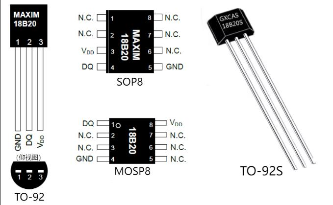
图152.1
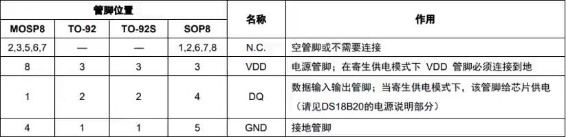
图152.2
## 152.5 ds18b20 内部结构
ds18b20 是一种数字温度传感器芯片，其内部结构如图152.3 所示。
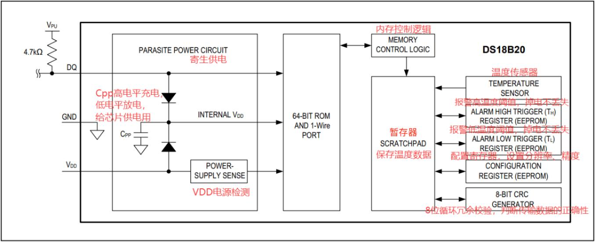
图152.3

温度传感器：内部集成了温度传感器，用于测量环境的温度。传感器通常基于基准电压的变化来检测温度，并将其转换为数字信号。存储器：包括64 位ROM 存储芯片唯一序列号，以及暂存器用于存储配置信息和温度测量结果。控制逻辑：负责指令解析、寄存器管理、通信流程控制及温度报警判断，协调芯片内部模块协同运行。单总线接口：采用单总线总线协议，仅需一根信号线即可完成数据通信和寻址识别。寄生供电电路：除常规VDD 供电外，ds18b20 还支持通过数据线（DQ）实现寄生供电。数据线上拉至高电平时，不仅传输控制信号，还为芯片内部电容充电，在总线拉低期间通过该电容维持工作，实现无需独立供电的低功耗运行。高速暂存存储器简称暂存器，由9 个字节组成，其分配如图152.4 所示。
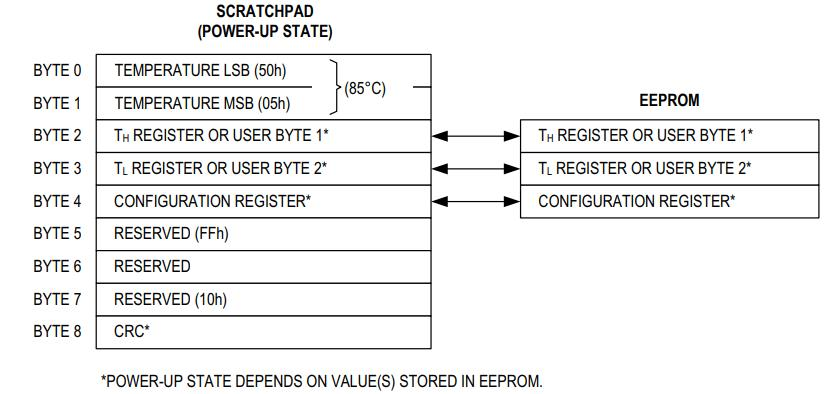
图152.4当温度转换命令发布后，经转换所得的温度值以二字节补码形式存放在高速暂存存储器的第0 和第1 个字节，处理器可通过单线接口读到该数据，读取时低位在前，高位在后，数据格式如图152.5 所示。
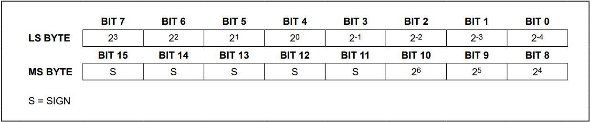
图152.5

## 152.6 ds18b20 寄存器介绍
ds18b20 主要包含两个寄存器，分别是温度寄存器和配置寄存器，两个寄存器的具体描述如图152.6 所示。
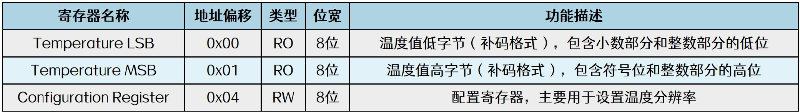
图152.6温度寄存器由两个字节组成，以补码格式存储最近一次转换的温度值。其中TemperatureLSB 包含小数部分和整数部分的低位，Temperature MSB 包含符号位和整数部分的高位，通过读取这两个寄存器，并按照图152.7 所示的公式进行计算，即可获得当前的温度值。如果计算结果是负数（最高位为1，即符号位为1），需要先将其转换为十进制补码再进行计算。
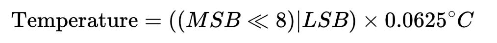
图152.7配置寄存器是一个可读可写的8 位寄存器，用于设置ds18b20 的温度分辨率，其寄存器值如图152.8 所示。
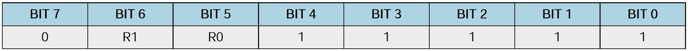
图152.8其中配置寄存器中的BIT5(R0)和BIT6(R1)控制分辨率设定，可设置为9、10、11 或12 位，不同分辨率对应的测量精度与转换时间关系如图152.9 所示。

图152.9温度分辨率实际就是温度递增的幅度，9、10、11和12位对应的分辨率分别为0.5℃、0.25℃、0.125℃和0.0625℃，转换的精度越高，对应的转换时间越长。注意：默认情况下，R0 和R1 均为1，即默认分辨率为12 位。

## 152.7 ds18b20 指令介绍
根据ds18b20 的通讯协议，主机每次操作ds18b20 都需经过复位、发送ROM 指令和发送RAM 指令这三个步骤，流程如图152.10 所示。
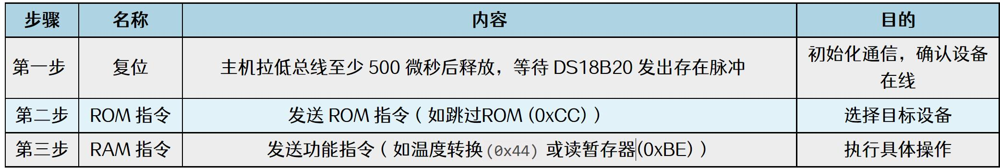
图152.10每个ds18b20 拥有一个全球唯一的ROM 编码，使用ROM 指令通过ROM 编码可以识别或选择ds18b20 设备，ROM 指令表如图152.11 所示。
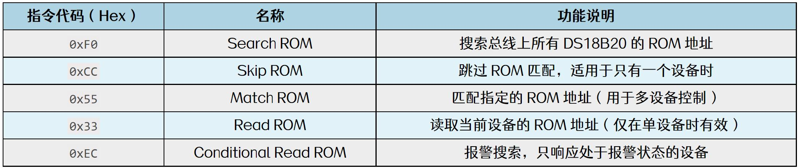
图152.11RAM 指令执行具体的功能操作，例如启动温度转换、读写寄存器等，RAM 指令表如图152.12 所示。
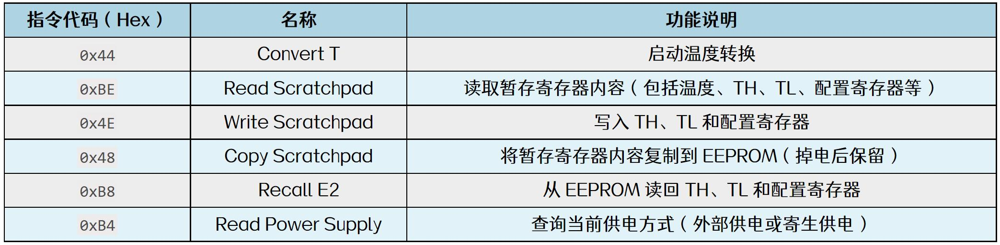
图152.12ROM 指令要如何使用呢？以操作一个ds18b20 和多个ds18b20 举例：当单总线上只有一个ds18b20 的时候：1 开始进行温度转换：复位信号->发送ROM 指令OXCC 跳过搜索->发送RAM 指令0x44 进行温度转换。

