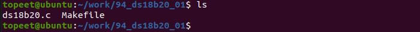

# 第153章 ds18b20驱动框架编写

2 读温度：复位信号->发送ROM 指令OXCC 跳过搜索->发送RAM 指令0xbe 读暂存器。3 设置ds18b20:复位信号->发送ROM 指令OXCC 跳过搜索->发送RAM 指令0x4e 写暂存器->要写的数据。当单总线上有多个ds18b20 的时候：1 开始进行温度转换：复位信号->发送ROM 指令0x55 匹配指令->发送ds18b20 的地址->发送RAM 指令0x44 进行温度转换。2 读温度：复位信号->发送ROM 指令0x55 匹配指令->发送ds18b20 的地址->发送RAM 指令0xbe 读暂存器。3 设置ds18b20:复位信号->发送ROM指令0x55匹配指令->发送ds18b20的地址->发送RAM指令0x4e 写暂存器->要写的数据。

编写ds18b20 驱动涉及以下几个关键知识点：字符设备驱动、平台总线、设备树、解析设备树、gpio 子系统、pinctrl 子系统、单总线协议，因此ds18b20 驱动涉及到的内容较多。本章节编写ds18b20 的驱动框架。
## 153.1 驱动程序的编写
本实验代码存储在网盘iTOP-RK3568 开发板\07_学习教程配套资料\03_Linux 驱动配套资料\04_Linux 驱动例程\94_ds18b20_01 路径下。ds18b20 驱动框架使用平台总线与设备树中的ds18b20 节点进行匹配，ds18b20 驱动框架中compatible 属性值为ds18b20。ds18b20 驱动框架与设备树中ds18b20 设备节点匹配成功以后会执行ds18b20 驱动框架中的probe 函数。实验代码ds18b20.c 如代码清单153.1 所示。代码清单153.1
```c
#include <linux/init.h>
#include <linux/module.h>
#include <linux/platform_device.h>
#include <linux/of.h>
// probe 函数，在设备探测时调用
int ds18b20_probe(struct platform_device *dev) {
    printk("This is probe \n");
    return 0;
}
//设备ID 表，用于匹配兼容字符串
const struct of_device_id ds18b20_match_table[] = {
    { .compatible = "ds18b20" },
    { },
};
//平台驱动结构体
struct platform_driver ds18b20_driver = {
    .driver = {
        .owner = THIS_MODULE,
```

```c
.name = "ds18b20",
.of_match_table = ds18b20_match_table,
},
.probe = ds18b20_probe,
};
//初始化函数
static int __init ds18b20_init(void) {
int ret;
//注册平台驱动
ret = platform_driver_register(&ds18b20_driver);
if (ret < 0) {
printk("platform_driver_register error\n");
return -1;
}
return 0;
}
//退出函数
static void __exit ds18b20_exit(void) {
//注销平台驱动
platform_driver_unregister(&ds18b20_driver);
}
module_init(ds18b20_init);
module_exit(ds18b20_exit);
MODULE_LICENSE("GPL");
```
## 153.2 编译驱动程序
在ds18b20.c 代码同一目录下创建Makefile 文件，如图153.1 所示。

图153.1Makefile 文件内容如代码清单153.2 所示。代码清单153.2
```c
export ARCH=arm64#设置平台架构
export CROSS_COMPILE=aarch64-linux-gnu-#交叉编译器前缀
obj-m +=ds18b20.o#此处要和你的驱动源文件同名
KDIR :=/home/topeet/Linux/linux_sdk/kernel#这里是你的内核目录
```

