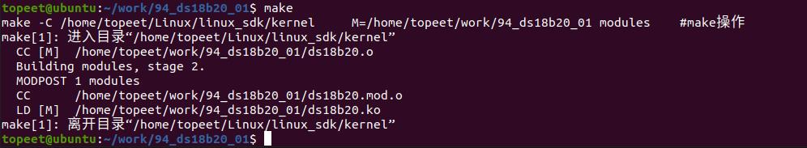
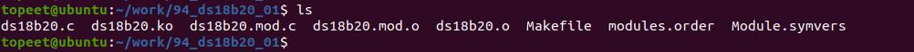

# 第154章 ds18b20编写字符设备驱动框架

```c
PWD ?= $(shell pwd)
all:
    make -C $(KDIR) M=$(PWD) modules#make 操作
clean:
    make -C $(KDIR) M=$(PWD) clean#make clean 操作
```
在存放ds18b20.c 和Makefile 文件目录下使用make 命令编译驱动程序，编译完成如图153.2所示。

图153.2编译完生成ds18b20.ko 目标文件，如图153.3 所示。

图153.3至此ds18b20 驱动框架编写完成。

本章在ds18b20 驱动框架代码的基础上注册ds18b20 字符设备，并实现file_operations 结构体中的打开ds18b20 和读ds18b20 函数。
## 154.1 驱动程序的编写
本实验代码存储在网盘iTOP-RK3568 开发板\07_学习教程配套资料\03_Linux 驱动配套资料\04_Linux 驱动例程\94_ds18b20_02 路径下。实验代码ds18b20.c 如代码清单154.1 所示。代码清单154.1
```c
#include <linux/init.h>
#include <linux/module.h>
#include <linux/platform_device.h>
#include <linux/of.h>
#include <linux/fs.h>
#include <linux/cdev.h>
#include <linux/kdev_t.h>
#include <linux/slab.h>
struct ds18b20_data
{
    dev_t dev_num;//设备号
    struct cdev ds18b20_cdev;//字符设备结构
    struct class *ds18b20_class;//设备类
    struct device *ds18b20_device;//设备
};
struct ds18b20_data *ds18b20;// 全局设备数据指针
//设备打开函数
int ds18b20_open(struct inode *inode, struct file *file)
{
    return 0;
}
//设备读取函数
ssize_t ds18b20_read(struct file *file, char __user *buf, size_t size, loff_t *offs)
{
```

```c
return 0;
}
//设备释放函数
int ds18b20_release(struct inode *inode, struct file *file)
{
return 0;
}
//定义设备文件操作结构
struct file_operations ds18b20_fops = {
.open = ds18b20_open,
.read = ds18b20_read,
.release = ds18b20_release,
.owner = THIS_MODULE,
};
//设备探测函数
int ds18b20_probe(struct platform_device *dev)
{
int ret;
printk("This is probe \n");
//分配设备数据结构内存
ds18b20 = kzalloc(sizeof(*ds18b20), GFP_KERNEL);
if (ds18b20 == NULL)
{
    printk("kzalloc error\n");
    ret = -ENOMEM;
    goto error_0;
}
//分配字符设备号
ret = alloc_chrdev_region(&ds18b20->dev_num, 0, 1, "myds18b20");
if (ret < 0)
{
    printk("alloc_chrdev_region error\n");
    ret = -EAGAIN;
    goto error_1;
}
//初始化字符设备并添加到系统
cdev_init(&ds18b20->ds18b20_cdev, &ds18b20_fops);
ds18b20->ds18b20_cdev.owner = THIS_MODULE;
```

```c
cdev_add(&ds18b20->ds18b20_cdev, ds18b20->dev_num, 1);
//创建设备类
ds18b20->ds18b20_class = class_create(THIS_MODULE, "sensors");
if (IS_ERR(ds18b20->ds18b20_class))
{
    printk("class_create error\n");
    ret = PTR_ERR(ds18b20->ds18b20_class);
    goto error_2;
}
//创建设备
ds18b20->ds18b20_device = device_create(ds18b20->ds18b20_class, NULL, ds18b20->dev_num, NULL,
"ds18b20");
if (IS_ERR(ds18b20->ds18b20_device))
{
    printk("device_create error\n");
    ret = PTR_ERR(ds18b20->ds18b20_device);
    goto error_3;
}
return 0;
error_3:
class_destroy(ds18b20->ds18b20_class);
error_2:
cdev_del(&ds18b20->ds18b20_cdev);
unregister_chrdev_region(ds18b20->dev_num, 1);
error_1:
kfree(ds18b20);
error_0:
return ret;
}
//定义设备匹配表
const struct of_device_id ds18b20_match_table[] = {
{ .compatible = "ds18b20" },
{ },
};
//定义平台驱动
struct platform_driver ds18b20_driver = {
```

```c
.driver = {
    .owner = THIS_MODULE,
    .name = "ds18b20",
    .of_match_table = ds18b20_match_table,
},
.probe = ds18b20_probe,
};
//模块初始化函数
static int __init ds18b20_init(void)
{
int ret;
ret = platform_driver_register(&ds18b20_driver);
if (ret < 0)
{
    printk("platform_driver_register error\n");
    return -1;
}
return 0;
}
//模块退出函数
static void __exit ds18b20_exit(void)
{
//销毁设备
device_destroy(ds18b20->ds18b20_class, ds18b20->dev_num);
//销毁设备类
class_destroy(ds18b20->ds18b20_class);
//删除字符设备
cdev_del(&ds18b20->ds18b20_cdev);
//注销字符设备号
unregister_chrdev_region(ds18b20->dev_num, 1);
//释放设备数据结构内存
kfree(ds18b20);
//注销平台驱动
platform_driver_unregister(&ds18b20_driver);
}
//注册模块初始化和退出函数
module_init(ds18b20_init);
module_exit(ds18b20_exit);
MODULE_LICENSE("GPL");
```

