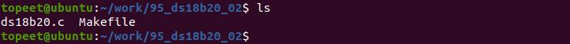
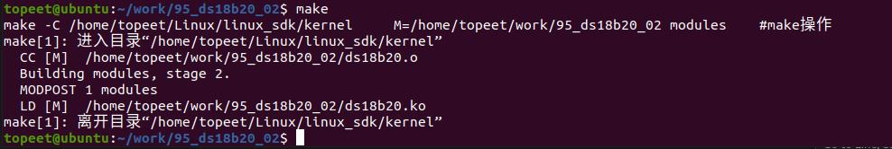
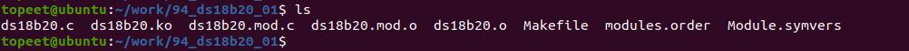
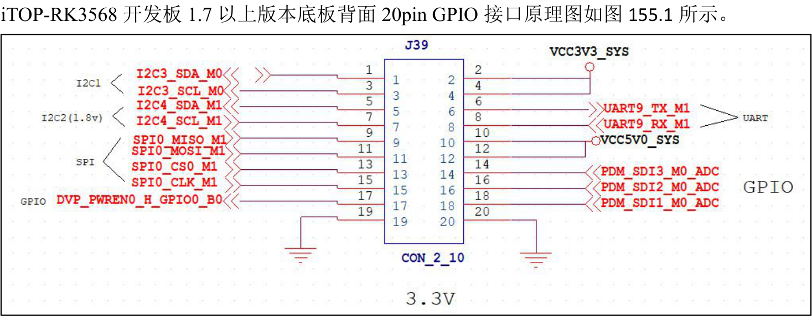
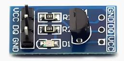
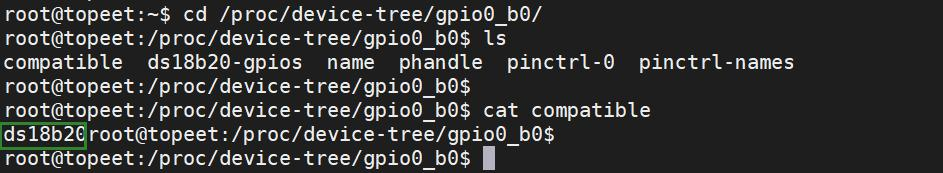
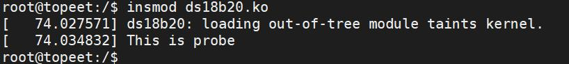

# 第155章ds18b20驱动设备树

## 154.2 编译驱动程序
在ds18b20.c 代码同一目录下创建Makefile 文件，如图154.1 所示。

图154.1Makefile 文件内容如代码清单154.2 所示。代码清单154.2
```c
export ARCH=arm64#设置平台架构
export CROSS_COMPILE=aarch64-linux-gnu-#交叉编译器前缀
obj-m +=ds18b20.o#此处要和你的驱动源文件同名
KDIR :=/home/topeet/Linux/linux_sdk/kernel#这里是你的内核目录
PWD ?= $(shell pwd)
all:
    make -C $(KDIR) M=$(PWD) modules#make 操作
clean:
    make -C $(KDIR) M=$(PWD) clean#make clean 操作
```
在存放ds18b20.c 和Makefile 文件目录下使用make 命令编译驱动程序，编译完成如图154.2所示。

图154.2编译完生成ds18b20.ko 目标文件，如图154.3 所示。

图154.3至此ds18b20 字符设备驱动框架编写完成。

本章编写设备树中ds18b20 的设备节点。
## 155.1 ds18b20 硬件连接
在做实验之前需要把ds18b20 模块连接到iTOP-RK3568 开发板背面的GPIO 接口上。

图155.1
本篇实验使用的是ds18b20 模块，如图155.2 所示。ds18b20 模块可自行在淘宝购买。

图155.2
ds18b20 模块与iTOP-RK3568 开发板背面20pin GPIO 接口连接线序如表155.1 所示。表155.1ds18b20 模块引脚编ds18b20 模块引脚名连接到的开发连接到的开发板的引脚名称号称板的引脚编号VCCVCC3.3DQDVP_PWREN0_H_GPIO0_B0GND19/20GND

## 155.2 ds18b20 驱动设备树配置
打开iTOP-RK3568 开发板sdk 中的linux_sdk/kernel/arch/arm64/boot/dts/rockchip/rk3568-evb1-ddr4-v10.dtsi 文件，在rk3568-evb1-ddr4-v10.dtsi 设备树文件的根节点下添加ds18b20 节点，ds18b20 节点如代码清单155.1 所示。代码清单155.1
```c
dsi8b20_gpio:gpio0_b0{
        compatible = "dsi8b20"; //与驱动中compatible 属性值保持一致。
        dsi8b20-gpios = <&gpio0 RK_PB0 GPIO_ACTIVE_HIGH>; //ds18b20 使用的引脚
        pinctrl-names = "default"; //使用pinctrl 配置引脚复用为gpio
        pinctrl-0 = <&dsi8b20_gpio_ctrl>;
};
```
在rk3568-evb1-ddr4-v10.dtsi 文件中的&pinctrl 节点中添加如代码清单155.2 所示。代码清单155.2
```c
ds18b20_gpio{//pinctrl 对应的引脚配置节点
    ds18b20_gpio_ctrl:ds18b20-gpio-ctrl{
        rockchip,pins = <0 RK_PB0 RK_FUNC_GPIO &pcfg_pull_none>;
    };
}
```
修改完成后，重新编译并烧写内核镜像。内核镜像烧写完毕，检测compatible 值是否为ds18b20，如图155.3 所示。

图155.3输入insmod ds18b20.ko 命令加载上一章中编译好的驱动模块，如图155.4 所示。

图155.4驱动加载成功之后，如果输入以下命令，如果如图155.5、155.6 所示，则设备树编写成功。ls /dev/ds18b20//列出位于/dev 目录下的名为ds18b20 的设备文件cat /proc/devices//用于查看系统中已加载的设备驱动程序列表。

