# 第156章 实现ds18b20驱动复位函数

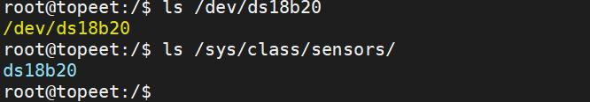
图155.5
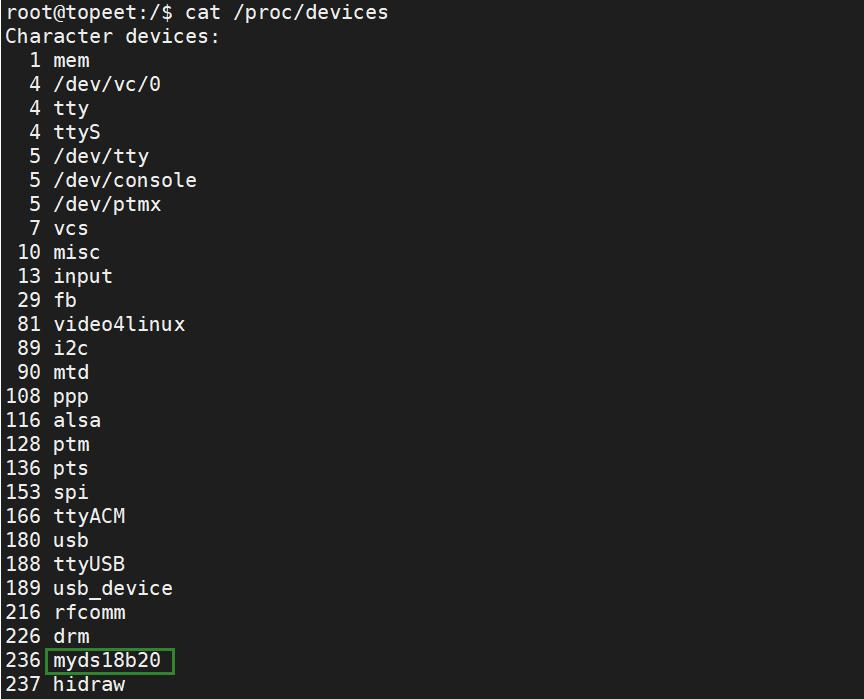
图155.6

本章继续编写ds18b20 驱动，本章在驱动中获取ds18b20 设备节点中所描述的GPIO 引脚，并编写复位函数。在加载驱动之后，使用逻辑分析仪对复位时序进行分析。
## 156.1 ds18b20 驱动获取GPIO 编写
本实验代码存储在网盘iTOP-RK3568 开发板\07_学习教程配套资料\03_Linux 驱动配套资料\04_Linux 驱动例程\95_ds18b20_02 路径下。获取ds18b20 设备节点中所描述的GPIO 引脚直接使用GPIO 子系统的API 函数即可，实验代码ds18b20代码清单156.1
```c
#include <linux/init.h>
#include <linux/module.h>
#include <linux/platform_device.h>
#include <linux/of.h>
#include <linux/fs.h>
#include <linux/cdev.h>
#include <linux/kdev_t.h>
#include <linux/slab.h>
#include <linux/gpio.h>
#include <linux/gpio/consumer.h>
struct ds18b20_data
{
    dev_t dev_num;// 设备号
    struct cdev ds18b20_cdev;// 字符设备结构体
    struct class *ds18b20_class;// 设备类
    struct device *ds18b20_device;// 设备
    struct gpio_desc *ds18b20_gpio; // GPIO 描述符
};
struct ds18b20_data *ds18b20;// ds18b20 数据结构指针
int ds18b20_open(struct inode *inode, struct file *file)
{
    return 0;
```

```c
}
ssize_t ds18b20_read(struct file *file, char __user *buf, size_t size, loff_t *offs)
{
    return 0;
}
int ds18b20_release(struct inode *inode, struct file *file)
{
    return 0;
}
struct file_operations ds18b20_fops = {
    .open = ds18b20_open,
    .read = ds18b20_read,
    .release = ds18b20_release,
    .owner = THIS_MODULE,
};
//设备探测函数
int ds18b20_probe(struct platform_device *dev)
{
    int ret;
    printk("This is probe \n");
    //分配内存给ds18b20_data 结构体
    ds18b20 = kzalloc(sizeof(*ds18b20), GFP_KERNEL);
    if (ds18b20 == NULL)
    {
        printk("kzalloc error\n");
        ret = -ENOMEM;
        goto error_0;
    }
    //分配字符设备号
    ret = alloc_chrdev_region(&ds18b20->dev_num, 0, 1, "myds18b20");
    if (ret < 0)
    {
        printk("alloc_chrdev_region error\n");
        ret = -EAGAIN;
        goto error_1;
    }
    //初始化字符设备
```

```c
cdev_init(&ds18b20->ds18b20_cdev, &ds18b20_fops);
ds18b20->ds18b20_cdev.owner = THIS_MODULE;
cdev_add(&ds18b20->ds18b20_cdev, ds18b20->dev_num, 1);
//创建设备类
ds18b20->ds18b20_class = class_create(THIS_MODULE, "sensors");
if (IS_ERR(ds18b20->ds18b20_class))
{
    printk("class_create error\n");
    ret = PTR_ERR(ds18b20->ds18b20_class);
    goto error_2;
}
//创建设备
ds18b20->ds18b20_device = device_create(ds18b20->ds18b20_class, NULL, ds18b20->dev_num, NULL,
"ds18b20");
if (IS_ERR(ds18b20->ds18b20_device))
{
    printk("device_create error\n");
    ret = PTR_ERR(ds18b20->ds18b20_device);
    goto error_3;
}
//获取GPIO 描述符
ds18b20->ds18b20_gpio = gpiod_get_optional(&dev->dev, "ds18b20", 0);
if (ds18b20->ds18b20_gpio == NULL)
{
    ret = -EBUSY;
    goto error_4;
}
//设置GPIO 方向为输出
gpiod_direction_output(ds18b20->ds18b20_gpio, 1);
return 0;
error_4:
device_destroy(ds18b20->ds18b20_class, ds18b20->dev_num);
error_3:
class_destroy(ds18b20->ds18b20_class);
error_2:
cdev_del(&ds18b20->ds18b20_cdev);
```

```c
unregister_chrdev_region(ds18b20->dev_num, 1);
error_1:
kfree(ds18b20);
error_0:
return ret;
}
//设备匹配表
const struct of_device_id ds18b20_match_table[] = {
{ .compatible = "ds18b20" },
{},
};
struct platform_driver ds18b20_driver = {
.driver = {
    .owner = THIS_MODULE,
    .name = "ds18b20",
   .of_match_table = ds18b20_match_table,
},
.probe = ds18b20_probe,
};
static int __init ds18b20_init(void)
{
int ret;
ret = platform_driver_register(&ds18b20_driver);
if (ret < 0)
{
    printk("platform_driver_register error\n");
    return -1;
}
return 0;
}
static void __exit ds18b20_exit(void)
{
//释放GPIO 描述符
gpiod_put(ds18b20->ds18b20_gpio);
//销毁设备
device_destroy(ds18b20->ds18b20_class, ds18b20->dev_num);
//销毁设备类
```

```c
class_destroy(ds18b20->ds18b20_class);
//删除字符设备
cdev_del(&ds18b20->ds18b20_cdev);
//注销字符设备号
unregister_chrdev_region(ds18b20->dev_num, 1);
//释放ds18b20_data 内存
kfree(ds18b20);
//注销平台驱动
platform_driver_unregister(&ds18b20_driver);
}
module_init(ds18b20_init);
module_exit(ds18b20_exit);
MODULE_LICENSE("GPL");
```
## 156.2 ds18b20 复位时序分析
ds18b20 的复位操作是启动通信的关键步骤，其时序如图156.1 所示。控制器（一般是处理器）将数据线拉低至少480 微秒从而发送复位脉冲，然后释放总线并切换GPIO 为输入模式，等待ds18b20 发送应答信号，即ds18b20 拉低总线60-240us 发送应答信号，控制器检测到应答信号后，等待总线恢复高电平，并延时至少480 微秒完成复位过程。
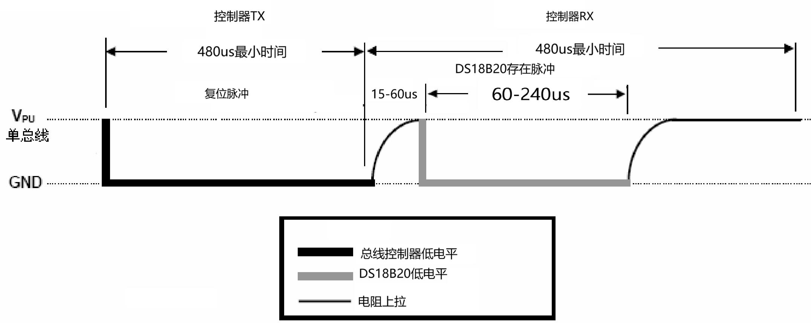
图156.1在驱动程序中，可以使用Linux 内核提供的GPIO 子系统API 函数来控制GPIO 引脚的电平状态。例如，在实现复位信号时序时，可以使用以下函数来控制GPIO 引脚的状态：gpiod_direction_output()函数：设置GPIO 引脚为输出模式。

gpiod_set_value()函数：将GPIO 引脚设置为高电平或低电平。udelay()函数：延时一定的微秒数。
## 156.3 ds18b20 驱动复位函数编写
ds18b20_reset()函数用来实现复位操作。在该函数中首先将GPIO 配置为输出模式并拉低电平，维持700 微秒以产生复位脉冲。然后将GPIO 设为输入模式，进入等待状态，直到检测到ds18b20 拉低总线产生应答信号。在ds18b20 释放总线后，延时480 微秒以确保设备复位成功。。本实验代码存储在网盘iTOP-RK3568 开发板\07_学习教程配套资料\03_Linux 驱动配套资料\04_Linux 驱动例程\95_ds18b20_02 路径下。实验代码ds18b20.c 如代码清单156.2 所示。代码清单156.2
```c
#include <linux/init.h>
#include <linux/module.h>
#include <linux/platform_device.h>
#include <linux/of.h>
#include <linux/fs.h>
#include <linux/cdev.h>
#include <linux/kdev_t.h>
#include <linux/slab.h>
#include <linux/gpio.h>
#include <linux/gpio/consumer.h>
#include <linux/delay.h>
struct ds18b20_data
{
    dev_t dev_num;
    struct cdev ds18b20_cdev;
    struct class *ds18b20_class;
    struct device *ds18b20_device;
    struct gpio_desc *ds18b20_gpio;
};
struct ds18b20_data *ds18b20;
void ds18b20_reset(void)
```

```c
{
    //设置GPIO 方向为输出，输出低电平
    gpiod_direction_output(ds18b20->ds18b20_gpio, 1);
    gpiod_set_value(ds18b20->ds18b20_gpio, 0);
    udelay(700); // 延迟700 微秒
    //设置GPIO 输出高电平，并将GPIO 方向设置为输入
    gpiod_set_value(ds18b20->ds18b20_gpio, 1);
    gpiod_direction_input(ds18b20->ds18b20_gpio);
    //等待直到GPIO 输入为低电平
while (gpiod_get_value(ds18b20->ds18b20_gpio));
    //等待直到GPIO 输入为高电平
while (!gpiod_get_value(ds18b20->ds18b20_gpio));
    udelay(480); //延迟480 微秒
}
int ds18b20_open(struct inode *inode, struct file *file)
{
    return 0;
}
ssize_t ds18b20_read(struct file *file, char __user *buf, size_t size, loff_t *offs)
{
    return 0;
}
int ds18b20_release(struct inode *inode, struct file *file)
{
    return 0;
}
struct file_operations ds18b20_fops = {
    .open = ds18b20_open,
    .read = ds18b20_read,
    .release = ds18b20_release,
    .owner = THIS_MODULE,
};
int ds18b20_probe(struct platform_device *dev)
{
    int ret;
    printk("This is probe \n");
```

```c
//分配并初始化ds18b20_data 结构体
ds18b20 = kzalloc(sizeof(*ds18b20), GFP_KERNEL);
if (ds18b20 == NULL)
{
    printk("kzalloc error\n");
    ret = -ENOMEM;
    goto error_0;
}
//分配字符设备号
ret = alloc_chrdev_region(&ds18b20->dev_num, 0, 1, "myds18b20");
if (ret < 0)
{
    printk("alloc_chrdev_region error\n");
    ret = -EAGAIN;
    goto error_1;
}
//初始化字符设备结构体
cdev_init(&ds18b20->ds18b20_cdev, &ds18b20_fops);
ds18b20->ds18b20_cdev.owner = THIS_MODULE;
//将字符设备添加到系统
cdev_add(&ds18b20->ds18b20_cdev, ds18b20->dev_num, 1);
//创建设备类
ds18b20->ds18b20_class = class_create(THIS_MODULE, "sensors");
if (IS_ERR(ds18b20->ds18b20_class))
{
    printk("class_create error\n");
    ret = PTR_ERR(ds18b20->ds18b20_class);
    goto error_2;
}
//创建设备节点
ds18b20->ds18b20_device = device_create(ds18b20->ds18b20_class, NULL, ds18b20->dev_num, NULL,
"ds18b20");
if (IS_ERR(ds18b20->ds18b20_device))
{
    printk("device_create error\n");
    ret = PTR_ERR(ds18b20->ds18b20_device);
    goto error_3;
}
```

```c
//获取GPIO 描述符
ds18b20->ds18b20_gpio = gpiod_get_optional(&dev->dev, "ds18b20", 0);
if (ds18b20->ds18b20_gpio == NULL)
{
    ret = -EBUSY;
        goto error_4;
    }
    gpiod_direction_output(ds18b20->ds18b20_gpio, 1);
    return 0;
error_4:
device_destroy(ds18b20->ds18b20_class, ds18b20->dev_num);
error_3:
class_destroy(ds18b20->ds18b20_class);
error_2:
cdev_del(&ds18b20->ds18b20_cdev);
unregister_chrdev_region(ds18b20->dev_num, 1);
error_1:
kfree(ds18b20);
error_0:
return ret;
}
const struct of_device_id ds18b20_match_table[] = {
{.compatible = "ds18b20"},
{},
};
struct platform_driver ds18b20_driver = {
.driver = {
    .owner = THIS_MODULE,
    .name = "ds18b20",
    .of_match_table = ds18b20_match_table,
},
.probe = ds18b20_probe,
};
static int __init ds18b20_init(void)
{
```

```c
int ret;
//注册平台驱动
ret = platform_driver_register(&ds18b20_driver);
if (ret < 0)
{
    printk("platform_driver_register error\n");
    return -1;
}
ds18b20_reset(); //调用复位函数
return 0;
}
static void __exit ds18b20_exit(void)
{
//释放资源
gpiod_put(ds18b20->ds18b20_gpio);
device_destroy(ds18b20->ds18b20_class, ds18b20->dev_num);
class_destroy(ds18b20->ds18b20_class);
cdev_del(&ds18b20->ds18b20_cdev);
unregister_chrdev_region(ds18b20->dev_num, 1);
kfree(ds18b20);
platform_driver_unregister(&ds18b20_driver);
}
module_init(ds18b20_init);
module_exit(ds18b20_exit);
MODULE_LICENSE("GPL");
```
## 156.4 编译驱动程序
在ds18b20.c 代码同一目录下创建Makefile 文件，如图156.2 所示。
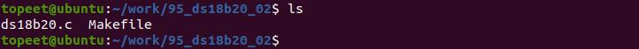
图156.2Makefile 文件内容如代码清单156.3 所示。代码清单156.3
```c
export ARCH=arm64#设置平台架构
export CROSS_COMPILE=aarch64-linux-gnu-#交叉编译器前缀
obj-m +=ds18b20.o#此处要和你的驱动源文件同名
```

```c
KDIR :=/home/topeet/Linux/linux_sdk/kernel#这里是你的内核目录
PWD ?= $(shell pwd)
all:
    make -C $(KDIR) M=$(PWD) modules#make 操作
clean:
    make -C $(KDIR) M=$(PWD) clean#make clean 操作
```
在存放ds18b20.c 和Makefile 文件目录下使用make 命令编译驱动程序，编译完成如图156.3所示。
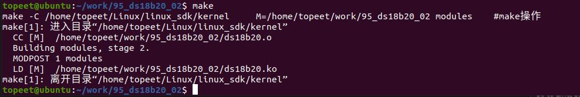
图156.3编译成功后生成ds18b20.ko 目标文件，如图156.4 所示。
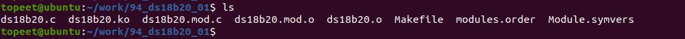
图156.4
## 156.5 通过逻辑分析仪验证复位时序
首先将ds18b20 模块和开发板背面的GPIO 连接起来，然后将逻辑分析仪连接到ds18b20模块上，连接如图156.5 所示。（逻辑分析仪需自行在淘宝购买）
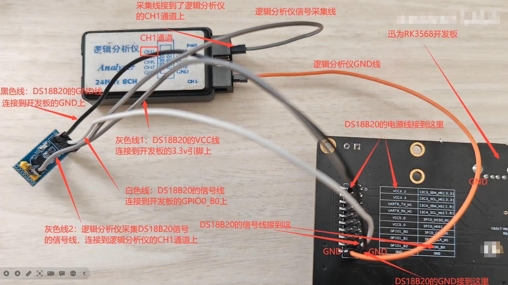

图156.5硬件连接好之后，安装逻辑分析仪的上位机软件，安装完成之后，打开上位机软件，按照图156.6、156.7 和156.8 设置参数。
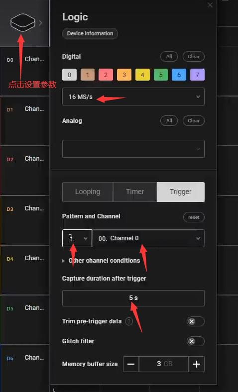
图156.6

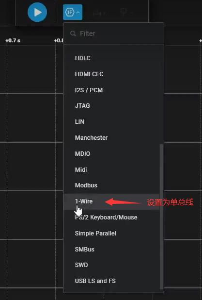
图156.7
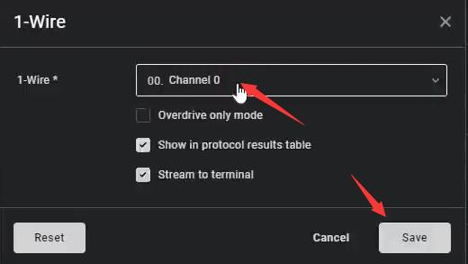
图156.8设置完毕之后，准备采集波形，如图156.9 所示。

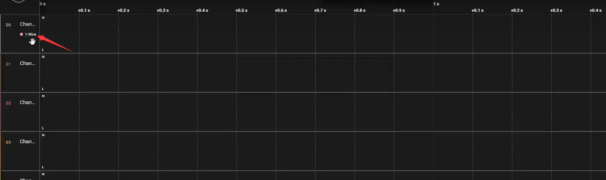
图156.9使用insmod ds18b20.ko 命令将本节编译的驱动模块加载到内核中，如图156.10 所示。
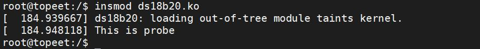
图156.10上位机上捕捉到时序如图156.11、156.12 和156.13 所示。
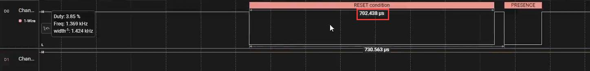
图156.11
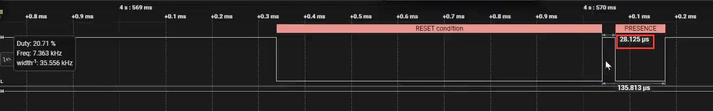
图156.12
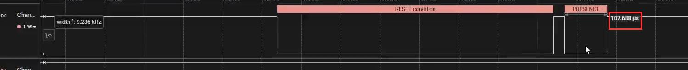
图156.13将捕捉到的复位时序和图156.14 的时序图对比分析，可以确定驱动中编写的复位函数是满足时序要求的。

