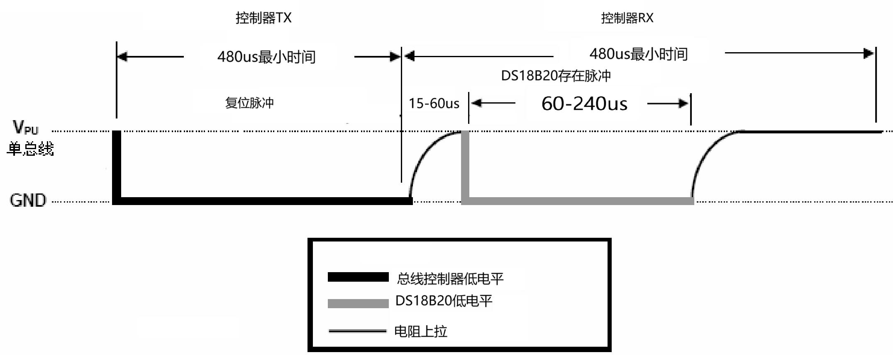
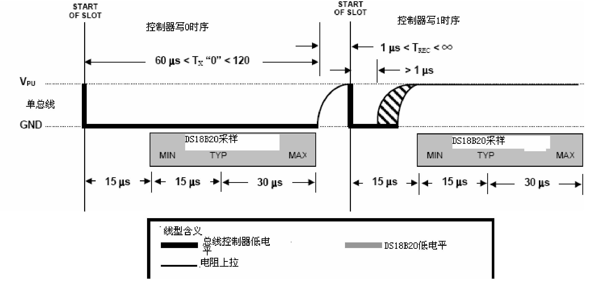
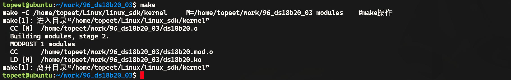
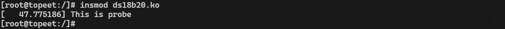
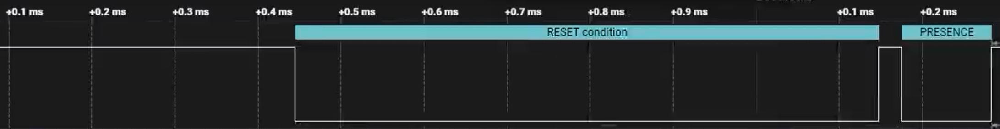
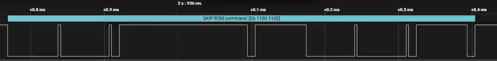

# 第157章实现ds18b20驱动写函数


图156.14至此，ds18b20 驱动复位时序编写完成。

本章实现ds18b20 写函数。
## 157.1 写时序分析
ds18b20 的写时序是主机向设备发送数据的基本操作，其时序如图161.1 所示。ds18b20每次只能写入1 位数据。主机首先将总线拉低至少1 微秒，然后根据是写入0 还是1 决定是否释放总线，若写入0，则保持总线低电平至少60 微秒；若写入1，则释放总线并延时至少15微秒以确保采样完成，每写完一位数据需再延时至少1 微秒以满足恢复时间。

图157.1根据上述时序编写ds18b20_writebit()函数实现ds18b20 写入1bit 操作。该函数中首先将GPIO 配置为输出并将总线拉低至少1 微秒，随后根据待写入的位是0 还是1 决定后续操作，若写入1，则延时10 微秒后释放总线，若写入0，则继续维持低电平。之后统一延时65 微秒以确保低电平总持续时间约为75 微秒从而满足时序要求，最后再延时2 微秒以满足总线恢复时间。在此写1bit 的基础上，循环调用8 次ds18b20_writebit()函数实现ds18b20_writebyte()写字节函数，ds18b20_writebit()函数与ds18b20_writebyte()函数如代码清单157.1 所示。代码清单157.1
```c
void ds18b20_writebit(unsigned char bit) {
    gpiod_direction_output(ds18b20->ds18b20_gpio, 1);//设置方向为输出并输出高电平
```

```c
gpiod_set_value(ds18b20->ds18b20_gpio, 0);//将GPIO 拉低
if (bit){
    udelay(10);//延时10 微秒
    gpiod_direction_output(ds18b20->ds18b20_gpio, 1);//设置方向为输出并输出高电平
}
udelay(65);//延时65 微秒
gpiod_direction_output(ds18b20->ds18b20_gpio, 1);//设置方向为输出并输出高电平
udelay(2);//延时2 微秒
}
void ds18b20_writebyte(int data) {
int i;
for (i = 0; i < 8; i++) {
    //逐位写入数据
    ds18b20_writebit(data & 0x01);
    data = data >> 1;
}
}
```
## 157.2 ds18b20 驱动写函数编写
本实验代码存储在网盘iTOP-RK3568开发板\07_学习教程配套资料\03_Linux驱动配套资料\04_Linux 驱动例程\96_ds18b20_03\02_module 路径下。本节编写ds18b20_writebit()函数和ds18b20_writebyte()函数，并在驱动入口函数中调用ds18b20 的复位函数和写函数进行测试。实验代码ds18b20.c 如代码清单157.2 所示。代码清单157.2
```c
#include <linux/init.h>
#include <linux/module.h>
#include <linux/platform_device.h>
#include <linux/of.h>
#include <linux/fs.h>
#include <linux/cdev.h>
#include <linux/kdev_t.h>
#include <linux/slab.h>
#include <linux/gpio.h>
#include <linux/gpio/consumer.h>
```

```c
#include <linux/delay.h>
struct ds18b20_data
{
    dev_t dev_num;
    struct cdev ds18b20_cdev;
    struct class *ds18b20_class;
    struct device *ds18b20_device;
    struct gpio_desc *ds18b20_gpio;
};
struct ds18b20_data *ds18b20;
void ds18b20_reset(void)
{
    //设置GPIO 输出高电平再拉低
    gpiod_direction_output(ds18b20->ds18b20_gpio, 1);
    gpiod_set_value(ds18b20->ds18b20_gpio, 0);
    udelay(700); //延迟700 微秒
    //设置GPIO 输出高电平，并将GPIO 方向设置为输入
    gpiod_set_value(ds18b20->ds18b20_gpio, 1);
    gpiod_direction_input(ds18b20->ds18b20_gpio);
    //等待直到GPIO 输入为低电平
    while (gpiod_get_value(ds18b20->ds18b20_gpio))
        ;
    //等待直到GPIO 输入为高电平
    while (!gpiod_get_value(ds18b20->ds18b20_gpio))
        ;
    udelay(480); //延迟480 微秒
}
void ds18b20_writebit(unsigned char bit) {
    //将GPIO 方向设置为输出，并输出高电平
    gpiod_direction_output(ds18b20->ds18b20_gpio, 1);
    //将GPIO 拉低
    gpiod_set_value(ds18b20->ds18b20_gpio, 0);
    //若bit 为1，则延时10 微秒
    if (bit)
    {
```

```c
udelay(10);
//将GPIO 方向设置为输出，并输出高电平
gpiod_direction_output(ds18b20->ds18b20_gpio, 1);
}
//延时65 微秒
udelay(65);
//将GPIO 方向设置为输出，并输出高电平
gpiod_direction_output(ds18b20->ds18b20_gpio, 1);
// 延时2 微秒
udelay(2);
}
void ds18b20_writebyte(int data) {
int i;
for (i = 0; i < 8; i++) {
//逐位写入数据
ds18b20_writebit(data & 0x01);
data = data >> 1;
}
}
int ds18b20_open(struct inode *inode, struct file *file)
{
return 0;
}
ssize_t ds18b20_read(struct file *file, char __user *buf, size_t size, loff_t *offs)
{
return 0;
}
int ds18b20_release(struct inode *inode, struct file *file)
{
return 0;
}
struct file_operations ds18b20_fops = {
.open = ds18b20_open,
.read = ds18b20_read,
.release = ds18b20_release,
.owner = THIS_MODULE,
```

```c
};
int ds18b20_probe(struct platform_device *dev)
{
    int ret;
    printk("This is probe \n");
    // 分配内存给ds18b20_data 结构体
    ds18b20 = kzalloc(sizeof(*ds18b20), GFP_KERNEL);
    if (ds18b20 == NULL)
    {
        printk("kzalloc error\n");
        ret = -ENOMEM;
        goto error_0;
    }
    // 分配字符设备号
    ret = alloc_chrdev_region(&ds18b20->dev_num, 0, 1, "myds18b20");
    if (ret < 0)
    {
        printk("alloc_chrdev_region error\n");
        ret = -EAGAIN;
        goto error_1;
    }
    // 初始化字符设备
    cdev_init(&ds18b20->ds18b20_cdev, &ds18b20_fops);
    ds18b20->ds18b20_cdev.owner = THIS_MODULE;
    cdev_add(&ds18b20->ds18b20_cdev, ds18b20->dev_num, 1);
    // 创建设备类
    ds18b20->ds18b20_class = class_create(THIS_MODULE, "sensors");
    if (IS_ERR(ds18b20->ds18b20_class))
    {
        printk("class_create error\n");
        ret = PTR_ERR(ds18b20->ds18b20_class);
        goto error_2;
    }
    // 创建设备
    ds18b20->ds18b20_device = device_create(ds18b20->ds18b20_class, NULL, ds18b20->dev_num, NULL,
"ds18b20");
    if (IS_ERR(ds18b20->ds18b20_device))
    {
```

```c
printk("device_create error\n");
ret = PTR_ERR(ds18b20->ds18b20_device);
goto error_3;
}
// 获取GPIO 描述符
ds18b20->ds18b20_gpio = gpiod_get_optional(&dev->dev, "ds18b20", 0);
if (ds18b20->ds18b20_gpio == NULL)
{
ret = -EBUSY;
goto error_4;
}
// 设置GPIO 方向为输出
gpiod_direction_output(ds18b20->ds18b20_gpio, 1);
return 0;
error_4:
device_destroy(ds18b20->ds18b20_class, ds18b20->dev_num);
error_3:
class_destroy(ds18b20->ds18b20_class);
error_2:
cdev_del(&ds18b20->ds18b20_cdev);
unregister_chrdev_region(ds18b20->dev_num, 1);
error_1:
kfree(ds18b20);
error_0:
return ret;
}
const struct of_device_id ds18b20_match_table[] = {
{.compatible = "ds18b20"},
{},
};
struct platform_driver ds18b20_driver = {
.driver = {
.owner = THIS_MODULE,
.name = "ds18b20",
```

```c
.of_match_table = ds18b20_match_table,
},
.probe = ds18b20_probe,
};
static int __init ds18b20_init(void)
{
int ret;
// 注册平台驱动
ret = platform_driver_register(&ds18b20_driver);
if (ret < 0)
{
printk("platform_driver_register error\n");
return -1;
}
ds18b20_reset(); // 调用复位函数
ds18b20_writebyte(0xCC);//写入0xCC 字符
return 0;
}
static void __exit ds18b20_exit(void)
{
// 释放资源
gpiod_put(ds18b20->ds18b20_gpio);
device_destroy(ds18b20->ds18b20_class, ds18b20->dev_num);
class_destroy(ds18b20->ds18b20_class);
cdev_del(&ds18b20->ds18b20_cdev);
unregister_chrdev_region(ds18b20->dev_num, 1);
kfree(ds18b20);
platform_driver_unregister(&ds18b20_driver);
}
module_init(ds18b20_init);
module_exit(ds18b20_exit);
MODULE_LICENSE("GPL");
```
## 157.3 运行测试
### 157.3.1 编译驱动程序
在ds18b20.c 代码同一目录下创建Makefile 文件，如图157.2 所示。


图157.2Makefile 文件内容如代码清单157.3 所示。代码清单157.3
```c
export ARCH=arm64#设置平台架构
export CROSS_COMPILE=aarch64-linux-gnu-#交叉编译器前缀
obj-m +=ds18b20.o#此处要和你的驱动源文件同名
KDIR :=/home/topeet/Linux/linux_sdk/kernel#这里是你的内核目录
PWD ?= $(shell pwd)
all:
    make -C $(KDIR) M=$(PWD) modules#make 操作
clean:
    make -C $(KDIR) M=$(PWD) clean#make clean 操作
```
在存放ds18b20.c和Makefile文件目录下使用make命令编译驱动程序，编译完成如图157.3所示。

图157.3编译完生成ds18b20.ko 目标文件，如图157.4 所示。
图157.4至此驱动模块就编译成功了。
### 157.3.2 运行测试
将本章节编译好的ds18b20.ko 驱动文件拷贝到开发板上，然后根据前面章节相同的方法连接好逻辑分析仪，并设置好相应的软件。接着使用insmod ds18b20.ko 命令加载驱动程序，加载驱动打印信息如图157.5 所示。


图157.5查看逻辑分析仪采集到的波形，第一段波形为复位信号，如图157.6 所示。

图157.6第二段波形表示发送0xCC 指令，如图157.7 所示。波形与驱动程序对应，说明写函数编程成功。

图157.7

