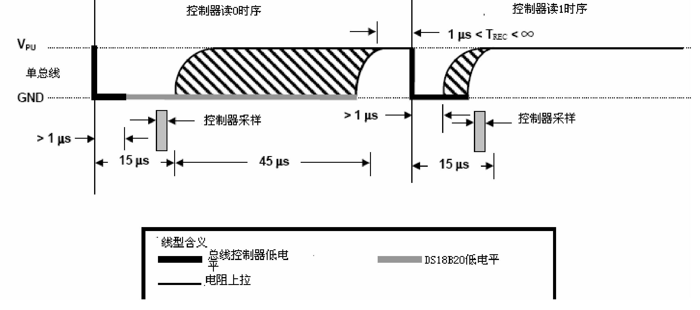

# 第158章 实现ds18b20驱动读函数

本章编写ds18b20 的读函数。
## 158.1 读时序分析
ds18b20 的读时序是主机从设备获取数据的基本操作，其时序如图162.1 所示。ds18b20每次只能读取1 位数据，主机首先将数据线拉低至少1 微秒以启动读操作，随后主机释放总线并切换GPIO 为输入模式，等待ds18b20 返回数据，若为返回0，ds18b20 会在15 微秒内将数据线拉低，若返回1，则保持高电平，主机在约15 微秒内采样总线状态以完成读取，每读完一位需再延时至少1 微秒以满足恢复时间。

图158.1根据上述时序编写ds18b20_readbit()函数实现ds18b20 读取1bit 操作。该函数首先将GPIO配置为输出并拉低数据线至少1 微秒，随后释放总线并切换GPIO 为输入模式，在适当时间点读取数据线状态以判断当前位是“0”还是“1”。在此基础上，循环调用8 次该函数实现ds18b20_readbyte()读字节函数，ds18b20_readbyte()函数与ds18b20_readbit()函数如代码清单158.1 所示。代码清单158.1
```c
unsigned char ds18b20_readbit(void) {
```

```c
unsigned char bit;
gpiod_direction_output(ds18b20->ds18b20_gpio, 1);//将GPIO 方向设置为输出，并输出高电平
gpiod_set_value(ds18b20->ds18b20_gpio, 0);//将GPIO 输出设置为低电平
udelay(2);//延时2 微秒
gpiod_direction_input(ds18b20->ds18b20_gpio);//将GPIO 方向设置为输入
udelay(10);//延时10 微秒
bit = gpiod_get_value(ds18b20->ds18b20_gpio);//读取GPIO 的值
udelay(60);//延时60 微秒
return bit;
}
int ds18b20_readbyte(void) {
int data = 0;
int i;
for (i = 0; i < 8; i++) {
    //读取单个位(bit)并根据位的位置进行左移操作
    data |= ds18b20_readbit() << i;
}
return data;
}
```
## 158.2 ds18b20 驱动读时序编写
本实验存储在网盘iTOP-RK3568 开发板\07_学习教程配套资料\03_Linux 驱动配套资料\04_Linux 驱动例程\97_ds18b20_04 路径下。在驱动程序中实现读函数，实验代码ds18b20.c 如代码清单158.2 所示:代码清单158.2
```c
#include <linux/init.h>
#include <linux/module.h>
#include <linux/platform_device.h>
#include <linux/of.h>
#include <linux/fs.h>
#include <linux/cdev.h>
#include <linux/kdev_t.h>
#include <linux/slab.h>
#include <linux/gpio.h>
#include <linux/gpio/consumer.h>
#include <linux/delay.h>
```

```c
struct ds18b20_data
{
    dev_t dev_num;
    struct cdev ds18b20_cdev;
    struct class *ds18b20_class;
    struct device *ds18b20_device;
    struct gpio_desc *ds18b20_gpio;
};
struct ds18b20_data *ds18b20;
void ds18b20_reset(void)
{
    //设置GPIO 输出高电平再拉低
    gpiod_direction_output(ds18b20->ds18b20_gpio, 1);
    gpiod_set_value(ds18b20->ds18b20_gpio, 0);
    udelay(700); //延迟700 微秒
    //设置GPIO 输出高电平，并将GPIO 方向设置为输入
    gpiod_set_value(ds18b20->ds18b20_gpio, 1);
    gpiod_direction_input(ds18b20->ds18b20_gpio);
    //等待直到GPIO 输入为低电平
    while (gpiod_get_value(ds18b20->ds18b20_gpio))
        ;
    //等待直到GPIO 输入为高电平
    while (!gpiod_get_value(ds18b20->ds18b20_gpio))
        ;
    udelay(480); //延迟480 微秒
}
void ds18b20_writebit(unsigned char bit) {
    //将GPIO 方向设置为输出，并输出高电平
    gpiod_direction_output(ds18b20->ds18b20_gpio, 1);
    //将GPIO 拉低
    gpiod_set_value(ds18b20->ds18b20_gpio, 0);
    //若bit 为1，则延时10 微秒
    if (bit)
    {
         udelay(10);
```

```c
//将GPIO 方向设置为输出，并输出高电平
gpiod_direction_output(ds18b20->ds18b20_gpio, 1);
}
//延时65 微秒
udelay(65);
//将GPIO 方向设置为输出，并输出高电平
gpiod_direction_output(ds18b20->ds18b20_gpio, 1);
//延时2 微秒
udelay(2);
}
void ds18b20_writebyte(int data) {
int i;
for (i = 0; i < 8; i++) {
//逐位写入数据
ds18b20_writebit(data & 0x01);
data = data >> 1;
}
}
unsigned char ds18b20_readbit(void) {
unsigned char bit;
gpiod_direction_output(ds18b20->ds18b20_gpio, 1);//将GPIO 方向设置为输出，并输出高电平
gpiod_set_value(ds18b20->ds18b20_gpio, 0);//将GPIO 输出设置为低电平
udelay(2);//延时2 微秒
gpiod_direction_input(ds18b20->ds18b20_gpio);//将GPIO 方向设置为输入
udelay(10);//延时10 微秒
bit = gpiod_get_value(ds18b20->ds18b20_gpio);//读取GPIO 的值
udelay(60);//延时60 微秒
return bit;
}
int ds18b20_readbyte(void) {
int data = 0;
int i;
for (i = 0; i < 8; i++) {
// 读取单个位(bit)并根据位的位置进行左移操作
data |= ds18b20_readbit() << i;
```

```c
}
return data;
}
int ds18b20_open(struct inode *inode, struct file *file)
{
return 0;
}
ssize_t ds18b20_read(struct file *file, char __user *buf, size_t size, loff_t *offs)
{
return 0;
}
int ds18b20_release(struct inode *inode, struct file *file)
{
return 0;
}
struct file_operations ds18b20_fops = {
.open = ds18b20_open,
.read = ds18b20_read,
.release = ds18b20_release,
.owner = THIS_MODULE,
};
int ds18b20_probe(struct platform_device *dev)
{
int ret;
printk("This is probe \n");
// 分配内存给ds18b20_data 结构体
ds18b20 = kzalloc(sizeof(*ds18b20), GFP_KERNEL);
if (ds18b20 == NULL)
{
    printk("kzalloc error\n");
    ret = -ENOMEM;
    goto error_0;
}
// 分配字符设备号
ret = alloc_chrdev_region(&ds18b20->dev_num, 0, 1, "myds18b20");
if (ret < 0)
```

```c
{
    printk("alloc_chrdev_region error\n");
    ret = -EAGAIN;
    goto error_1;
}
// 初始化字符设备
cdev_init(&ds18b20->ds18b20_cdev, &ds18b20_fops);
ds18b20->ds18b20_cdev.owner = THIS_MODULE;
cdev_add(&ds18b20->ds18b20_cdev, ds18b20->dev_num, 1);
// 创建设备类
ds18b20->ds18b20_class = class_create(THIS_MODULE, "sensors");
if (IS_ERR(ds18b20->ds18b20_class))
{
    printk("class_create error\n");
    ret = PTR_ERR(ds18b20->ds18b20_class);
    goto error_2;
}
// 创建设备
ds18b20->ds18b20_device = device_create(ds18b20->ds18b20_class, NULL, ds18b20->dev_num, NULL,
"ds18b20");
if (IS_ERR(ds18b20->ds18b20_device))
{
    printk("device_create error\n");
    ret = PTR_ERR(ds18b20->ds18b20_device);
    goto error_3;
}
// 获取GPIO 描述符
ds18b20->ds18b20_gpio = gpiod_get_optional(&dev->dev, "ds18b20", 0);
if (ds18b20->ds18b20_gpio == NULL)
{
    ret = -EBUSY;
    goto error_4;
}
//设置GPIO 方向为输出，并输出高电平
gpiod_direction_output(ds18b20->ds18b20_gpio, 1);
return 0;
error_4:
```

```c
device_destroy(ds18b20->ds18b20_class, ds18b20->dev_num);
error_3:
class_destroy(ds18b20->ds18b20_class);
error_2:
cdev_del(&ds18b20->ds18b20_cdev);
unregister_chrdev_region(ds18b20->dev_num, 1);
error_1:
kfree(ds18b20);
error_0:
return ret;
}
const struct of_device_id ds18b20_match_table[] = {
{.compatible = "ds18b20"},
{},
};
struct platform_driver ds18b20_driver = {
.driver = {
    .owner = THIS_MODULE,
    .name = "ds18b20",
    .of_match_table = ds18b20_match_table,
},
.probe = ds18b20_probe,
};
static int __init ds18b20_init(void)
{
int ret;
// 注册平台驱动
ret = platform_driver_register(&ds18b20_driver);
if (ret < 0)
{
    printk("platform_driver_register error\n");
    return -1;
}
return 0;
}
```

```c
static void __exit ds18b20_exit(void)
{
    // 释放资源
    gpiod_put(ds18b20->ds18b20_gpio);
    device_destroy(ds18b20->ds18b20_class, ds18b20->dev_num);
    class_destroy(ds18b20->ds18b20_class);
    cdev_del(&ds18b20->ds18b20_cdev);
    unregister_chrdev_region(ds18b20->dev_num, 1);
    kfree(ds18b20);
    platform_driver_unregister(&ds18b20_driver);
}
module_init(ds18b20_init);
module_exit(ds18b20_exit);
MODULE_LICENSE("GPL");
```

