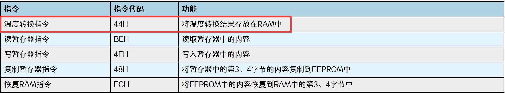
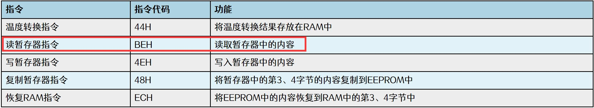

# 第159章 实现ds18b20驱动温度读取功能

本章实现ds18b20 读取温度功能。
## 159.1 如何实现ds18b20 读取温度功能？
单总线的通信步骤需要遵循以下操作顺序。顺序1：复位操作，调用ds18b20_reset()函数。顺序2：ROM 操作命令，本实验只使用了一个ds18b20 所以ROM 指令选择0xCC，即忽略序列号。（单个ds18b20 不需要选择要操作的ds18b20，使用0xCC 指令忽略序列号即可，多个ds18b20 组网需要根据序列号选择要操作的ds18b20）。顺序3：功能命令。如温度转换的ROM 指令为0x44。根据ds18b20 是否组网分以上操作顺序需要分情况讨论。当单总线上只有一个ds18b20 的时候读取温度步骤：1 开始进行温度转换：复位信号（顺序1）->发送ROM 指令OXCC 跳过搜索（顺序2）->发送RAM 指令0x44 进行温度转换（顺序3）。2 读温度：复位信号（顺序1）->发送ROM 指令OXCC 跳过搜索（顺序2）->发送RAM 指令0xbe 读暂存器（顺序3）。3 设置ds18b20:复位（顺序1）信号->发送ROM 指令OXCC 跳过搜索（顺序2）->发送RAM指令0x4e 写暂存器->要写的数据（顺序3）。当单总线上有多个ds18b20 的时候读取温度步骤：1 开始进行温度转换：复位信号（顺序1）->发送ROM 指令0x55 匹配指令（顺序2）->发送ds18b20 的地址（顺序2）->发送RAM 指令0x44 进行温度转换（顺序3）。2 读温度：复位信号（顺序1）->发送ROM 指令0x55 匹配指令（顺序2）->发送ds18b20的地址（顺序2）->发送RAM 指令0xbe 读暂存器换（顺序3）。3 设置ds18b20:复位信号（顺序1）->发送ROM 指令0x55 匹配指令（顺序2）->发送ds18b20的地址（顺序2）->发送RAM 指令0x4e 写暂存器（顺序3）->要写的数据（顺序3）。本实验只使用一个ds18b20，所以不需要通过序列号选择要操作的ds18b20，因此使用ROM

指令0xCC 跳过序列号，由于在每次执行功能命令之前，都需要先复位和使用ROM 指令0xCC忽略序列号，即操作顺序1 和2 步骤重复，所以重点介绍顺序3。1.获取当前温度写入ROM 指令0x44 进行温度转换，如图159.1 所示。

图159.1温度的转换是需要进行一定的时间的，并且不同分辨率下转换时间也是不同的，具体的转换时间和分辨率关系如图159.2 所示。

图159.2而默认情况下分辨率为12 位，所以需要在程序中延时750 毫秒。通过以上三个顺序实现温度转换对应的代码如代码清单159.1 所示。代码清单159.1
```c
int ds18b20_readtemp(void) {
    ds18b20_reset();//复位ds18b20
    ds18b20_writebyte(0xCC);//发送写入字节命令0xCC（跳过ROM）
    ds18b20_writebyte(0x44);//发送写入字节命令0x44（启动温度转换）
    mdelay(750);//延时750 微秒，等待温度转换完成
}
```
接下来需要对转换完成之后的温度进行读取，读取操作仍旧需要遵循三个顺序，其中顺序1 的复位和顺序2 的ROM 操作命令不在赘述，在顺序3 中要进行温度的读取，所以需要发送RAM 指令中的第二条0xbe，如图159.3 所示。


图159.3暂存器中的Byte0 和Byte1 用来存储转换之后的温度低位和高位，如图159.5 所示，所以需要使用上一章中编写的读操作来读取转换之后的温度，结合3 个操作顺序具体代码如代码清单159.2 所示。代码清单159.2
```c
/**
 * 从ds18b20 读取温度值
 * @return 读取到的温度值
 */
int ds18b20_readtemp(void) {
    int temp_l, temp_h, temp;
    ds18b20_reset();// 复位ds18b20
    ds18b20_writebyte(0xCC);// 发送写入字节命令0xCC（跳过ROM）
    ds18b20_writebyte(0xBE);// 发送写入字节命令0xBE（读取温度值）
    temp_l = ds18b20_readbyte();// 读取温度低位字节
    temp_h = ds18b20_readbyte();// 读取温度高位字节
    temp_h = temp_h << 8;// 将温度高位字节左移8 位
    temp = temp_h | temp_l;// 组合温度值
    return temp;
}
```
将温度转换的步骤和温度读取的步骤整合在一起，形成一个完整的函数，具体函数内容如代码清单159.3 所示。代码清单159.3
```c
/**
 * 从ds18b20 读取温度值
 * @return 读取到的温度值
 */
int ds18b20_readtemp(void) {
    int temp_l, temp_h, temp;
    ds18b20_reset();//复位ds18b20
    ds18b20_writebyte(0xCC);//发送写入字节命令0xCC（跳过ROM）
    ds18b20_writebyte(0x44);//发送写入字节命令0x44（启动温度转换）
```

```c
mdelay(750);//延时750 微秒，等待温度转换完成
ds18b20_reset();//复位ds18b20
ds18b20_writebyte(0xCC);//发送写入字节命令0xCC（跳过ROM）
ds18b20_writebyte(0xBE);//发送写入字节命令0xBE（读取温度值）
temp_l = ds18b20_readbyte();//读取温度低位字节
temp_h = ds18b20_readbyte();//读取温度高位字节
temp_h = temp_h << 8;//将温度高位字节左移8 位
temp = temp_h | temp_l;//组合温度值
return temp;
}
```
## 159.2 ds18b20 读取温度驱动编写
本实验代码存储在网盘iTOP-RK3568开发板\07_学习教程配套资料\03_Linux驱动配套资料\04_Linux 驱动例程\98_ds18b20_05\01_module 路径下。在驱动程序中实现了读取温度函数，并在文件操作集中的read()函数里通过copy_to_user()将驱动获取到的温度数据传递到用户空间。实验代码ds18b20.c 如代码清单159.4 所示。代码清单159.4
```c
#include <linux/init.h>
#include <linux/module.h>
#include <linux/platform_device.h>
#include <linux/of.h>
#include <linux/fs.h>
#include <linux/cdev.h>
#include <linux/kdev_t.h>
#include <linux/slab.h>
#include <linux/gpio.h>
#include <linux/gpio/consumer.h>
#include <linux/delay.h>
#include <linux/uaccess.h>
struct ds18b20_data
{
    dev_t dev_num;
    struct cdev ds18b20_cdev;
    struct class *ds18b20_class;
    struct device *ds18b20_device;
```

```c
struct gpio_desc *ds18b20_gpio;
};
struct ds18b20_data *ds18b20;
void ds18b20_reset(void)
{
//设置GPIO 输出高电平再拉低
gpiod_direction_output(ds18b20->ds18b20_gpio, 1);
gpiod_set_value(ds18b20->ds18b20_gpio, 0);
udelay(700); //延迟700 微秒
//设置GPIO 输出高电平，并将GPIO 方向设置为输入
gpiod_set_value(ds18b20->ds18b20_gpio, 1);
gpiod_direction_input(ds18b20->ds18b20_gpio);
//等待直到GPIO 输入为低电平
while (gpiod_get_value(ds18b20->ds18b20_gpio))
    ;
//等待直到GPIO 输入为高电平
while (!gpiod_get_value(ds18b20->ds18b20_gpio))
    ;
udelay(480); //延迟480 微秒
}
/**
* 向ds18b20 写入单个位(bit)
* @param bit 要写入的位(bit)，0 或1
*/
void ds18b20_writebit(unsigned char bit) {
//将GPIO 方向设置为输出，并输出高电平
gpiod_direction_output(ds18b20->ds18b20_gpio, 1);
//将GPIO 拉低gpiod_set_value(ds18b20->ds18b20_gpio, 0);
//若bit 为1，则延时10 微秒
if (bit){
    udelay(10);
    //将GPIO 方向设置为输出，并输出高电平
    gpiod_direction_output(ds18b20->ds18b20_gpio, 1);
}
//延时65 微秒
```

```c
udelay(65);
//将GPIO 方向设置为输出
gpiod_direction_output(ds18b20->ds18b20_gpio, 1);
//延时2 微秒
udelay(2);
}
/**
* 向ds18b20 写入一个字节(byte)数据
* @param data 要写入的字节数据
*/
void ds18b20_writebyte(int data) {
int i;
for (i = 0; i < 8; i++) {
    //逐位写入数据
    ds18b20_writebit(data & 0x01);
    data = data >> 1;
}
}
/**
* 从ds18b20 读取单个位(bit)
* @return 读取到的位(bit)，0 或1
*/
unsigned char ds18b20_readbit(void) {
unsigned char bit;
gpiod_direction_output(ds18b20->ds18b20_gpio, 1);//将GPIO 方向设置为输出，并输出高电平
gpiod_set_value(ds18b20->ds18b20_gpio, 0);//将GPIO 输出设置为低电平
udelay(2);//延时2 微秒
gpiod_direction_input(ds18b20->ds18b20_gpio);//将GPIO 方向设置为输入
udelay(10);//延时10 微秒
bit = gpiod_get_value(ds18b20->ds18b20_gpio);//读取GPIO 的值
udelay(60);//延时60 微秒
return bit;
}
/**
* 从ds18b20 读取一个字节(byte)数据
* @return 读取到的字节数据
*/
```

```c
int ds18b20_readbyte(void) {
    int data = 0;
    int i;
    for (i = 0; i < 8; i++) {
        //读取单个位(bit)并根据位的位置进行左移操作
        data |= ds18b20_readbit() << i;
    }
    return data;
}
/**
* 从ds18b20 读取温度值
* @return 读取到的温度值
 */
int ds18b20_readtemp(void) {
    int temp_l, temp_h, temp;
    ds18b20_reset();// 复位ds18b20
    ds18b20_writebyte(0xCC);// 发送写入字节命令0xCC（跳过ROM）
    ds18b20_writebyte(0x44);// 发送写入字节命令0x44（启动温度转换）
    mdelay(750);// 延时750 微秒，等待温度转换完成
    ds18b20_reset();// 复位ds18b20
    ds18b20_writebyte(0xCC);// 发送写入字节命令0xCC（跳过ROM）
    ds18b20_writebyte(0xBE);// 发送写入字节命令0xBE（读取温度值）
    temp_l = ds18b20_readbyte();// 读取温度低位字节
    temp_h = ds18b20_readbyte();// 读取温度高位字节
    temp_h = temp_h << 8;// 将温度高位字节左移8 位
    temp = temp_h | temp_l;// 组合温度值
    return temp;
}
int ds18b20_open(struct inode *inode, struct file *file)
{
    return 0;
}
ssize_t ds18b20_read(struct file *file, char __user *buf, size_t size, loff_t *offs) {
    int ds18b20_temp;
    ds18b20_temp = ds18b20_readtemp();// 从ds18b20 读取温度值
    // 将温度值复制到用户空间缓冲区
```

```c
if (copy_to_user(buf, &ds18b20_temp, sizeof(ds18b20_temp))) {
    return -1; // 复制失败，返回错误代码
}
return 0; // 成功读取并复制温度值
}
int ds18b20_release(struct inode *inode, struct file *file)
{
return 0;
}
struct file_operations ds18b20_fops = {
.open = ds18b20_open,
.read = ds18b20_read,
.release = ds18b20_release,
.owner = THIS_MODULE,
};
int ds18b20_probe(struct platform_device *dev)
{
int ret;
printk("This is probe \n");
// 分配内存给ds18b20_data 结构体
ds18b20 = kzalloc(sizeof(*ds18b20), GFP_KERNEL);
if (ds18b20 == NULL)
{
    printk("kzalloc error\n");
    ret = -ENOMEM;
    goto error_0;
}
//分配字符设备号
ret = alloc_chrdev_region(&ds18b20->dev_num, 0, 1, "myds18b20");
if (ret < 0)
{
    printk("alloc_chrdev_region error\n");
    ret = -EAGAIN;
    goto error_1;
}
// 初始化字符设备
cdev_init(&ds18b20->ds18b20_cdev, &ds18b20_fops);
```

```c
ds18b20->ds18b20_cdev.owner = THIS_MODULE;
cdev_add(&ds18b20->ds18b20_cdev, ds18b20->dev_num, 1);
// 创建设备类
ds18b20->ds18b20_class = class_create(THIS_MODULE, "sensors");
if (IS_ERR(ds18b20->ds18b20_class))
{
    printk("class_create error\n");
    ret = PTR_ERR(ds18b20->ds18b20_class);
    goto error_2;
}
// 创建设备
ds18b20->ds18b20_device = device_create(ds18b20->ds18b20_class, NULL, ds18b20->dev_num, NULL,
"ds18b20");
if (IS_ERR(ds18b20->ds18b20_device))
{
    printk("device_create error\n");
    ret = PTR_ERR(ds18b20->ds18b20_device);
    goto error_3;
}
// 获取GPIO 描述符
ds18b20->ds18b20_gpio = gpiod_get_optional(&dev->dev, "ds18b20", 0);
if (ds18b20->ds18b20_gpio == NULL)
{
    ret = -EBUSY;
    goto error_4;
}
// 设置GPIO 方向为输出
gpiod_direction_output(ds18b20->ds18b20_gpio, 1);
return 0;
error_4:
device_destroy(ds18b20->ds18b20_class, ds18b20->dev_num);
error_3:
 lass_destroy(ds18b20->ds18b20_class);
error_2:
cdev_del(&ds18b20->ds18b20_cdev);
unregister_chrdev_region(ds18b20->dev_num, 1);
```

```c
error_1:
    kfree(ds18b20);
error_0:
    return ret;
}
const struct of_device_id ds18b20_match_table[] = {
    {.compatible = "ds18b20"},
    {},
};
struct platform_driver ds18b20_driver = {
    .driver = {
        .owner = THIS_MODULE,
        .name = "ds18b20",
        .of_match_table = ds18b20_match_table,
    },
    .probe = ds18b20_probe,
};
static int __init ds18b20_init(void)
{
    int ret;
    // 注册平台驱动
    ret = platform_driver_register(&ds18b20_driver);
    if (ret < 0)
    {
        printk("platform_driver_register error\n");
        return -1;
    }
    return 0;
}
static void __exit ds18b20_exit(void)
{
    // 释放资源
    gpiod_put(ds18b20->ds18b20_gpio);
    device_destroy(ds18b20->ds18b20_class, ds18b20->dev_num);
    class_destroy(ds18b20->ds18b20_class);
    cdev_del(&ds18b20->ds18b20_cdev);
```

```c
unregister_chrdev_region(ds18b20->dev_num, 1);
kfree(ds18b20);
platform_driver_unregister(&ds18b20_driver);
}
module_init(ds18b20_init);
module_exit(ds18b20_exit);
MODULE_LICENSE("GPL");
```
## 159.3 应用程序编写
上一小节中的驱动程序会将采集到的温度值通过copy_to_user()函数传递到用户空间，而用户空间需要使用系统调用read()函数来读取传递过来的温度数据，需要注意的是驱动传递过来的数据是16 进制数据，如0x11，不是摄氏度这种数据，如35 摄氏度，因此需要在应用程序中转换成易读数据（如转成35 摄氏度）。关于温度转换内容可以查看ds18b20 寄存器介绍章节。编写好的应用程序存放在网盘
\98_ds18b20_05\02_app 路径下。实验代码app.c 如代码清单159.5 所示。代码清单159.5
```c
#include <stdio.h>
#include <sys/types.h>
#include <sys/stat.h>
#include <fcntl.h>
#include <unistd.h>
void ds18b20_get_temp(int value) {
    char sig;
    float temp;
    if ((value >> 11) & 0x01) {
        sig = '-';
        value = ~value + 1;// 取补码，表示负数
        value &= ~(0xF8 << 8);// 清除高5 位，保留低11 位
    } else {
        sig = '+';
    }
    temp = value * 0.0625;// 将温度值乘以0.0625，得到实际温度值
}
```

```c
int main(int argc, char *argv[]) {
    int fd;
    int data;
    fd = open("/dev/ds18b20", O_RDWR);// 打开设备文件/dev/ds18b20
    if (fd < 0) {
        printf("打开文件失败！\n");
        return -1;
    }
    while (1) {
        if (read(fd, &data, sizeof(data)) < 0) {// 从设备文件中读取数据
            printf("读取数据失败！\n");
            return -1;
        }
        ds18b20_get_temp(data);// 将读取的数据转换为温度值
        printf("温度为%c%.4f\n", sig, temp);// 打印温度值
    }
    close(fd);// 关闭设备文件
    return 0;
}
```
## 159.4 运行测试
### 159.4.1 编译驱动程序
在de18b20.c 代码同一目录下创建Makefile 文件，如图159.4 所示。

图159.4Makefile 文件内容如代码清单159.6 所示。代码清单159.6
```c
export ARCH=arm64#设置平台架构
export CROSS_COMPILE=aarch64-linux-gnu-#交叉编译器前缀
obj-m +=ds18b20.o#此处要和你的驱动源文件同名
KDIR :=/home/topeet/Linux/linux_sdk/kernel#这里是你的内核目录
PWD ?= $(shell pwd)
all:
    make -C $(KDIR) M=$(PWD) modules#make 操作
```

```c
clean:
    make -C $(KDIR) M=$(PWD) clean#make clean 操作
```
在存放ds18b20.c和Makefile文件目录下使用make命令编译驱动程序，编译完后如图159.5所示。

图159.5编译完生成ds18b20.ko 目标文件，如图159.6 所示。

图159.6至此驱动模块就编译成功了。
### 159.4.2 编译应用程序
使用aarch64-linux-gnu-gcc app.c -o app 命令交叉编译应用程序，编译成功如图159.7 所示。

图159.7然后将编译完成的可执行程序拷贝到开发板上。
### 159.4.3 运行测试
将本章节编译完成的ds18b20.ko 驱动和可执行程序app 文件拷贝到开发板上，然后使用insmod ds18b20.ko 命令加载驱动程序，如图159.8 所示。

图159.8接着使用./app 命令运行可执行程序app，在应用程序中会打印当前温度，然后用手触摸ds18b20 传感器，打印信息如图159.9 所示。


图159.9由图159.9 可以看到触摸ds18b20 以前温度是27.5 摄氏度，触摸ds18b20 以后温度明显的上升了，为30 摄氏度左右，接下来用逻辑分析仪采集时序图，采集过程不在赘述。图159.10 采集到的时序图首先是复位时序，接下来是发送0xCC 的ROM 指令时序和发送0x44 功能命令时序。

图159.10第二个采集到的时序图中首先发送了0xbe ROM 指令，表示读取暂存寄存器，后面的0xBB和0x01 分别表示读取到温度的低八位和高8 位，换算成10 进制为443，然后乘以0.0625 可以得到当前的温度为27.6875。至此关于逻辑分析仪采集到的波形就分析完成了。时序图如图159.11 所示。

图159.11

