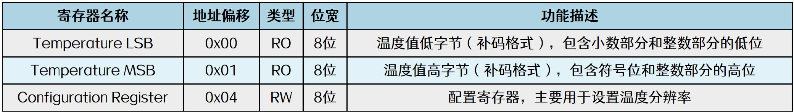
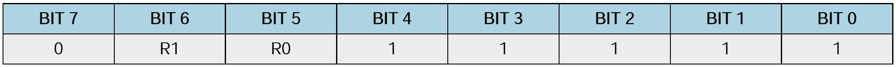
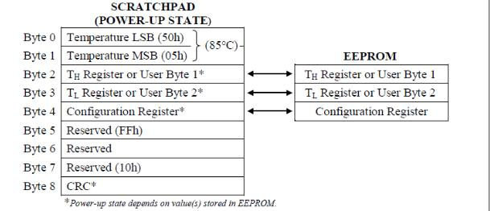
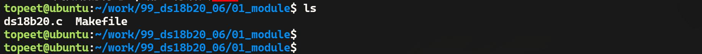
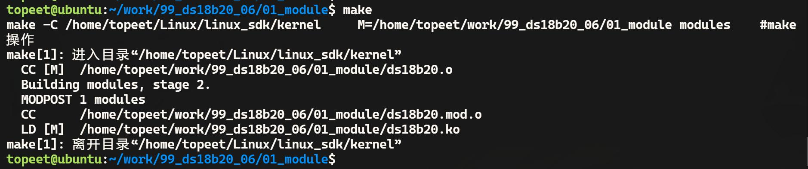
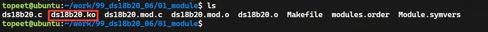
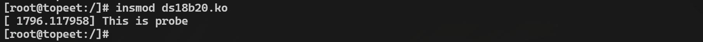
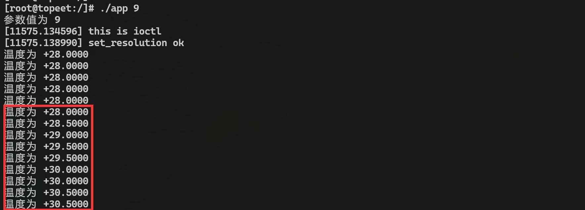

# 第160章实现ds18b20驱动使用ioctl设置分辨率功能

本章通过ioctl 实现修改ds18b20 的分辨率并编写应用程序进行分辨率修改测试。
## 160.1 ioctl 设置分辨率步骤
设置ds18b20 分辨率也需要按照ds18b20 读取温度函数章节中的三个顺序进行操作，顺序1 和顺序2 与读取温度函数相同，本章不在赘述，在顺序3 中需要设置配置寄存器从而设置ds18b20 分辨率。配置寄存器是一个可读可写的8 位寄存器，用于设置ds18b20 的温度分辨率，如图160.1所示。

图160.1其中配置寄存器中的BIT5(R0)和BIT6(R1)控制分辨率设定，可设置为9、10、11 或12 位分辨率。如图160.2 所示。

图160.2分别给配置寄存器写入0x1f、0x3f、0x5f 和0x7f 即可给ds18b20 设置9 位、10 位、11 位和12 位分辨率。如图160.3 所示。

图160.3

在暂存器中配置寄存器位于Byte4，如图160.4 所示，其中Byte0 和Byte1 用来存储温度，是只读寄存器，Byte2 和Byte3 用来设置温度报警的上限和下限。暂存器中的字节是按照顺序写入的，即按照Byte2~Byte8（Byte0 和Byte1 是只读寄存器，不可写入）顺序依次进行写入，所以如果对配置寄存器进行操作，需要先写入温度报警的上限和下限。

图160.4如代码清单160.1 是设置9 位分辨率步骤。代码清单160.1
```c
void set_resolution(){
    ds18b20_reset();//复位ds18b20 温度传感器
    ds18b20_writebyte(0xCC);//发送跳过ROM 命令
    ds18b20_writebyte(0x4E);//发送写暂存器命令
    ds18b20_writebyte(60);//发送字节2，设置温度上限阈值
    ds18b20_writebyte(10);//发送字节3，设置温度下限阈值
    ds18b20_writebyte(0x1F);//发送字节4，设置分辨率为9 位
}
```
## 160.2 ioctl 设置分辨率驱动编写
本实验代码存储在网盘iTOP-RK3568开发板\07_学习教程配套资料\03_Linux驱动配套资料\04_Linux 驱动例程\99_ds18b20_06\01_module 路径下。本实验添加了设置ds18b20 温度传感器的分辨率的set_resolution()函数，以及检查参数的有效性的check_args()函数，检查有效性指的是通过读取配置寄存器检查分辨率是否设置成功。实验代码ds18b20.c 如代码清单160.2 所示。

代码清单160.2
```c
#include <linux/init.h>
#include <linux/module.h>
#include <linux/platform_device.h>
#include <linux/of.h>
#include <linux/fs.h>
#include <linux/cdev.h>
#include <linux/kdev_t.h>
#include <linux/slab.h>
#include <linux/gpio.h>
#include <linux/gpio/consumer.h>
#include <linux/delay.h>
#include <linux/uaccess.h>
#define SET_RESOLUTION _IOW('A', 0, int)
#define SET_RESOLUTION_9 9
#define SET_RESOLUTION_10 10
#define SET_RESOLUTION_11 11
#define SET_RESOLUTION_12 12
struct ds18b20_data
{
    dev_t dev_num;
    struct cdev ds18b20_cdev;
    struct class *ds18b20_class;
    struct device *ds18b20_device;
    struct gpio_desc *ds18b20_gpio;
};
struct ds18b20_data *ds18b20;
void ds18b20_reset(void)
{
    //设置GPIO 输出高电平在拉低
    gpiod_direction_output(ds18b20->ds18b20_gpio, 1);
    gpiod_set_value(ds18b20->ds18b20_gpio, 0);
    udelay(700); //延迟700 微秒
    //设置GPIO 输出高电平，并将GPIO 方向设置为输入
    gpiod_set_value(ds18b20->ds18b20_gpio, 1);
    gpiod_direction_input(ds18b20->ds18b20_gpio);
    //等待直到GPIO 输入为低电平
```

```c
while (gpiod_get_value(ds18b20->ds18b20_gpio));
    //等待直到GPIO 输入为高电平
while (!gpiod_get_value(ds18b20->ds18b20_gpio));
    udelay(480); //延迟480 微秒
}
/**
 * 向ds18b20 写入单个位(bit)
 * @param bit 要写入的位(bit)，0 或1
*/
void ds18b20_writebit(unsigned char bit) {
    //将GPIO 方向设置为输出，并输出高电平
    gpiod_direction_output(ds18b20->ds18b20_gpio, 1);
    //将GPIO 拉低
    gpiod_set_value(ds18b20->ds18b20_gpio, 0);
    //若bit 为1，则延时10 微秒
    if (bit){
        udelay(10);
        // 将GPIO 方向设置为输出，并输出高电平
        gpiod_direction_output(ds18b20->ds18b20_gpio, 1);
    }
    //延时65 微秒
    udelay(65);
    //将GPIO 方向设置为输出，并输出高电平
    gpiod_direction_output(ds18b20->ds18b20_gpio, 1);
    //延时2 微秒
    udelay(2);
}
/**
 * 向ds18b20 写入一个字节(byte)数据
 * @param data 要写入的字节数据
 */
void ds18b20_writebyte(int data) {
    int i;
    for (i = 0; i < 8; i++) {
```

```c
// 逐位写入数据
ds18b20_writebit(data & 0x01);
data = data >> 1;
}
}
/**
* 从ds18b20 读取单个位(bit)
* @return 读取到的位(bit)，0 或1
*/
unsigned char ds18b20_readbit(void) {
unsigned char bit;
gpiod_direction_output(ds18b20->ds18b20_gpio, 1);//将GPIO 方向设置为输出，并输出高电平
gpiod_set_value(ds18b20->ds18b20_gpio, 0);//将GPIO 输出设置为低电平
udelay(2);//延时2 微秒
gpiod_direction_input(ds18b20->ds18b20_gpio);//将GPIO 方向设置为输入
udelay(10);//延时10 微秒
bit = gpiod_get_value(ds18b20->ds18b20_gpio);//读取GPIO 的值
udelay(60);//延时60 微秒
return bit;
}
/**
* 从ds18b20 读取一个字节(byte)数据
* @return 读取到的字节数据
*/
int ds18b20_readbyte(void) {
int data = 0;
int i;
for (i = 0; i < 8; i++) {
//读取单个位(bit)并根据位的位置进行左移操作
data |= ds18b20_readbit() << i;
}
return data;
}
/**
* 从ds18b20 读取温度值
* @return 读取到的温度值
*/
int ds18b20_readtemp(void) {
```

```c
int temp_l, temp_h, temp;
ds18b20_reset();//复位ds18b20
ds18b20_writebyte(0xCC);//发送写入字节命令0xCC（跳过ROM）
ds18b20_writebyte(0x44);//发送写入字节命令0x44（启动温度转换）
mdelay(750);//延时750 微秒，等待温度转换完成
ds18b20_reset();//复位ds18b20
ds18b20_writebyte(0xCC);//发送写入字节命令0xCC（跳过ROM）
ds18b20_writebyte(0xBE);//发送写入字节命令0xBE（读取温度值）
temp_l = ds18b20_readbyte();//读取温度低位字节
temp_h = ds18b20_readbyte();//读取温度高位字节
temp_h = temp_h << 8;//将温度高位字节左移8 位
temp = temp_h | temp_l;//组合温度值
return temp;
}
/**
* 设置ds18b20 温度传感器的分辨率
* @param args 分辨率参数
*/
void set_resolution(int args) {
ds18b20_reset();//复位ds18b20 温度传感器
ds18b20_writebyte(0xCC);//发送跳过ROM 命令
ds18b20_writebyte(0x4E);//发送写暂存器命令
ds18b20_writebyte(60);//发送配置字节2，设置温度上限阈值
ds18b20_writebyte(10);//发送配置字节3，设置温度下限阈值
switch (args) {
    case SET_RESOLUTION_9://设置分辨率为9 位
        ds18b20_writebyte(0x1F);//发送配置字节4，设置分辨率为9 位
        break;
    case SET_RESOLUTION_10://设置分辨率为10 位
        ds18b20_writebyte(0x3F);//发送配置字节4，设置分辨率为10 位
        break;
    case SET_RESOLUTION_11://设置分辨率为11 位
        ds18b20_writebyte(0x5F);//发送配置字节3，设置分辨率为11 位
        break;
    case SET_RESOLUTION_12://设置分辨率为12 位
        ds18b20_writebyte(0x7F);//发送配置字节4，设置分辨率为12 位
        break;
    default:
        break;
```

```c
}
}
/**
* 检查参数的有效性
* @param args 参数
* @return 返回执行结果，成功返回0，失败返回-1
*/
int check_args(int args) {
int ret = -1;//返回值，默认为失败
ds18b20_reset();//复位传感器
ds18b20_writebyte(0xCC);//发送指令字节0xCC
ds18b20_writebyte(0xBE);//发送指令字节0xBE
ds18b20_readbyte();//读取一个字节
ds18b20_readbyte();//读取一个字节
ds18b20_readbyte();//读取一个字节
ds18b20_readbyte();//读取一个字节，读暂存区也要按照顺序依次进行读取。
switch (args) {
    case SET_RESOLUTION_9:
        if (ds18b20_readbyte() == 0x1F) {//读取一个字节并与0x1F 进行比较
            ret = 0;//设置返回值为成功
        }
        break;
    case SET_RESOLUTION_10:
        if (ds18b20_readbyte() == 0x3F) {//读取一个字节并与0x3F 进行比较
            ret = 0;//设置返回值为成功
        }
        break;
    case SET_RESOLUTION_11:
       if (ds18b20_readbyte() == 0x5F) {//读取一个字节并与0x5F 进行比较
            ret = 0;//设置返回值为成功
        }
        break;
    case SET_RESOLUTION_12:
        if (ds18b20_readbyte() == 0x7F) {//读取一个字节并与0x7F 进行比较
            ret = 0;//设置返回值为成功
        }
        break;
    default:
        break;
}
```

```c
return ret;//返回结果
}
int ds18b20_open(struct inode *inode, struct file *file)
{
return 0;
}
ssize_t ds18b20_read(struct file *file, char __user *buf, size_t size, loff_t *offs) {
int ds18b20_temp;
ds18b20_temp = ds18b20_readtemp();//从ds18b20 读取温度值
//将温度值复制到用户空间缓冲区
if (copy_to_user(buf, &ds18b20_temp, sizeof(ds18b20_temp))) {
    return -1; //复制失败，返回错误代码
}
return 0; //成功读取并复制温度值
}
int ds18b20_release(struct inode *inode, struct file *file)
{
return 0;
}
/**
* ds18b20 温度传感器的ioctl 函数
* @param file 文件指针
* @param cmd 命令
* @param args 参数
* @return 返回执行结果，成功返回0，失败返回-1
*/
long ds18b20_ioctl(struct file *file, unsigned int cmd, unsigned long args) {
printk("this is ioctl\n");
if (cmd == SET_RESOLUTION) {//判断命令是否为设置分辨率
    if (args >= SET_RESOLUTION_9 && args <= SET_RESOLUTION_12) {//判断参数是否在有效的分辨率
范围内
        set_resolution(args);//调用设置分辨率
        printk("set_resolution ok \n");
        return 0;// 返回成功
    }
}
//如果不匹配SET_RESOLUTION 或者args 不在有效范围内，不执行任何操作
return -1;//返回失败
}
```

```c
struct file_operations ds18b20_fops = {
    .open = ds18b20_open,
    .read = ds18b20_read,
    .release = ds18b20_release,
    .unlocked_ioctl = ds18b20_ioctl,
    .owner = THIS_MODULE,
};
int ds18b20_probe(struct platform_device *dev)
{
    int ret;
    printk("This is probe \n");
    //分配内存给ds18b20_data 结构体
    ds18b20 = kzalloc(sizeof(*ds18b20), GFP_KERNEL);
    if (ds18b20 == NULL)
    {
        printk("kzalloc error\n");
        ret = -ENOMEM;
        goto error_0;
    }
    //分配字符设备号
    ret = alloc_chrdev_region(&ds18b20->dev_num, 0, 1, "myds18b20");
    if (ret < 0)
    {
        printk("alloc_chrdev_region error\n");
        ret = -EAGAIN;
        goto error_1;
    }
    //初始化字符设备
    cdev_init(&ds18b20->ds18b20_cdev, &ds18b20_fops);
    ds18b20->ds18b20_cdev.owner = THIS_MODULE;
    cdev_add(&ds18b20->ds18b20_cdev, ds18b20->dev_num, 1);
    //创建设备类
    ds18b20->ds18b20_class = class_create(THIS_MODULE, "sensors");
    if (IS_ERR(ds18b20->ds18b20_class))
    {
        printk("class_create error\n");
        ret = PTR_ERR(ds18b20->ds18b20_class);
        goto error_2;
```

```c
}
//创建设备
ds18b20->ds18b20_device = device_create(ds18b20->ds18b20_class, NULL, ds18b20->dev_num, NULL,
"ds18b20");
if (IS_ERR(ds18b20->ds18b20_device))
{
    printk("device_create error\n");
    ret = PTR_ERR(ds18b20->ds18b20_device);
    goto error_3;
}
//获取GPIO 描述符
ds18b20->ds18b20_gpio = gpiod_get_optional(&dev->dev, "ds18b20", 0);
if (ds18b20->ds18b20_gpio == NULL)
{
    ret = -EBUSY;
    goto error_4;
}
//设置GPIO 方向为输出，并输出高电平
gpiod_direction_output(ds18b20->ds18b20_gpio, 1);
return 0;
error_4:
device_destroy(ds18b20->ds18b20_class, ds18b20->dev_num);
error_3:
class_destroy(ds18b20->ds18b20_class);
error_2:
cdev_del(&ds18b20->ds18b20_cdev);
unregister_chrdev_region(ds18b20->dev_num, 1);
error_1:
kfree(ds18b20);
error_0:
return ret;
}
const struct of_device_id ds18b20_match_table[] = {
{.compatible = "ds18b20"},
```

```c
{},
};
struct platform_driver ds18b20_driver = {
.driver = {
    .owner = THIS_MODULE,
    .name = "ds18b20",
    .of_match_table = ds18b20_match_table,
},
.probe = ds18b20_probe,
};
static int __init ds18b20_init(void)
{
int ret;
//注册平台驱动
ret = platform_driver_register(&ds18b20_driver);
if (ret < 0)
{
    printk("platform_driver_register error\n");
    return -1;
}
return 0;
}
static void __exit ds18b20_exit(void)
{
// 释放资源
gpiod_put(ds18b20->ds18b20_gpio);
device_destroy(ds18b20->ds18b20_class, ds18b20->dev_num);
class_destroy(ds18b20->ds18b20_class);
cdev_del(&ds18b20->ds18b20_cdev);
unregister_chrdev_region(ds18b20->dev_num, 1);
kfree(ds18b20);
platform_driver_unregister(&ds18b20_driver);
}
module_init(ds18b20_init);
module_exit(ds18b20_exit);
MODULE_LICENSE("GPL");
```

## 160.3 应用程序编写
编写好的应用程序存放在网盘iTOP-RK3568开发板\07_学习教程配套资料\03_Linux驱动配套资料\04_Linux 驱动例程\99_ds18b20_06\02_app 路径下。在应用程序中使用ioctl()函数设置ds18b20 分辨率，实验代码app.c 如代码清单160.3 所示。代码清单160.3
```c
#include <stdio.h>
#include <sys/types.h>
#include <sys/stat.h>
#include <fcntl.h>
#include <unistd.h>
#include <sys/ioctl.h>
#include <stdlib.h>
#define SET_RESOLUTION _IOW('A', 0, int)
/**
 * 根据传感器读取的原始数据计算温度值
 * @param value 传感器读取的原始数据
 */
void ds18b20_get_temp(int value) {
        char sig;// 温度正负号
        float temp; // 温度值
        // 判断温度正负号
        if ((value >> 11) & 0x01) {
            sig = '-';
            value = ~value + 1;
            value &= ~(0xf8 << 8);
        } else {
            sig = '+';
        }
        // 计算温度值
        temp = value * 0.0625;
        // 打印温度信息
        printf("温度为%c%.4f\n", sig, temp);
    }
    int main(int argc, char *argv[]) {
```

```c
int fd;// 文件描述符
int data;// 读取的数据
int args;// 参数值
// 打开设备文件
fd = open("/dev/ds18b20", O_RDWR);
if (fd < 0) {
    printf("打开设备文件出错\n");
    return -1;
}
// 获取命令行参数
args = atoi(argv[1]);
printf("参数值为%d\n", args);
// 检查参数范围
if (args < 9 || args > 12) {
    printf("错误！参数范围应为9 - 12\n");
    return -1;
}
// 设置分辨率
ioctl(fd, SET_RESOLUTION, args);
while (1) {
    // 读取数据
    read(fd, &data, sizeof(data));
    // 处理并打印温度信息
    ds18b20_get_temp(data);
}
return 0;
}
```
## 160.4 运行测试
### 160.4.1 编译驱动程序
在de18b20.c 代码同一目录下创建Makefile 文件，如图160.5 所示。


图160.5Makefile 文件内容如代码清单160.4 所示。代码清单160.4
```c
export ARCH=arm64#设置平台架构
export CROSS_COMPILE=aarch64-linux-gnu-#交叉编译器前缀
obj-m +=ds18b20.o#此处要和你的驱动源文件同名
KDIR :=/home/topeet/Linux/linux_sdk/kernel#这里是你的内核目录
PWD ?= $(shell pwd)
all:
    make -C $(KDIR) M=$(PWD) modules#make 操作
clean:
    make -C $(KDIR) M=$(PWD) clean#make clean 操作
```
在存放ds18b20.c和Makefile文件目录下使用make命令编译驱动程序，编译完成如图160.6所示。

图160.6编译完生成ds18b20.ko 目标文件，如图160.7 所示。

图160.7至此驱动模块就编译成功了。
### 160.4.2 编译应用程序
使用aarch64-linux-gnu-gcc app.c -o app 命令交叉编译应用程序，编译成功如图160.8 所示。


图160.8然后将编译完成的可执行程序拷贝到开发板上。
### 160.4.3 运行测试
将本章节编译完成的ds18b20.ko 驱动和可执行程序app 文件拷贝到开发板上，然后使用insmod ds18b20.ko 命令加载驱动程序，如图160.9 所示。

图160.9使用./app 9 命令运行可执行程序app 并设置分辨率为9 位，如果驱动和应用运行成功会打印采集到的温度，如图160.10 所示。

图160.10然后用手触摸ds18b20 传感器，由图160.10 可以看到温度明显的上升了，并且温度上升的分辨率为9 位（温度增幅0.5℃），说明设置成功（未设置以前分辨率默认为12 位）。

