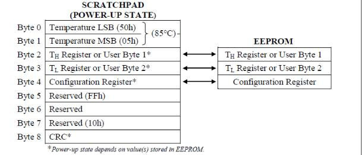
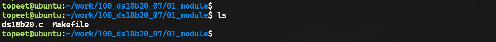
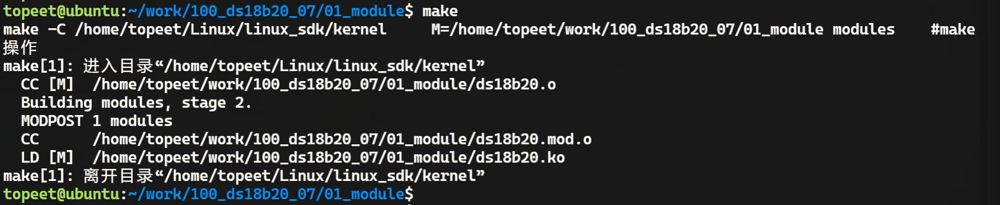
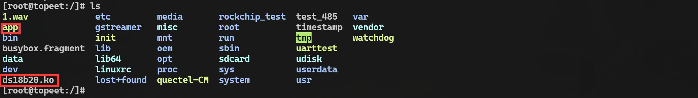
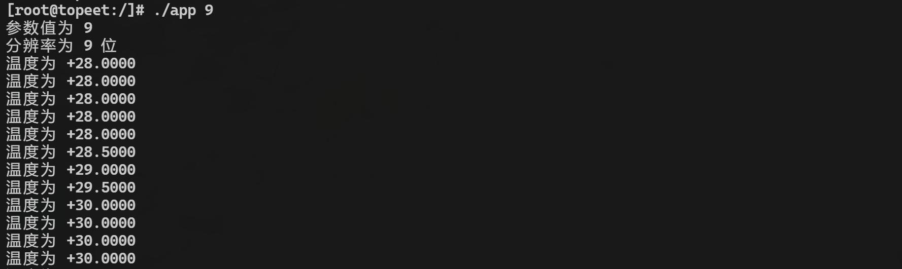

# 第161章 实现ds18b20驱动使用ioctl读取分辨率功能

本章实现读取ds18b20 温度分辨率功能，并编写应用程序读取温度分辨率。
## 161.1 ioctl 读取分辨率步骤分析
读取分辨率需要读取暂存器中配置寄存器，即Byte4，如图161.1 所示，读暂存器中的字节也是按照顺序读取，即按照Byte0~Byte8 顺序依次读取，所以读取分辨率需要读取四次才可以获得。

图161.1如代码清单161.1 是读取分辨率的步骤。代码清单161.1//复位传感器ds18b20_reset();//发送指令字节0xCC，跳过ROM操作，直接与单个设备通信ds18b20_writebyte(0xCC);//发送指令字节0xBE，读取当前设备的配置寄存器ds18b20_writebyte(0xBE);//读取Byte0 到Byte4 5 个字节的数据，Byte4 是分辨率信息，所以只保留Byte4 信息。ds18b20_readbyte();ds18b20_readbyte();

ds18b20_readbyte();ds18b20_readbyte();//返回分辨率值ret = ds18b20_readbyte();
## 161.2 ioctl 读取分辨率驱动代码编写
本实验代码存储在网盘iTOP-RK3568 开发板\07_学习教程配套资料\03_Linux 驱动配套资料\04_Linux 驱动例程\100_ds18b20_07\01_module 路径下。实现读取ds18b20 分辨率有俩种方法。方法1：在驱动代码中通过文件操作集中的read()函数读取配置寄存器，然后在应用程序中通过read()系统调用获得ds18b20 的分辨率。方法2：在驱动程序中通过ioctl()函数读取配置寄存器，然后在应用程序中通过ioctl()系统调用获取ds18b20 分辨率。如果应用空间和内核空间需要交换的数据比较大选择方法1，如何数据比较小，选择方法2，很显然，分辨率数据比较小，所以在驱动程序中选择方法2 实现该功能。实验代码ds18b20.c如代码清单161.2 所示。代码清单161.2
```c
#include <linux/init.h>
#include <linux/module.h>
#include <linux/platform_device.h>
#include <linux/of.h>
#include <linux/fs.h>
#include <linux/cdev.h>
#include <linux/kdev_t.h>
#include <linux/slab.h>
#include <linux/gpio.h>
#include <linux/gpio/consumer.h>
#include <linux/delay.h>
#include <linux/uaccess.h>
#define SET_RESOLUTION _IOW('A', 0, int)
#define READ_RESOLUTION _IOR('A', 1, int)
#define SET_RESOLUTION_9 9
#define SET_RESOLUTION_10 10
```

```c
#define SET_RESOLUTION_11 11
#define SET_RESOLUTION_12 12
struct ds18b20_data
{
    dev_t dev_num;
    struct cdev ds18b20_cdev;
    struct class *ds18b20_class;
    struct device *ds18b20_device;
    struct gpio_desc *ds18b20_gpio;
};
struct ds18b20_data *ds18b20;
void ds18b20_reset(void)
{
    //设置GPIO 输出高电平再拉底
    gpiod_direction_output(ds18b20->ds18b20_gpio, 1);
    gpiod_set_value(ds18b20->ds18b20_gpio, 0);
    udelay(700); //延迟700 微秒
    //设置GPIO 输出高电平，并将GPIO 方向设置为输入
    gpiod_set_value(ds18b20->ds18b20_gpio, 1);
    gpiod_direction_input(ds18b20->ds18b20_gpio);
    //等待直到GPIO 输入为低电平
while (gpiod_get_value(ds18b20->ds18b20_gpio));
    //等待直到GPIO 输入为高电平
while (!gpiod_get_value(ds18b20->ds18b20_gpio));
    udelay(480); //延迟480 微秒
}
/**
 * 向ds18b20 写入单个位(bit)
 * @param bit 要写入的位(bit)，0 或1
 */
void ds18b20_writebit(unsigned char bit) {
    //将GPIO 方向设置为输出，并输出高电平
    gpiod_direction_output(ds18b20->ds18b20_gpio, 1);
    //将GPIO 拉低
    gpiod_set_value(ds18b20->ds18b20_gpio, 0);
```

```c
//若bit 为1，则延时10 微秒
if (bit){
    udelay(10);
    //将GPIO 方向设置为输出，并输出高电平
    gpiod_direction_output(ds18b20->ds18b20_gpio, 1);
}
//延时65 微秒
udelay(65);
//将GPIO 方向设置为输出，并输出高电平
gpiod_direction_output(ds18b20->ds18b20_gpio, 1);
//延时2 微秒
udelay(2);
}
/**
* 向ds18b20 写入一个字节(byte)数据
* @param data 要写入的字节数据
*/
void ds18b20_writebyte(int data) {
int i;
for (i = 0; i < 8; i++) {
    //逐位写入数据
    ds18b20_writebit(data & 0x01);
    data = data >> 1;
}
}
/**
* 从ds18b20 读取单个位(bit)
* @return 读取到的位(bit)，0 或1
*/
unsigned char ds18b20_readbit(void) {
unsigned char bit;
gpiod_direction_output(ds18b20->ds18b20_gpio, 1);//将GPIO 方向设置为输出，并输出高电平
gpiod_set_value(ds18b20->ds18b20_gpio, 0);// 将GPIO 输出设置为低电平
udelay(2);//延时2 微秒
gpiod_direction_input(ds18b20->ds18b20_gpio);//将GPIO 方向设置为输入
udelay(10);//延时10 微秒
bit = gpiod_get_value(ds18b20->ds18b20_gpio);//读取GPIO 的值
```

```c
udelay(60);//延时60 微秒
return bit;
}
/**
* 从ds18b20 读取一个字节(byte)数据
* @return 读取到的字节数据
*/
int ds18b20_readbyte(void) {
int data = 0;
int i;
for (i = 0; i < 8; i++) {
    //读取单个位(bit)并根据位的位置进行左移操作
    data |= ds18b20_readbit() << i;
}
return data;
}
/**
* 从ds18b20 读取温度值
* @return 读取到的温度值
*/
int ds18b20_readtemp(void) {
int temp_l, temp_h, temp;
ds18b20_reset();//复位ds18b20
ds18b20_writebyte(0xCC);//发送写入字节命令0xCC（跳过ROM）
ds18b20_writebyte(0x44);//发送写入字节命令0x44（启动温度转换）
mdelay(750);//延时750 微秒，等待温度转换完成
ds18b20_reset();//复位ds18b20
ds18b20_writebyte(0xCC);//发送写入字节命令0xCC（跳过ROM）
ds18b20_writebyte(0xBE);//发送写入字节命令0xBE（读取温度值）
temp_l = ds18b20_readbyte();//读取温度低位字节
temp_h = ds18b20_readbyte();//读取温度高位字节
temp_h = temp_h << 8;//将温度高位字节左移8 位
temp = temp_h | temp_l;//组合温度值
return temp;
}
```

```c
/**
 * 设置ds18b20 温度传感器的分辨率
 * @param args 分辨率参数
 */
void set_resolution(int args) {
    ds18b20_reset();//复位ds18b20 温度传感器
    ds18b20_writebyte(0xCC);//发送跳过ROM 命令
    ds18b20_writebyte(0x4E);//发送写配置寄存器命令
    ds18b20_writebyte(60);//发送配置字节，设置温度上限阈值
    ds18b20_writebyte(10);// 发送配置字节2，设置温度下限阈值
    switch (args) {
        case SET_RESOLUTION_9://设置分辨率为9 位
            ds18b20_writebyte(0x1F);//发送配置字节3，设置分辨率为9 位
            break;
        case SET_RESOLUTION_10://设置分辨率为10 位
            ds18b20_writebyte(0x3F);//发送配置字节3，设置分辨率为10 位
            break;
        case SET_RESOLUTION_11://设置分辨率为11 位
            ds18b20_writebyte(0x5F);//发送配置字节3，设置分辨率为11 位
            break;
        case SET_RESOLUTION_12://设置分辨率为12 位
            ds18b20_writebyte(0x7F);//发送配置字节3，设置分辨率为12 位
            break;
        default:
            break;
    }
}
/**
 * 检查参数的有效性
 * @param args 参数
 * @return 返回执行结果，成功返回0，失败返回-1
 */
int check_args(int args) {
    int ret = -1;//返回值，默认为失败
    ds18b20_reset();//复位传感器
    ds18b20_writebyte(0xCC);//发送指令字节0xCC
    ds18b20_writebyte(0xBE);//发送指令字节0xBE
    ds18b20_readbyte();//读取一个字节
    ds18b20_readbyte();//读取一个字节
    ds18b20_readbyte();//读取一个字节
    ds18b20_readbyte();//读取一个字节
```

```c
switch (args) {
    case SET_RESOLUTION_9:
        if (ds18b20_readbyte() == 0x1F) {//读取一个字节并与0x1F 进行比较
            ret = 0;//设置返回值为成功
        }
        break;
    case SET_RESOLUTION_10:
        if (ds18b20_readbyte() == 0x3F) {//读取一个字节并与0x3F 进行比较
            ret = 0;//设置返回值为成功
        }
        break;
    case SET_RESOLUTION_11:
        if (ds18b20_readbyte() == 0x5F) {// 读取一个字节并与0x5F 进行比较
            ret = 0;// 设置返回值为成功
        }
        break;
    case SET_RESOLUTION_12:
        if (ds18b20_readbyte() == 0x7F) {//读取一个字节并与0x7F 进行比较
            ret = 0;//设置返回值为成功
        }
        break;
    default:
        break;
}
return ret;//返回结果
}
/**
* 读取分辨率。
*
* @return 分辨率值
*/
int read_resolution(void) {
int ret;
//复位传感器
ds18b20_reset();
//发送指令字节0xCC，跳过ROM 操作，直接与单个设备通信
ds18b20_writebyte(0xCC);
```

```c
//发送指令字节0xBE，读取当前设备的配置寄存器
ds18b20_writebyte(0xBE);
//读取4 个字节的数据，但实际上只有最后一个字节是分辨率信息
ds18b20_readbyte();
ds18b20_readbyte();
ds18b20_readbyte();
ds18b20_readbyte();
//读取最后一个字节，即分辨率信息
ret = ds18b20_readbyte();
//返回分辨率值
return ret;
}
int ds18b20_open(struct inode *inode, struct file *file)
{
return 0;
}
ssize_t ds18b20_read(struct file *file, char __user *buf, size_t size, loff_t *offs) {
int ds18b20_temp;
ds18b20_temp = ds18b20_readtemp();//从ds18b20 读取温度值
//将温度值复制到用户空间缓冲区
if (copy_to_user(buf, &ds18b20_temp, sizeof(ds18b20_temp))) {
    return -1; //复制失败，返回错误代码
}
return 0; //成功读取并复制温度值
}
int ds18b20_release(struct inode *inode, struct file *file)
{
return 0;
}
/**
* ds18b20 温度传感器的ioctl 函数
* @param file 文件指针
* @param cmd 命令
* @param args 参数
* @return 返回执行结果，成功返回0，失败返回-1
```

```c
*/
long ds18b20_ioctl(struct file *file, unsigned int cmd, unsigned long args) {
   int resolution;
   if (cmd == SET_RESOLUTION) {//判断命令是否为设置分辨率
       if (args >= SET_RESOLUTION_9 && args <= SET_RESOLUTION_12) {//判断参数是否在有效的分辨率
范围内
           set_resolution(args);//调用设置分辨率的函数
           return 0;//返回成功
       }
   }
   else if (cmd == READ_RESOLUTION) {
       //读取分辨率
       resolution = read_resolution();
       //将分辨率的值复制给用户空间的args
       if (copy_to_user((int *)args, &resolution, sizeof(resolution))) {
           //复制失败，返回-1 表示失败
           return -1;
       }
   }
   //如果不匹配SET_RESOLUTION 或者args 不在有效范围内，不执行任何操作
   return -1;//返回失败
}
struct file_operations ds18b20_fops = {
   .open = ds18b20_open,
   .read = ds18b20_read,
   .release = ds18b20_release,
   .unlocked_ioctl = ds18b20_ioctl,
   .owner = THIS_MODULE,
};
int ds18b20_probe(struct platform_device *dev)
{
   int ret;
   printk("This is probe \n");
   //分配内存给ds18b20_data 结构体
   ds18b20 = kzalloc(sizeof(*ds18b20), GFP_KERNEL);
   if (ds18b20 == NULL)
   {
       printk("kzalloc error\n");
       ret = -ENOMEM;
       goto error_0;
   }
```

```c
//分配字符设备号
ret = alloc_chrdev_region(&ds18b20->dev_num, 0, 1, "myds18b20");
if (ret < 0)
{
    printk("alloc_chrdev_region error\n");
    ret = -EAGAIN;
    goto error_1;
}
//初始化字符设备
cdev_init(&ds18b20->ds18b20_cdev, &ds18b20_fops);
ds18b20->ds18b20_cdev.owner = THIS_MODULE;
cdev_add(&ds18b20->ds18b20_cdev, ds18b20->dev_num, 1);
//创建设备类
ds18b20->ds18b20_class = class_create(THIS_MODULE, "sensors");
if (IS_ERR(ds18b20->ds18b20_class))
{
    printk("class_create error\n");
    ret = PTR_ERR(ds18b20->ds18b20_class);
    goto error_2;
}
//创建设备
ds18b20->ds18b20_device = device_create(ds18b20->ds18b20_class, NULL, ds18b20->dev_num, NULL,
"ds18b20");
if (IS_ERR(ds18b20->ds18b20_device))
{
    printk("device_create error\n");
    ret = PTR_ERR(ds18b20->ds18b20_device);
    goto error_3;
}
//获取GPIO 描述符
ds18b20->ds18b20_gpio = gpiod_get_optional(&dev->dev, "ds18b20", 0);
if (ds18b20->ds18b20_gpio == NULL)
{
    ret = -EBUSY;
    goto error_4;
}
//设置GPIO 方向为输出
gpiod_direction_output(ds18b20->ds18b20_gpio, 1);
```

```c
return 0;
error_4:
device_destroy(ds18b20->ds18b20_class, ds18b20->dev_num);
error_3:
class_destroy(ds18b20->ds18b20_class);
error_2:
cdev_del(&ds18b20->ds18b20_cdev);
unregister_chrdev_region(ds18b20->dev_num, 1);
error_1:
kfree(ds18b20);
error_0:
return ret;
}
const struct of_device_id ds18b20_match_table[] = {
{.compatible = "ds18b20"},
{},
};
struct platform_driver ds18b20_driver = {
.driver = {
    .owner = THIS_MODULE,
    .name = "ds18b20",
    .of_match_table = ds18b20_match_table,
},
.probe = ds18b20_probe,
};
static int __init ds18b20_init(void)
{
int ret;
//注册平台驱动
ret = platform_driver_register(&ds18b20_driver);
if (ret < 0)
{
    printk("platform_driver_register error\n");
    return -1;
```

```c
}
return 0;
}
static void __exit ds18b20_exit(void)
{
//释放资源
gpiod_put(ds18b20->ds18b20_gpio);
device_destroy(ds18b20->ds18b20_class, ds18b20->dev_num);
class_destroy(ds18b20->ds18b20_class);
cdev_del(&ds18b20->ds18b20_cdev);
unregister_chrdev_region(ds18b20->dev_num, 1);
kfree(ds18b20);
platform_driver_unregister(&ds18b20_driver);
}
module_init(ds18b20_init);
module_exit(ds18b20_exit);
MODULE_LICENSE("GPL");
```
## 161.3 应用程序编写
编写好的应用程序存储在网盘iTOP-RK3568开发板\07_学习教程配套资料\03_Linux驱动配套资料\04_Linux 驱动例程\100_ds18b20_07\02_app 路径下。在应用程序使用ioctl()函数获取ds18b20 的分辨率。实验代码app.c 如代码清单161.3 所示。代码清单161.3
```c
#include <stdio.h>
#include <sys/types.h>
#include <sys/stat.h>
#include <fcntl.h>
#include <unistd.h>
#include <sys/ioctl.h>
#include <stdlib.h>
#define SET_RESOLUTION _IOW('A', '0', int)
#define READ_RESOLUTION _IOR('A', '1', int)
/**
 * 根据传感器读取的原始数据计算温度值
 * @param value 传感器读取的原始数据
```

```c
*/
void ds18b20_get_temp(int value) {
   char sig;//温度正负号
   float temp; //温度值
   //判断温度正负号
   if ((value >> 11) & 0x01) {
       sig = '-';
       value = ~value + 1;
       value &= ~(0xf8 << 8);
   } else {
       sig = '+';
   }
   //计算温度值
   temp = value * 0.0625;
   //打印温度信息
   printf("温度为%c%.4f\n", sig, temp);
}
/**
* 根据传感器分辨率值打印分辨率信息
* @param value 传感器分辨率值
*/
void ds18b20_get_resolution(int value) {
   switch (value) {
       case 0x1F:
           printf("分辨率为9 位\n");
           break;
       case 0x3F:
           printf("分辨率为10 位\n");
           break;
       case 0x5F:
           printf("分辨率为11 位\n");
           break;
       case 0x7F:
           printf("分辨率为12 位\n");
           break;
       default:
           break;
   }
}
```

```c
int main(int argc, char *argv[]) {
    int fd;//文件描述符
    int data;//读取的数据
    int args;//参数值
    int resolution;//返回的分辨率的值
    //打开设备文件
    fd = open("/dev/ds18b20", O_RDWR);
    if (fd < 0) {
        printf("打开设备文件出错\n");
        return -1;
    }
    // 获取命令行参数
    args = atoi(argv[1]);
    printf("参数值为%d\n", args);
    //检查参数范围
    if (args < 9 || args > 12) {
        printf("错误！参数范围应为9 - 12\n");
        return -1;
    }
    //设置分辨率
    ioctl(fd, SET_RESOLUTION, args);
    //读取分辨率
    ioctl(fd, READ_RESOLUTION, &resolution);
    ds18b20_get_resolution(resolution);
    while (1) {
        //读取数据
        read(fd, &data, sizeof(data));
        //处理并打印温度信息
        ds18b20_get_temp(data);
    }
    return 0;
}
```

## 161.4 运行测试
### 161.4.1 编译驱动程序
在de18b20.c 代码同一目录下创建Makefile 文件，如图161.2 所示。

图161.2Makefile 文件内容如代码清单161.4 所示。代码清单161.4
```c
export ARCH=arm64#设置平台架构
export CROSS_COMPILE=aarch64-linux-gnu-#交叉编译器前缀
obj-m +=ds18b20.o#此处要和你的驱动源文件同名
KDIR :=/home/topeet/Linux/linux_sdk/kernel#这里是你的内核目录
PWD ?= $(shell pwd)
all:
    make -C $(KDIR) M=$(PWD) modules#make 操作
clean:
    make -C $(KDIR) M=$(PWD) clean#make clean 操作
```
在存放ds18b20.c和Makefile文件目录下使用make命令编译驱动程序，编译完成如图161.3所示。

图161.3编译完生成ds18b20.ko 目标文件，如图161.4 所示。

图161.4至此驱动模块就编译成功了。

### 161.4.2 编译应用程序
使用aarch64-linux-gnu-gcc app.c -o app 命令交叉应用程序，如图161.5 所示。

图161.5然后将编译完成的可执行程序拷贝到开发板上。
### 161.4.3 运行测试
将本章节编译完成的ds18b20.ko 驱动和可执行程序app 文件拷贝到开发板上，然后使用insmod ds18b20.ko 命令加载驱动程序，如图161.6 所示。

图161.6使用./app 9 命令运行可执行程序app 并设置分辨率为9 位，打印信息如图161.7 所示。

图161.7图161.7 中第一个打印表示的传入参数9，第二个打印为通过ioctl 获取得到的ds18b20 的温度分辨率，可以看到设置的和通过ioctl 获取的分辨率相同，且后面得到的温度为9 位分辨率（温度增幅0.5℃），说明试验成功。

