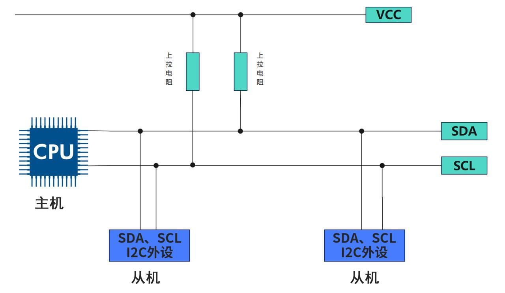
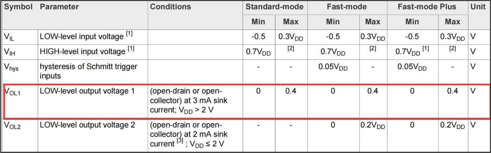
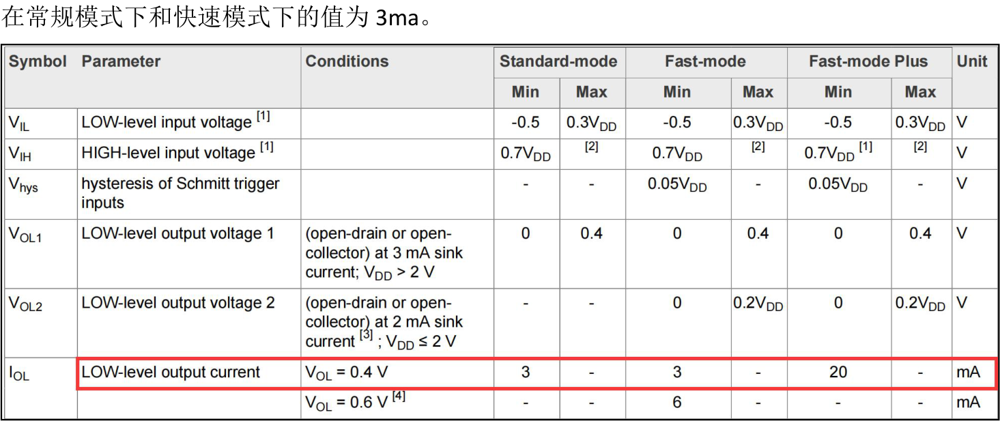
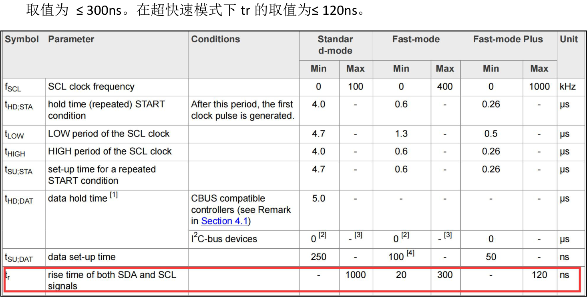
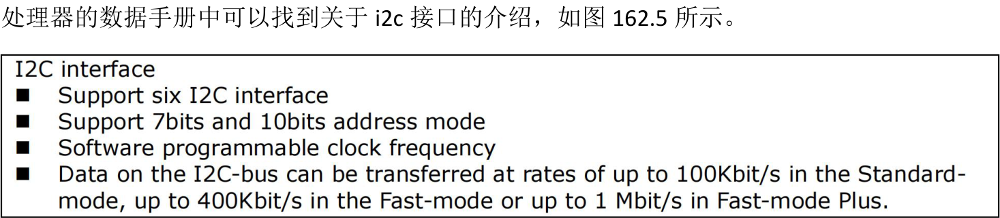

# 第162章 i2c总线概述

## 162.1 i2c 总线介绍
i2c（Inter-Integrated Circuit）总线是一种简单高效的芯片间通信协议，由荷兰飞利浦公司于1982 年提出。i2c 总线主要有以下特点。(1) i2C 总线是同步，串行，半双工通信总线。(2) i2c 总线由时钟线SDA 和SCL 两根信号线构成，并且都需要使用上拉电阻，从而确保总线空闲状态为高电平。i2c 总线连接方式如图162.1 所示。

图162.1图162.1 中SDA 和SCL 线均需外接上拉电阻，主要原因有两个：一是维持总线电平，由于i2c 接口采用开漏输出结构，总线不能输出高电平，此时用上拉电阻实现i2c 通信中的高电平，同时也可确保总线空闲时为高电平，避免受干扰；二是实现线与逻辑，借助开漏输出的特性实现低电平优先原则，即谁先发送低电平谁就掌握对总线的控制权。(3) i2C 总线支持多设备连接，允许多主机存在，但同一时刻只允许一台主机控制总线。通常我们把带有i2c 总线接口的CPU 作为主机，把挂载在i2c 总线下的其他设备看作从机。如

图162.1 所示。(4) 每一个i2c 外设都会对应一个唯一的地址（这个地址可以从具体i2c 外设数据手册中获得），i2c 总线需要通过这个地址来确定主机要和哪个从机进行通信的。(5) i2c 总线上挂载的i2c 外设最大数量受总线最大电容限制，在i2c 协议中规定总线最大电容为400pF。如果同一i2c 总线上挂载的是多个相同型号的i2c 外设，最大数量还会受到i2c外设地址限制。(6) i2c 总线在标准模式下传输速率可达100kbit/s，在快速模式下可达400kbit/s，在高速模式下可达3.4Mbit/s。(7) i2C 总线上的主机和从机之间以字节为单位进行数据传输。(8) i2C 总线有硬件i2c 和软件i2c。硬件i2c 是指处理器原生的i2c 接口，软件i2c 是指使用GPIO接口模拟i2c 时序从而模拟i2c 接口。硬件i2c 和软件i2c 介绍如下。硬件i2c:(1) 实现方式：通过专用的硬件i2c 接口电路来实现i2c 总线协议。(2) 优点:CPU 占用低，i2c 时序由硬件电路自动完成。传输速率高，可以达到400kbit/s 或3.4Mbit/s。并且更加可靠和稳定，不易受外部干扰。(3) 缺点:接口固定，不如软件i2c 那么灵活。(4) 适用范围：适用于高速、大量数据传输的场合，如LCD、EEPROM 等外设的连接。软件i2c:(1) 实现方式:通过GPIO 接口模拟i2c 时序。(2) 优点:灵活性强，可以在任何GPIO 口上实现i2c 接口。(3) 缺点:CPU 占用较高，因为需要在软件中模拟i2c 时序。传输速率较低，一般在100kbit/s左右。(4) 适用范围：适用于低速、少量数据传输的场合。
## 162.2 上拉电阻阻值计算方法
上拉电阻的阻值需根据i2c 总线的负载电容(包括线路和芯片引脚电容)合理选择，以满足不同通信速率(标准模式100kbit/s、快速模式400kbit/s、高速模式3.4Mbit/s)的要求。过大的阻

值会导致电容充电过慢，使上升沿变缓影响信号质量；过小的阻值则可能无法产生有效的低电平。因此，i2c 规范要求总线总电容不超过400pF，并建议上拉电阻取值范围为1kΩ-10kΩ。接下来我们学习实际应用中如何计算上拉电阻阻值的最大值与最小值。1.计算上拉电阻阻值的最小值计算公式:Rp(min) = (VDD - VOL(max)) / IOL公式中各参数解释:VDD：上拉电压，通常为5V 或3.3V 等供电电压。VOL(max)：表示i2c 外设在低电平时的最大输出电压，如图162.2 所示范例中当VDD为3.3V 时，VOL 为0.4V。

图162.2IOL：i2c 外设在低电平时的最大灌入电流，如图166.3 所示范例中当VOL 值为0.4 时，IOL

图162.3Rp(min)：上拉电阻阻值的最小值。

举例说明当VDD 为3.3V，VOL(max) =0.4V，IOL 为3mA 时，代入公式Rp(min) = (VDD - VOL(max))/ IOL 计算得到上拉电阻阻值的最小值为Rp(min) = (3V - 0.4V) / 3mA = 966Ω。2.计算上拉电阻阻值的最大值计算公式Rp(max) = 0.8473 * Cb / tr公式中各参数解释:Rp(max)：上拉电阻阻值的最大值Cb：总线电容tr：高电平上升时间，一般上升时间是从0.3VDD 到0.7VDD，具体可以从i2c 外设的数据手册获得，如图166.4 所示范例在标准模式下tr 的取值为≤1000ns。在快速模式下tr 的

图162.4举例说明i2c 总线工作在标准模式，上拉电压是3.3V，引脚电容是10pF，连接电容是30pF，高电平上升时间tr = 1000ns，计算上拉电阻的最大值。此时总线电容Cb = 10pF + 30pF = 40pF，然后代入公式Rp(max) = 0.8473 * Cb / tr Rp(max)= 0.8473 * 40pF / 1000ns Rp(max) = 33.89 kΩ可得上拉电阻阻值最大值为33.89 kΩ3.总结一般来说，i2c 总线速度越快，所需的上拉电阻值阻值越小，如工作在400kbit/s 时一

般选择4.7k 上拉电阻。如工作100kbit/s 时一般选择10k 上拉电阻。如工作在1Mbit/s 时一般选择2.2k 上拉电阻。需要强调的是在实际使用中需要根据实际i2c 波形调整阻值大小，无需过于纠结计算结果。
## 162.3 介绍iTOP-RK3568 开发板上的i2c 接口

图162.5通过图162.2 可知，RK3568 处理器支持6 路i2c 接口，分别为i2c0、i2c1、i2c2、i2c3、i2c4、i2c5。支持7 位和10 位地址模式。支持软件可编程时钟频率。i2c 总线上的数据传输速率在标准模式下最高为100Kbit/s，在快速模式下最高400Kbit/s，在快速模式下最高1Mbit/s。
表162.1

