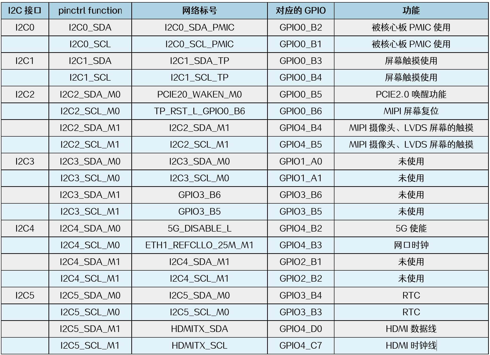
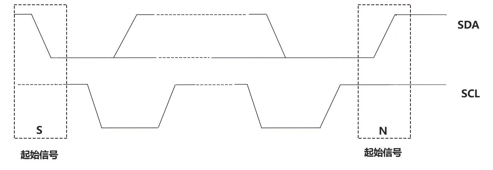
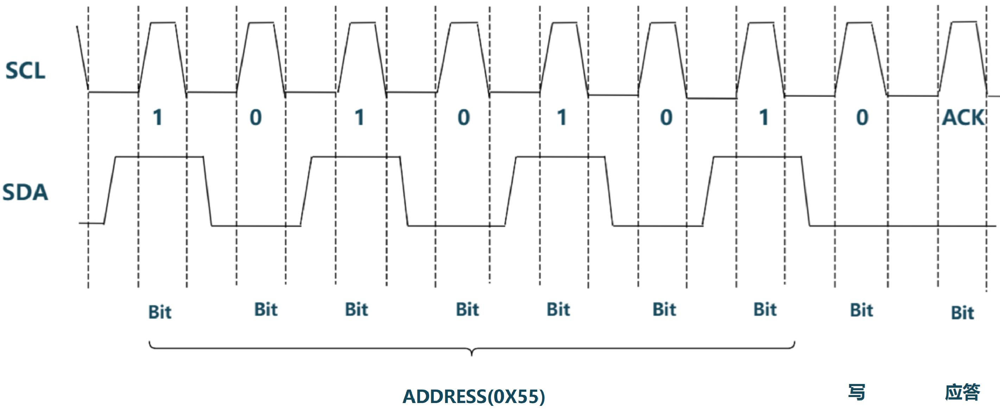
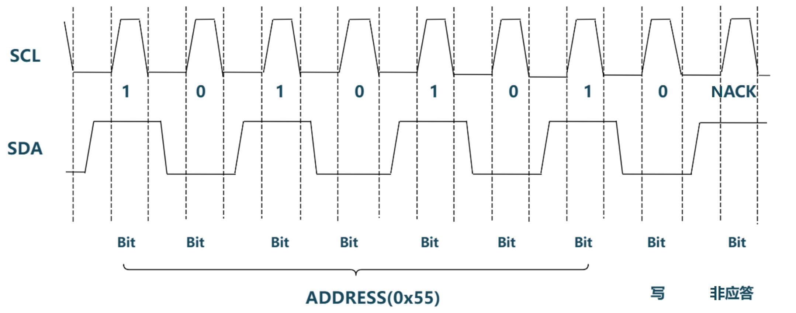
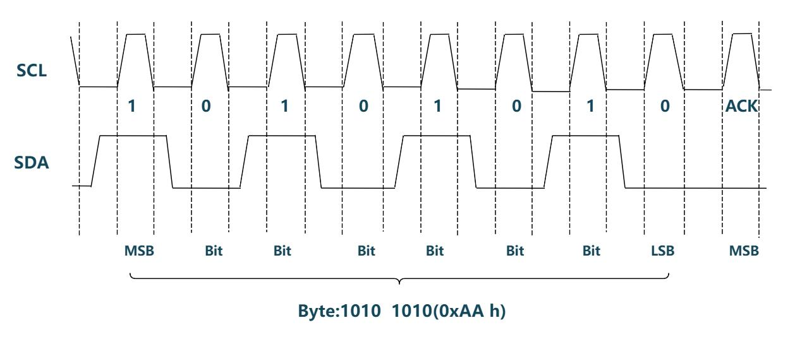
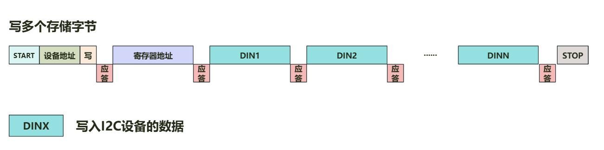
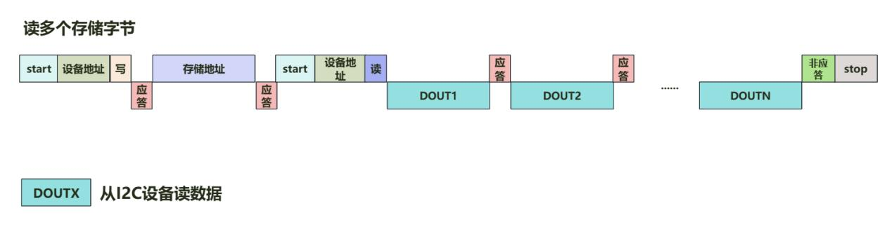

# 第163章 i2c总线协议讲解

通过表162.1 可知，iTOP-RK3568 开发板上的6 路i2c 接口并未全部作为i2c 接口使用。如果需要使用6 路i2c，需要通过pinctl 子系统配置引脚复用为i2c 功能。

本章先分析i2c 总线的通信时序，然后讲解使用i2c 总线的读写步骤。
## 163.1 i2c 总线时序分析
i2c 通信以起始信号（START）开始，以终止信号（STOP）结束，起始信号和终止信号均为主机发出。当SCL 为高电平时，SDA 从高电平变为低电平时为起始信号。当SCL 为高电平时，SDA 从低电平变成高电平时为终止信号，起始信号和终止信号时序图如图163.1 所示。

图163.1主机发送起始信号后，接着以字节为单位发送或接收数据，对于每次传输的字节数没有限制，传输顺序按照高位在前低位在后的顺序进行传输。每个字节数据传送完后第9 位紧跟着应答（ACK）或者非应答信号（NACK）。起始信号后的首字节前7 位为从设备地址，最后1 位是读写方向位，读写方向位为0 表示写操作，读写方向位为1 表示读操作。7 位地址空间理论支持最多127 个具有唯一地址的从机。主机发送首字节（7 位地址+1 位读写位）后，若总线上存在地址匹配的从机，该从机将在第9 个时钟周期拉低SDA 线，即返回应答信号（ACK）表示成功匹配地址；若地址无匹配，第9 个时钟周期SDA 线保持高电平，即产生非应答信号（NACK）。例如，主机向地址为0x55 的从机发送数据时，主机首字节需发送0xAA（0x55 左移1 位+

最低位0 表示写操作），该部分时序及应答信号如图163.2 所示。

图163.2若从机没有匹配地址，从机会返回非应答信号，该部分时序及非应答信号如图163.3 所示。

图163.3在地址和方向位被正确接收并返回应答信号(ACK)后，i2c 总线进入数据传输阶段。每个字节传输完成，接收方需要在第9 个时钟周期返回一个应答信号(ACK）或非应答信号(NACK)，用于告知发送方该字节是否已被成功接收。例如，无论是向从机发送0XAA，还是主机接收从机发送的0XAA 数据时，该部分时序及应答信号如图163.4 所示。

图163.4
## 163.2 i2c 读写步骤
i2c 写操作步骤如图163.5 所示。

图163.5首先通过起始信号启动i2c 通信，主机发送从机写地址（即7 位从机地址+读写方向位0）。该字节传输完成后，在第9 个SCL 周期内从机拉低SDA 发送ACK 应答信号确认地址匹配成功。随后主机发送要写入的寄存器地址，从机同样通过拉低SDA 发送ACK 应答信号确认接收。接下来主机发送待写入的数据，每成功写入一个数据，从机仍发送一个ACK 应答信号响应。主机发送完了所有数据以后主机发送停止信号来结束本次i2c 通信。i2c 读操作步骤如图163.6 所示。

图163.6首先通过起始信号启动i2c 通信，主机发送从机写地址（即7 位从机地址+读写方向位0），该字节输完成后，在第9 个SCL 周期内从机拉低SDA 发送ACK 应答信号确认地址匹配成功。接着主机发送要读取的寄存器地址，从机再次通过拉低SDA 发送ACK 应答信号确认接收。随后无需发送停止信号，而是直接通过重复发送起始信号切换为读操作。主机接着发送从机读地址（7 位从机地址+读写方向位1），该字节传输完后，从机在第9 个SCL 周期内拉低SDA 发送ACK 应答信号，表示准备发送数据。接着从机开始送一个数据字节，主机每成功接收完一个数据字节都发送一个ACK 应答信号。数据读取完后主机发送非应答信号和停止信号来结束本次i2c 通信。

