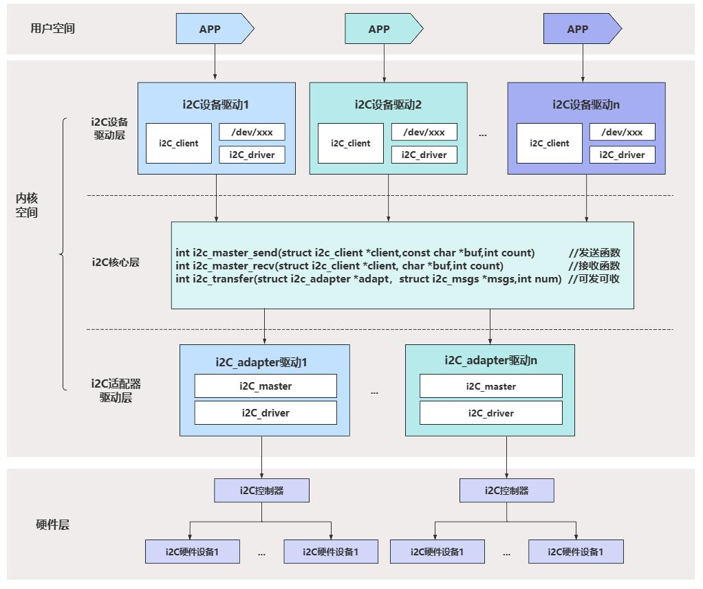

# 第164章i2c子系统框架

本章讲解Linux 系统中i2c 子系统框架，对Linux 系统中的i2c 建立一个整体认识。
## 164.1 i2c 子系统框架介绍
i2c 子系统框架如图164.1 所示。

图164.1i2c 子系统框图中用户空间可通过i2c 设备驱动层提供的设备节点（如/dev/i2c-X）操作i2c设备。硬件层是具体的i2c 外设，所有i2c 外设均通过SCL 时钟线和SDA 数据线挂载在i2c 总线上。

内核空间是连接硬件与用户空间的核心枢纽，内核空间中包含i2c 设备驱动层、i2c 核心层和i2c 控制器驱动层。i2c 控制器驱动层负责控制i2c 控制器硬件产生i2c 时序并完成数据收发，这部分驱动通常由芯片厂商适配。i2c 核心层介于控制器驱动层与设备驱动层之间，起到承上启下的作用，对上为i2c 设备驱动层提供如i2c_transfer()、i2c_master_send()等通用通信接口，用于操作i2c 设备，对下向i2c控制器驱动层提供注册i2c 控制器驱动的接口。i2c 设备驱动层是具体i2c 外设的驱动实现，i2c 设备驱动由i2c_client 和i2c_driver 两部分构成，i2c_client 是对i2c 外设资源的描述，i2c_driver 中包含设备初始化、数据读写等具体操作。二者通过i2c 总线完成匹配。

