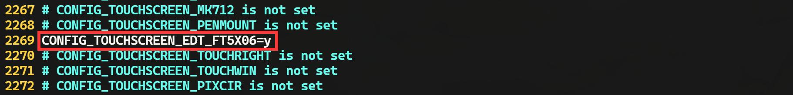
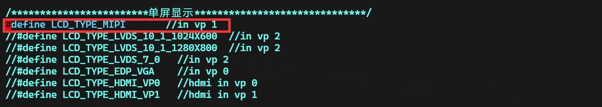
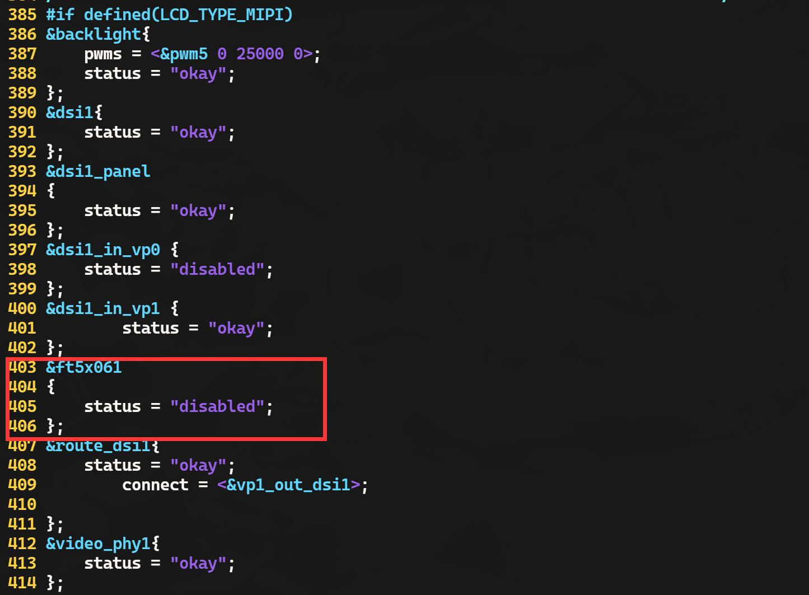
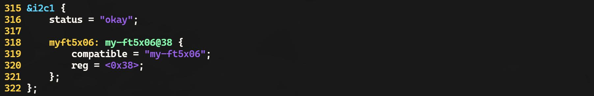
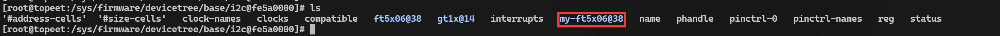

# 第165章 编写i2c client代码（方法1）

i2c 设备驱动分成了i2c_client 和i2c_driver 两部分，本章以触摸芯片ft5x06 为例编写该i2c外设对应的i2c client 代码。本章使用设备树编写i2c client 代码。
## 165.1 i2c 设备树分析
在使用设备树编写i2c client 代码之前先分析i2c 设备树。在rk3568.dtsi 设备树文件中有i2c0~i2c5 六个i2c 控制器对应的设备节点。由于实验要用到的i2c 控制器为i2c1，所以以i2c1 控制器和挂载在i2c1 下的i2c 外设节点为例讲解i2c 设备树，i2c1 控制器节点如代码清单165.1 所示。代码清单165.1
```c
i2c1: i2c@fe5a0000 {
            compatible = "rockchip,rk3399-i2c";
            reg = <0x0 0xfe5a0000 0x0 0x1000>;
            clocks = <&cru CLK_i2c1>, <&cru PCLK_i2c1>;
            clock-names = "i2c", "pclk";
            interrupts = <GIC_SPI 47 IRQ_TYPE_LEVEL_HIGH>;
            pinctrl-names = "default";
            pinctrl-0 = <&i2c1_xfer>;
            #address-cells = <1>;
            #size-cells = <0>;
            status = "disabled";
};
```
i2c1: i2c@fe5a0000 节点代表i2c1 控制器，节点中描述的是i2c1 控制器对应的硬件资源。如把i2c 外设挂载到i2c1 总线上，在i2c1 控制器的节点下添加i2c 外设子节点即表示i2c 外设挂载到了i2c1 总线上。如topeet_rk3568_lcds.dtsi 设备树文件中使用追加的方式把ft5x06 触摸芯片挂载在i2c1 下，即ft5x06 触摸芯片对应的节点是i2c1 控制器的子节点，如代码清单165.2 所示。代码清单165.2&i2c1 {

status = "okay";ft5x061:ft5x06@38 {status = "disabled";compatible = "edt,edt-ft5306";reg = <0x38>;touch-gpio = <&gpio3 RK_PA5 IRQ_TYPE_EDGE_RISING>;interrupt-parent = <&gpio3>;interrupts = <RK_PA5 IRQ_TYPE_LEVEL_LOW>;reset-gpios = <&gpio0 RK_PB6 GPIO_ACTIVE_LOW>;touchscreen-size-x = <800>;touchscreen-size-y = <1280>;touch_type = <1>;};};
## 165.2 取消ft5x06 的驱动和设备树
在学习i2c 总线时，使用的i2c 外设是迅为MIPI 屏幕中的ft5x06 触摸芯片。在内核中默认已经添加了ft5x06 的驱动和设备树，这会给后续的实验带来影响，所以在编写i2c client 设备树之前需要取消默认的ft5x06 的驱动和对应的设备树。使用vim kernel/arch/arm64/configs/rockchip_linux_defconfig 命令打开内核默认配置文件，找到ft5x06 配置项，如图165.1 所示。

图165.1在最前面使用“#”对该行内容进行注释，注释完成如图165.2 所示。

图165.2图165.3 中的操作为取消配置内核中ft5x06 的驱动，即编译内核时不会把ft5x06 驱动程序编译进内核。然后使用vim kernel/arch/arm64/boot/dts/rockchip/topeet_screen_choose.dtsi 命令打开屏幕选择文件。使能mipi 屏幕对应的宏定义，其他屏幕对应的宏定义全部注释，使能完成图16

5.3 所示。

图165.3使用vim kernel/arch/arm64/boot/dts/rockchip/topeet_rk3568_lcds.dtsi命令打开屏幕配置设备树，找到MIPI 屏幕对应的ft5x06 触摸芯片节点并设置为disabled，设置完成如图165.4 所示。

图165.4图165.5 中ft5x06 节点中的status 属性设置成disabled 后，ft5x06 的节点将被禁用。重新编译内核并烧写到开发板中，如果使用命令ls /proc/device-tree/i2c@fe5a0000/在/proc/device-tree/i2c@fe5a0000/路径下看不到ft5x06 相关字眼说明已经成功把默认的ft5x06 驱动和设备树从内核中去掉了。

## 165.3 编写ft5x06 client 代码
使用vim kernel/arch/arm64/boot/dts/rockchip/topeet_rk3568_lcds.dtsi 命令打开topeet_rk3568_lcds.dtsi 设备树文件，在topeet_rk3568_lcds.dtsi 设备树中采用追加的方式在i2c1 节点下添加ft5x06 节点，ft5x06 节点如代码清单165.3 内容。代码清单165.3 即i2c client 代码。代码清单165.3&i2c1 {status = "okay";myft5x06: my-ft5x06@38 {compatible = "my-ft5x06";reg = <0x38>;};};修改完成的设备树如图165.5 所示。

图165.5修改完成重新编译内核得到boot.img 镜像，为方便同学学习老师已经将编译好的内核镜像放到了网盘iTOP-RK3568 开发板\07_学习教程配套资料\03_Linux 驱动配套资料\04_Linux 驱动程序\101_i2c_01\04_编译好的内核镜像目录下。将boot.img 烧写进开发板之后，使用cd /proc/device-tree/i2c@fe5a0000/与ls 命令进入i2c1 控制器节点目录下，如图165.6 所示。

图165.6由图165.7 可以看到myft5x06 节点被成功添加，说明i2c client 代码编写成功。

