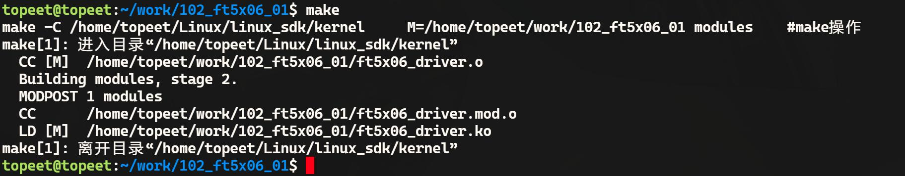
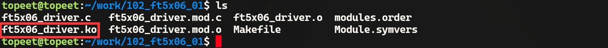
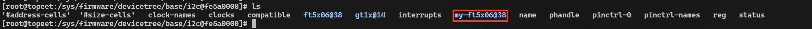
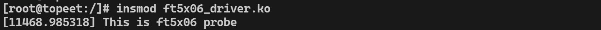

# 第166章 编写i2cdriver框架

i2c 设备驱动分成了i2c_client 和i2c_driver 两部分，本章以触摸芯片ft5x06 为例编写该i2c外设对应的i2c driver 代码。由于ft5x06 的驱动非常复杂，因此本章先编写i2c 驱动框架，并使用i2c 总线与ft5x06 对应的i2c client 进行匹配。
## 166.1 分析i2c driver 注册流程
注册i2c driver 使用i2c_add_driver()函数，该函数被定义在内核源码的include/linux/i2c.h文件中，具体内容如代码清单166.1 所示。代码清单166.1
```c
#define i2c_add_driver(driver) \
    i2c_register_driver(THIS_MODULE, driver)
```
由代码清单166.1 可知i2c_add_driver()函数是一个宏定义，这个宏定义的作用是为了简化注册i2c driver 的过程，实际注册i2c driver 的函数为i2c_register_driver()，该函数定义在drivers/i2c/i2c-core-base.c 文件中，具体内容如代码清单166.2 所示。代码清单166.2
```c
int i2c_register_driver(struct module *owner, struct i2c_driver *driver)
{
    int res;
    /* 在驱动模型初始化完成之前,无法注册驱动程序*/
    if (WARN_ON(!is_registered))
        return -EAGAIN;
    driver->driver.owner = owner;
    driver->driver.bus = &i2c_bus_type;
    INIT_LIST_HEAD(&driver->clients);
    res = driver_register(&driver->driver);
```

```c
if (res)
    return res;
pr_debug("driver [%s] registered\n", driver->driver.name);
i2c_for_each_dev(driver, __process_new_driver);
return 0;
}
```
i2c_register_driver()函数中的is_registered 变量在i2c_init()函数里面赋值为true ，i2c_ini()函数使用postcore_initcall 宏初始化。所以只有i2c 总线注册成功以后，才可以i2c_add_driver()注册驱动，把i2c_driver 结构体中bus 赋值为i2c_bus_type 和i2c 总线绑定，接着调用driver_register()函数将i2c_driver 内部的device_driver 通过设备模型进行初始化。初始化的流程套用设备模型即可，这里老师直接讲结论。driver_register()函数中按照bus_add_driver()->driver_attach()->bus_for_each_dev()函数的调用关系搜索i2c 总线上所有的device，即搜索i2c 总线上的i2c_client。然后调用__driver_attach()函数判断i2c_driver 与i2c_client 是否配备，接着通过调用driver_match_device()函数调用总线下的match 函数，即i2c 总线的match 函数进行匹配。在match 函数中调用i2c_match_id()函数通过id_table 与i2c_cliten 进行匹配，如果配备成功则正常返回到__driver_attach()函数，接着按照设备模型中driver_probe_device()->really_probe()函数调用顺序调用i2c 总线下的probe 函数，i2c 总线中的probe 函数里利用to_i2c_driver()函数把device_driver 转换成i2c_driver，最后调用i2c_driver 的下probe 的函数。接下来继续看i2c_register_driver()函数，该函数的函数参数是i2c_driver 结构体，该结构体定义在include/linux/i2c.h 头文件中，如代码清单166.3 所示。代码清单166.3
```c
struct i2c_driver {
    unsigned int class;//驱动程序所属的设备类型
   int (*probe)(struct i2c_client *, const struct i2c_device_id *); //探测并绑定设备的回调函数
    int (*remove)(struct i2c_client *); //从设备上解绑驱动程序的回调函数
    int (*probe_new)(struct i2c_client *); //新的探测设备并绑定的回调函数
    void (*shutdown)(struct i2c_client *); //设备关闭时调用的回调函数
    void (*alert)(struct i2c_client *, enum i2c_alert_protocol protocol,
               unsigned int data); //设备报警时调用的回调函数,格式和含义取决于所使用的协议
    int (*command)(struct i2c_client *client, unsigned int cmd, void *arg); //用于执行设备特定功能的命令回
```

```c
调函数
    struct device_driver driver; //设备驱动程序基础结构
    const struct i2c_device_id *id_table; //与该驱动程序匹配的设备ID 表
    int (*detect)(struct i2c_client *, struct i2c_board_info *); //用于自动创建设备的探测回调函数
    const unsigned short *address_list; //与该驱动程序匹配的设备地址列表
    struct list_head clients; //与该驱动程序绑定的i2c 设备列表
    bool disable_i2c_core_irq_mapping; //禁用i2c 核心中断映射的标志
};
```
在调用i2c_add_driver()函数注册i2c driver 之前，需要先填充i2c_driver 结构体，并实现i2c_driver 结构体中的回调函数。
## 166.2 驱动程序的编写
本实验代码存储在网盘iTOP-RK3568 开发板\07_学习教程配套资料\03_Linux 驱动配套资料\04_Linux 驱动程序\102_ft5x06_01 路径下。在i2c driver 框架中实现了probe()函数和remove()函数。实验代码ft5x06_driver.c 如代码清单166.4 所示。代码清单166.4
```c
#include <linux/init.h>
#include <linux/module.h>
#include <linux/i2c.h>
#include <linux/of_device.h>
// ft5x06 设备的初始化函数
int ft5x06_probe(struct i2c_client *client, const struct i2c_device_id *id) {
    printk("This is ft5x06 probe\n");
    return 0;
}
// ft5x06 设备的移除函数
int ft5x06_remove(struct i2c_client *client) {
    return 0;
}
// 设备树匹配表
static const struct of_device_id ft5x06_id[] = {
    { .compatible = "my-ft5x06" },
    { },
};
```

```c
// ft5x06 设备驱动结构体
static struct i2c_driver ft5x06_driver = {
    .driver = {
        .owner = THIS_MODULE,
        .name = "my-ft5x06",
        .of_match_table = ft5x06_id, //添加设备树匹配表
    },
    .probe = ft5x06_probe,
    .remove = ft5x06_remove,
};
// 驱动初始化函数
static int __init ft5x06_driver_init(void) {
    int ret;
    // 注册i2c 设备驱动
    ret = i2c_add_driver(&ft5x06_driver);
    if (ret < 0) {
        printk("i2c_add_driver is error\n");
        return ret;
    }
    return 0;
}
// 驱动退出函数
static void __exit ft5x06_driver_exit(void) {
    // 注销i2c 设备驱动
    i2c_del_driver(&ft5x06_driver);
}
module_init(ft5x06_driver_init);
module_exit(ft5x06_driver_exit);
MODULE_LICENSE("GPL");
```
## 166.3 运行测试
### 166.3.1 编译驱动程序
在ft5x06_driver.c 代码同一目录下创建Makefile 文件，如图166.1 所示。


图166.1Makefile 文件内容如代码清单166.5 所示。代码清单166.5
```c
export ARCH=arm64#设置平台架构
export CROSS_COMPILE=aarch64-linux-gnu-#交叉编译器前缀
obj-m += ft5x06_driver.o#此处要和你的驱动源文件同名
KDIR :=/home/topeet/Linux/linux_sdk/kernel#这里是你的内核目录
PWD ?= $(shell pwd)
all:
    make -C $(KDIR) M=$(PWD) modules#make 操作
clean:
    make -C $(KDIR) M=$(PWD) clean#make clean 操作
```
在存放platform_driver.c 和Makefile 文件目录下使用make 命令编译驱动程序，编译完成如图166.2 所示。

图166.2编译完生成ft5x06_driver.ko 目标文件，如图166.3 所示。

图166.3至此驱动模块就编译成功了。
### 166.3.2 运行测试
在进行实验之前，首先要确保开发板烧写的是我们在编写i2c client 代码章节中编译出来的boot.img。开发板启动之后，首先进入到/proc/device-tree/i2c@fe5a0000/目录下确保存在my-ft5x06@38 目录，如图166.4 所示。

图166.4如果存在my-ft5x06@38 目录接着使用insmod ft5x06_driver.ko 命令加载驱动程序，如图166.5 所示。


